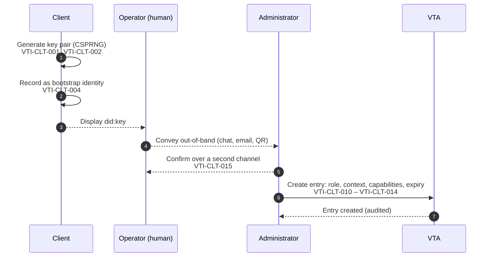
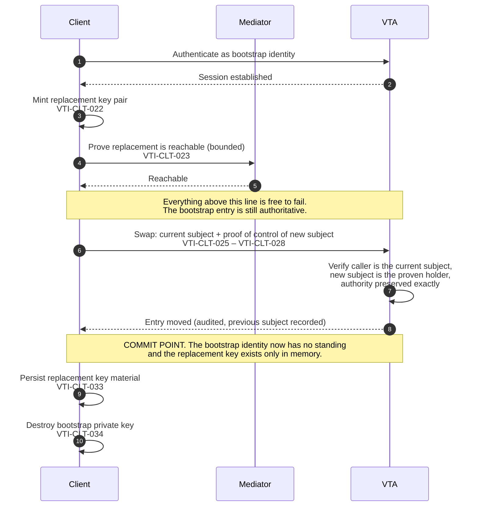

# Verifiable Trust Infrastructure (VTI) Specification

_Version:_ 1.0  
_Document Status:_ Working Draft 0.2.0  
_DOI:_ {{see [this wiki page](https://lf-toip.atlassian.net/wiki/spaces/HOME/pages/767787009/ToIP+Approved+Deliverable+Process#Persistent-DOI-Link) for instructions about how to add a DOI}}  
_GitHub:_ <https://github.com/trustoverip/dtgwg-vti-spec>  
_Published:_ <https://trustoverip.github.io/dtgwg-vti-spec/>

_Editors:_

- Alberto Leon, Applied Technology Lab at Harvard University
- Brendan A. Miller, Applied Technology Lab at Harvard University
- Drummond Reed, First Person Cooperative
- Glenn Gore, Affinidi

_Contributors:_

- Geoff Turk, First Person Project
- Sankarshan Mukhopadhyay, QBF Consulting LLP
- The participants of the Decentralized Trust Graph Working Group (DTGWG)

**Abstract**

Decentralized Trust Graph (DTG) specifications are deliberately modular: each
defines one component — an identifier, a credential, a message, a task, a
registry — and each can be conformed to on its own. A working trust system is
none of those things individually. It is a set of running nodes that hold keys,
grant and revoke authority, admit and remove members, delegate to software
agents, and act on evidence produced elsewhere.

This specification defines that infrastructure. It specifies the nodes of a
Verifiable Trust Infrastructure — the Verifiable Trust Agent (VTA), the
Verifiable Trust Community (VTC), their clients and supporting hosts — together
with the model of trust contexts and authority they share, the way a client is
enrolled and operated against them, and the requirements that apply to the
composed system rather than to any one component. That last part matters
because some properties a relying party depends on cannot be established by
inspecting a single specification: they are properties of the composition, and
this document is where they are owned.

**Intellectual Property Rights**

This specification is provided under the [Joint Development Foundation (JDF) charter](https://cdn.platform.linuxfoundation.org/agreements/ToIP.pdf) for [Trust Over IP](https://trustoverip.org) (ToIP) and is subject to the intellectual property rights policy of the **Trust over IP - Decentralized Trust Graph Working Group**:

_Copyright:_ [Creative Commons Attribution 4.0 International (CC BY 4.0)](https://creativecommons.org/licenses/by/4.0/)  
_Patent:_ W3C Mode (based on the [W3C Patent Policy](https://www.w3.org/Consortium/Patent-Policy-20040205/))  
_Source Code:_ [Apache License, Version 2.0](https://www.apache.org/licenses/LICENSE-2.0)

THESE MATERIALS ARE PROVIDED “AS IS.” The parties expressly disclaim any warranties (express, implied, or otherwise), including implied warranties of merchantability, non-infringement, fitness for a particular purpose, or title, related to the materials. The entire risk as to implementing or otherwise using the materials is assumed by the implementer and user. IN NO EVENT WILL THE PARTIES BE LIABLE TO ANY OTHER PARTY FOR LOST PROFITS OR ANY FORM OF INDIRECT, SPECIAL, INCIDENTAL, OR CONSEQUENTIAL DAMAGES OF ANY CHARACTER FROM ANY CAUSES OF ACTION OF ANY KIND WITH RESPECT TO THIS DELIVERABLE OR ITS GOVERNING AGREEMENT, WHETHER BASED ON BREACH OF CONTRACT, TORT (INCLUDING NEGLIGENCE), OR OTHERWISE, AND WHETHER OR NOT THE OTHER MEMBER HAS BEEN ADVISED OF THE POSSIBILITY OF SUCH DAMAGE.

## Introduction

This section is informative.

### The idea in plain terms

Imagine a company where every employee has a keyring. One key opens the
stationery cupboard, another the server cabinet, another the safe. Nobody carries
a master key, because a master key is one lost keyring away from a disaster.
When someone joins a team they get the keys that team needs, and when they
leave, those keys stop working — not because they hand them back, but because
the locks stop recognising them.

Now imagine the same company has to work with a hundred other companies, none
of whom share a building, a keyring, or a security desk. Someone from another
firm arrives and says they are authorised to collect a document. How do you
check? You can look at their card. You can ring their office. What you cannot
do is assume that because their card is genuine, they still work there, or
that the person holding it is the person it was issued to.

That is the problem this specification is about. The keys are cryptographic,
the buildings are organisations, and the cards are credentials — but the
questions are the old ones: **who is this, what are they allowed to do, who
says so, and is that still true right now?**

#### The three things that go wrong

Almost everything in this document exists to prevent one of three failures,
and each is easier to understand than the machinery that prevents it.

**A key that opens too much.** The simplest failure and the most common. An
application is given access to everything because giving it access to exactly
what it needs was harder. This specification's answer is the **trust context**:
a boundary you put things inside, so that authority is always authority over
*something in particular* rather than authority as such.

**A credential that says more than it knows.** A signature proves who wrote a
document and that nobody changed it. It does not prove that the writer was
entitled to write it, that they still are, or that the thing they described is
still the case. A letter signed by a manager who left last year is perfectly
genuine and completely worthless. Much of this document is about keeping *this
was signed by them* and *they are allowed to do this* as separate questions,
because systems that merge them fail in ways that look like success.

**A system that works in pieces and fails as a whole.** Every component can be
correct and the arrangement still be wrong. A privacy-preserving proof, carried
under a name that never changes, is not private. A task that completes exactly
as specified has not necessarily achieved what it was invoked to achieve. This
is the hardest of the three, because there is nobody to blame: each part is
doing its job. The Composition Requirements chapter exists for it.

#### Why the writing is careful

Several requirements here prohibit something that is easy to build, widely
done, and wrong only under conditions you will not meet during testing. Those
requirements are written as prohibitions rather than recommendations, and each
carries a *Rationale* paragraph saying what goes wrong without it — usually
because the obvious simpler version has already been built somewhere and has
already failed.

If a requirement seems fussy, the rationale is where to look before deciding it
is.

### What this specification covers

A [[ref: VTI]] is the running infrastructure in which Decentralized Trust Graph
(DTG) components are composed into an operating trust system. This
specification defines:

- **the common model** every node shares — [[ref: trust context]]s, the
  authority model built over them, identity and keys, transports and delivery,
  sessions, the [[ref: client]] lifecycle, the operation surface, and credential
  handling;
- **the nodes** themselves — the [[ref: VTA]], the [[ref: VTC]], the
  [[ref: VTN]] and the supporting hosts — and, where two of them could each
  plausibly own an authority decision, which one actually does;
- **the composition requirements** — properties that must hold across a
  complete interaction and that no single component specification can
  establish.

### What this specification does not cover

VTI does not define identifier methods, credential data models,
[[ref: trust task]] definitions, transport protocols, or governance frameworks. It
references those specifications and states how they compose. Where a
requirement belongs to a component specification, this document says so rather
than restating it.

### The vocabulary in one paragraph

A [[ref: principal]] — a person, an organisation or a software agent — is
represented by a [[ref: VTA]], which holds their keys and organises what it
holds into [[ref: trust context]]s. A [[ref: client]] acts under authority the
VTA granted it, recorded in an [[ref: access control entry]]; so does any other
[[ref: delegate]]. A client with no standing yet begins with a
[[ref: bootstrap identity]] and rotates off it. Authority in a context may be
unrestricted, in which case the entry is a [[ref: super-administrator]], or
scoped to part of the tree, in which case it is a [[ref: context administrator]]
of that subtree. Sensitive operations may additionally require the caller to
re-prove control — [[ref: step-up]] — or require a different party, an
[[ref: approver]], to give [[ref: consent]]. Nodes reach each other through a
[[ref: mediator]] and depend on [[ref: host service]]s, and each node and client
is run by an [[ref: operator]] — the boundary within which two services are one
trust domain. A [[ref: VTC]] decides
who is a [[ref: member]] of a community and publishes to a
[[ref: trust registry]] so that other communities can extend
[[ref: recognition]]. A [[ref: VTN]] aggregates communities and other networks
into a curated set, where an entry — a [[ref: listing]] — is the network's to
make and need not be agreed to by the party listed. Everything above is a
component or a node; what happens when they are operated together is
[[ref: composition]], and a property that no component can establish on its own
is a [[ref: composition-owned requirement]]. Where the evidence does not settle a
question, the answer is [[ref: indeterminate]], which is a result rather than
an error.

### This specification is written first

This document states how a Verifiable Trust Infrastructure is to work. It is
not a description of any existing implementation, and where a running system
behaves differently, it is the system that diverges.

That direction matters more here than it does for a specification written after
the fact. Several requirements in this document prohibit an encoding or a
default that is easy to implement, widely used, and wrong in a way that only
appears under adversarial conditions — an authority inferred from an empty
collection, a query direction supplied by default, a send reported as
successful because nothing objected. A specification written to describe such
an implementation would record the behaviour and add a warning. This one states
the behaviour that is correct and treats the difference as work to be done.

Known divergences between this specification and implementations are recorded
in Appendix F. The register exists so that the difference is visible and
tracked rather than argued about, and so that a reader evaluating an
implementation knows which requirements to ask about. An entry in it is a
statement about the implementation, never a qualification of the requirement.

### Structure of this document

The specification is in four parts.

| Part | Chapters | Binds |
|---|---|---|
| **A — Foundations** | Introduction; Terminology; Architecture and conformance targets | nothing normatively; fixes the vocabulary and names the targets |
| **B — The common model** | Trust contexts; Access control and authority; Approvals, consent and step-up; Audit; Identity, DIDs and key management; Transports, messaging and delivery; Sessions and authentication; Client onboarding and lifecycle; Trigger links; Operation surface; Credentials and presentations | every node type |
| **C — Node specifications** | The Verifiable Trust Agent; The Verifiable Trust Community; The Verifiable Trust Network; Membership lifecycle and community credentials; The community directory and groups; Community voting; Trust registries and cross-community recognition | the named node |
| **D — System properties** | Composition requirements; Operational and assurance requirements; Considerations; Conformance | the deployment and the relying party |

A node type's chapter in Part C states what it adds to the common model, not
what it replaces in it. The Conformance chapter states which parts each target
implements.

### How requirements are stated

Normative statements carry stable identifiers of the form `VTI-<AREA>-<nnn>` —
for example `VTI-CTX-016`. The area is a three-letter code for the subject
matter, listed in the Conformance chapter, and the number is allocated in order
within its area.

Identifiers are permanent. A withdrawn requirement is marked withdrawn rather
than renumbered, and an identifier is never reused for different text. This is
what allows a conformance test, an implementation's conformance claim, and an
independent assessment to cite the same requirement without any of them having
to agree on the document's structure.

Paragraphs marked *Rationale* record why a requirement is written as it is.
They carry no normative force. They are kept in the document because the common
failure mode for these requirements is a reader reasonably concluding that the
obvious simpler formulation would do — and in most cases the simpler
formulation is one that has already been implemented, and has already failed.

### Reading this document for a purpose

| If you are | Read |
|---|---|
| Deciding whether VTI fits your ecosystem | This chapter, then Architecture and conformance targets |
| Implementing a client | Client onboarding and lifecycle; Sessions and authentication; Operation surface; Trigger links, for a wallet that reads codes |
| Implementing or operating a VTA | Trust contexts; Access control and authority; Approvals, consent and step-up; Audit; The Verifiable Trust Agent; Operational and assurance requirements |
| Implementing or operating a VTC | Trust contexts; Access control and authority; Approvals, consent and step-up; Audit; The Verifiable Trust Community; Membership lifecycle and community credentials; The community directory and groups, and Community voting, for a community that offers them; Trust registries and cross-community recognition |
| Curating communities into a network | The Verifiable Trust Network; Trust registries and cross-community recognition |
| Assessing a deployment | Composition requirements; Conformance; Appendix E |
| Writing a governance framework | Access control and authority; Approvals, consent and step-up; Governance Considerations |

### Specification Versioning

This specification distinguishes two version numbers that read as if they mean the same thing but do not:

- **`_Version:_`** states the version of VTI that the working group is converging toward — the number a wider ratifying body confirms when this specification reaches Working Group Approved Deliverable or ToIP Approved Deliverable status. It changes only when the specification is re-targeted, not with each Working Draft revision.
- **`_Document Status:_`** carries the semantic version of *this Working Draft* — `Working Draft MAJOR.MINOR.PATCH` — and is what editors and implementers use to coordinate day-to-day while the specification converges.

Document Status follows [Semantic Versioning 2.0.0](https://semver.org/):

- **MAJOR** — a change that breaks conformance for existing implementations, such as removing or tightening a MUST requirement, changing the semantics of an existing requirement, or withdrawing a conformance target or profile.
- **MINOR** — a backward-compatible addition, such as a new OPTIONAL or MAY requirement, a new profile, or a new informative chapter.
- **PATCH** — an editorial or clarifying change with no effect on conformance.

Before this specification's first ratification, a breaking change MAY be released as a MINOR increment instead of a MAJOR one, and `Document Status`'s MAJOR component MUST NOT advance past `0` until ratification — SemVer 2.0.0 §4 already treats `0.y.z` as carrying no compatibility guarantee, so there is no need to spend a MAJOR increment confirming that. See [Ratification and the Stable Release Line](#ratification-and-the-stable-release-line) below for what happens to `Document Status` and `_Version:_` at and after ratification.

> **Note on cross-specification versioning:** VTI composes companion specifications — including [DTG-CRED] and [TRUST-TASKS] (see [References](#references)) — that are versioned independently of VTI and of each other, each using the same `_Version:_` / `_Document Status:_` split; a MAJOR release of one does not imply, require, or correspond to any particular release of another. Where this specification's conformance requirements depend on a mechanism defined by a companion specification, this specification states the minimum Document Status of that companion specification with which VTI's stated Document Status is compatible, and the companion specification is expected to do the same in reverse. Implementers integrating multiple specifications MUST check the stated minimums rather than assuming that matching or adjacent version numbers imply compatibility. Minimum compatible versions for [DTG-CRED] and [TRUST-TASKS], whose citations are fixed in [References](#references): VTI-CMP-022, VTI-CMP-023 and VTI-CRD-032 require the first Document Status of [DTG-CRED] that defines `taskDigestMultibase`, and the first Document Status of [TRUST-TASKS] that defines outcome evidence for a cited exchange. VTI-TRN-045 and VTI-TRN-047 take an advertised acceptance window from the first Document Status of [TRUST-TASKS] whose discovery definition carries one; before it, VTI-TRN-045's fallback applies to every recipient. *Editor's note: these minimums are pending — each definition is proposed for its specification and not yet released; the Document Status values are recorded here once they are.*
>
> `_Version:_` is set to `1.0`, the release VTI is converging toward; it is not yet ratified.

#### Ratification and the Stable Release Line

At the moment a wider body ratifies this specification as a Working Group Approved Deliverable or ToIP Approved Deliverable, `Document Status`'s MAJOR component crosses from `0` to `1`, the header's status label changes from `Working Draft` to the ratified label, and `_Version:_` is confirmed at the matching `MAJOR.MINOR`. From that point on, `_Version:_` and `Document Status`'s `MAJOR.MINOR` carry the same value — they differ only in the status label — until a breaking change resumes drafting toward the next MAJOR: `Document Status` advances to the new `MAJOR.0.0` immediately, but `_Version:_` stays at the last-ratified release until that new line is itself ratified. This is the same convention adopted across the DTGWG's specifications; see [Ratification and the Stable Release Line](https://github.com/trustoverip/dtgwg-trust-tasks-spec/blob/main/spec/body.md#ratification-and-the-stable-release-line) in the Trust Tasks specification for the full rationale.

This section governs the version of *this document*. Compatibility between peers at the operation level — negotiating a common operation version, refusing one that is unsupported, and maintaining a version floor — is a separate, already-specified concern: see VTI-OPS-005 and VTI-OPS-043 through VTI-OPS-047 in [Operation Surface](#operation-surface), and the conformance-claim rules VTI-CNF-002 and VTI-CNF-008 in [Conformance](#conformance).

## Requirements Language

The key words “MUST”, “MUST NOT”, “REQUIRED”, “SHALL”, “SHALL NOT”, “SHOULD”, “SHOULD NOT”, “RECOMMENDED”, “MAY”, and “OPTIONAL” in this document are to be interpreted as described in [IETF RFC 2119](https://datatracker.ietf.org/doc/html/rfc2119).

[//]: # 'This file, named "terms-and-definitions-intro.md" is mandatory and should not be deleted. However, you can safely delete this comment and replace it with text of your choice.'

## Terminology

This section is informative.

The terms below are used precisely throughout this specification. A term
defined in a referenced glossary is transcluded rather than redefined here.

Two distinctions are worth stating before the list, because conflating either
has produced defects in running systems:

- **Delegation is not authority.** That a party is able to execute an
  operation — it holds a key, it can reach the endpoint, its message is
  well-formed — is evidence about capability and none about whether the
  authority to do so was granted. See the Composition Requirements chapter.
- **An attribute is an attribute.** Where an implementation's internal
  vocabulary uses a different word for a subject's attributes, that word means
  something else at another layer. This specification says *attribute* and
  means the thing a credential asserts about its subject.

Any hyperlinked term not included in this section is referenced from one of the following glossaries:

- [ToIP Main Glossary](https://glossary.trustoverip.org)
- [ToIP General IT Glossary](https://trustoverip.github.io/ctwg-general-glossary)

The glossaries of the DTG component specifications this document binds are
added to that list as the normative references to them are settled.

[[def: access control entry, ACL entry]]

~ The artefact in which authority is held. An entry names a [[ref: subject]] and states the [[ref: role]] it holds, the [[ref: trust context]]s it is scoped to, any narrowed [[ref: capability]] set, its [[ref: approve scope]], its expiry and its provenance.

~ Authority is derived from an entry and from nothing else: configuration, deployment position and possession of a transport credential confer none.

[[def: act scope]]

~ The axis of an [[ref: access control entry]] that answers: in which [[ref: trust context]]s may this [[ref: subject]] make a change?

~ Act scope takes three values — none, unrestricted, or a named set of contexts — and is derived from the pair of role and scoped contexts rather than from either alone. An empty context set means everywhere for an administrative role and nowhere for every other.

[[def: approver]]

~ A [[ref: subject]] that satisfies a [[ref: consent]] requirement on behalf of the community or the [[ref: principal]], by virtue of its [[ref: approve scope]].

~ A least-privilege approver holds [[ref: act scope]] none and a non-empty approve scope: it carries authority to authorize and none to act.

[[def: approve scope]]

~ The axis of an [[ref: access control entry]] that answers: in which [[ref: trust context]]s may this [[ref: subject]] bless a change made by someone else? Independent of [[ref: act scope]], and defaulting to none.

[[def: assurance level]]

~ The strength of the authentication behind a session. Assurance level is recorded in the session, is preserved across refresh, and determines the lifetime of the credential issued.

[[def: attestation artefact]]

~ An artefact by which a node asserts to third parties a decision about a subject's membership, standing, authority or status — a membership, role or endorsement credential, a vetter grant, or a status list — and which is therefore signed with an `attestation` [[ref: key role]] key.

~ Unrelated to an approval rule: an attestation artefact records a decision already taken, which may itself have been subject to one.

[[def: bootstrap identity]]

~ The ephemeral identifier a [[ref: client]] mints for itself before it has any standing, and which is conveyed out-of-band to an administrator for enrolment.

~ A bootstrap identity is low-trust by construction: it has crossed a channel outside the trust system. A client should rotate off it on first successful authentication, and an entry naming one that is not rotated must carry an expiry.

[[def: capability]]

~ A single power that can be gated separately from the [[ref: role]] that ordinarily implies it. An entry's capability set narrows what its role permits.

~ The capability set is an extensible registry, which is safe because an implementation must not treat a capability it does not recognise as granted.

[[def: client]]

~ Anything acting under granted authority rather than its own — an interactive operator client, a headless application, an AI-agent runtime, or a mobile authorizer.

~ A client's authority is an artefact held by the node that granted it, revocable at that node, and never inferred from the client's ability to execute a protocol.

[[def: composition]]

~ The operation of independently specified components together as a running trust system. Several properties a relying party depends on are properties of the composition rather than of any component within it.

[[def: composition-owned requirement]]

~ A requirement that no single component specification can establish, and that this specification therefore owns. A component's conformance to its own specification does not satisfy one.

[[def: consent]]

~ A requirement that one or more parties other than the caller approve an operation, bound to the digest of the exact payload approved.

~ A consent requirement is never satisfied by elevating the requester's session on the strength of another party's approval: approving one action must not admit any other.

[[def: context administrator]]

~ An [[ref: access control entry]] with an administrative [[ref: role]] scoped to named [[ref: trust context]]s. A context administrator administers those contexts and every descendant of them, and may act nowhere else.

[[def: context path]]

~ The materialized path of a [[ref: trust context]] within its tree, and the context's identifier — for example `acme/eng/team-a`.

~ Segments are separated by a single solidus and compared octet by octet. Ancestry is evaluated over whole segments, never over the identifier as a string, so `acme` is an ancestor of `acme/eng` and is not an ancestor of `acme-evil`.

[[def: delegate]]

~ A [[ref: subject]] acting for another — a client, a device or a software agent. Delegation is expressed as an [[ref: access control entry]] and by no other means, and a delegate never holds authority its delegator lacks.

[[def: host service]]

~ Infrastructure a node depends on but does not embody — an identifier-log host, a witness, a push gateway, or a room host.

[[def: indeterminate]]

~ The outcome of a trust evaluation where the evidence is insufficient to determine whether a condition holds. Distinct from both success and failure, and never silently converted into either.

[[def: key role]]

~ A named position a key occupies in a node's durable identity — `attestation`, `operational`, `messaging` or `update` — fixing what the key may sign, which verification relationship it may appear in, which proof purpose its proofs may carry, and who may hold it. Registered by this specification and bound in the identifier document through the `keyRoles` property.

~ Not a [[ref: role]]: a role is a position of a subject in an [[ref: access control entry]], and a key role is a position of a key in an identity.

[[def: listing, listed]]

~ An entry in a [[ref: VTN]]'s published set, naming a [[ref: VTC]] or another
~ VTN. A listing is made by the network alone and does not require the listed
~ party's agreement; it therefore carries whether the listed party has
~ acknowledged it, and any repudiation the network has received. A listing is
~ not evidence of current authority, and it is not transitive with
~ [[ref: recognition]].

[[def: mediator]]

~ A store-and-forward transport node. A mediator observes routing metadata, does not observe content, and confers no authority: a recipient authenticates the sender from the message itself.

[[def: member]]

~ A [[ref: subject]] admitted to a [[ref: VTC]], and whose membership is evidenced by a credential the community issues. Admission is a decision made under community authority, not the completion of a join exchange.

[[def: operator]]

~ The human or organisation responsible for running a node or a client. The trust boundary of a deployment is drawn per operator rather than per service: two services run by one operator are inside one boundary.

[[def: principal]]

~ The person, organisation or software agent that a [[ref: VTA]] exists to represent. Authority held by a [[ref: client]] is always narrower than, and derived from, the authority of the principal it acts for.

[[def: recognition]]

~ The acceptance by one [[ref: VTC]] of a [[ref: member]] of another. Recognition requires proof of possession of the presented credentials, agreement of their subjects, a status check with the issuing community, and an explicit mapping from the foreign role to local authority. Recognition is not transitive.

[[def: role]]

~ A coarse position named by an [[ref: access control entry]], which determines the maximum set of [[ref: capability]] values that entry can carry. A role is a ceiling rather than a grant: an entry may hold less than its role permits and never more.

[[def: step-up, re-authentication]]

~ A requirement that the caller re-prove control with an additional factor before an operation runs, raising the [[ref: assurance level]] of that caller's session for a bounded window.

~ Step-up involves no third party. Where the requirement is that a different party agrees, the mechanism is [[ref: consent]].

[[def: subject]]

~ The party an [[ref: access control entry]] names — the identifier whose authority the entry states. A subject is not necessarily a person: a client, a device and a software agent are each subjects of their own entries.

[[def: super-administrator]]

~ An [[ref: access control entry]] with unrestricted [[ref: act scope]] — an administrative [[ref: role]] naming no [[ref: trust context]]. A super-administrator may act in every context of the node.

[[def: trigger link]]

~ The text an inviter shows as a QR code or a link to start an exchange with a wallet: an `https` URL whose fragment names the inviter, a handle for the pending exchange and, optionally, an expiry and a flow. It carries no task, endpoint, key or authority.

~ A wallet treats every field of a trigger link as an untrusted hint, and takes everything the exchange needs from the inviter's verified DID document.

[[def: trust context]]

~ The isolation boundary — a partition — within which a [[ref: VTA]] holds keys, credentials, stored data, agent memory and delegations, and the unit in which authority is granted. Distinct from a data room, which is a shared space with its own membership; a trust context partitions what one node holds.

~ Compromise of a credential authorized in one trust context reaches what that context holds and nothing else. Contexts are nested: a context identifier is its [[ref: context path]], and authority over a context extends to every descendant of it.

[[def: trust registry]]

~ The authority lookup for issuers and communities. Presence in a trust registry is not evidence of current authority, and unavailability of a registry is not evidence of absence from it.

[[def: trust task]]

~ A canonically defined operation, identified by a versioned identifier, that a node exposes and a peer invokes. Where a canonical trust task exists for an operation, a conforming node exposes that operation as that task; a private interface is permitted only where no canonical task covers it.

<!-- ~ [[tref: ToIP_Glossary, verifiable identifiers, verifiable identifier]]

~ Note: This is a tref example. The term "verifiable identifier" is imported from the ToIP external glossary. -->

[[def: VC, verifiable credential]]

~ A verifiable credential is a tamper-evident credential that has authorship that can be cryptographically verified.

~ See the [[xref: ToIP_Glossary, credential]] specification for more details.

[[def: VTA, verifiable trust agent]]

~ The key, credential and authority root for a [[ref: principal]] in a [[ref: VTI]] deployment. A VTA holds the principal's key hierarchy, organises what it holds into [[ref: trust context]]s, decides who may act in each of them, holds and presents credentials on the principal's behalf, and delegates narrowed authority to the clients and software agents that act for the principal.

~ A VTA is the authority for its principal's context tree and for key derivation within it. A [[ref: VTC]] is provisioned on top of a VTA and derives its identity from it; the dependency is one-way.

[[def: VTC, verifiable trust community]]

~ A community authority in a [[ref: VTI]] deployment: the node that decides who
~ is a member of a community, what that membership means over time, and which
~ other communities it recognises. A VTC is provisioned on top of an existing VTA
~ and derives its identity from it. It is not a key authority — it creates no
~ trust contexts and derives no keys.

[[def: VTI, verifiable trust infrastructure]]

~ The infrastructure layer at which DTG components are composed into an
~ operating trust system: the nodes that hold keys, grant and revoke authority,
~ admit and remove members and delegate to software agents, together with the
~ requirements that apply to their composition rather than to any single
~ component.

[[def: VTN, verifiable trust network]]

~ A curation authority in a [[ref: VTI]] deployment: the node that aggregates
~ [[ref: VTC]]s and other VTNs into a published set, under an identified owner
~ and a governance framework. A VTN sits above the VTC in aggregation and not
~ in authority — it creates no trust contexts, derives no keys, and does not
~ decide the membership state of any community's members. Unlike
~ [[ref: recognition]], a VTN's relationship to a listed party may be
~ one-sided: a VTN may list a party that has not agreed to be listed, and the
~ entry is published as unacknowledged.

## Architecture and Conformance Targets

This section is informative.

This chapter describes the shape of a [[ref: VTI]] and names
the node types that the normative chapters bind requirements to. It defines no
requirements of its own: it fixes the vocabulary those requirements are written
in.

### The problem this specification addresses

A DTG component specification can be conformed to on its own. An identifier
method, a credential data model, a task definition, a transport — each is
implementable and testable in isolation, and that isolation is what allows them
to evolve independently.

An operating trust system is not any of those things. It is a set of running
nodes that hold keys on behalf of people and organisations, grant and revoke
authority over parts of what they hold, admit and remove members, delegate to
software agents, and act on evidence produced somewhere else by someone else.
Several properties that a relying party depends on are properties of that
running arrangement rather than of any component within it. A credential can be
cryptographically impeccable and issued by a party that no longer holds the
authority it asserts. A task can complete exactly as specified while the
outcome it was invoked to achieve remains unestablished. Two components, each
privacy-preserving, can compose into an interaction that is not.

Those properties need an owner. This specification is that owner, and the
architecture below exists to give the ownership somewhere to attach.

### Conformance targets

Every normative requirement in this specification binds to at least one of the
following targets. The Conformance chapter states which profiles each target
implements.

| Target | Role |
|---|---|
| **Verifiable Trust Agent (VTA)** | The key, credential and authority root for a principal — a person, an organisation, or a software agent. Owns the trust context tree and key derivation within it. |
| **Verifiable Trust Community (VTC)** | A community authority: admission, membership state, recognition and publication. Provisioned on top of an existing VTA. |
| **Verifiable Trust Network (VTN)** | A curation authority: which communities and which other networks it lists, under an identified owner and a governance framework. Aggregates communities; grants them nothing. *Provisional — see the Conformance chapter.* |
| **Client** | Any consumer acting under authority granted by a VTA or VTC: an interactive operator client, a headless application, an AI-agent runtime, or a mobile authorizer. |
| **Mediator** | A store-and-forward transport node. Observes routing metadata; does not observe content. |
| **Host service** | An identifier-log host, a witness, a push gateway, or a room host — infrastructure a node depends on but does not embody. |
| **Trust registry** | Authority lookup for issuers and communities. |

#### Verifiable Trust Agent

A VTA is the root of everything else. It holds the key hierarchy for its
principal, organises what it holds into trust contexts, decides who may act in
which of them, holds and presents credentials on the principal's behalf, and
delegates narrowed authority to the clients and software agents that act for
the principal. A principal with no VTA has no way to be represented in a VTI
deployment; a VTA with no principal is not a thing this specification
describes.

#### Verifiable Trust Community

A [[ref: VTC]] is a community authority rather than a personal one. It decides who is a
member, what membership means over time, and which other communities it
recognises. It is provisioned on top of an existing VTA and derives its
identity from it, which makes the dependency one-way: a VTA operates with no
VTC anywhere in sight, and a VTC without its underlying VTA has no identity to
act with.

The division of authority between the two is a recurring source of confusion,
so this specification states it rather than leaving it to be inferred: the VTA
is the key and context authority, and the VTC is the membership authority. A
VTC references context identifiers as membership metadata; it does not create
contexts and does not derive keys.

#### Verifiable Trust Network

A [[ref: VTN]] aggregates communities. It curates a published set of
[[ref: VTC]]s and of other VTNs, under an identified owner and a governance
framework, so that a relying party can discover many communities through one
list rather than through a relationship with each of them. The Internet
comparison is deliberate: a VTN is to communities roughly what an autonomous
system is to networks — the unit at which a set is aggregated, announced
and found.

It sits above the VTC in aggregation and not in authority. A VTN is not a
parent of the communities it lists: it creates no contexts, derives no keys,
and does not decide who is a member of any community in it. Removing a
community from a network's list removes nothing from that community's members.

One difference from the VTC is structural rather than a matter of degree. A
[[ref: listing]] may be one-sided — a network may list a party that never asked
to be listed, where community membership requires both parties to agree — so an
entry carries whether the listed party has acknowledged it. Networks are
expected to nest (state, national, global) and to overlap (several networks
curating the same subject, with different owners and criteria), and neither
nesting nor overlap changes what an entry establishes.

No implementation exists at the time of publication, and whether a VTN is a
distinct node type or a VTC operating in a curation role is an open question
recorded in that chapter. The target is therefore marked provisional.

#### Client

A client is anything acting under granted authority rather than under its own.
The category deliberately spans an operator typing at a terminal, a headless
process running unattended, an AI-agent runtime acting between human
interactions, and a phone used to approve something. What varies across them is
who holds the private key, whether a human is present at the moment of action,
and whether the thing can be woken. What does not vary is that a client's
authority is an artefact held by the node that granted it, revocable at that
node, and never wider than what that artefact says.

#### Mediator, host, registry

These are infrastructure a deployment depends on. They are named as conformance
targets because requirements attach to them — a mediator observes routing
metadata and therefore has privacy obligations; a host holds an identifier log
and therefore has integrity and availability obligations; a registry answers
authority questions and therefore has currency obligations — and because a
deployment's properties depend on their behaviour even though they are
typically operated by someone else.

### The trust boundary

The trust boundary in a VTI deployment is drawn **per operator, not per
service**.

Two services run by the same operator sit inside one boundary: compromise of
one is, for threat-modelling purposes, compromise of both, and a security
argument that depends on them being separate is not sound. Two instances of the
same software run by different operators sit in different boundaries even
though they share every line of code.

This has a consequence that runs through the whole specification. A property
enforced by a node about itself is worth less than a property a relying party
can check, because the first is inside a boundary the relying party does not
control. Where this specification can require the checkable form, it does.

### Layering

```
                 governance frameworks
                          |
    +---------------------+---------------------+
    |     this specification (VTI)              |
    |  contexts and authority | nodes | composition |
    +---------------------+---------------------+
                          |
   identifier methods · credential data models · task
   definitions · transports · registries · proof mechanisms
```

Components below define what an artefact is and what a message means.
Governance frameworks above define what a particular ecosystem expects of its
participants. This specification occupies the layer between: it defines the
infrastructure the components run inside, and it is where a requirement lands
when it belongs to the composition of components rather than to any one of
them.

The layering also settles where a requirement is edited when it turns out to be
wrong. A requirement about what a credential contains belongs to the credential
specification even when it was discovered here. A requirement about what must
remain true when that credential is presented over a transport, by a delegate,
in a context whose authority changed since issuance, belongs here.

### The common model

Every node type shares one model, defined in Part B:

- **trust contexts** — the isolation boundary that keys, credentials, data,
  delegations and grants are organised into, and the unit in which authority is
  granted;
- **the authority model** built over contexts — access control entries, roles,
  capabilities, the separation between acting and approving, and the approval
  and step-up requirements that sit in front of sensitive operations;
- **identity and keys** — the identifier methods each node uses and the
  cryptography behind them;
- **transports and delivery** — how nodes reach each other, and what a sender
  is entitled to conclude when a send returns;
- **sessions** — how a client's authority is established for a period of use;
- **the operation surface** — the task catalogue that *is* the API, and the
  transport bindings of it;
- **credentials and presentations** — what a node issues, holds and presents,
  and what verifying one of them establishes.

A node type's own chapter in Part C says what it adds to this model, not what
it replaces in it.

### A request, end to end

The following walkthrough orients the chapters that follow. It describes a
single ordinary operation — an AI-agent runtime asking its principal's VTA to
sign something on the principal's behalf — and names the chapter that governs
each step.

1. **The agent holds granted authority.** Some time earlier it minted its own
   identifier, an administrator recorded an access control entry naming a role,
   a context and a narrowed capability set, and the agent rotated onto a
   long-term identifier. *Client onboarding and lifecycle.*
2. **The agent opens a session.** It answers a challenge from the VTA, which
   resolves its authority from the entry at that moment rather than from
   anything cached. *Sessions and authentication.*
3. **The agent sends the operation.** It uses the canonical task for signing if
   one exists, over whichever transport both ends support, and the request is
   authenticated by the transport. *Operation surface; transports.*
4. **The VTA locates the authority.** It resolves the entry again, computes the
   effective capability set from the role's ceiling and the entry's own
   narrowing, and checks that the target key is in a context the entry's scope
   covers. *Trust contexts; access control and authority.*
5. **The VTA evaluates approval rules.** If a rule names this operation, the
   VTA requires either re-authentication of the caller or consent from a
   different party, and does so before the operation's handler runs. *Approvals,
   consent and step-up.*
6. **The operation runs, or is refused.** Either outcome is audited, and a
   refusal names the rule that produced it so the agent can distinguish "not
   permitted" from "not yet approved" from "failed". *Audit; operation
   surface.*
7. **The reply reaches the agent, or does not.** The agent concludes delivery
   only on the evidence the transport chapter says counts as delivery, and
   retries under the idempotency contract. *Transports, messaging and
   delivery.*
8. **A relying party later evaluates the result.** What it may conclude from a
   valid signature, a valid credential and a registry entry — and what it may
   not — is governed by the composition requirements. *Composition
   requirements.*

Every step above is where at least one real system has gone wrong, which is why
each one has a chapter.

### How requirements are stated

Normative statements carry stable identifiers of the form `VTI-<AREA>-<nnn>`.
Identifiers are permanent: a withdrawn requirement is marked withdrawn rather
than renumbered, and an identifier is never reused for different text. Areas in
use are listed in the Conformance chapter.

Paragraphs marked *Rationale* record why a requirement is written the way it is.
They carry no normative force, and they are kept in the document because the
common failure mode for the requirements in this specification is a reader
reasonably concluding that the obvious simpler formulation would do.

## Trust Contexts

This section is normative.

### In plain terms

A trust context is a **partition**. Everything a node holds — keys,
credentials, data, the authority it has delegated — belongs to one of them, and
a grant is always a grant over particular partitions rather than over the node.

Think of the bulkheads in a ship. They are not there to keep things tidy; they
are there so that a breach floods one compartment instead of the hull. The
payoff comes on the bad day: a credential that leaks reaches what its
partitions hold and nothing else, so "how bad is this?" is a question you
answer from the grant itself rather than by auditing everything its holder ever
touched.

Partitions nest, and authority over one reaches everything beneath it. That is
why the way a partition's name is compared matters so much: `acme` contains
`acme/eng`, and must not be read as containing `acme-evil`, which merely starts
with the same letters. One careless string comparison hands an organisation's
authority to anyone who can register a similar-looking name — which is why the
central requirement in this chapter is written as a prohibition.

### What this chapter defines

This chapter defines the boundary a VTI node organises everything it holds
into: what a trust context is, how it is named, how one context is decided to
contain another, and how contexts are created and retired. The three chapters
that follow build the authority model over it — Access Control and Authority
states how authority over contexts is granted, narrowed, delegated and
withdrawn; Approvals, Consent and Step-Up states when a single credential is
not enough; Audit states what is recorded. The Sessions, Client, Verifiable
Trust Agent and Verifiable Trust Community chapters express their requirements
in the terms these four chapters define.

### Trust contexts

A **trust context** is the isolation boundary within which a VTA holds keys,
credentials, stored data, agent memory and delegations, and it is the unit in
which authority is granted. A single VTA holds many contexts. Compromise of a
credential authorized in one context reaches what that context holds, and
nothing else.

**VTI-CTX-001** — Every key, credential, stored datum and delegation held by a
VTA MUST be associated with exactly one trust context.

**VTI-CTX-002** — A VTA MUST NOT perform an operation on a resource except
under authority whose scope covers the trust context that resource belongs to.

*Rationale.* Making the context the unit of grant, rather than the node or the
individual key, is what makes least privilege expressible: a purpose gets a
context, a client gets authority over that context, and the blast radius of
that client is legible without enumerating the resources it can reach.

### Context identifiers

A context identifier **is** the materialized path of the context within its
tree — `acme`, `acme/eng`, `acme/eng/team-a`. There is no separate parent
pointer, and no identifier that has to be resolved to discover where a context
sits.

**VTI-CTX-010** — A context identifier MUST be a non-empty sequence of
segments separated by U+002F SOLIDUS (`/`). SOLIDUS is the only separator.

**VTI-CTX-011** — Each segment MUST be non-empty, MUST NOT exceed 64 bytes, and
MUST consist only of the characters `A`–`Z`, `a`–`z`, `0`–`9`, FULL STOP (`.`),
LOW LINE (`_`) and HYPHEN-MINUS (`-`).

**VTI-CTX-012** — A context identifier MUST NOT contain a leading separator, a
trailing separator, or two consecutive separators.

**VTI-CTX-013** — A context identifier MUST NOT exceed 8 segments.

*Note.* The depth and segment-length limits are fixed by this specification
rather than left to implementations, so that an identifier valid at one node is
valid at every node. A limit chosen per deployment would make a context
creatable in one place and unaddressable in another, which is a failure that
appears only once the two are federated.

**VTI-CTX-014** — An implementation MUST NOT assign relative-path semantics to
any segment. A segment consisting of `.` or `..` is an ordinary segment naming
an ordinary context and MUST NOT be interpreted as a reference to the context
itself or to its parent.

**VTI-CTX-015** — Segments MUST be compared for equality octet by octet.
An implementation MUST NOT apply case folding, Unicode normalization or any
other transformation before comparison.

#### Ancestry

Ancestry is the predicate the authorization gate is built on. For identifiers
*a* and *d*, *a* is an **ancestor-or-self** of *d* when the segment sequence of
*a* is a prefix of the segment sequence of *d*.

**VTI-CTX-016** — Ancestry MUST be evaluated over whole segments. An
implementation MUST NOT decide ancestry with a byte-prefix or string-prefix
comparison over the complete identifier.

**VTI-CTX-017** — Authority over a context MUST extend to every descendant of
that context, and MUST NOT extend to any context of which it is not an
ancestor-or-self.

*Rationale.* A byte-prefix comparison reports `acme` as an ancestor of
`acme-evil`, which hands authority over one organisation's subtree to anyone
who can name a context whose first segment merely begins with it. This is the
single most consequential rule in the chapter, and it is stated as a
prohibition rather than as a definition because the incorrect implementation is
the shorter one.

#### Purity of the authorization gate

**VTI-CTX-018** — The decision whether a caller's authority covers a target
context MUST be computable from the caller's verified authority and the target
identifier alone. An implementation MUST NOT require the resolution of stored
context records to reach that decision.

*Rationale.* Path-encoded identifiers are chosen over parent pointers precisely
to make this possible. A gate that has to traverse a store to resolve ancestry
acquires, inside the security check, a question about what to do when the store
errors — which is a fail-open waiting to be written — along with a
denial-of-service surface, the possibility of a cycle in the parent graph, and
a gap between the moment ancestry is resolved and the moment it is used. A pure
gate has none of these. The price is that a context cannot be moved
(VTI-CTX-024), and it is worth paying.

The grammar for a context identifier is given in Appendix D.

### Context lifecycle

**VTI-CTX-020** — Creating a context MUST require that the creator holds act
authority covering the parent under which it is created. Creating a root
context MUST require unrestricted act authority.

**VTI-CTX-021** — A context MUST be bound at creation to a key-derivation base,
and that base MUST NOT change for the lifetime of the context.

**VTI-CTX-022** — The derivation base of a child context MUST nest under the
derivation base of its parent.

**VTI-CTX-023** — Deleting a context MUST either refuse when the context has
descendants, or delete the entire subtree. An implementation MUST document
which behaviour it implements, and MUST NOT delete a context while leaving any
descendant reachable.

**VTI-CTX-024** — A context identifier MUST be stable for the lifetime of the
context. A node MUST NOT support re-parenting a context, and MUST NOT rewrite
an existing context's identifier.

*Rationale.* Identifier stability is what allows a grant, an audit record and a
derived key to refer to the same context years apart without a translation
step. Re-parenting is not deferred for want of effort: moving a subtree
rewrites every descendant identifier and every grant that names one, which
means an authority statement written yesterday no longer resolves, and the
window during which it resolves to the wrong thing is exactly the window an
attacker would choose. A deployment that needs a different shape creates the
new context and migrates into it, where each step is an audited grant rather
than a silent rewrite.

**VTI-CTX-025** — A context identifier MUST NOT be reused for a new context
while any access control entry names it. Reuse of an identifier after deletion
is NOT RECOMMENDED in any case.

*Rationale for VTI-CTX-025.* An identifier that comes back into use inherits
every grant that named it and was not cleaned up, which converts an
administrative convenience into a silent restoration of authority.

## Access Control and Authority

This section is normative.

### In plain terms

Authority in a VTI deployment is written down, one grant at a time, in an
**access control entry**: who the grant is for, what they may do, and in which
trust contexts. Nothing else confers authority — not where a request comes
from, not what key it is signed with, not the fact that the caller managed to
reach the node at all.

A **role** is a ceiling, not a grant: it says the most an entry could be
allowed, and the entry can hold less. And every part of a grant is stated
rather than implied. The most dangerous encoding of authority is the one in
which leaving something out means "everything", because leaving things out is
what serializers do by default.

Taking authority away matters as much as giving it. A revocation that removes
the grants it happened to find, and reports success, has not revoked anything
it missed — so this chapter is as exact about finding every grant beneath a
context as it is about making one.

### What this chapter defines

This chapter defines the model by which authority over trust contexts is
granted, narrowed, exercised, delegated and withdrawn: the access control
entry, roles and capabilities, act and approve scope, listing entries by
context, delegation and revocation, and which node owns which authority
decision. It is expressed over the contexts and the ancestry predicate defined
in the Trust Contexts chapter. When a single grant is not sufficient to
authorize an operation is the subject of the Approvals, Consent and Step-Up
chapter.

### The access control entry

Authority is held in **access control entries**. An entry names a subject and
states what that subject may do.

**VTI-ACL-001** — A node MUST derive every authorization decision from an
access control entry. Configuration, deployment state, network position and
possession of a transport credential MUST NOT confer authority.

**VTI-ACL-002** — An entry MUST carry at least: the subject identifier; the
role; the set of contexts the entry is scoped to; and provenance sufficient to
establish who created it and when. An entry MAY additionally carry: a narrowed
capability set; a narrowed set of key identifiers; an approve scope; a step-up
requirement; an expiry; a human-readable label; and ecosystem-defined extension
members.

**VTI-ACL-003** — Every field of an entry MUST default to the interpretation
that grants least authority, except where this chapter states otherwise.

**VTI-ACL-004** — An expired entry MUST confer no authority. Expiry MUST be
evaluated at every authorization decision, and MUST NOT be evaluated only when
a session is established.

**VTI-ACL-005** — A node MUST NOT interpret an ecosystem-defined extension
member as conferring authority.

#### Every grant is stated, never inferred from a shape

**VTI-ACL-006** — Where an entry narrows the keys its subject may reach, the
narrowing MUST be stated explicitly as one of `all`, `none`, or a non-empty
list of key identifiers.

**VTI-ACL-007** — A node MUST NOT infer a key grant from the absence of a
member or from an empty list. An entry carrying neither an explicit key
narrowing nor an explicit statement that it is unnarrowed MUST be refused.

**VTI-ACL-008** — More generally, a node MUST NOT derive any element of
authority from the absence of a member, the emptiness of a collection, or a
default applied by a serializer.

*Rationale.* Omitting an empty collection is a common and usually harmless
serialization convention. Applied to a grant it is not harmless: it converts
the narrowest authority expressible into the widest, silently, on the wire,
with both ends conforming to their own understanding of the shape and neither
in a position to notice.

The general form is VTI-ACL-008, and it is the rule the two specific ones are
instances of. A grant is a statement about authority; a shape is a property of
an encoder. Where the second is allowed to imply the first, the authority a
deployment holds depends on a library's configuration.

#### Storage of subject identifiers

**VTI-ACL-009** — A node SHOULD store the subject identifier of an entry under
a one-way function rather than in the clear, and MUST be able to answer an
authorization question without disclosing the set of subjects it holds entries
for.

### Roles

A **role** names a coarse position — administrator, initiator, application,
reader, monitor — and determines the maximum set of capabilities an entry can
carry.

**VTI-ACL-010** — A role MUST be treated as a ceiling and MUST NOT be treated
as a grant. What an entry may do is the role's set narrowed by the entry's own,
never widened by it.

**VTI-ACL-011** — A node that encounters a role it does not recognise MUST
treat the entry as conferring no authority, and MUST NOT fall back to a default
role.

The role set and the capability ceiling of each role are recorded in the annex
in Appendix C.

### Act scope: super-administrators and context administrators

The **act scope** of an entry answers: in which contexts may this subject make
a change? It takes exactly three values: `none`, `all`, or a named set of
contexts.

**VTI-ACL-020** — An entry MUST state its act scope explicitly, as one of
`none`, `all`, or a non-empty list of context paths.

**VTI-ACL-021** — An implementation MUST NOT infer act scope from the presence,
absence or emptiness of a list. In particular, an empty list MUST NOT be read
as `all`, and MUST NOT be read as `none`: it is not a valid act scope and MUST
be refused.

**VTI-ACL-022** — An entry whose act scope is `all` is a
**super-administrator**, and MUST be able to act in every context of the node.
An entry whose act scope names contexts, and whose role is administrative, is a
**context administrator** of those contexts: it MUST be able to administer them
and every descendant of them, and MUST NOT be able to act anywhere else.

**VTI-ACL-023** — Act scope and role are independent members. A node MUST NOT
compute either from the other, and MUST refuse an entry that omits either.

*Rationale.* Authority is the thing this model exists to state, so it is stated
rather than encoded. An encoding in which the same empty list means "everywhere"
for one role and "nowhere" for another cannot be read correctly without knowing
both members, which means every call site is one omission away from inverting a
grant — and the two readings are not adjacent errors, they are opposites.

Requiring the explicit form removes the class rather than warning about it: a
reader that sees `"act": "all"` cannot mistake it for `"act": "none"`, and a
reader that sees an empty list has encountered a malformed entry rather than a
grant it must interpret. Appendix F records the encoding a current
implementation uses instead, and the migration that follows from this
requirement.

### Capabilities

A **capability** names a single power that can be gated separately from the
role that ordinarily implies it.

**VTI-ACL-030** — The effective capability set of an entry MUST be the
intersection of the role's ceiling with the entry's own set, together with any
additive capability explicitly granted to the entry.

**VTI-ACL-031** — A grant naming a capability outside the role's ceiling MUST
be refused when it is written. An implementation MUST NOT accept such a grant
and silently omit the capability.

**VTI-ACL-032** — A node MUST NOT treat a capability it does not recognise as
granted.

**VTI-ACL-033** — An **additive capability** is one that no role implies.
Granting an additive capability MUST require unrestricted act authority, and an
entry MUST NOT acquire one by virtue of its role.

**VTI-ACL-034** — Where an entry carries a narrowed set of key identifiers,
that set MUST intersect the authority conferred by the entry's context scope,
and MUST NOT widen it.

The capability set is an extensible registry. The capabilities registered at
the time of publication are listed in Appendix C.

*Rationale for VTI-ACL-031.* Silently dropping an unauthorized capability
produces an entry that does not say what its author believed it said. Refusing
it by name sends the author back to the role, which is the decision that
actually needs revisiting.

*Rationale for VTI-ACL-032.* A registry that can grow means a node will
eventually read an entry naming a capability defined after that node was built.
The capability a node has never heard of is precisely the one it has no basis
for granting, and requiring the refusal to be explicit means the decision is
written down rather than arrived at by whichever way the parser happens to
fail.

**VTI-ACL-035** — A capability MAY be qualified by a resource the node owns.
A qualified capability MUST confer authority only over that resource and the
resources it contains; an unqualified one confers it over every resource of
its kind.

**VTI-ACL-036** — A resource qualifier MUST NOT name a trust context. Authority
within the context tree is expressed by act scope alone.

**VTI-ACL-037** — A capability grant MUST confer nothing without a live entry
for the same subject, and a subject MUST NOT grant a capability, at any
qualifier, wider than one it holds itself (see VTI-ACL-071).

*Rationale for VTI-ACL-035 – 037.* Some authority belongs to a part of a node
that is not a context — one repository namespace at a community, one policy
purpose — and expressing it as a context label either invents contexts a node
may not create (VTI-ACL-090) or gives the label a meaning nothing enforces.
Qualifying the capability keeps that authority in the one model, bounded the
way every other delegation is.

### Approve scope

The **approve scope** of an entry answers a question independent of the act
scope: in which contexts may this subject bless a change made by someone else?

**VTI-ACL-040** — Approve scope MUST be represented independently of act scope,
MUST take the same three values, and MUST default to none.

**VTI-ACL-041** — An entry with act scope none and a non-empty approve scope —
a **least-privilege approver** — MUST be expressible, and MUST be able to
satisfy an approval requirement in the contexts its approve scope covers while
being unable to initiate any change.

**VTI-ACL-042** — A subject MUST NOT confer approve authority wider than the
approve authority it holds itself.

*Rationale.* Separating the two axes is what makes an approver account safe to
hand out. An approver whose authority to approve implies authority to act is
not a control; it is a second way to do the thing the control exists to gate.

### Visibility and management of entries

**VTI-ACL-050** — A caller MUST be able to modify an entry only where the
caller's act scope covers every context in the entry's act scope and in its
approve scope. Overlap is sufficient for reading (VTI-ACL-051) and is not
sufficient for modification or removal.

**VTI-ACL-051** — A caller MUST be able to read or list an entry where
VTI-ACL-050 permits modification, and additionally where the entry's approve
scope reaches the caller.

**VTI-ACL-052** — A subject MUST NOT modify its own entry, except:

1. by the self-service rotation defined in the Client Onboarding chapter, which
   moves an entry to a new subject identifier while preserving its authority
   exactly;
2. to change the entry's human-readable label and nothing else. The label
   confers no authority (VTI-ACL-001). A node MUST record such a change in its
   audit trail, and SHOULD show a label its subject set as self-set wherever it
   shows the label to another party; or
3. in single-administrator mode (VTI-APV-022), where the subject's entry has
   unrestricted act scope. The modification MUST be authorized by the
   subject's re-authentication bound to that operation under VTI-APV-015, MUST
   be audited at the node's highest severity, and MUST NOT leave the node
   without an entry with unrestricted act scope.

**VTI-ACL-053** — A caller MUST NOT create or modify an entry, for any
subject, that would hold authority the caller's own entry does not hold. In
particular, the resulting entry's role MUST NOT exceed the caller's, its
effective capability set MUST be contained in the caller's (additive
capabilities are governed by VTI-ACL-033 instead), where the caller's entry
narrows the keys it may use the resulting entry MUST be narrowed to a subset of
them, where the caller's entry carries an expiry the resulting entry MUST
carry one no later, and its approve scope MUST satisfy VTI-ACL-042. A node MUST
evaluate this against the caller's stored entry, not against a credential that
summarises it, and MUST refuse the write of a caller that has no live entry.

**VTI-ACL-054** — A caller creating an entry for another subject MAY mark it
as a **hand-off**: authority for its subject to exercise, exactly once, a
rollover that writes one successor entry for a different subject and removes
the marked entry. The node MUST record with the marker the granter's identifier
and the granter's authority as it stood when the marker was set: role, act
scope, effective capability set, key narrowing, approve scope and expiry. A
node MUST accept the marker only on a create, only on an entry that carries an
expiry, and only from a caller whose own entry carries no marker. A node MUST
refuse a request to set, extend or re-set the marker by any other operation,
including an update and a rotation. A rotation (VTI-CLT-025) MUST NOT carry
the marker to the new subject.

**VTI-ACL-055** — A node MUST refuse a rollover unless the caller is the
subject of the marked entry, the entry is unexpired, and its marker has not
been exercised. The successor MUST NOT exceed the marked entry, nor the
granter's authority recorded with the marker, on role, act scope, effective
capability set, key narrowing or approve scope. The successor's expiry MUST be
no later than the granter's recorded expiry, and the successor MUST NOT be
permanent where the granter's entry was not. The marked entry's own expiry
does not bound the successor; that is the one exception the marker makes to
VTI-ACL-053.

**VTI-ACL-056** — A rollover MUST consume the marker, write the successor and
remove the marked entry as one atomic operation. Of concurrent rollovers of the
same entry, at most one MUST succeed. A failure before the commit MUST leave
the marked entry, with its marker, authoritative.

**VTI-ACL-057** — A node MUST durably record a rollover in its audit log before
committing it, identifying the granter, the marked subject and the successor.
A node that cannot record it MUST NOT commit it.

**VTI-ACL-058** — A node MUST NOT infer a hand-off from any property of an
entry other than the marker. In particular, an entry that carries an expiry
without a marker is bounded by VTI-ACL-053 in full, and a node MUST refuse a
write by its subject of an entry that would outlive it.

*Rationale for VTI-ACL-050.* An entry acting in two contexts carries one
capability set, one key narrowing and one expiry, and they apply in both. An
administrator of one of the contexts who may edit the entry therefore changes
what its subject may do in the other, and one who may delete it revokes the
subject from a context it does not administer. Overlap answers whether the
caller has a legitimate interest in the entry; it does not make the caller the
authority for all of it.

*Rationale for VTI-ACL-052 and VTI-ACL-053.* Each closes the other's bypass.
Forbidding a subject to edit its own entry is empty if it may instead write a
wider entry for a second identifier it controls, scoped to the same context;
bounding what a caller may grant is empty if the caller may simply raise its
own bound first. Every axis on which an entry can be narrowed is an axis on
which it can be widened again, so the bound is stated for all of them rather
than for the role and the context list alone — clearing a capability
narrowing, dropping a key filter or lifting an expiry is a grant, and is
bounded like one. The rotation carved out of VTI-ACL-052 cannot be used for
the same purpose, because VTI-CLT-029 requires it to preserve every one of
those axes exactly. Nor can the label: it is on no axis of authority, so a
subject relabelling itself gains nothing a bound could have withheld. What it
can do is mislead, by naming itself as something it is not, which is why the
change is audited and shown as self-set. The single-administrator exception is
the case where the rule has no one to protect: in that mode the
administrators are one person (VTI-APV-022), and a holder of unrestricted act
scope already holds every axis, so the edit cannot widen anything; the person
who would otherwise make the edit for it is the same person. The exception
carries the mode's own conditions — a gesture bound to the operation, the
highest audit severity — and keeps the one consequence that cannot be undone
from inside the node: an edit that would leave no unrestricted entry is
refused.

*Rationale for VTI-ACL-054 – VTI-ACL-058.* Onboarding hands a bootstrap
identifier a short-lived grant, and the identifier then establishes the
long-term one that replaces it (Client Onboarding, Step 2). Where the long-term
entry is written by the bootstrap identifier itself, VTI-ACL-053 refuses it,
because it outlives its writer. Nothing about a time-boxed entry distinguishes
a bootstrap from any other short-lived administrator, so exempting "the
bootstrap" by inference would exempt every time-boxed administrator from the
expiry bound, which is the widening VTI-ACL-053 exists to close. The marker
makes the exemption the granter's explicit, recorded decision instead. It is
one-shot, it lapses with the entry, and it is bounded by what the granter held
when it made the decision, so the successor can be no more than the granter
could have granted directly. The subject cannot create the marker, so it
cannot manufacture an exemption for itself. Atomicity and the audit record
before the commit ensure that the marker cannot be spent twice, and that a
spent marker is always accounted for.

*Offline writers.* VTI-ACL-052 and VTI-ACL-053 bound callers: parties whose
requests a running node authorizes. A node's operator writing an entry directly
to the node's storage while the node is stopped, for example to enrol the
first administrator or to recover a node that has lost every administrator, is
not a caller. The node makes no authorization decision about the write, and no
entry could bound it: whoever can open the node's storage and its seed already
holds every key the node holds. The requirement that a caller with no live
entry is refused therefore does not apply to such a writer. It applies in full
to every request the node receives, whatever the requester's configuration,
deployment state or network position (VTI-ACL-001). An offline write is made
visible rather than prevented: it is an entry's creation or modification, and
VTI-AUD-001 requires it to be recorded like any other.

*Rationale for VTI-ACL-051.* Reading an entry and managing it are different
powers. An approver needs to see the grants it is being asked to bless
decisions about; it does not thereby need to be able to change them.

### Listing entries by context

A filter over a context expresses one of two opposite questions, and a caller
that cannot say which one it means will sometimes be given the other.

**VTI-ACL-060** — A listing filtered by context MUST support an explicit
direction with the following values:

| Direction | Question | Predicate |
|---|---|---|
| `acting-in` | Who may act in this context? | the entry's scope is an ancestor-or-self of the queried context |
| `subtree` | What is granted beneath this context? | the queried context is an ancestor-or-self of the entry's scope |
| `any` | Whose authority touches this subtree? | either predicate holds |

**VTI-ACL-061** — A node MUST refuse a listing that filters by context without
stating a direction. A node MUST NOT apply a default direction.

**VTI-ACL-062** — A node MUST refuse a direction value it does not recognise,
and the refusal MUST name the valid values. A node MUST NOT substitute a
default for an unrecognised direction.

**VTI-ACL-063** — A node MUST refuse a direction given without a context.

**VTI-ACL-064** — An entry with unrestricted act scope MUST NOT appear in a
`subtree` answer, and MUST appear in an `acting-in` or `any` answer.

**VTI-ACL-065** — An entry naming contexts both inside and outside the queried
subtree MUST appear in the `subtree` answer.

**VTI-ACL-066** — Where a listing is paginated, the pagination cursor MUST bind
the direction it was minted under, and a node MUST refuse to resume a cursor
under a different direction.

*Rationale.* A caller sweeping a subtree in order to revoke it needs the second
question. Asked with the first, it receives precisely the entries that are not
being revoked — the ancestors keeping their authority — and none of the
leaf-scoped grants the sweep exists to cut. The answer is short rather than
empty, so it looks complete. Once nested contexts exist the natural
least-privilege layout is a leaf context per purpose, which is exactly the
layout that makes the omission total.

There is no default direction because there is no safe one. Either default
answers a question the caller did not ask, in a form indistinguishable from the
question they did ask, and the caller most likely to be harmed is the one
performing a revocation. Requiring the direction costs a parameter; supplying
one costs a containment failure. Appendix F records that a current
implementation defaults to `acting-in`.

The two edges in VTI-ACL-064 and VTI-ACL-065 are deliberate. An unrestricted
entry names no context, so it is not a grant *of* the branch; including it
would hand a caller revoking a compromised branch its own super-administrator
to delete. An entry straddling the boundary does hold a grant inside the
branch, so omitting it would under-report exactly the case the direction exists
to surface.

### Delegation

A **delegate** is a subject acting for another — a client, a device, a software
agent. Delegation in a VTI deployment is expressed as an access control entry
and by no other means.

**VTI-ACL-070** — Delegated authority MUST be expressed as an access control
entry. A node MUST NOT infer authority from the fact that a subject is able to
execute a protocol, hold a key, or reach an endpoint.

**VTI-ACL-071** — A delegate MUST NOT hold authority the delegator does not
hold at the moment the delegation is created, and MUST NOT retain authority the
delegator has since lost.

**VTI-ACL-072** — A node MUST be able to determine, for any action taken by a
delegate, the entry that authorized it and the subject that created that entry.

**VTI-ACL-073** — Re-delegation MUST be refused unless the delegating entry
explicitly permits it, and a re-delegated entry MUST NOT be wider in any axis
than the entry it derives from.

*Rationale.* Protocol capability is not authority. An agent that can construct
a well-formed request, reach the node, and authenticate has demonstrated
exactly that and nothing about whether the action was granted to it. This
requirement is the local form of the composition requirement on delegation
lineage.

### Revocation

**VTI-ACL-080** — Removing or narrowing an entry MUST take effect at the next
authorization decision made under it. A node MUST NOT defer the effect to the
expiry of an existing session, token or cached decision.

**VTI-ACL-081** — A sweep intended to revoke authority over a context MUST
enumerate entries using the `subtree` direction, and MUST therefore include
every entry scoped to a descendant of that context.

**VTI-ACL-082** — A node MUST NOT report a revocation as successful while any
entry granting authority within the revoked scope remains effective. Where a
sweep cannot remove such an entry, the node MUST report the revocation as
incomplete and MUST identify the entries that remain.

*Rationale for VTI-ACL-082.* A containment control that reports success without
having contained anything is worse than no control, because it ends the
response that would otherwise have found what it missed. The failure mode is
specific: a grant scoped one level beneath the swept context is not returned by
a query that reads up the tree, so a sweep built on that query removes the
ancestors and leaves the leaves — and reports the removals it performed. This
requirement makes the report answer the question the operator asked, which is
whether authority within the scope still exists, rather than the question the
implementation happened to answer, which is whether the entries it found were
deleted.

### Where authority decisions live

Two node types could each plausibly own several of the decisions in the
authority model. This section states which one does, so that an implementer is never
left to infer it.

**VTI-ACL-090** — The VTA MUST be the authority for the context tree and for
key derivation within it. A VTC MUST NOT create contexts and MUST NOT derive
keys.

**VTI-ACL-091** — Where a VTC references context identifiers, it MUST evaluate
them using the ancestry predicate defined in the Trust Contexts chapter.

**VTI-ACL-092** — A node MUST NOT infer ownership of an authority decision that
this specification does not assign. Where this specification is silent, an
implementation MUST refuse rather than assume.

*Rationale.* A decision with two plausible owners and no assigned one is a
decision that gets made twice, differently, and the disagreement surfaces as an
authorization gap rather than as an error. The purpose of VTI-ACL-092 is that
the gap is closed by refusal rather than by whichever implementation happens to
be more permissive.

## Approvals, Consent and Step-Up

This section is normative.

### In plain terms

**Acting** is separate from **approving**. The person who writes the cheque
and the person who countersigns it are doing different jobs, and an approver
who can also act is not a control.

Some operations are too consequential to rest on one credential, and there are
two different ways to ask for more. One asks the caller to prove again that
they are still there — a fresh factor, for a short window. The other asks
somebody else to agree to this exact change. They answer different questions,
and a design that uses one where the other was needed provides the appearance
of a control and none of its effect.

### What this chapter defines

This chapter defines approval rules: how a node states that an operation needs
more than the caller's own authority, the difference between re-authentication
and consent, how a consent is bound to what was approved, and how a node
refuses a rule that could never be satisfied. Who may approve is stated by the
approve scope defined in the Access Control and Authority chapter.

### Approval rules

Some operations are not safely authorized by a single credential. A node
expresses that with **approval rules**, evaluated before the operation runs.

There are two kinds of requirement, and they are not interchangeable.

| | Re-authentication | Consent |
|---|---|---|
| Who decides | the caller, re-proving with an additional factor | one or more parties other than the caller |
| Bound to | the caller's session, for a bounded window — or exactly one operation, by digest (VTI-APV-015) | the exact payload, by digest |
| Establishes | that the caller is still present | that a different party agreed to this change |
| Threshold | not applicable | N-of-M, optionally excluding the requester |

**VTI-APV-001** — An approval rule MUST name the operation it applies to, and
MAY additionally name the contexts it applies in. Where both a
context-scoped and an unscoped rule name the same operation, the
context-scoped rule MUST apply in the contexts it names.

**VTI-APV-002** — A node MUST evaluate applicable approval rules before the
operation's handler runs, and MUST reach the same decision on every transport.

**VTI-APV-003** — A re-authentication requirement MUST be satisfied only by the
caller, and MUST NOT be treated as evidence that any party other than the
caller agreed to anything. It MUST either raise the assurance level of the
caller's session for a bounded window, or be bound to exactly one operation
under VTI-APV-015.

**VTI-APV-004** — A consent requirement MUST be bound to the digest of the
exact payload approved. An approval MUST NOT be redeemable for a payload other
than the one approved, and MUST NOT be redeemable more than once.

**VTI-APV-005** — A node MUST NOT implement a consent requirement by elevating
the requester's session on the strength of another party's approval. Approval
of one action MUST NOT admit any other action.

**VTI-APV-006** — A party satisfying a consent requirement MUST hold approve
authority covering the context the operation acts in.

**VTI-APV-007** — Where a rule excludes the requester, the requester MUST NOT
count toward the threshold. A single subject MUST NOT count more than once
toward a threshold.

**VTI-APV-008** — A consent request MUST expire, and an expired approval MUST
NOT be redeemable.

**VTI-APV-009** — A node MUST refuse, at the time it is written, an approval
rule that cannot be satisfied. At minimum this includes: a rule naming an
approver set that does not exist or is empty; a threshold larger than the set
it draws on; approver configuration on a re-authentication rule; and two rules
for one operation whose context scopes overlap.

**VTI-APV-010** — A node MUST be able to report, for a given operation and
context: which rule applies, what it requires, which subjects can satisfy it,
and whether it can be satisfied at all.

**VTI-APV-011** — The description presented to an approver MUST identify the
operation, the party requesting it, the context it acts in, and the effect of
approving it.

**VTI-APV-012** — A node MUST provide a means of removing an approval rule that
has rendered itself unsatisfiable, and the use of that means MUST be audited.

**VTI-APV-013** — What is presented to an approver MUST be derived from the
same octets that are digested under VTI-APV-004. A node MUST NOT present a
rendering produced from a different source than the one it commits to.

**VTI-APV-014** — Creating an entry with unrestricted act scope, or widening an
entry to unrestricted act scope, SHOULD require consent from a party other than
the requester. A node that does not require it MUST do so only as VTI-APV-022
describes.

**VTI-APV-015** — A re-authentication bound to one operation MUST be bound to
the digest of that operation's exact type and payload, computed as VTI-APV-004
computes a consent digest. It MUST be redeemable only by the caller who
performed it, only for that digest, and only once; it MUST expire; and it MUST
NOT raise the assurance level of any session. The gesture MUST be the caller's
own additional factor, verified against the challenge the node issued for that
operation — a proof the caller could produce without the factor, such as a
signature by a key the caller already holds, does not satisfy it.
A signature satisfies it only where the key is bound to the caller as a
re-authentication factor under VTI-APV-016, is distinct from every key that can
sign the caller's operations, and is held where its use requires user
verification.

**VTI-APV-016** — A node MUST bind a re-authentication factor to a subject only
on evidence independent of the subject's signing keys: a single-use token
delivered out of band, a factor the subject already holds, the authority of
another administrator exercised under that administrator's own
re-authentication, or administrative access to the host. The binding MUST
prove possession of the factor, and MUST be audited, naming the evidence it
rested on.

**VTI-APV-017** — Where a node holds an operation pending a consent requirement
and executes it when the consent completes, it MUST re-evaluate, at execution
and against the state at execution, every authorization check that applies to
the operation; MUST execute it at most once; and MUST NOT execute it after the
pending request has expired. A re-authentication the caller performed when
submitting the operation MAY stand for that execution only under these
conditions.

**VTI-APV-018** — Granting a capability that permits its holder to create or
widen authority — an **authority-conferring capability** — or widening an
entry to hold one, SHOULD require consent from a party other than the
requester. VTI-APV-014 is the instance of this recommendation for unrestricted
act scope, and VTI-APV-022 governs a node that does not apply it.

**VTI-APV-019** — Removing or narrowing another subject's unrestricted act
scope or authority-conferring capability SHOULD require consent from a party
other than both the requester and the subject, wherever such a party exists.
Wherever no such consent is obtained — none exists, or the node does not
require it under VTI-APV-022 — the node MUST require the requester's
re-authentication, MUST notify the subject, and MUST audit the removal at its
highest severity.

**VTI-APV-020** — A change that lowers the number of approvals a consent
requirement needs, or removes the requirement, SHOULD itself require consent
meeting the requirement as it stood before the change.

**VTI-APV-021** — A node SHOULD bound the number of pending consent requests a
single requester may hold, and SHOULD alert the other eligible approvers to a
burst of requests from one requester.

**VTI-APV-022** — Second-party consent (VTI-APV-014, VTI-APV-018 – 020,
VTI-APV-023) is recommended practice, not every deployment's requirement: a
community run by one person has no second party to ask, even where that person
administers it under several identifiers, such as one per device. A node MAY
operate in **single-administrator mode**, in which an operation those
recommendations cover is authorized by the requester's re-authentication bound
to that operation under VTI-APV-015 in place of another party's consent, whether or
not other administrators' entries exist. A node that does not apply those
recommendations MUST do so only through this mode, and the mode:

1. MUST be enabled only by a party with administrative access to the host, and
   MUST NOT be settable, or clearable, through the node's operation surface;
2. SHOULD be enabled only where every administrator is the same person;
3. MUST be reported to every administrator, in every session, for as long as
   it is in effect; and
4. MUST be audited at the node's highest severity when it takes effect, each
   time the node starts with it in effect, and for every operation whose
   consent it waived.

**VTI-APV-023** — A change to configuration that decides who may become a
member (join or admission criteria), what evidence counts towards that decision
(the list of witnesses whose credentials a community trusts), or who is
recognised as a person (personhood policy) SHOULD require consent from an
administrator other than the requester. The recommendation covers every change
made through the node's operation surface — adding, replacing or removing an
entry alike — and not only one that loosens the configuration. A criterion's
requirements include every way it can be met, so publishing or withdrawing a
means of meeting one — such as a hidden-vetting requirement, which lets an
applicant prove vetting without naming the vetters — is a change to the
criteria under this requirement. Such a change is
configuration that alters trust semantics (VTI-CMP-090); where it is expressed
as community policy, the policy still MUST NOT confer authority
(VTI-VTC-022). VTI-APV-022 governs a node that does not apply it.

*Rationale for VTI-APV-013.* An approval is only as good as the correspondence
between what the human saw and what the system committed to. Where the display
is rendered from one structure and the digest computed over another, the
approver's decision is about a document that need not exist — and every part of
the ceremony still functions, which is what makes the gap hard to notice.

*Rationale for VTI-APV-014.* Unrestricted authority is the one grant from which
every other grant can be made, including the removal of the controls that
governed it. Requiring a second party is not a statement about the requester's
trustworthiness; it is the recognition that a single compromised credential
should not be able to end the deployment's ability to constrain anything.

*Rationale for VTI-APV-015.* A request that arrives as a signed document, rather
than over a session, has no session to raise, and binding the gesture to one
of the caller's sessions after the fact cannot say which one — while a window
opened on any of them is one a process holding the caller's signing key can
spend on acts the caller never saw. Binding the gesture to the one operation
it was made for closes that: one gesture admits one act. It is strictly
narrower than the session form, not an alternative to it, and it is still the
caller's own presence that it establishes — never another party's agreement,
which remains the business of consent.

*Rationale for VTI-APV-005.* A design in which a third party ratifies an action
and the requester's session is then elevated for a period is consent with the
binding removed: the approver believes they approved one change, and what they
actually granted was a window in which every gated change passes. The
distinction is invisible in the approval interface and decisive in effect.

*Rationale for VTI-APV-009.* An unsatisfiable rule is a lockout that has not
happened yet. Refusing it when it is written costs the author one error
message; discovering it at the moment it blocks an operator costs an incident,
and the error at that point names a condition the operator cannot act on.

*Rationale for VTI-APV-011.* Several requirements in this specification depend
on a human understanding what they are approving. An approval a person cannot
comprehend is not consent, and a control built on it provides assurance to
everyone except the person exercising it. See also the Accessibility
Considerations.

*Rationale for VTI-APV-016.* A second factor bound on the strength of the
first is the first factor twice. The binding is where a re-authentication
factor gets its independence, so it is the binding that has to rest on
something the signing key cannot produce; every later use of the factor
inherits exactly the assurance its binding had.

*Rationale for VTI-APV-017.* Holding an operation until its approvers are
available is what lets a team that is not online together use consent at all.
The cost is that the community may move between the request and its execution
— an approver removed, the subject's entry changed — and an operation executed
on the state its approvers saw, rather than the state it acts on, is an
operation nobody approved. Re-evaluating at execution makes a long wait fail
closed instead.

*Rationale for VTI-APV-019 and VTI-APV-020.* Second-party consent for granting
authority can be defeated without granting anything: remove the other
administrators one at a time, or lower the threshold to one, and every later
grant needs nobody. Both are the same attack on the same control, and both are
closed the same way. Where no third party exists — two administrators, one
removing the other — refusing would make a compromised administrator
irremovable, so the requirement settles for making the removal loud.

*Rationale for VTI-APV-022.* Second-party consent presupposes a second party.
A community run by one person — a household, a test deployment — has none, and
without this mode its administrator can neither add a colleague nor change a
rule except through the offline break-glass, which is less visible, not more.
Counting entries does not find the second party either: one person holding an
administrator entry per device would otherwise be asked to approve their own
requests from another of their own devices, which is ceremony without a second
mind. The node cannot tell one person's identifiers from two people's, so the
mode does not try; it is a statement by whoever controls the host that the
administrators are one person (item 2), and it keeps what consent was for
wherever it still can: every operation still takes the requester's own second
factor bound to that operation, the mode cannot be switched on by anyone the
consent rules are meant to restrain, and it is never quiet. An administrator
who is in fact a different person sees it in every session (item 3) and can
have it turned off on the host, at which point ordinary consent applies again.

*Rationale for VTI-APV-023.* Authority over a community is not only who
administers it; it is also who is let in. Admission criteria, the witnesses
whose word is evidence, and the rule that recognises a person are the inputs
from which every membership decision follows, and a change to any of them
alters the community's trust behaviour without granting anyone anything — so
the consent rules that guard grants (VTI-APV-018) never see it. One
administrator who can rewrite them alone can admit whomever they choose by
changing what admission means, and the other administrators learn of it only
from the members who arrive. Treating these changes as governance changes
(VTI-CMP-090) means holding them for the same second party as a grant. Every
change is covered, not only a loosening, because whether an edit widens or
narrows admission depends on the rest of the configuration and on the evidence
applicants hold, which the node is badly placed to judge; and removing the one
criterion an applicant cannot meet is as decisive as adding one they can.

## Audit

This section is normative.

### In plain terms

An audit trail is how a deployment answers, after the fact, the question the
rest of this specification is built to keep answerable: who did this, under
what authority, and was it allowed? It is only useful if it records the refusals
as well as the successes, if nobody can quietly edit it, and if keeping it does
not force an operator to choose between integrity and a person's right to be
forgotten.

### What this chapter defines

This chapter defines which authority events a node records, what each record
contains, and the properties the trail as a whole must hold. Other chapters add
events to the set — sessions in the Sessions and Authentication chapter, and
operator obligations in the Operational and Assurance Requirements chapter.

**VTI-AUD-001** — A node MUST record an audit event for: the creation,
modification, removal and rotation of an access control entry; the creation and
deletion of a context; the creation, modification and removal of an approval
rule; and every approval decision.

**VTI-AUD-002** — An audit event MUST identify the subject that acted, the
authority that permitted the action, the resource acted on, the time, and the
outcome.

**VTI-AUD-003** — A node MUST audit refusals as well as successful actions.

**VTI-AUD-004** — The audit trail MUST be tamper-evident: an observer MUST be
able to detect the modification or removal of a previously recorded event.

**VTI-AUD-005** — An audit record MUST NOT embed personal data in a form that
cannot later be erased. Where a record must refer to personal data, it MUST do
so by reference or by a salted commitment, such that erasing the data leaves
the record's integrity verifiable.

**VTI-AUD-006** — Access to the audit trail MUST itself be authorized, and MUST
itself be audited.

*Rationale for VTI-AUD-005.* Tamper-evidence and erasure are in genuine
tension: a chain that cannot be altered cannot have a name removed from it. The
tension is resolved at write time or not at all. A record that commits to a
reference rather than embedding the data can honour an erasure without breaking
the chain; a record that embedded the data leaves an operator choosing between
two obligations, and whichever they choose they will be in breach of the other.

*Rationale for VTI-AUD-006.* The audit trail is the most complete description
of a principal's activity that a deployment holds. Reading it is a privileged
act, and a control that records everything except who read it has a gap exactly
where an insider would stand.

*Rationale for VTI-AUD-003.* The refused attempts are the half of the record
that answers whether a control is working, and a trail containing only
successes cannot distinguish a system nobody attacked from one whose gate is
open.

## Identity, DIDs and Key Management

This section is normative.

This chapter specifies the identifiers a VTI node uses, the cryptography behind
them, the roles a node's keys play, and the lifecycle of all three.

### Identifier methods

**VTI-KEY-001** — The durable identity of a VTA, a VTC or a host service MUST
be a `did:webvh` identifier, or a `did:scid:vh:1` identifier whose source is a
`did:webvh` log (VTI-KEY-160). `did:webvh` is the default (VTI-KEY-165).

**VTI-KEY-002** — A client bootstrap identity MUST be a `did:key` identifier, as
required by VTI-CLT-003.

**VTI-KEY-003** — A node MAY support further identifier methods, and MUST NOT
require a peer to support a method other than those named in VTI-KEY-001 and
VTI-KEY-002.

**VTI-KEY-004** — An identifier method serving the durable position MUST provide:
resolution by a party with no prior relationship to the subject; a verifiable
history of the identifier's updates; rotation of key material without change of
the identifier; and deactivation.

*Rationale.* The two positions have opposite requirements, which is why two
methods are required rather than one. A node's identity outlives its keys and
has to be resolvable by strangers, so it needs a log and a history. A client's
bootstrap identity is minted before the client has standing, network access or
anywhere to publish, so it has to be derivable from a key and nothing else.
VTI-KEY-004 states what the durable position depends on, so that a future
method can be evaluated against the requirement rather than against the name.

### The `did:scid` form of a `did:webvh` identifier

`did:scid` [DID-SCID] is a metamethod: a `did:scid` identifier is a
self-certifying identifier of a source method, and its `src` parameter says
where the source method publishes its verification metadata. For the `vh`
format, the source method is `did:webvh`, so a `did:scid:vh:1` identity is
verified by the same log as a `did:webvh` one, but is not bound to the host
that serves it: the log can move and the identifier stays the same. This
specification admits only that format to the durable position; other
`did:scid` formats are OPTIONAL to resolve and are not durable identities.

**VTI-KEY-160** — A `did:scid:vh:1` identity is the DID `did:scid:vh:1:<scid>`.
The `src` query parameter is a locator, not part of the identity:
`did:scid:vh:1:<scid>?src=<source>` says that the identity's log is published
as `did:webvh:<scid>:<tail>`, where `<tail>` is `<source>` with each `/`
replaced by `:`. A producer MUST write `<source>` as `<tail>` with each `:`
replaced by `/`, keeping the percent-encoding of the `did:webvh` form (a port
is `%3A<port>`). A reader MUST also accept a `<source>` with an `https://`
scheme, a trailing `/` or a literal `:` before a port, and normalise it to
`<tail>`. A node MUST compare `did:scid` identities by DID, with any `src`
removed: two DID URLs that differ only in `src` name the same subject.

**VTI-KEY-161** — A node MUST resolve a `did:scid:vh:1` identity by deriving
the `did:webvh` form from a source, resolving it, and verifying the log as
`did:webvh` requires. The source is the `src` of the DID URL being resolved
where it has one, and otherwise one the node already holds for that SCID
(VTI-KEY-162); a node holding none MUST fail resolution without caching the
failure as a statement that the identifier does not exist (VTI-KEY-061). The
resolved document MUST be the identity's own: its `id` is the `did:scid` DID;
every reference in it to the `did:webvh` DID, with or without a fragment, is
the same reference under the `did:scid` DID; and its `alsoKnownAs` lists the
`did:webvh` DID and the `did:scid` DID URL with the `src` it was resolved
through.

**VTI-KEY-162** — A node SHOULD keep, for each SCID, the source of its last
successful resolution, and use it to resolve the DID when no `src` is given. A
source is untrusted: the SCID makes the log verifiable wherever it is fetched
from, but a source can serve an older version of it. A node MUST NOT accept,
for a SCID, a log whose latest version precedes one it has already verified for
that SCID, whatever the source.

**VTI-KEY-163** — A node presenting a `did:scid` identity MUST give it out as a
DID URL with `src` wherever the recipient may not hold a source for it: in
trigger links, invitations, credentials it issues and the first message it
sends a peer. The identity's document lists its key and service references
under the DID (`did:scid:vh:1:<scid>#<fragment>`). A reference the recipient
uses to resolve the key, such as a DIDComm `skid` or a proof's
`verificationMethod`, MAY carry `src` before the fragment
(`did:scid:vh:1:<scid>?src=<source>#<fragment>`), and so MAY a field that
names the sender, such as a DIDComm `from`. A recipient MUST dereference such a
reference by DID and fragment, ignoring `src`, and MUST match a reference to its
sender or issuer by DID, ignoring `src`; it MUST NOT ignore any other query
parameter on that ground. Where a format binds a key reference to a named
issuer by exact string, as a Trust Task binds its proof's `verificationMethod`
to its `issuer`, a producer MUST write the two in the same form.

**VTI-KEY-164** — A node MUST use a `did:scid` identity as itself: it MUST
address, encrypt to, verify, authorise and record the subject under the
`did:scid` DID, and MUST NOT substitute the `did:webvh` form, or the reverse.
The two forms are distinct identifiers. A node MUST NOT treat them as one
subject unless the `did:webvh` form's document lists the `did:scid` form in
`alsoKnownAs` (VTI-KEY-166), and MAY where it does, for example to carry an
access control entry or a membership from one form to the other.

**VTI-KEY-165** — A node that creates durable identities MUST create them as
`did:webvh` logs, and MUST present each new identity in the `did:webvh` form
unless the request, or the configuration of VTI-VTA-034 or VTI-VTC-004, selects
the `did:scid` form. The log is the same either way; the form decides which
identity the node gives out.

**VTI-KEY-166** — When it creates a `did:webvh` log, a node MUST, unless the
request or its configuration says otherwise, list the `did:scid` DID URL of the
new log, with its `src`, in the first version's `alsoKnownAs`. It MUST list it
where the identity is presented in the `did:scid` form, and MUST NOT offer an
option to leave it out in that case.

*Rationale for VTI-KEY-160 to VTI-KEY-166.* The `did:scid` form costs the
durable position nothing it depends on: VTI-KEY-004's four properties come
from the `did:webvh` log. What it adds is an identity that does not name its
host. A `did:webvh` identifier changes when its log moves; a `did:scid`
identity keeps its DID and changes only its `src`, which is why the DID and
not the DID URL is the identity (VTI-KEY-160), and why the resolved document
must be the identity's own (VTI-KEY-161): DID Core requires a document's `id`
to be the DID resolved, and a party verifying a key under the `did:scid` DID
must find it there.

Moving `src` out of the identity is what makes sources a concern (VTI-KEY-162).
Forgery is not one, because the SCID commits to the log's first entry and every
later entry is signed under keys that entry commits to. Replay of an old
version is, because any host can serve a copy of a log it once fetched.

VTI-KEY-164 keeps the two forms apart because a subject that chose one has not
necessarily chosen the other. The alias in `alsoKnownAs` is the controller
saying that it has, which is why it is listed by default (VTI-KEY-166): an
identity created without it cannot later be recognised in the other form
until it publishes a new version.

*Note.* `did:webvh` stays the default form presented, so a deployment that
configures nothing presents exactly what it did before. The new requirements
on such a deployment are to resolve the `did:scid` form (VTI-KEY-161, VTI-KEY-162)
and to accept a peer that presents it.

### Correlation and identifier reuse

**VTI-KEY-005** — A node SHOULD use a distinct identifier for each relationship
it holds, where that relationship does not require a publicly resolvable
identity.

**VTI-KEY-006** — A client identifier MUST NOT be reused across trust contexts.

**VTI-KEY-007** — A durable node identifier is publicly resolvable and
therefore inherently correlatable. A node MUST NOT use its durable identifier
for interactions in which correlation of the parties is not intended.

*Rationale.* The context boundary is the deployment's primary privacy control,
and an identifier that spans contexts defeats it without touching a single
credential: the observer does not need to read anything, only to notice the
same name in two places. This is the identifier-layer form of the composition
requirement on privacy — a set of unlinkable credentials presented under one
stable identifier composes into a linkable interaction.

### Cryptography

**VTI-KEY-010** — Ed25519 for signatures and X25519 for key agreement are
mandatory to implement. Every conforming node MUST support both.

**VTI-KEY-011** — A node MAY support further algorithms, and MUST NOT assume a
peer supports any algorithm other than those in VTI-KEY-010.

**VTI-KEY-012** — A node MUST identify the algorithm of every key it publishes,
and MUST NOT infer the algorithm of a peer's key from context.

**VTI-KEY-013** — A node MUST maintain a set of accepted algorithms, MUST
refuse a proof whose algorithm is outside it, and MUST be able to retire an
algorithm from that set without a software change.

*Rationale for VTI-KEY-013.* An algorithm is retired at the moment it is broken,
which is not a moment anyone schedules. A deployment that can only retire an
algorithm by shipping a release will keep accepting it for as long as the
release takes, and the decision will be made by whoever owns the build rather
than by whoever owns the risk.

*Rationale.* One mandatory suite is what makes two conforming nodes
interoperable without negotiation. Everything else is a local optimisation that
a peer is entitled not to have.

### Key purposes

**VTI-KEY-020** — Every published key MUST state the purposes it is authorized
for.

**VTI-KEY-021** — A key authorized for one purpose MUST NOT be used for another.

**VTI-KEY-022** — A verifier MUST check that the key used is authorized for the
purpose the material is being relied on for, and MUST refuse where it is not.

*Note.* For the durable identity of a VTA, a VTC or a VTN, the purposes of
VTI-KEY-020 are stated as key roles, and VTI-KEY-021 and VTI-KEY-022 are
applied through them: see [Key roles](#key-roles), VTI-KEY-070 onward.

### Derivation

**VTI-KEY-030** — A key belonging to a context MUST be derived from that
context's derivation base. An `attestation` or `update` key is exempt: it is
generated, not derived, under VTI-KEY-110 and VTI-KEY-116.

**VTI-KEY-031** — A context's derivation base MUST be immutable, as required by
VTI-CTX-021, and a child context's base MUST nest under its parent's, as
required by VTI-CTX-022.

**VTI-KEY-032** — Derivation MUST NOT permit a key belonging to one context to
be derived from the base of a context that is not its ancestor.

**VTI-KEY-033** — Root derivation material MUST NOT leave the node's protection
boundary except through the backup mechanism specified in the Verifiable Trust
Agent chapter.

### Rotation

**VTI-KEY-040** — Rotation of a durable identity's key material MUST NOT change
the identifier.

**VTI-KEY-041** — Rotation MUST be recorded in the identifier's verifiable
history.

**VTI-KEY-042** — A verifier that observes a rotation MUST verify subsequent
material against the current key, and MUST NOT accept material created after the
rotation's effective time under the retired key.

**VTI-KEY-043** — An identifier method that supports commitment to the next key
SHOULD be used with that commitment made.

*Note.* How rotation applies to each key role — planned rotation against
revocation for compromise, overlap, and how material signed before a rotation
is judged afterwards — is specified in
[Rotation and revocation by role](#rotation-and-revocation-by-role) and
[Judging material signed before a rotation](#judging-material-signed-before-a-rotation).
For the identifier-log update authority, VTI-KEY-124 makes the commitment of
VTI-KEY-043 a requirement.

### Service endpoints

**VTI-KEY-050** — An identifier document MUST carry the transports at which its
subject can be reached.

**VTI-KEY-051** — A peer MUST NOT assume a single transport, and MUST select
from what the document offers.

### Resolution, caching and deactivation

**VTI-KEY-060** — A resolver MUST respect the validity period stated by a
resolution result, and MUST NOT extend it.

**VTI-KEY-061** — A resolver MUST NOT cache a negative resolution result beyond
a short bounded period, and MUST NOT cache one at all where the failure was a
transport failure rather than an authoritative statement that the identifier
does not exist.

**VTI-KEY-062** — A node MUST provide a means of forcing re-resolution of an
identifier.

**VTI-KEY-063** — A deactivated identifier MUST be treated as conferring
nothing.

*Rationale for VTI-KEY-061.* A negative cache entry outlives the condition that
produced it, and the symptom is an identifier that cannot be resolved long
after it can — indistinguishable, from the caller's side, from one that does
not exist. A newly published identifier is the common case: it is looked up
before it exists, and the answer is then remembered for as long as the cache
holds it.

Caching a transport failure is the specific error the second half prohibits. A
timeout is evidence about the network and none at all about the identifier, so
recording it as a fact about the identifier converts a transient condition into
a durable wrong answer.

### Key roles

A durable node identity signs two very different kinds of thing. Some of what
it signs is a decision other parties rely on long after delivery, often without
ever contacting the node: a membership credential, a role credential, an
endorsement, a status list. The rest is the node's own traffic: a Trust Task
response, a DIDComm or TSP message, an invitation, an audit checkpoint. A key
that signs both is a key whose theft converts the compromise of a running
service — the process that answers messages, and therefore the process most
exposed — into the ability to forge the community's decisions. This section
separates the two, and names each separation, so that a verifier can tell which
kind of key produced what it is looking at and refuse the wrong one.

The separation is by [[ref: key role]]. A key role is a named, spec-defined position
a key occupies in an identity: what it may sign, which verification
relationship of the identifier document it may appear in, which proof purpose
its proofs may carry, and who may hold it. A key role is not a [[ref: role]] in
the sense of the Access Control and Authority chapter, which is a position of a
subject; the two share a word and nothing else.

The key role named `attestation` below is named so as not to be confused with
an [[ref: approver]] — a subject that satisfies a consent requirement under the
Approvals, Consent and Step-Up chapter. The two are related in one direction
only: an approval rule may govern whether a node decides to issue an
attestation artefact, and the `attestation` key is what makes the decision,
once taken, verifiable by a third party.

**VTI-KEY-070** — The durable identity of a VTA, a VTC and a VTN MUST bind every
key it publishes, and the key or keys holding its identifier-log update
authority, to exactly one key role registered under VTI-KEY-072. This binding is
how such an identity satisfies VTI-KEY-020.

**VTI-KEY-071** — A key MUST NOT be bound to more than one key role. Key
material MUST NOT be reused across key roles, across the identities of different
nodes, or between a node's identity and the identity of any service operated
alongside it.

**VTI-KEY-072** — The key roles are an extensible registry. This specification
registers the roles in the table below. A registration MUST state, for the
role: what it signs or is used for; the verification relationships it may
appear in; the proof purposes its proofs may carry; and its custody class.

| Key role | Signs or is used for | Verification relationship | Proof purpose | Custody |
|---|---|---|---|---|
| `attestation` | attestation artefacts (VTI-KEY-080) | `assertionMethod`, and no other | `assertionMethod` | held only by the VTA; non-exportable (VTI-KEY-110) |
| `operational` | the node's own operational material (VTI-KEY-081) | `authentication`, and no other | `authentication` | MAY be held by the node's service process (VTI-KEY-114) |
| `messaging` | key agreement for encrypted transports; signs nothing | `keyAgreement`, and no other | none | MAY be held by the node's service process (VTI-KEY-114) |
| `update` | entries in the identifier's verifiable history | none: named only as the method's update authority, never as a verification method | as the identifier method defines for log entries | held only by the VTA; non-exportable (VTI-KEY-113) |

**VTI-KEY-073** — A registration MUST NOT widen what an existing role permits,
and MUST NOT permit a verification relationship or proof purpose already
permitted to another role unless it states why the two cannot be confused by a
verifier.

**VTI-KEY-074** — A verifier MUST ignore a key role identifier it does not
recognise. It MUST NOT treat a verification method bound to an unrecognised
role as bound to any role it recognises, and MUST NOT rely on such a method for
any purpose.

**VTI-KEY-075** — No registered role permits the `capabilityInvocation` or
`capabilityDelegation` relationships. A node MUST NOT list a verification method
in either relationship until a role permitting it is registered, and a verifier
MUST NOT rely on a method found only there.

*Rationale for VTI-KEY-070 and VTI-KEY-071.* A published purpose (VTI-KEY-020)
that the verifier has to reconstruct from which relationship a key happens to
appear in is a purpose the verifier cannot check: a key in both
`assertionMethod` and `authentication` is authorized for both, and nothing tells
the verifier which the node meant. Naming the role, one per key, is what turns
VTI-KEY-022 from an intention into a check. Reusing material across roles would
undo the separation without changing a single document; reusing it across
identities would make the compromise of one identity the compromise of another,
and would link the two for every observer.

*Rationale for VTI-KEY-074.* Extension is made safe the same way the capability
registry makes it safe (D6): a role nobody recognises confers nothing. The
failure this closes is the verifier that, not recognising a role, falls back to
the relationship the method appears in and so treats it as whatever that
relationship ordinarily means.

*Rationale for VTI-KEY-075.* An operational request that invokes authority at
a peer — a Trust Task request, as opposed to a response — is signed with an
`operational` key in `authentication`, like the rest of the node's operational
material. The authority it invokes is established by the peer's access control
entry for the node, not by the relationship the key appears in, so moving
requests to `capabilityInvocation` would add a second operational key without
adding a check. The capability relationships are reserved for a role that is
registered for them, and until one is, a method listed there is one a verifier
has no rule for.

#### Services operated alongside a node

A node is often deployed with companion services: a forge bridge beside a VTC, a
status-list host, a website host. Each is a separate process with a separate
exposure, and the question is whether it signs as the node or as itself.

**VTI-KEY-076** — A service operated alongside a node MUST have an identifier
and keys of its own, and MUST sign as itself. Its keys are not key roles of the
node, and the node's identifier document MUST NOT list them.

**VTI-KEY-077** — A verifier MUST NOT accept a signature by such a service as a
signature of the node. Authority the service holds on the node's behalf MUST be
recorded as an access control entry (VTI-VTA-032) or by an attestation artefact
the node issues to the service, and never by the service's key appearing in the
node's document.

*Rationale.* A service that signs as the node is a copy of the node's signing
authority in another process, reachable by whoever compromises that process, and
indistinguishable from the node in every record. A service that signs as itself
can be scoped, revoked and audited separately — which is the argument of
VTI-VTA-040 applied to infrastructure rather than to agents.

### What each role signs

**VTI-KEY-080** — The following are [[ref: attestation artefact]]s, and a node MUST sign
each with an `attestation` key and with no key of another role:

1. every membership credential, including each credential of a pair that
   commit to one another (VTI-MEM-021);
2. every role credential;
3. every endorsement credential, including one of a community-defined
   endorsement type, and every grant that confers the standing to vet or
   endorse others;
4. every status list credential, and every other artefact that states the
   status of an attestation artefact; and
5. every other verifiable credential the node issues.

**VTI-KEY-081** — A node MUST sign the following with an `operational` key and
with no key of another role: invitations; removal and departure notices; Trust
Task request and response documents (VTI-OPS-020); signatures carried by
DIDComm or TSP messages; and audit checkpoints.

**VTI-KEY-082** — An artefact not named in VTI-KEY-080 or VTI-KEY-081 MUST be
treated as an attestation artefact if it asserts, to any party other than its
immediate recipient, a decision of the node about a subject's membership,
standing, authority or status. Every other artefact the node signs MUST be
signed with an `operational` key.

**VTI-KEY-083** — A verifier MUST NOT treat material signed with an
`operational` key as evidence of a decision that VTI-KEY-080 requires an
attestation artefact to evidence. A removal notice informs its recipient; the
removal takes effect for relying parties through the status an `attestation` key
signs (VTI-MEM-030).

*Rationale for status lists in VTI-KEY-080.* A status list is the one artefact
whose forgery reverses a decision rather than inventing one. A forged
credential admits a stranger; a forged status list re-admits everyone the
community has suspended or removed, at once and silently, because a verifier
that checks status is exactly the verifier that trusts the list. It is signed
by the key the community's decisions are signed by, or those decisions can be
undone by the key that answers messages.

*Rationale for VTI-KEY-081.* Operational material is either consumed at once by
the party it is sent to, or is evidence of what the node did rather than of what
the community decided. An invitation confers nothing until an admission
decision is made, and the membership credential that follows is an attestation
artefact. Keeping this material on a key the service process holds is what lets
the service run without asking the VTA to sign every message, and VTI-KEY-083
is what keeps that convenience from reaching the decisions.

#### Registry records

What a Trust Registry answers about a community is only as authentic as the
channel it arrives by, unless the answer carries a proof. Registries do not yet
store the proof of the artefact a record was derived from, or sign their
answers, so an `attestation` proof on a registry record is a target rather than a
present fact.

**VTI-KEY-084** — A node writing to a Trust Registry MUST do so by an operation
document signed with its `operational` key, and a registry MUST attribute a
write to a node only where the document's proof verifies under that node's
`operational` key.

**VTI-KEY-085** — A record a registry publishes on a node's behalf SHOULD carry
the node's `attestation` proof over the record's content, and a registry SHOULD
return that proof with every answer derived from the record. Where the
registry's query protocol defines a member for a record's proof, the record
MUST carry the proof and the registry MUST return it.

**VTI-KEY-086** — Until a registry answer carries a proof under
VTI-KEY-085, a consumer MUST treat it as an assertion of the registry, bounded
by VTI-REG-010 and VTI-REG-011, and MUST NOT treat it as an attestation artefact
of the node.

*Open issue.* The registry query protocol this specification binds carries no
member for a record's proof, so the MUST in VTI-KEY-085 binds nothing yet. The
change needed is to that protocol, not to this requirement.

### Binding roles in the identifier document

A node's identifier document states each key's role twice: once through the
standard verification relationship, which every DID-aware verifier already
reads, and once through a `keyRoles` property, which says which role the node
meant. The relationships are what generic tooling checks; the property is what
lets a VTI verifier distinguish two keys that share a relationship, and refuse
the one that should not have signed.

**VTI-KEY-090** — A node's identifier document MUST carry a `keyRoles` property:
a map from each registered key role identifier the node uses to a non-empty
array of the identifiers of the verification methods bound to that role. Every
verification method the document lists in any verification relationship MUST
appear in `keyRoles` under exactly one role.

**VTI-KEY-091** — A verification method MUST appear in the verification
relationship its role requires, and in no other.

**VTI-KEY-092** — A verifier MUST NOT rely, for any purpose, on a verification
method that is absent from `keyRoles`, listed under more than one role, or
listed in a relationship its role does not permit.

**VTI-KEY-093** — `keyRoles` MUST NOT list the `update` role. The update
authority is stated only where the identifier method states it — for
`did:webvh` and its `did:scid` form, the log's update keys — and an update key MUST NOT appear as a
verification method in the document.

**VTI-KEY-094** — A verifier MUST select a node's key by role, through
`keyRoles` and the verification relationship together. It MUST NOT select or
accept a key by its fragment, its position in the document, its type or its
algorithm.

A non-normative example, for a VTC with an Ed25519 and an ML-DSA-44 `attestation`
key:

```json
{
  "id": "did:webvh:{SCID}:community.example",
  "verificationMethod": [
    { "id": "#z6Mkq…", "type": "Multikey", "publicKeyMultibase": "z6Mkq…" },
    { "id": "#z2Sy…",  "type": "Multikey", "publicKeyMultibase": "z2Sy…" },
    { "id": "#z6Mkv…", "type": "Multikey", "publicKeyMultibase": "z6Mkv…" },
    { "id": "#z6LSb…", "type": "Multikey", "publicKeyMultibase": "z6LSb…" }
  ],
  "assertionMethod": ["#z6Mkq…", "#z2Sy…"],
  "authentication": ["#z6Mkv…"],
  "keyAgreement": ["#z6LSb…"],
  "keyRoles": {
    "attestation": ["#z6Mkq…", "#z2Sy…"],
    "operational": ["#z6Mkv…"],
    "messaging": ["#z6LSb…"]
  }
}
```

The fragments in the example are derived from the key rather than named for
it; see VTI-KEY-150.

*Rationale for VTI-KEY-092.* A document in which the two statements disagree has
been produced by a node that is misconfigured or by a party that is not the
node, and in neither case does the verifier know which statement is true.
Refusing the method rather than the whole document keeps a node reachable while
its operator fixes the error, and fails closed on the one key in doubt.

*Rationale for VTI-KEY-094.* A fragment is a name the node chose, and a
verifier that selects by it — `#key-0` is the signing key — has made the node's
naming convention part of its security decision. The convention is not stated
anywhere a verifier can check, and it changes with every template.

*Open issue.* `keyRoles` needs a term definition — a JSON-LD context and a
stable IRI — before a document carrying it is valid JSON-LD. Whether it belongs
in the identifier document, in the identifier method's own parameters, or in a
resource the document links to is also open; the requirements above are stated
so that any of the three can satisfy them.

### Selecting and verifying by role

The rule that a proof's verification method must be listed in the relationship
its proof purpose names is already the rule of [VC-DATA-INTEGRITY]. It is
restated here because a verifier that skips it — accepting any method the
controller lists — is exactly the verifier the role separation cannot protect.
The Trust Tasks framework states the same rule for task documents in its Proof
section ([TRUST-TASKS]); this section applies it to everything a VTI node signs
and does not restate the framework.

**VTI-KEY-100** — A verifier MUST establish that a proof's verification method
is listed in the verification relationship its `proofPurpose` names, in the
version of the signer's identifier document that applies under
VTI-KEY-130, and MUST refuse a proof where it is not.

**VTI-KEY-101** — A verifier MUST accept an attestation artefact only where it
verifies under a method bound to `attestation`, and MUST accept material that
VTI-KEY-081 assigns to the `operational` role only where it verifies under a
method bound to `operational`. Material signed under a key of the other role
MUST be refused, as VTI-KEY-022 requires.

**VTI-KEY-102** — Where an artefact carries a set of proofs, every proof that
the verifier evaluates MUST verify and MUST satisfy VTI-KEY-100 and
VTI-KEY-101, and at least one proof MUST be evaluated. A proof whose
cryptosuite is outside the verifier's accepted set (VTI-KEY-013) is not
evaluated. A verifier MUST refuse the artefact where any evaluated proof fails;
it MUST NOT accept an artefact because some proof in the set verifies.

**VTI-KEY-103** — A node MAY sign an attestation artefact with more than one
`attestation` key of different algorithms — an Ed25519 proof and an ML-DSA-44
proof, for example — as a proof set. Every key in the set MUST be bound to
`attestation`, and every proof MUST be by the same controller.

**VTI-KEY-104** — A verifier's policy MAY require that a proof set include a
proof under a named cryptosuite — a verifier that implements ML-DSA MAY require
the ML-DSA-44 proof, for example. A verifier with such a policy MUST refuse an
artefact that does not carry a verifying proof under each cryptosuite it
requires, whatever other proofs verify.

**VTI-KEY-105** — A VTA, a VTC and a VTN SHOULD publish the cryptosuites its
attestation artefacts carry, in a form a verifier can read before verifying, so
that a verifier whose policy requires a cryptosuite can tell an artefact from
which a proof has been stripped from one that never carried it.

*Rationale for VTI-KEY-102.* A proof set that is accepted when any member
verifies is as strong as its weakest member, and it can be extended by anyone:
an attacker who can forge a proof under a weak or compromised key appends it to
a genuine artefact, or strips the genuine proof and substitutes their own. The
rule that every evaluated proof must verify makes the set as strong as the
strongest proof the verifier can check. The exemption for an unaccepted
cryptosuite is what lets a hybrid set reach verifiers that implement only one
of its algorithms — a verifier that has not implemented ML-DSA checks the
Ed25519 proof — without letting an algorithm the verifier has retired veto an
artefact it can otherwise establish.

*Rationale for VTI-KEY-104 and VTI-KEY-105.* The same exemption means that an
artefact stripped of the proof a verifier cannot evaluate looks, to that
verifier, like an artefact that never carried it — harmless to a verifier that
could not check the proof anyway, but not to one that can. A post-quantum-aware
verifier that requires the ML-DSA proof closes the gap for itself; publishing
which cryptosuites a node's artefacts carry is what lets it decide to require
one, and lets a verifier that has not decided detect the stripping.

**VTI-KEY-106** — A proof made with an `operational` key MUST carry the proof
purpose `authentication`, including a proof on a Trust Task request or response
document. An attestation artefact carried inside such a document keeps its own
`assertionMethod` proof.

**VTI-KEY-107** — A verifier that accepts an `authentication` proof carrying no
challenge or domain MUST refuse it unless the document it covers carries an
intended recipient, a time of issue and a document identifier (VTI-OPS-020,
VTI-OPS-025), and MUST apply to that document VTI-OPS-023 (it is the intended
recipient), VTI-OPS-024 (the time of issue is within its acceptance window) and
VTI-OPS-026 and VTI-OPS-027 (the identifier has not already been accepted, on
any binding). A verifier that does not apply all four MUST refuse such a proof.

*Rationale for VTI-KEY-107.* Challenge and domain are what bind an
`authentication` proof to one verifier and one exchange. Without them the proof
is bound by nothing but the document's own members and the verifier's checks on
them, so those checks are the replay protection, and a verifier that skips any
one accepts a proof that can be replayed to it, or to another recipient, or
after its window has closed.

*Note.* The examples in the Trust Tasks framework show task documents with the
proof purpose `assertionMethod`, which VTI-KEY-091 forbids an `operational` key
to appear under. They are to be updated to `authentication` together with the
proposal, made separately to that framework's Proof section, of the rule that a
proof's verification method is listed in the relationship its proof purpose
names ([TRUST-TASKS]).

### Custody of role keys

**VTI-KEY-110** — An `attestation` key MUST be generated within the VTA's
protection boundary, not derived — it is exempt from VTI-KEY-030 — and marked
non-exportable at creation. It MUST NOT be exportable by any operation, including an export under VTI-VTA-003, and MUST be
used only by the VTA, as the signing oracle of the Verifiable Trust Agent
chapter.

**VTI-KEY-111** — For a VTC or a VTN, the `attestation` keys MUST be held by the VTA
the node is provisioned on, and the node's service process MUST NOT hold them.
The node obtains every attestation artefact by a signing request to that VTA,
which applies VTI-VTA-004 through VTI-VTA-007 to it.

**VTI-KEY-112** — An `attestation` key or an `update` key MUST NOT be included in
any backup, export or state transfer, including a backup of a VTC and a backup
of the VTA under VTI-VTA-050.

**VTI-KEY-113** — An `update` key MUST be held by the VTA with the custody
VTI-KEY-110 requires of an `attestation` key, and MUST be distinct from every key
of every other role. A process that holds an `operational` or `messaging` key
MUST NOT be able to produce an entry in the identifier's verifiable history.

**VTI-KEY-114** — An `operational` or `messaging` key MAY be held by the node's
service process. It MUST NOT be derived from, or be used to derive, any other
secret: a storage encryption key, an audit chaining key, an installation or
enrolment secret, a session secret, or a key of another role. Each such secret
MUST be generated or derived independently of every signing key.

**VTI-KEY-115** — A deployment MUST be such that compromise of a node's service
process, including every key and secret it holds, does not yield the ability to
produce an attestation artefact or an identifier-log entry other than by a request
the VTA authorizes and records.

**VTI-KEY-116** — An `update` key, and every committed next update key, MUST be
generated rather than derived, and is exempt from VTI-KEY-030. A committed next
update key MUST be held, with the custody VTI-KEY-110 requires, in a protection
boundary other than the one holding the current update key, so that the loss of
the VTA does not lose both.

**VTI-KEY-117** — Recovery of a node's identity after the loss of its VTA MUST
rely on the committed next update key (VTI-KEY-124) and on re-issuance, and on
nothing restored from a backup. The recovering VTA MUST publish, in one
history entry made with the committed key, new `attestation` keys, a new
committed next update key, and the retirement of the lost `attestation` keys.
It MUST re-sign every status list at once, and MUST re-issue every other
attestation artefact still in force no later than its renewal. Where the loss
may have exposed the keys rather than destroyed them, the retirement MUST be a
revocation for compromise.

*Rationale for VTI-KEY-110 and VTI-KEY-111.* The service process is the part
of a node that parses untrusted input from the network, and it is therefore the
part most likely to be compromised. What VTI-KEY-111 buys is that such a
compromise yields a caller of the signing oracle rather than a holder of the
key: every attestation it can obtain is one the VTA parsed, constrained to its
shape and addressee, and recorded (VTI-VTA-006), and the caller's authority can
be withdrawn at once (VTI-VTA-002). A stolen key signs whatever the thief
likes, for as long as it stays published, and leaves no record.

*Rationale for VTI-KEY-114.* A secret derived from a signing key falls with it,
and one from which a signing key is derived exposes it. The closed entry for
VTI-AUD-005 in Appendix F records the same reasoning applied to the audit key:
a secret that shares an origin with another is backed up, recovered and
compromised together with it, whether or not anyone intended the two to be
linked.

*Rationale for VTI-KEY-110, VTI-KEY-116 and VTI-KEY-117.* A key derived from a
base that can be backed up is not non-exportable: whoever holds the backup and
its separately held material can re-derive it, so the backup becomes a second
copy of the community's seal and of control of its identifier, kept wherever
backups are kept. Generating the keys removes that copy. The cost is that a
lost VTA loses them, and the design pays it with mechanisms that already exist
for other reasons: the committed next update key recovers control of the
identifier, and re-issuance replaces the artefacts. A lost `attestation` key is
destroyed rather than stolen, so what it signed before the loss stays valid
under VTI-KEY-132 and is replaced at renewal; only the status lists, which must
go on being updated, need re-signing at once.

*Open issue.* Signing an attestation artefact is a constrained signing capability
under VTI-VTA-007, distinct from the generic `sign` and from `sign-trust-task`.
Appendix C does not yet register a capability for it.

### Rotation and revocation by role

Two events retire a key, and a verifier has to be able to tell them apart. A
**planned rotation** replaces a key that is believed sound: what it signed
before it was retired stays valid. A **revocation for compromise** withdraws a
key that is believed to be in someone else's hands from some time — the
compromise time, which is often earlier than the moment the compromise is
discovered — and from that time the key's signatures establish nothing.

**VTI-KEY-120** — A node MUST support, for each key role, both planned rotation
and revocation for compromise, and MUST record each in the identifier's
verifiable history (VTI-KEY-041) such that a verifier can distinguish the two.

**VTI-KEY-121** — A revocation for compromise MUST state the compromise time:
the earliest time from which the key is to be treated as compromised. A node
that cannot establish when a compromise began MUST state the time the key was
first published.

**VTI-KEY-122** — A planned rotation of an `attestation`, `operational` or
`messaging` key MUST publish the new key, bound to the same role, before the
node first uses it, and at least the document's stated validity period
(VTI-KEY-060) earlier. The retiring key MAY remain listed during the overlap.
From the first use of the new key, the node MUST NOT sign with the retiring key.
A retiring `messaging` key MAY remain listed for as long as messages encrypted to
it can still be in transit, and MUST NOT be used to encrypt.

**VTI-KEY-123** — A revocation for compromise MUST remove the key from every
verification relationship and from `keyRoles` in the same history entry that
records the revocation. It MUST NOT use an overlap.

**VTI-KEY-124** — The `update` role MUST be used with commitment to the next
update key made (VTI-KEY-043). Where an update key is compromised, the node MUST
rotate to the committed key. Where no uncompromised committed key remains, the
identifier MUST be deactivated, and a successor identity established; a node
MUST NOT continue to operate an identifier whose history it no longer solely
controls.

**VTI-KEY-125** — A node MUST destroy an `attestation` key within its protection
boundary when that key is retired by planned rotation.

*Rationale for VTI-KEY-122.* A verifier holding a cached document learns of a new
key only when it re-resolves. A key used before every cache could have seen it
fails at every verifier holding the old document, and the failure looks like a
forgery. Publishing first, and using only after the validity period has run, is
what makes a planned rotation invisible to the parties relying on the node;
ceasing to sign with the old key at once is what keeps the overlap from
becoming a second active key.

*Rationale for VTI-KEY-125.* Destruction is what lets a retired `attestation` key's
past signatures be judged without evidence of when they were made: a key that
no longer exists cannot have signed anything after it was destroyed, so the
retirement time bounds the issuance time from above (VTI-KEY-132). A retired key
that is kept can still sign, and its signatures carry whatever dates the signer
chooses.

*Open issue.* No identifier method this specification requires records the
reason for a key's removal. VTI-KEY-120 and VTI-KEY-121 need an encoding — a
member of the log entry or of `keyRoles` naming each revoked key and its
compromise time, or a status entry the VTA writes — and the working group has to
fix one. Until it does, VTI-KEY-120 cannot be met, and the only reading of a
removed `attestation` key that is safe for a verifier is as revoked for compromise
from the time it was first published — which turns every planned rotation into
a re-issuance.

### Judging material signed before a rotation

A verifier that finds an attestation artefact signed by a key no longer in the
current document has to decide whether the artefact was issued while the key was
the node's, and the artefact's own dates cannot tell it: they are written by the
signer, and a signer holding a retired key writes whatever dates it likes.

**VTI-KEY-130** — A verifier MUST accept an attestation artefact under a key that
is not in the current document only where: the key was bound to `attestation`, in
`assertionMethod`, in the version of the document current at the artefact's
issuance time; and the key has not been revoked for compromise with a compromise
time at or before the issuance time.

**VTI-KEY-131** — The issuance time used by VTI-KEY-130 MUST be established from
evidence the signer cannot backdate — the identifier's verifiable history, or a
status entry written by the VTA at issuance and published under an `attestation`
key that is not itself revoked for compromise. It MUST NOT be established from
the artefact's own dates alone.

**VTI-KEY-132** — For a key retired by planned rotation under VTI-KEY-125, the
history entry that retired it bounds the issuance time of everything it signed,
and a verifier MAY accept the artefact under VTI-KEY-130 without further
evidence of issuance time.

**VTI-KEY-133** — For a key revoked for compromise, a verifier MUST refuse an
attestation artefact unless evidence under VTI-KEY-131 establishes that it was
issued before the compromise time. On such a revocation the node MUST re-issue,
under a sound `attestation` key, every attestation artefact still in force that its
VTA's record of what it signed (VTI-VTA-006) shows it issued, and MUST re-sign
every status list at once.

**VTI-KEY-134** — A verifier MUST re-resolve the signer's identifier before
relying on an attestation artefact where it has not resolved the identifier within
the document's stated validity period (VTI-KEY-060), and where the artefact
names a verification method the verifier's copy of the document does not list.
A verifier MUST NOT use a copy of a document older than 24 hours for a decision
under VTI-KEY-101 or VTI-KEY-130, whatever validity period the document states.

**VTI-KEY-135** — Material whose time of creation is established only by the
signer's own assertion MUST be verified against the keys current at the time of
verification, as VTI-KEY-042 requires. In particular, a commit signed by a
member's key that has since been retired, for any reason, MUST NOT be accepted
by a verification made after the retirement's effective time, and a change that
is still open when the member's key is retired MUST be re-signed under the
current key before it is accepted.

*Rationale for VTI-KEY-131.* Every date in a credential — its validity period,
the proof's creation time — is a claim by the signer. For a key that is sound
that is enough, because the signer is the node. For a key that has been stolen,
it is the thief's claim, and a verifier that trusts it accepts every backdated
forgery as having been issued before the theft.

*Rationale for VTI-KEY-135.* The difference from VTI-KEY-132 is custody. The
node destroys its retired `attestation` key, so the retirement bounds what the key
can have signed. A member's key is held by the member's own VTA, whose custody
the community does not govern (VTI-VTC-013), and a commit's date is the
author's assertion. A retired member key that is still accepted for new
verification is a key that can still add commits to a repository under a date
of its holder's choosing. Re-signing open changes is the cost of that
protection, and it falls on exactly the changes that have not yet been relied
on.

*Open issue.* The identifier's verifiable history establishes when a key was
listed, not when a given artefact was signed. For VTI-KEY-131 to admit anything
under a key revoked for compromise, the VTA needs a published issuance record —
a status entry allocated at issuance, or a commitment anchored in the history
or with its witnesses — whose form is not yet specified. Until it is,
VTI-KEY-133 refuses every artefact under such a key and relies on re-issuance.

*Open issue.* The 24-hour bound in VTI-KEY-134 is a proposal. It trades the
load of re-resolution against the time a verifier can go on accepting a key the
node has revoked, and the working group may set it per role or leave the
tighter bound to the document's own validity period.

### Identities that do not bind key roles

An identity that does not state its key roles gives a verifier nothing to check
VTI-KEY-101 against: a single key in both `assertionMethod` and
`authentication`, held by the service process and signing everything, is exactly
the arrangement this section exists to rule out. This specification defines no
way to convert such an identity in place, because none can make it sound: its
key has had operational custody, so it cannot be retrofitted as an
`attestation` key, and it is not destroyed, so VTI-KEY-132 cannot bound what it
has signed.

**VTI-KEY-140** — *Withdrawn.*

**VTI-KEY-141** — *Withdrawn.*

**VTI-KEY-142** — *Withdrawn.*

**VTI-KEY-143** — *Withdrawn.*

**VTI-KEY-144** — *Withdrawn.*

**VTI-KEY-145** — *Withdrawn.*

*Note.* VTI-KEY-140 through VTI-KEY-145 specified an in-place migration with a
grace period, and are withdrawn in favour of VTI-KEY-146 through VTI-KEY-148.

**VTI-KEY-146** — The durable identity of a VTA, a VTC or a VTN whose identifier
document does not satisfy VTI-KEY-070 through VTI-KEY-094 — including one that
carries no `keyRoles`, or binds one key to more than one relationship — is
non-conformant.

**VTI-KEY-147** — A verifier MUST NOT accept an attestation artefact from a
non-conformant identity, whatever relationships its document lists and whenever
the artefact was issued.

**VTI-KEY-148** — The remedy for a non-conformant identity is a new identity
created conformant, from which the node issues afresh; this specification
defines no in-place migration. Once the new identity is in use, the
non-conformant one MUST be deactivated (VTI-KEY-063).

### Privacy of key roles

**VTI-KEY-150** — `keyRoles` MUST contain only registered role identifiers and
verification method identifiers. A node MUST NOT publish in its identifier
document, in a verification method identifier or elsewhere, the custody,
location, host, operator, device or personal data behind a key, nor any
structure of the node's deployment beyond the roles a verifier needs.
A verification method identifier MUST NOT reveal the key's role or anything
about the key beyond its own identity, and SHOULD be derived from the key.

**VTI-KEY-151** — A node's durable identifier document MUST NOT list a key that
exists for a single member, context or relationship. Such a key belongs to an
identifier for that relationship (VTI-KEY-005).

**VTI-KEY-152** — Where material sent to a single recipient need not be relied
on by any other party, a node SHOULD authenticate it by authenticated encryption
under its `messaging` key rather than by a signature, so that the recipient does
not hold transferable proof that the node sent it.

**VTI-KEY-153** — A node SHOULD rotate its `attestation` keys on a schedule that is
independent of any member's admission, renewal or departure, and SHOULD NOT
rotate them more often than its security policy requires.

*Rationale for VTI-KEY-153.* Every artefact names the key that signed it, and
the identifier's history publishes when each key was listed, so a key is a
coarse timestamp: whoever sees which key signed a member's credential learns
the interval in which it was issued. Frequent rotation partitions the
membership by issuance interval, which is the allocation VTI-CRD-014 forbids a
status list to follow, reached by another route; rotation timed to a member's
event identifies the member outright. Long-lived keys trade the other way — a
larger crowd per key, and a longer exposure if the key is stolen — which is why
the requirement is a SHOULD and the schedule is the node's policy.

*Note.* A node's `attestation` and `operational` keys are long-lived and
publicly resolvable, as its identifier is (VTI-KEY-007). Everything they sign is
linkable to the node by design: an issuer that could not be identified could
not be trusted. What these requirements prevent is the keys revealing more than
the issuer — how the node is built, who operates it, or whom it has been
dealing with.

## Transports, Messaging and Delivery

This section is normative.

### In plain terms

The post office accepting your letter is not the recipient reading it.

Most of this chapter is that sentence applied carefully. A send that returns
without error has, at best, handed the message to something that promised to
carry it. Treating that as delivery is how a system ends up confident that
something happened when it did not — and the failure is silent, because
everything reported success.

So this chapter is exact about what counts as evidence that a message arrived,
and requires a sender to record *which* evidence it has. It also requires a
node's health signal to answer "can I send right now?" rather than "did I
manage to once, when I started".

### What this chapter defines

This chapter specifies how VTI nodes reach each other, and — the harder half —
what a sender is entitled to conclude when a send returns successfully.

### Transport independence

**VTI-TRN-001** — A node MUST support at least one of the transports defined by
the referenced transport specifications, and MUST state which.

**VTI-TRN-002** — An authorization decision MUST NOT depend on the transport a
request arrived over. The same request under the same authority MUST produce
the same decision on every transport a node exposes.

**VTI-TRN-003** — A node MUST NOT expose an operation on one transport that it
refuses on another for any reason other than the caller's authority.

*Rationale.* Where transports carry different decisions, the weakest one is the
node's real policy, and which transport that is will not be recorded anywhere.

### Liveness

**VTI-TRN-010** — A node MUST retain at least one working transport. A
configuration change that would remove the last one MUST be refused.

### Mediators

**VTI-TRN-020** — A mediator MUST NOT be able to read the content it forwards.

**VTI-TRN-021** — A recipient MUST authenticate the sender of a message from the
message itself, and MUST NOT rely on an assertion by the mediator.

**VTI-TRN-022** — A node MUST NOT treat the ability to reach it through a
particular mediator as conferring authority.

### Metadata and correlation

**VTI-TRN-025** — A sender MUST NOT place outside the encrypted envelope any
metadata that reveals the nature of the operation being performed.

**VTI-TRN-026** — Routing identifiers SHOULD differ per relationship, such that
an intermediary cannot link two of a principal's contexts by their routing
alone.

**VTI-TRN-027** — Where a deployment's threat model includes traffic analysis,
a node SHOULD apply padding, batching or cover traffic, and MUST document
whether it does.

**VTI-TRN-028** — A wake or push notification delivered through a third-party
service MUST NOT carry content, and MUST NOT carry identifiers that reveal to
that service the nature of the pending action or the parties to it.

*Rationale.* A mediator is trusted to route and not to read, and the routing is
the part it necessarily sees. What it must not be able to do is reconstruct a
principal's activity across contexts from routing alone, which is what shared
routing identifiers hand it for free. VTI-TRN-028 addresses the same hazard one
layer out: a push service is an intermediary nobody in the trust system chose,
and a notification that says what is waiting tells it more than the mediator
learns.

### Resource bounds

**VTI-TRN-029** — A node MUST bound the resources any one subject can consume,
and MUST bound those available to unauthenticated peers separately.

### Truthful send

**VTI-TRN-030** — A send operation MUST NOT report success unless the message
has been transmitted or durably queued for transmission.

**VTI-TRN-031** — Acceptance of a message by a hop MUST NOT be reported as
delivery to the recipient.

*Rationale.* A send that resolves successfully for a frame that was dropped
makes every layer above it wrong in the same direction: the application
believes the message is gone, the retry machinery has nothing to retry, and the
health signal agrees with both. Nothing in the system disagrees, so nothing
raises an alarm.

The requirement is stated at the send because that is the only place the truth
is still available. A layer above can observe that no reply came, which is
consistent with delivery; only the sending layer knows whether anything left.

### Delivery confirmation

**VTI-TRN-040** — A sender MUST NOT treat a message as delivered except on one
of the following classes of evidence, listed in descending strength:

1. **A receipt from the recipient's delivery layer**, acknowledging durable
   receipt. This is the only class that is end-to-end and does not rest on
   trusting an intermediary's durability.
2. **A protocol reply** correlated to the message.
3. **Transport evidence that the recipient collected the message**, where the
   transport provides it.

Evidence of the first or third class is further qualified by VTI-TRN-044.

**VTI-TRN-041** — A sender MUST record which class of evidence a delivery was
confirmed by. Where it declines to count evidence as delivery under
VTI-TRN-044, it MUST record the evidence and that it was not counted.

**VTI-TRN-042** — Where a stated delivery window passes without evidence, a
sender MUST NOT assume delivery. It MUST escalate: re-resolve the recipient and
attempt an alternate binding offered by the recipient's identifier document
where one exists; otherwise mark the delivery failed and surface it to the
operator.

**VTI-TRN-043** — A receiver MUST deduplicate redelivered messages by their
idempotency key, as required by VTI-OPS-061.

### Delivery and the acceptance window

A store-and-forward delivery can outlive the document it carries. A recipient
refuses a document whose time of issue lies outside its acceptance window
(VTI-OPS-024), and a message held by a mediator, refused by a hop, or escalated
under VTI-TRN-042 can reach its recipient after that window has closed. The
requirements below keep such a message from being counted as delivered, and say
how a sender delivers the operation instead.

In this section, the **latest acceptable instant** of a document at a recipient
is the earlier of: the document's time of issue plus the recipient's maximum
age and its clock-skew tolerance; and the document's expiry, where it carries
one. After that instant no recipient applying that window accepts the document,
whatever its clock reads within its tolerance.

**VTI-TRN-044** — A sender MUST NOT treat evidence of the first or third class
of VTI-TRN-040 as delivery where the message arrived after the latest
acceptable instant of the document it carries. The sender MUST place the
arrival at the time the evidence states, or, where the evidence states none, at
the time the sender received the evidence. A message so arrived MUST be treated
as undelivered, and VTI-TRN-042 continues to apply to the operation it carries.

**VTI-TRN-045** — A sender MUST determine a recipient's acceptance window from
the window the recipient advertises in an authenticated discovery response
(VTI-OPS-046), where it advertises one. Otherwise it MUST use the acceptance
window the operation's definition states, where it states one, and otherwise a
window the sender documents and applies to every recipient for which it has no
other.

**VTI-TRN-046** — A sender MUST NOT send a document after its latest
acceptable instant at the recipient, and SHOULD NOT send one after its time of
issue plus the recipient's maximum age. Where it would otherwise do so, where
VTI-TRN-044 leaves an operation undelivered, and where the recipient has refused
a document as outside its acceptance window, a sender that continues the
delivery MUST deliver the operation as a new document: a new identifier
(VTI-OPS-025), a new time of issue, a new proof by the same issuer, the
original's thread, and every other member unchanged, including the idempotency
key (VTI-OPS-064). The sender:

1. MUST NOT re-send the original under a new time of issue, or send any altered
   copy of it under the original's identifier;
2. MUST NOT issue a new document for an operation of the third class of
   VTI-OPS-060 unless the original carries an idempotency key;
3. MUST NOT issue a new document once the original's own expiry has passed, or
   once the delivery window of VTI-TRN-042 has closed; and
4. MUST bound the number of new documents one delivery can issue, and MUST mark
   the delivery failed and surface it to the operator when the bound is reached.

**VTI-TRN-047** — A node SHOULD advertise its acceptance window in its
discovery response, where the discovery definition provides for it, and MUST
NOT advertise a window longer than the one it applies.

*Rationale for VTI-TRN-044.* Collection is evidence that the recipient was
reachable, not that it accepted anything. A copy collected after its window has
closed is refused as expired, and a sender that records it as delivered has
closed the one obligation — VTI-TRN-042's — that would have delivered the
operation. Nothing downstream disagrees, because the refusal is sent to a
sender that has stopped listening. A receipt from the recipient's delivery
layer has the same defect where it acknowledges arrival below the point where
the window is applied. A protocol reply does not: it carries the recipient's
disposition, and an `expired` refusal is a refusal the sender acts on under
VTI-TRN-046, not a delivery. The bound is the latest acceptable instant rather
than the maximum age alone, so that a copy the recipient might still accept is
not recorded as lost; a copy that arrives inside the skew tolerance and is
refused comes back as a refusal and is handled by VTI-TRN-046.

*Rationale for VTI-TRN-045 and VTI-TRN-047.* A recipient's acceptance window is
its own policy, and a sender holding a document for delivery cannot apply
VTI-TRN-044 or VTI-TRN-046 without knowing it. Where the two ends happen to
share a constant, the sender is right by coincidence, and the first recipient
configured differently is one whose deliveries are either recorded as lost
while they are accepted, or recorded as delivered while they are refused. An
advertised window longer than the one applied produces the second, which is
why VTI-TRN-047 forbids it; one shorter than the one applied costs only the
signatures spent on new documents the recipient did not need.

*Rationale for VTI-TRN-046.* The obvious repair — re-stamping the time of issue
and re-signing — produces a different document under an identifier the
recipient may already have accepted, which it refuses under VTI-OPS-026 as a
conflicting document rather than absorbing as a repeat. A new identifier is what makes the
document acceptable, and the idempotency key is what keeps the new document one
operation with the old: a recipient performs a keyed operation at most once per
key (VTI-OPS-061), so however many of the documents reach it, the operation is
performed once. That is also why item 2 refuses a new document for an unkeyed
operation of the third class: for such an operation, delivering it again is
performing it again. The replay exposure is unchanged. The recipient's window
and its record of accepted identifiers stay as they were, and the new document
is one only the issuer could have signed. A copy already held by an
intermediary cannot be recalled; its recipient refuses one stale copy, and a
new document follows under VTI-TRN-044. The bound of item 4 matters where
signing is expensive or is itself an audited act, and it is what stops a
recipient that refuses every document from costing the sender a signature per
window for as long as the delivery window lasts.

*Rationale for VTI-TRN-040.* Store-and-forward transports are at-least-once
buses. Acceptance by a mediator means durably queued, which is a genuine
property and not the one the application needs: the mediator can still lose the
message, and the recipient may never collect it. The three classes are kept
distinct rather than collapsed because they close different windows, and a
sender that records only "delivered" cannot later tell which window its claim
rests on.

*Rationale for VTI-TRN-042.* A dead mediator is not a dead peer. Re-resolving
before failing is what distinguishes the two, and doing it in that order is what
prevents a transport outage from being recorded as a peer that will not answer.

### Bounded waits and honest health

**VTI-TRN-050** — Every network operation MUST be bounded by a timeout.

**VTI-TRN-051** — A failure to establish a transport MUST fail closed.

**VTI-TRN-052** — A node's determination of its own reachability MUST be
re-falsifiable. A node MUST NOT latch a reachability determination made at
start-up.

**VTI-TRN-053** — A health signal MUST reflect the node's current ability to
send, and MUST NOT report the last known good state.

*Rationale for VTI-TRN-052 and VTI-TRN-053.* A connection state decided once at
boot is a claim about a moment that has passed, and a health endpoint built on
it reports success for as long as the process survives. The failure mode is
specific and expensive: the operator's dashboard is green, the messages are not
arriving, and the signal designed to detect exactly that is the reason nobody
is looking.

## Sessions and Authentication

This section is normative.

### In plain terms

Signing in is a conversation of three steps: the node sends a number nobody can
guess, the caller signs it with the key only they hold, and the node hands back
something that stands in for that proof for a while.

The last part is where the care goes. That stand-in — a session — is a
convenience, not a grant. It says *this caller proved who they were a moment
ago*; it does not say they are still allowed to do anything. So the node looks
up what they are allowed to do again every time the session is extended, which
is what makes withdrawing someone's access take effect in minutes rather than
whenever their session happened to end.

One rule in this chapter looks pedantic and is not: the node must not tell an
unauthenticated caller whether it has ever heard of the subject they named.
Otherwise anyone who can guess identifiers can ask a node which of them it
holds authority for, which is the first step in targeting the people behind
them.

### What this chapter defines

This chapter specifies authentication once, for every transport: challenge,
authenticate, refresh. Each is an operation of the `auth` family in the
required catalogue (VTI-OPS-080), and every requirement here binds that
operation on every binding of it. A session is a period during which a node accepts a
subject's requests without repeating the proof of control that opened it, and
every requirement here exists to bound what that period can be relied on to
mean.

### The challenge

**VTI-SES-001** — A challenge MUST be generated from a cryptographically secure
random source and MUST carry at least 128 bits of entropy.

**VTI-SES-002** — A challenge MUST be bound to the subject it was issued for.

**VTI-SES-003** — A challenge MUST expire, and a node MUST enforce the
expiry.

**VTI-SES-004** — A challenge MUST be redeemable at most once.

**VTI-SES-005** — A node MUST limit the number of outstanding challenges per
subject.

**VTI-SES-006** — A node MUST refuse to issue a challenge to a subject with no
effective access control entry.

**VTI-SES-007** — The refusal required by VTI-SES-006 MUST NOT be
distinguishable, by an unauthenticated caller, from the other refusals a
challenge request can produce. A node MUST NOT disclose whether an entry exists
for a subject to a caller that has not authenticated as that subject.

*Rationale for VTI-SES-007.* A challenge endpoint that answers differently for
a known and an unknown subject is an enumeration oracle: an attacker who can
guess identifiers learns which ones a node holds authority for, which is the
first step in targeting the humans behind them. The refusal is uniform, and the
client's own signal — that it has repeatedly failed to obtain standing — is
what reaches its operator (VTI-CLT-016), because a client knows it enrolled and
an attacker probing identifiers does not.

### Authentication

**VTI-SES-010** — The signer of an authentication response MUST be the subject
the challenge was issued to. A node MUST refuse a response signed by any other
subject.

**VTI-SES-011** — A node MUST compare the presented challenge to the issued
challenge in constant time.

**VTI-SES-012** — Where the transport carries a creation time, a node MUST
enforce a freshness window on it.

**VTI-SES-013** — A node MUST record, in the session it establishes, the means
by which the subject authenticated and the assurance level reached.

*Rationale for VTI-SES-010.* Without this binding, a challenge that leaks
becomes a credential: any subject able to sign can redeem it. It is stated
separately from the challenge's binding to its subject (VTI-SES-002) because
the two are enforced at different moments, and an implementation that has done
the first still has to do the second.

### Resolving authority

**VTI-SES-020** — A node MUST resolve the subject's authority from its access
control entry at authentication, and again at every refresh.

**VTI-SES-021** — A node MUST NOT establish or continue a session for a subject
whose entry has been removed, has expired, or no longer confers any authority.

**VTI-SES-022** — A node MUST NOT rely on authority captured at authentication
when performing an operation later in the session, where this specification
requires the authority to be current.

*Rationale.* A session is a convenience over repeated proof of control, and it
is not a grant. Re-resolving at every refresh is what makes a revocation take
effect on the timescale of a refresh rather than on the timescale of whatever
the longest-lived session happens to be.

### Refresh

**VTI-SES-030** — Claiming a refresh credential MUST be atomic: for a given
credential, exactly one concurrent caller MUST succeed.

**VTI-SES-031** — A refresh MUST invalidate the session it replaces.

**VTI-SES-032** — The assurance level of a session MUST be preserved across
refresh. A session that was elevated MUST NOT silently return to a lower level.

**VTI-SES-033** — The lifetime of an access credential MUST be a function of the
assurance level of the session, and an elevated session's credential MUST NOT
be longer-lived than an unelevated one's.

**VTI-SES-034** — A node MUST enforce a maximum total session lifetime that
refresh cannot extend.

*Rationale for VTI-SES-030.* Without atomic claiming, a refresh credential
replayed concurrently across replicas yields two live sessions from one, and
the second is invisible to anything that assumes the first replaced it.

*Rationale for VTI-SES-032.* Silently dropping the assurance level at refresh
converts an elevation into something that expires without saying so: the caller
continues, the node continues, and the requirement that produced the elevation
is no longer being met by anything.

### Session lifecycle

**VTI-SES-040** — A node MUST be able to terminate a session, and MUST be able
to invalidate an issued access credential before its expiry.

**VTI-SES-041** — A node MUST audit the establishment, refresh, termination and
failed establishment of a session.

**VTI-SES-042** — Where the transport supports binding a session to a key held
by the client, a node SHOULD bind it, and MUST refuse a request under a bound
session that does not demonstrate that key.

**VTI-SES-043** — A node MUST be able to enumerate the sessions active for a
subject, and MUST be able to terminate them collectively.

## Client Onboarding and Lifecycle

This section is normative.

### In plain terms

A new client is a contractor arriving at reception with no pass.

It makes its own temporary pass — the node never sees the key behind it, so a
compromised node cannot impersonate its own clients. It reads out the pass
number to an administrator, who writes it into the register with the partitions
it reaches and the hours it is good for. That number travelled by whatever channel was handy:
chat, email, a photograph of a screen. It has been seen by people whose
interest in it nobody checked.

So on first arrival the contractor trades the temporary pass for a permanent
one and the temporary number stops working. The order matters more than it
looks: the new pass is checked at the door *before* the old one is cancelled,
because a pass that has been cancelled in favour of one that does not work
leaves someone standing outside with no way back in. Everything in Step 3 is
about that sequence.

The threat this does *not* solve is worth naming. If someone alters the message
carrying the pass number, the administrator enrols an impostor — and rotation
does not help, because the impostor simply rotates onto another pass of their
own. What helps is confirming the number by a second route, and noticing that
the real contractor never got in.

### What this chapter defines

This chapter specifies how a client obtains standing against a VTA, and how it
holds that standing over time. The onboarding sequence has four steps, and the
order carries the security properties, so the chapter is written in that order.

Throughout this chapter, *the node* means the VTA or VTC the client obtains
standing against, and *the operator* means the human responsible for the client.

### Client classes

A client is anything acting under granted authority rather than its own. Four
classes recur, and they differ in ways this chapter accounts for:

| Class | Holds its key | Human present at the moment of action | Can be woken |
|---|---|---|---|
| Interactive operator client | on the operator's machine | yes | not applicable |
| Headless application | on a server | no | no |
| AI-agent runtime | on a host the operator controls | not usually | yes |
| Mobile authorizer | in device-protected storage | yes, by definition | yes |

What does not vary across them: the client's authority is an artefact held by
the node, narrower than the node's own, revocable at the node, and never
inferred from the client's ability to execute a protocol.

### Step 1 — mint an ephemeral identifier client-side

**VTI-CLT-001** — A client MUST generate its own key pair, using a
cryptographically secure random source.

**VTI-CLT-002** — The private key MUST NOT leave the client. A client MUST NOT
transmit it to the node, to an administrator, or to any third party, and a node
MUST NOT require its disclosure as a condition of enrolment.

**VTI-CLT-003** — The resulting identifier MUST be a `did:key` identifier.

**VTI-CLT-004** — A client MUST record the identifier minted in this step as a
**bootstrap identity**, distinguishable in its local state from a long-term
identity.

**VTI-CLT-005** — This step MUST NOT require the node to be reachable.

**VTI-CLT-006** — A client SHOULD hold its private key in storage protected by
the platform — an operating-system keychain, a secure element, or equivalent —
and MUST NOT hold it in storage readable by other principals on the host.

*Rationale.* Client-side minting is what allows the node never to hold a
client's private key: a compromised node can revoke its clients, impersonate
none of them, and cannot repudiate what it signed by pointing at a key it also
held. `did:key` is required here because this step happens before the client
has any standing, any network, or anywhere to publish — an identifier that
requires a host or a registration is not mintable at this point in the
sequence.

### Step 2 — enrol the identifier

The bootstrap identifier is conveyed out-of-band to an administrator — a chat
message, an email, a scanned code — who records an access control entry for it.

**VTI-CLT-010** — Enrolment MUST result in an access control entry as defined
in the Access Control and Authority chapter. A node MUST NOT grant a client standing by any
other means.

**VTI-CLT-011** — The enrolling administrator MUST hold act authority covering
the context the entry is scoped to.

**VTI-CLT-012** — The entry created at enrolment MUST be scoped to the narrowest
context and capability set the client's purpose requires.

**VTI-CLT-013** — A bootstrap identifier MUST be treated as low-trust: it has
crossed a channel outside the trust system, and the node has no evidence of
which party controls it beyond the assertion of the person who relayed it.

**VTI-CLT-014** — The entry created at enrolment SHOULD carry a short expiry.
Where the client does not perform the rotation in Step 3, the entry MUST carry
an expiry.

**VTI-CLT-017** — Where the long-term entry that replaces the bootstrap entry
is written by the bootstrap identifier itself, rather than moved to it by the
rotation in Step 3, the enrolling administrator MUST mark the bootstrap entry
as a hand-off (VTI-ACL-054). Without the marker the node refuses the long-term
entry (VTI-ACL-058).

**VTI-CLT-015** — The enrolling administrator SHOULD confirm the identifier
with the client's operator over a channel distinct from the one that delivered
it.

**VTI-CLT-016** — A client that repeatedly fails to obtain standing after
enrolment MUST report that condition to its operator distinguishably from a
transport failure. A client MUST NOT rely on the node disclosing whether an
entry exists, which VTI-SES-007 prohibits: the signal is the client's own
knowledge that it enrolled and has not obtained standing.

*Rationale for VTI-CLT-015 and VTI-CLT-016.* The enrolment channel is the weak
point of the sequence, and the threat is substitution rather than disclosure:
an attacker who can modify the message that carries the identifier can have the
administrator enrol an identifier the attacker controls. Rotation in Step 3
does not address this — the substituted identifier would simply rotate onto
another identifier the attacker controls. What addresses it is confirming the
identifier over a second channel, and noticing that the legitimate client never
obtained standing. VTI-CLT-016 exists so that the second signal reaches a human
instead of appearing as an ordinary failure to connect.

*Rationale for VTI-CLT-012.* Enrolment is where scope is decided. Widening it
afterwards is a separate act with its own audit record, whereas a grant that
starts wide is rarely narrowed at all.

### Step 3 — connect, then roll the key

**VTI-CLT-020** — A VTA MUST implement the rotation operation specified in this
section — the `acl` family's key-swap operation in the required catalogue
(VTI-OPS-080) — so that the decision whether to rotate belongs to the
deployment rather than to the implementation.

**VTI-CLT-021** — On its first successful authentication, a client SHOULD
rotate off its bootstrap identifier onto a newly minted identifier and cause the
bootstrap identifier to lose standing.

*Rationale.* The strength of this recommendation tracks the exposure of the
bootstrap identifier. A deployment that delivered the identity inside a sealed
provisioning bundle has a defensible reason not to rotate. A deployment whose
identifier was pasted into a chat channel, forwarded, and quoted in a ticket
does not: that identifier is known to parties whose interest in it is unknown,
and it remains the name of a live grant until it is replaced.

Where rotation is performed, it MUST follow the sequence in this section.

#### Mint the replacement

**VTI-CLT-022** — The replacement key pair MUST be generated under the same
requirements as Step 1 (VTI-CLT-001, VTI-CLT-002, VTI-CLT-006).

#### Prove reachability before committing

**VTI-CLT-023** — Where the client will reconnect over a mediated transport,
the client MUST establish that the replacement identifier can be reached over
that transport before the rotation is committed, within a bounded timeout.

**VTI-CLT-024** — A client MUST NOT commit the rotation when reachability under
VTI-CLT-023 has not been established.

*Rationale.* This is not an authorization check: before the rotation the
replacement identifier has no entry and cannot authenticate at all. It is a
liveness check, and it is placed before the commit because that is the last
moment at which failure is free. A rotation committed to an identifier that
cannot be reached is unrecoverable — the bootstrap entry is already gone, and
the client holds a key nothing will accept. Before the commit, the same failure
costs a retry.

#### Swap atomically

**VTI-CLT-025** — The rotation MUST be a single operation that moves the
existing entry to the new subject. An implementation MUST NOT compose it from a
separate grant and revocation.

**VTI-CLT-026** — The request MUST carry a proof of control of the replacement
identifier that is bound to the node as its audience, is short-lived, and is
not replayable.

**VTI-CLT-027** — The node MUST verify that the authenticated caller is the
current subject of the entry being moved.

**VTI-CLT-028** — The node MUST verify that the declared new subject is the
holder proven by the accompanying proof.

**VTI-CLT-029** — The node MUST preserve the entry's role, context scope,
capability set, key-identifier narrowing, approve scope and expiry exactly. A
rotation request that would alter any of them MUST be refused.

**VTI-CLT-030** — The node MUST refuse a rotation of an entry whose current
subject is not the authenticated caller.

**VTI-CLT-031** — On completion, the bootstrap identifier MUST have no standing.
A node MUST NOT retain it as a grace-period credential.

**VTI-CLT-032** — The node MUST audit the rotation, identifying both the
previous and the new subject.

*Rationale for VTI-CLT-029 and VTI-CLT-030.* A rotation is a change of name,
not a change of authority. Together these two make the operation safe to expose
to the subject itself — which it has to be, since the point is that the client
performs it unattended — by ensuring that the most a caller can do with it is
rename its own grant. Without VTI-CLT-029 the operation is a self-service
escalation; without VTI-CLT-030 it is a way to take over someone else's.

#### Commit, then persist, before anything else

**VTI-CLT-033** — After the rotation is committed and before performing any
other operation, the client MUST persist the replacement key material.

**VTI-CLT-034** — A client MUST destroy the bootstrap private key once the
rotation has completed and the replacement key material has been persisted.

**VTI-CLT-035** — A failure occurring before the commit MUST leave the
bootstrap entry authoritative, and the sequence MUST be retryable in full.

*Rationale for VTI-CLT-033.* Between the commit and the persist, the previous
identifier has lost standing while the replacement key exists only in volatile
memory. Any work performed in that window — reporting, registration, discovery,
anything that can block or crash — risks leaving the operator with no usable
credential and no way back. The window cannot be eliminated, so the requirement
is that nothing optional is placed inside it.

### Step 4 — steady-state use

**VTI-CLT-040** — A client MUST maintain standing by refreshing its session as
specified in the Sessions chapter, and MUST NOT re-enrol as a means of
recovering from an expired session.

**VTI-CLT-041** — A client MUST NOT treat a previously successful authorization
as evidence that a later request is authorized.

**VTI-CLT-042** — Where an operation requires re-authentication, a client with a
human operator present MUST surface the demand to that operator. A client MUST
NOT attempt to satisfy a consent requirement on its own behalf.

**VTI-CLT-043** — A client MUST distinguish a refusal from a transport failure,
and MUST NOT retry a refusal as though it were one.

**VTI-CLT-044** — For an operation classified as requiring an idempotency key,
a client MUST hold that key stable across every attempt at the same logical
operation, and MUST NOT wrap the retrying layer in a retry loop of its own. See
the Operation Surface chapter.

**VTI-CLT-045** — A client MUST tolerate bounded clock skew when evaluating
credential and token validity, and MUST NOT extend that tolerance to material
it produces.

*Rationale for VTI-CLT-042.* A client that can satisfy a consent requirement is
a client for which the requirement does not exist. The requirement's purpose is
that a party other than the caller agreed, and a delegate acting for the caller
is not that party.

### Lifecycle

**VTI-CLT-050** — A client MUST support rotating its identifier again at any
time, under the requirements of Step 3.

**VTI-CLT-051** — A client that discovers its authority has been withdrawn or
narrowed MUST stop attempting the affected operations, MUST report the
condition to its operator, and MUST NOT attempt to re-enrol automatically.

**VTI-CLT-052** — A client identity belongs to exactly one client instance. Key
material MUST NOT be shared between instances, copied to another device, or
included in a machine image, template or backup from which further instances
are created.

**VTI-CLT-053** — Removing a client's entry MUST be sufficient to offboard it,
and MUST take effect as required by VTI-ACL-080.

**VTI-CLT-054** — A node MUST NOT move an entry to a new subject without a proof
of control from that subject. Recovery of a lost client key MUST be performed by
enrolling a new identifier.

*Rationale for VTI-CLT-052.* A shared identity cannot be revoked per instance:
withdrawing it stops every instance that holds it, so the operator facing one
compromised host is choosing between an outage and leaving the compromise in
place. It is also a durable correlator across every device carrying it, which
defeats the context boundary the rest of this model rests on.

Machine images are named explicitly because sharing is rarely a decision. An
image captured after enrolment carries the key, and every instance started from
it is the same subject as far as the node is concerned.

*Rationale for VTI-CLT-054.* An administrative move without proof of control is
a way to hand a grant to a subject that never asked for it and cannot be shown
to control it, which is the same power as forging the client. Deleting the
entry and enrolling the replacement produces the same operational outcome with
an audit trail that says what actually happened.

### Client conformance checklist

An implementer of a client target satisfies this chapter by implementing, in
order:

| Step | Requirements |
|---|---|
| Mint | VTI-CLT-001 – VTI-CLT-006 |
| Enrol | VTI-CLT-013, VTI-CLT-016 (the client's half; the rest bind the node and the administrator) |
| Roll | VTI-CLT-021 – VTI-CLT-026, VTI-CLT-033 – VTI-CLT-035 |
| Use | VTI-CLT-040 – VTI-CLT-045 |
| Lifecycle | VTI-CLT-050 – VTI-CLT-052 |

A node target additionally implements VTI-CLT-010 – VTI-CLT-012, VTI-CLT-014, VTI-CLT-017,
VTI-CLT-020, VTI-CLT-027 – VTI-CLT-032, VTI-CLT-053 and VTI-CLT-054.

Sequence diagrams, a worked example and test vectors — including the failure
cases either side of the commit point — appear in Appendix A.

## Trigger Links

This section is normative.

### In plain terms

A community wants a member to sign in on a laptop, or an operator wants a
phone to claim an agent. The easiest thing to hand a person is a QR code on a
screen or a link in a message. The person points a camera at it, or, when the
wallet is on the same device, clicks it, and the wallet they already use should
open.

The code is not a key and not an instruction. It is a note that says *this is
who wants to talk to you, and this is the reference number of the
conversation*. The wallet does not believe a word of it until it has checked.
It shows the person who claims to be asking, looks that party up in its own
published records, and only then, and only if the person agrees, sends a signed
first message. Everything the exchange needs after that comes from the
verified records, never from the note.

Two decisions in this chapter look fussy and are not. The note travels after
the `#` in the link, because that is the part a browser never sends to a
server: the host serving the link never learns the reference number. And a
wallet ignores any parameter it does not recognise, because mail systems and
link shorteners append their own; a link that breaks when a newsletter adds a
tracking parameter is a link people stop trusting.

### Design principles

These apply to this chapter the principles the specification already states:
DTG specifications are "deliberately modular", each defining one component
that "can be conformed to on its own" (Abstract), and a requirement about what
an artefact is belongs to the component, while this specification owns how
components are composed (Architecture and Conformance Targets, Layering).

1. **Modular.** The trigger-link format names whom to contact and which flow
   to start; it does not choose the protocol of the exchange. Each flow states
   its first request, so the format can carry flows built on Trust Tasks,
   DIDComm, OpenID or anything else, and can be used beyond VTI.
2. **No central party.** Anyone may host trigger links on a domain they
   control and define flows under URIs they control. Taking part needs no
   registry, no shared link host and no namespace owner. Flow identifiers are
   whole URIs, so two owners' flows never collide, and the path form gives
   every host's own flows the same shorthand. A shared link host is a
   convenience for camera scans, not a requirement.
3. **Simple inside VTI.** VTI's own use is deliberately narrow: one kind of
   first request (the Trust Task first request) and a small registry of
   flows. Breadth belongs in the format; VTI's flows stay simple.

*Note.* Under Layering, the trigger-link format is a component: it defines
what a link is and what it means. It is drafted here, in its own part, so that
it can later move to a component specification of its own without changing
any requirement identifier, leaving this chapter with VTI's use of trigger
links. That move is deferred until the format has settled.

### What this chapter defines

This chapter specifies the [[ref: trigger link]]: the text an inviter shows as a QR
code or a link to start an exchange with a wallet it cannot otherwise reach. It
defines the link's form and how a reader parses it, the fields it carries, the
flows it can name, what a reader does after reading it, what a producer must
and must not emit, and the first two registered flows, `sign-in` and
`vta-claim`.

It does not define the exchange that follows the first request. That is the
business of the flow. For the flows this specification registers, it is the
Trust Tasks the flow uses (Operation surface), carried over a transport the
inviter's DID document advertises (Transports, messaging and delivery).

The chapter has two parts. **The trigger-link format** is protocol-neutral:
any party can use it, with any kind of first request. **VTI's use of trigger
links** is what VTI adopts on top of it: the Trust Task first request
(VTI-LNK-054), the flow registry (VTI-LNK-046), and the `sign-in` and
`vta-claim` flows. Every VTI flow uses both parts; a party outside VTI can use
the format alone.

Terms used in this chapter:

| Term | Meaning |
|---|---|
| **Trigger link** | The text defined by this chapter. |
| **Inviter** | The party that produces a trigger link and receives the first request. For `sign-in`, the service offering sign-in, such as a VTC; for `vta-claim`, the VTA Farm. |
| **Reader** | A client that reads a trigger link and acts on it: a wallet. |
| **Producer** | Anything that emits a trigger link on the inviter's behalf: the inviter, or a page or service it operates. |
| **Link host** | The host named in the link's authority, which serves the platform association files and a page for people with no wallet. |
| **Flow** | A named kind of exchange a trigger link can start, identified by a URI. |

**VTI-LNK-001** — A target that reads, produces or hosts trigger links MUST
implement the `Links` profile, and MUST satisfy the requirements of this
chapter that bind the role it plays.

### The trigger-link format

This part is protocol-neutral. Everything in it applies to any party that
reads, produces or hosts trigger links, inside or outside VTI.

#### The link

A trigger link has the form:

```
https://<link host>/<path>#_from=<VID>&_id=<handle>[&_exp=<n>][&_type=<flow>]
```

The proposed shared link host is `link.trustoverip.org`, with the path `/t`.
Every parameter a reader uses sits in the fragment.

**VTI-LNK-010** — A producer MUST emit a trigger link as an `https` URL, with
`_from` and `_id`, and `_exp` and `_type` where used, each exactly once, in the
fragment. A producer MUST NOT put any of them in the query.

**VTI-LNK-011** — A reader MUST read only the four **reserved names** `_from`,
`_id`, `_exp` and `_type`, and only from the fragment. A reader MUST ignore every
other name, whatever its value, and MUST NOT read the query.

**VTI-LNK-012** — A reader MUST accept the same fragment on any link host that
meets the host rules (VTI-LNK-060). A reader MAY also read the same text under a
custom scheme it registers for its own scanner (an **alias scheme**), with the
same host, path and fragment.

**VTI-LNK-013** — A producer MUST NOT emit a trigger link under a custom scheme,
and MUST NOT offer one for a handle that can be spent.

*Rationale.* A client sends no fragment in a request or in `Referer` [RFC 9110],
so a host serving the link, a CDN in front of it and a link-preview fetch all
see the path and never the handle. Ignoring unknown names is what lets a link
survive a mail system or a redirector appending its own parameters; rejecting
them would break links and buy nothing, because every field that matters is
read by name and checked by grammar. A custom scheme is refused to producers
because any app on a phone can register one [RFC 8252], so the app that opens it
is not the one the person chose. Which app opens an `https` link is decided by
the operating system, from association files the link host publishes and from
what each installed app declares.

#### Reading a link

Parsing follows the WHATWG `application/x-www-form-urlencoded` parser [URL]
applied to the fragment: split on `&`, skip empty sequences, split each at its
first `=`, replace `+` with a space, percent-decode once (a malformed `%`
sequence stays as written), and decode as UTF-8. Names are compared
case-sensitively after decoding. A raw `=` inside a value therefore reads the
same as `%3D`; an unencoded `&` or `#` ends the value.

**VTI-LNK-020** — A reader MUST evaluate a trigger link in the following order,
and MUST stop at the first failure with the reason given. A reader MAY evaluate
in another order if it always reports the same reason for the same text.

1. Trim leading and trailing ASCII whitespace. More than 1,536 code points:
   `too-long`.
2. The text does not begin with `<scheme>://`, compared case-insensitively,
   where the scheme is `https`, `http` or an alias scheme: `not-ours`. No
   reserved name in the fragment: `query-form` if the query has one, otherwise
   `not-ours`. Scheme `http`: `insecure-scheme`.
3. Any code point from U+0000 to U+0020 or U+007F anywhere in the text, or a
   second `#`: `bad-grammar`.
4. The authority has userinfo or a port, or its host, after WHATWG host
   parsing as for an `https` URL, fails the host rules (VTI-LNK-060):
   `bad-authority`.
5. A reserved name occurs more than once: `repeated-param`.
6. `_from` is absent: `missing-from`. `_from` is empty: `bad-from`. `_from`
   contains `/@` (VTI-LNK-032): `unsupported-vid`, before any check of DID
   syntax. `_from` begins with `did:` and is not a DID [DID-CORE], or fails the
   syntax of an identifier type the reader supports (VTI-LNK-030): `bad-from`.
   `_from` is a DID of a method the reader does not support, or is not a DID
   and not of another identifier type the reader supports (VTI-LNK-031):
   `unsupported-vid`.
7. `_id` is absent or not as VTI-LNK-033 requires: `bad-id`. `_exp` is present
   and not as VTI-LNK-036 requires: `bad-exp`.
8. `_type` is present and not as VTI-LNK-040 requires: `bad-type`. The resolved
   flow's path, without its version segment, is the path of a flow the reader
   implements, on a different host (VTI-LNK-043): `wrong-host`.
   The resolved flow, without its version segment, is not a flow the reader
   implements: `unknown-flow`. Its version is one the reader does not accept
   (VTI-LNK-044): `unsupported-version`.
9. The flow does not allow the contact (VTI-LNK-031), such as a contact no
   route of the contact rule (VTI-LNK-118) can qualify: `from-not-allowed`. The
   flow requires an expiry and `_exp` is absent: `missing-exp`.
10. `_exp + 60 <= now`, by the reader's clock: `expired`.
11. Accept.

**VTI-LNK-021** — A reader MUST show the person only the message for the
outcome of the reason, from the table below, and MUST NOT say which field
failed or whether a contact was on a list.

| Outcome | Reasons | Message |
|---|---|---|
| `update` | `unsupported-vid`, `unknown-flow`, `unsupported-version` | "This code needs a newer version of the app." |
| `expired` | `expired` | "This code has expired. Get a new one." |
| `unreachable` | `no-common-transport` (VTI-LNK-053) | "This service can't be reached from your wallet." |
| `pass-on` | `not-ours` | None. The text goes to the reader's other handlers, unchanged. |
| `invalid` | every other reason | "This code can't be used." |

**VTI-LNK-022** — After `unsupported-vid`, `unknown-flow` or
`unsupported-version`, a reader MUST NOT try another flow, version or parser on
the same text.

*Rationale.* The outcomes are few because the person can act on only a few:
update the app, get a new code, or give up. A message that names the failing
field teaches an attacker which field to adjust and teaches the person nothing.
`unsupported-vid` maps to `update` because a newer wallet may support that kind
of identifier, and a reader without a resolver for a method says so with it;
`from-not-allowed` maps to `invalid` because no update changes a flow's rule.
`domain-not-linked` (VTI-LNK-123) maps to `invalid` because the fault is the
service's, and no update to the reader repairs it. The 60-second allowance in step 10 absorbs phone clock error
without outlasting a short-lived code; the inviter still decides expiry by its
own clock.

#### The fields

##### `_from`: the contact

**VTI-LNK-030** — `_from` MUST be a VID [TSP]: a DID of any method, or another
verifiable identifier. A reader MUST percent-decode it once and MUST check it
against the syntax of its identifier type.

**VTI-LNK-031** — A flow MAY restrict the identifier types it accepts as a
contact. A reader MUST refuse a contact the flow does not allow with
`from-not-allowed`, and MUST refuse an identifier type it does not support with
`unsupported-vid`. A value that is neither a DID nor an agent name, such as an
identifier of a type the reader does not know, is an identifier type the reader
does not support unless the reader implements that type: a reader cannot tell
a type it does not know from one that does not exist.

**VTI-LNK-032** — A value of `_from` containing the two characters `/@` is
reserved for agent names. Until this specification defines agent names as a
contact form, a reader MUST refuse such a value with `unsupported-vid`, and a
producer MUST NOT emit one.

*Note.* An agent name (`example.com/@alice`) is a domain-rooted, human-readable
name that resolves to a DID, verified in both directions: the domain points the
name at a DID, and that DID's document lists the name in `alsoKnownAs`. It is a
third the length of a `did:webvh` and shows the person a domain they recognise.
Its canonical form, what a community name (`example.com/@`) resolves to, and the
redirect contract are not yet settled; the reservation lets a later revision
admit it without changing how existing links are read. A DID cannot contain `/`
outside a DID URL, so no valid DID is mistaken for an agent name; the `/@` test
comes before the DID syntax test (VTI-LNK-020, step 6), so
`did:web:example.com/@alice` is `unsupported-vid`, not `bad-from`.

##### `_id`: the handle

**VTI-LNK-033** — `_id` MUST be 16 to 32 bytes written as unpadded base64url
[RFC 4648], using only `A-Za-z0-9-_`: 22 to 43 characters. A value of length 25,
29, 33, 37 or 41 characters, which no whole number of bytes produces, is
malformed. The unused bits of the last character MUST be zero.

**VTI-LNK-034** — A producer MUST generate the handle's bytes from a
cryptographically secure random source.

**VTI-LNK-035** — An inviter MUST compare a handle as a string.

*Rationale.* Requiring the unused bits to be zero gives each handle exactly one
spelling, so a handle compared as a string cannot be presented twice under two
spellings. 128 bits is the floor for a value nobody can guess; 256 bits leaves
room for an inviter that encodes state in the handle.

##### `_exp`: the expiry

**VTI-LNK-036** — `_exp` MUST be UTC epoch seconds written as a decimal
integer: `0`, or with no leading zero, and at most 2^53−1.

**VTI-LNK-037** — A producer MUST set `_exp` no later than the end of the
inviter's own lifetime for the handle.

#### Flows

##### `_type`: the flow

A flow is named by an absolute `https` URI whose last segment is the version,
`<MAJOR>.<MINOR>`. In a link, a flow on the link's own host is written as a
path, and resolved against that host. Any party may define a flow under an
`https` URI it controls, without registering it here; a reader implements
whichever flows it chooses, and the path form gives every host's own flows
the same shorthand.

**VTI-LNK-040** — `_type`, where present, MUST be either a **path form** or an
**absolute form**. The path form is a path starting with exactly one `/`,
containing only `A-Za-z0-9-._~/`, with no empty, `.` or `..` segment and no
percent-encoding, whose last segment is `<MAJOR>.<MINOR>` in decimal with no
leading zeros. The absolute form is `https://` in lower case, then a host in
lower case that meets the host rules (VTI-LNK-060), with no userinfo and no
port, then a path that meets every constraint of the path form, and no query or
fragment. A reader MUST check `_type` as written in the link, before
percent-decoding, MUST refuse any other value with `bad-type`, and MUST NOT
normalise one into shape.

**VTI-LNK-041** — A reader MUST resolve a path form against `https://` and the
link's host, lowercased, whatever the link's scheme. The flow is identified by
the resolved URI, compared as a whole string.

**VTI-LNK-042** — A producer MUST use the path form when the flow URI is on the
link's own host, and MUST use the absolute form otherwise.

**VTI-LNK-043** — A reader MUST refuse with `wrong-host` a resolved flow whose
path, without its version segment, is the path of a flow the reader implements,
but whose host differs from that flow's. The comparison is of the path only;
the flow is still identified by its whole string (VTI-LNK-041), so a match on
the path never makes the two the same flow.

*Rationale.* A flow is identified by its whole string, never by its final name
alone, so the same name under another host is a different flow. The path form
is a standard relative reference [RFC 3986], not a name completed against an
assumed registry, and it removes the scheme and host from the code, which is
most of `_type`'s length. Resolving against `https` and the lowercased host,
whatever scheme the link arrived under, keeps an alias scheme and an
upper-cased host from producing a URI that matches no flow; the absolute form
gets no such repair, because it is written out in full, and is held to the
path form's constraints so that one flow has one spelling. A path that names a
known flow on another host is refused as `wrong-host` rather than
`unknown-flow`, because telling the person to update the app would be wrong.

##### Versions

**VTI-LNK-044** — A reader MUST refuse a MAJOR version it does not implement,
and SHOULD accept a higher MINOR of a MAJOR it implements. For a flow whose
status is draft, a reader MUST accept only the MINOR versions it implements.

**VTI-LNK-045** — A published flow identifier MUST NOT be edited. A change to a
flow MUST be a new version, and a security-relevant field added to a flow MUST
come with a new version that a reader without the field refuses.

*Rationale for VTI-LNK-045.* A reader ignores names it does not know, so an
unsigned link can lose any optional field in transit. A field that matters to
security is only enforced if a reader that does not know it refuses the link,
and only a new version achieves that.

#### After the link

**VTI-LNK-050** — Before any network activity, DID resolution included, a
reader MUST show the person who the contact claims to be, marked unverified,
and, except as VTI-LNK-051 allows, MUST wait for the person to continue. For a contact with a domain, the
reader shows the domain, followed by the path where the identifier has one (for
example `dids.example.org/farm-auth` for
`did:webvh:<SCID>:dids.example.org:farm-auth`, and the source for
`did:scid:vh:1:<SCID>?src=dids.example.org/farm-auth`). For one without, it shows its own label for that
contact if it has one, and otherwise says the contact has no domain to show.

**VTI-LNK-051** — For a flow that acts only for contacts already in the reader's
own records, a reader MAY resolve such a contact before the person continues.
A reader that received the link from a person's activation on a page
(VTI-LNK-056) MAY also resolve and verify the contact before the person
continues, for any flow except `vta-claim` (VTI-LNK-111). A link read by a
camera or pasted MUST NOT be resolved early on that ground. Early resolution
fetches only what resolving and verifying the DID document needs. The
domain-linkage fetch of route B (VTI-LNK-120) is not part of resolution, and a
reader MUST NOT make it early on any ground (VTI-LNK-122). A reader MUST NOT
send anything to the contact's services, or fetch any endpoint the document
lists, before the person approves (VTI-LNK-052), except that fetch, which it
makes after the person continues.

**VTI-LNK-052** — A reader MUST resolve the contact's DID document and verify it
before sending anything. Each method defines what verification means: for
`did:webvh`, the log and its SCID chain verify; for `did:scid:vh:1`, the
log verifies as for `did:webvh`, through the source the contact names
(VTI-KEY-161); for `did:webs`, the KERI key
event log verifies; for a ledger method, the document matches the ledger's
state. If it cannot, it MUST stop with `did-document-unverified` (outcome
`invalid`) and send nothing. After verification it MUST show the verified
details, and MUST send nothing until the person approves, except as
VTI-LNK-106 allows for `sign-in`; the domain-linkage
fetch of route B (VTI-LNK-120) sends nothing to the contact's services and is
not held back by this rule. A reader MUST NOT show any field of the link other
than the contact as a statement of what the exchange is.

**VTI-LNK-053** — A reader MUST take the transport and endpoint from the
verified DID document, and never from the link. Candidates are the services of
the document whose `type` maps to a binding the reader implements, matched on
`type` and never on `id`, whose endpoint is an `https` URL or a DID, and whose
endpoint host meets the host rules: the URL's host, or, for a DID endpoint, the
host the DID names where its method names one (VTI-LNK-060). The reader's own
preference order chooses among bindings; among candidates of one type the first
in document order wins. With no candidate the reader MUST stop with
`no-common-transport`, MUST send nothing, and MUST NOT fall back to anything in
the link. A reader MUST resolve the document afresh for each exchange.

**VTI-LNK-055** — Where `_type` is absent, a reader MAY ask the inviter what it
supports, through a discovery mechanism of a protocol both implement (for
Trust Tasks, `trust-task-discovery`), and MAY refuse a link it cannot place
with `untyped` (outcome `invalid`).

**VTI-LNK-056** — A reader that receives a trigger link from the activation of
a link on a page, such as a browser extension, MUST record the origin of that
page at activation, and MUST NOT act on an activation the person did not make.

**VTI-LNK-057** — A flow MUST state the request a reader sends first. A reader
MUST send the first request only after the person approves (VTI-LNK-052, and
VTI-LNK-106 for `sign-in`),
only over the transport chosen under VTI-LNK-053, and with the handle, so
that the inviter can find the pending exchange. A first request the reader
signs MUST be signed by a key made for this exchange and used for no other
exchange, unless the flow defines a signature by an identifier the person
chooses when approving. A flow that defines such a signature MUST state why
the exchange needs an identifier the person already uses, and a reader MUST
tell the person, before approval, which identifier the inviter will see.

*Rationale.* The link is unauthenticated text that has been on screens,
photographed, previewed and logged. Showing the contact as unverified before
any network activity stops a code from making a phone contact a host the person
never chose. VTI-LNK-051 relaxes that in two cases. Where the reader already
knows the contact, the host contacted is one the person chose when they
joined. Where the person activated the link on a page, the person has already
chosen to act on that page, and resolving early lets the reader show verified
details, and refuse a page that is not the portal (VTI-LNK-105), before the
person is asked anything; a camera scan carries no such choice, and a
`vta-claim` Farm is a first contact. Even then only the DID document is
fetched: the contact's services learn nothing until the person approves, and
the domain-linkage fetch of route B waits for the person to continue in every
case (VTI-LNK-122). The
transport comes only from the verified document, so a link cannot point a
wallet at an endpoint of the link-maker's choosing. A fresh identifier for the
first request means a code seen by a stranger cannot be used to correlate the
person's other exchanges, which is why VTI-LNK-057 admits an identifier the
person already uses only where the flow says why it needs one. VTI-LNK-057
leaves the kind of first request to the flow so that the format can carry
flows that are not Trust Tasks, such as a DIDComm or OpenID exchange.

#### The host rules

**VTI-LNK-060** — The host rules apply to the link host, to the host of a
contact that has one, to the host a DID endpoint names (for `did:web` and
`did:webvh`, the domain segment after percent-decoding, and for a
`did:scid:vh:1` identifier, the host of its `src` parameter after
percent-decoding, so that
`did:web:localhost` and `did:web:example.com%3A8443` both fail), and to every
endpoint host a reader contacts. A host MUST
be a DNS name of at least two labels and at most 253 characters, with no
trailing dot. Each label is 1 to 63 of lowercase `a-z`, `0-9` and `-`, not
beginning or ending with `-`, and the last label is not all digits. A host MUST
NOT be an IP address in any form, including the forms that WHATWG host parsing
turns into an address, MUST NOT carry a port, and MUST NOT be `localhost`, a
name under `localhost` or `local` [RFC 6761] [RFC 6762], or a name under
`home.arpa` [RFC 8375].

**VTI-LNK-061** — A reader SHOULD refuse an endpoint whose resolved address is
loopback, link-local or private.

#### Security of the handle

**VTI-LNK-070** — A trigger link MUST NOT confer authority. Acting on it is the
reader's decision; granting anything is the inviter's, on the signed first
request.

**VTI-LNK-071** — An inviter that treats possession of a handle as authority
MUST make the handle single use and short lived.

**VTI-LNK-072** — Fetching a trigger link MUST NOT spend its handle. A handle is
spent, if at all, by the signed first request. A trigger link MUST NOT cause a
fetch by reference.

**VTI-LNK-073** — A reader MUST NOT log the link, the handle or the contact, and
MUST NOT put them in an error, a notification or analytics, or send them
anywhere but to the inviter in the first request. A reader MAY log the outcome
of a link. A reader MAY show the contact, and the detail of a refusal that names
it, to the person in the reader's own window; that is not an error,
notification or analytics within this rule.

*Rationale for VTI-LNK-072.* Link previews, mail scanners and browsers fetch
links nobody tapped. A handle spent by a GET is spent by whichever of them gets
there first.

#### Producers

**VTI-LNK-080** — A producer MUST emit only ASCII.

**VTI-LNK-081** — A producer MUST NOT emit a trigger link whose `https` form
exceeds 251 bytes where the code is rendered at QR error-correction level M, or
177 bytes where it is rendered at level Q [ISO 18004]. A flow's field limits
follow from these.

**VTI-LNK-082** — A page that carries or shows a trigger link MUST be served
with `Referrer-Policy: no-referrer` and `Cache-Control: no-store`, MUST load no
third-party scripts, and MUST NOT copy the fragment into a request, a log or a
script that sends it.

**VTI-LNK-083** — A redirect from a page that carries a trigger link MUST give
the target an explicit fragment, possibly empty.

**VTI-LNK-084** — A producer MUST NOT show a trigger link whose link host is, or
shares a registrable domain [URL] with, the host of the page showing it.

**VTI-LNK-085** — An inviter MUST publish in the contact's DID document a
service a reader can select under VTI-LNK-053.

**VTI-LNK-086** — A page that shows a trigger link as a QR code SHOULD also make
the code a link to the same `https` text, so that a person whose wallet is on
the same device can click or tap the code instead of scanning it.

*Rationale.* The two byte limits are the capacity of a version 11 QR code at
levels M and Q, which scan comfortably from a laptop or monitor. Limiting the
producer, not the reader, keeps a valid link valid after something appends to
it. Emitting only ASCII matters because QR byte mode does not say which
character set it carries: the standard assumes ISO-8859-1 and many scanners
guess UTF-8. A redirect with no fragment of its own carries the original
fragment to its target [RFC 9110]. A universal link tapped on a page of the same
domain opens in the browser on iOS, not in the app, which is why the link host
is kept off the page's domain.

##### Rendering guidance

The following is guidance for producers and carries no normative force:

- Render in byte mode at level M. Use level Q with a centre logo covering at most
  about 15% of the area, and keep the link within 177 bytes. Do not use level L:
  on a screen, glare damages a code as a scratch does.
- Keep a quiet zone of at least 4 modules, draw at least 4 CSS pixels per module
  and larger where there is room, and draw dark modules on a light background
  in every colour theme, never inverted.
- Draw as SVG or a crisp canvas, never scaled with smoothing.

#### The link host

**VTI-LNK-090** — A link host MUST publish platform association files that claim
only its trigger path, so that a flow identifier on the same host opens its page
and not a wallet.

**VTI-LNK-091** — A link host MUST serve, at its trigger path, a page for a
person with no wallet. The page MUST NOT read the fragment, MUST NOT send it
anywhere, and MUST NOT redirect to a custom scheme. It SHOULD say what the code
is for, and SHOULD offer the reader stores and an "open in the app" action that
uses the `https` link itself.

**VTI-LNK-092** — A link host SHOULD serve, at each flow identifier, a page that
describes the flow.

*Note.* One shared link host listed in every participating wallet's build is the
only way one link can open whichever wallet a person has, because each
platform opens an `https` link only in an app whose build declares that host.
Until a shared host exists, a link opens from a camera only in the wallets
that declare its host. A shared host is a convenience, not a requirement: a
link on any host that meets the host rules is equally valid, and works
through any reader's own scanner, by pasting, and by camera in every reader
that declares that host. Whether a platform keeps the fragment through every camera, browser and
app hand-off is not yet verified on real devices; if a platform drops it, the
handle cannot travel in the fragment there.

### VTI's use of trigger links

This part is VTI's adoption of the format. Every VTI flow uses it; a party
outside VTI need not. It keeps VTI's own stack simple: one kind of first
request, and a registry of the flows this specification defines.

#### The first request for VTI flows

**VTI-LNK-054** — For every flow in this specification's registry
(VTI-LNK-046), the first request (VTI-LNK-057) MUST be a Trust Task document
whose issuer is a `did:key` identifier [DID-KEY] for a fresh Ed25519 key,
generated by the reader for this exchange and used for no other exchange,
whose recipient is the contact, with a unique `id`, carrying the handle as
`parentThreadId`, and signed by the key of that identifier. A reader MUST send
it only after the person approves (VTI-LNK-052), and only over the transport
chosen under VTI-LNK-053. No flow in this registry uses the exception of
VTI-LNK-057 for an identifier the person chooses.

*Rationale for VTI-LNK-054.* VTI-LNK-057 leaves the kind of first request to
each flow. VTI makes one choice for all of its flows, so that every VTI
exchange starts on the Trust Task operation surface, with one way to sign the
first request and one way to verify it. A `did:key` needs no resolution, so the
inviter can verify the first request from the request alone, and a fresh one
links the exchange to nothing else the person does.

#### The flow registry

This registry holds the flows this specification defines. They are named
under `https://link.trustoverip.org/vti/flow/` and governed by this
specification. A flow names the purpose of an exchange, not the Trust Task
a reader sends first; the tasks a flow uses may change without changing its
identifier.

**VTI-LNK-046** — A new flow MUST be added to this registry by a change to this
specification that states its identifier, the contact it expects, its expiry
rule, which contacts it accepts, and test vectors, with an owner on the inviter
side and on each reader that implements it.

| Flow | Identifier (version 0.1, draft) | Contact | Expiry |
|---|---|---|---|
| Sign in to a service's portal | `https://link.trustoverip.org/vti/flow/sign-in/0.1` | the service's VID (a VTC, or another service offering sign-in, such as a DID hosting service) | required |
| Claim a VTA from a VTA Farm | `https://link.trustoverip.org/vti/flow/vta-claim/0.1` | the Farm's VID | required |

*Note.* Step-up and device enrolment, if started by a trigger link, are
separate flows, each named when it is designed.

#### The `sign-in` flow

The `sign-in` flow starts a person's sign-in to a service's portal from a code
the portal shows. The contact is the service's VID: a VTC, or another service
offering sign-in, such as a DID hosting service.

**VTI-LNK-100** — For `sign-in`, `_exp` is required, and MUST be no later than
300 seconds after the code is made.

**VTI-LNK-101** — For `sign-in`, a reader MUST act only for a service already
in its own records. For one that is not, it MUST send nothing to it until the
person has added it to those records. It SHOULD offer the relationship the
contact's verified document advertises (for example, joining a community, or
using a DID hosting service), and MAY then continue with the same link.

**VTI-LNK-102** — For `sign-in`, the contact's verified DID document MUST list
a service of type `SignInPortal` whose endpoint is an `https` URL meeting the
host rules (VTI-LNK-060). Its origin is the portal's origin. Without one, a
reader MUST stop with `no-portal-service` (outcome `invalid`) and send
nothing. A reader MUST accept as a contact only a DID that qualifies under the
contact rule (VTI-LNK-118), and MUST refuse with `from-not-allowed` a contact
that no route of that rule can qualify.

**VTI-LNK-103** — A VTC SHOULD use a 16-byte handle (22 characters) for
`sign-in`.

**VTI-LNK-104** — Before the first request, a reader MUST show the name it
holds for the contact in its own records, and the portal origin from the
verified DID document, and never a name taken from the link. A reader acting
under VTI-LNK-106 shows them instead before the person approves anything
further. When a signed
reply from the contact gives a name that differs from that record, the reader
MUST flag the difference before the person approves anything further. A name
that is empty, is a DID, or is the host of the verified portal origin is not a
different name. Nor is any name different from a record whose name is that
host: such a record holds the label a reader made for itself, not a name the
person gave the contact. Names are compared after trimming, folding runs of white space
to one space, and ignoring case.

**VTI-LNK-105** — For `sign-in`, a reader that recorded the origin of the page
the link was activated from (VTI-LNK-056) MUST compare it with the portal's
origin in the verified DID document. If they differ, it MUST stop with
`wrong-origin` (outcome `invalid`) and send nothing. A service that offers
sign-in to several surfaces, such as an operator console, serves them from the
`SignInPortal` origin.

*Rationale for VTI-LNK-105.* A page can show a genuine sign-in code it obtained
from a portal, so that the person signs in a session the page's owner holds. A
camera scan cannot tell which page showed the code. A reader on the same device
as the page can, and a sign-in started from a page that is not the portal is
refused before anything is signed. On a phone the operating system opens the
wallet without telling it the page, so this check is available only to a reader
that sees the activation itself.

**VTI-LNK-106** — For `sign-in`, a reader that received the link from the
person's activation on a page (VTI-LNK-056), whose recorded origin matched the
portal's origin (VTI-LNK-105), for a service already in its own records
(VTI-LNK-101), MAY take that activation as the person continuing and approving
the first request (VTI-LNK-050, VTI-LNK-052, VTI-LNK-057), when its records
hold exactly one identity for that service. Records that name the same
identifier count once. With more than one identity it MUST let the person
choose, and continue only when they do. The activation stands for continuing
for every rule that waits for it, the domain-linkage fetch of route B
included (VTI-LNK-122). It approves nothing the exchange asks afterwards: a
reader MUST still show the person, before they approve the sign-in itself,
the service's name and portal origin (VTI-LNK-104) and what the exchange's
tasks require to be shown.

**VTI-LNK-107** — For `sign-in`, where the exchange asks the person to enter
a number the portal shows, the portal SHOULD mark the element that shows it,
while it shows it, with the attributes `data-oob-request-id`, whose value is
the handle (`_id`), and `data-oob-match-number`, whose value is the number. A
reader that received the link from the person's activation on that page
(VTI-LNK-056), whose recorded origin matched the portal's origin
(VTI-LNK-105), MAY read the number from the element of that page whose
`data-oob-request-id` equals the link's handle, and enter it for the person.
An element inside an open shadow root that contains the activated link is of
that page; a portal that draws its sign-in box in a closed shadow root hides
the number from the reader, and the person enters it.
It MUST read it only from the page the link was activated on, only for that
handle, and only while the page's origin is still the one it recorded, and
MUST NOT send anything to the page. When it does not find the number, or when
a signed reply from the service gives a name that differs from its records
(VTI-LNK-104), it MUST ask the person to enter the number.

*Rationale for VTI-LNK-106 and VTI-LNK-107.* On a phone, a reader cannot tell
which page showed a code, so the person's tap on Continue and the number they
type are what tie the exchange to them and to a screen they can see. The
number answers two attacks: a code relayed from an attacker's browser, and a
code sent by email or chat to someone with no screen showing a number. A
reader that saw the activation itself has already refused both under
VTI-LNK-105: a relayed page or a mailed link is not on the portal's origin.
What is left for the person to decide is which identity to use, when there is
a choice, and whether to approve the sign-in once the service has said where
the request came from. That decision, and the user verification that goes
with it, are not shortened. The number is still entered and still checked by
the service; the reader enters it from the screen the person clicked. A
reader that reads it from any other page, or for another handle, could be fed
a number for a request the person never saw, which is why the rule binds it to
the activation's page, origin and handle.

*Note on the size budget.* With the path form on `link.trustoverip.org/t`, the
parts of a `sign-in` link other than `_from` and `_id` take 86 bytes. At level
M, VTI-LNK-081 leaves 165 bytes for `_from` and `_id` together: `_from` at most
122 with a 43-character handle, or 143 with the recommended 22. At level Q they
share 91, so `_from` is at most 69 with a 22-character handle, and a `did:webvh`
then fits only with a host of 12 characters or fewer.

*Note on the exchange that follows.* The Trust Tasks of the sign-in exchange,
`auth/oob/*`, are specified separately (trustoverip/dtgwg-trust-tasks-tf#738)
and are not part of this revision. The first reader whose signed first request
the service accepts locks the request to itself; every later claim for the same
handle gets `alreadyClaimed`. Whatever the tasks, VTI-LNK-050 to VTI-LNK-057
order them: the reader shows the service from its own records, the person
continues (or, under VTI-LNK-106, has activated the code on the portal), and
only then is anything signed sent.

#### The `vta-claim` flow

The `vta-claim` flow connects a wallet to a VTA that a VTA Farm provisions. A
visitor opens a claim page, which reserves a VTA and shows a code. The wallet
scans it and sends a fresh identifier, which becomes the VTA's first
administrator. The contact is the Farm, not the VTA: the VTA is what the
exchange produces, and the Farm returns its DID in the first response. The same
code serves a first administrator for a new VTA, an added device for a running
VTA and a claim of a pooled VTA; the Farm tells them apart from its own state,
and the reader cannot choose.

**VTI-LNK-110** — For `vta-claim`, `_exp` is required, and MUST be no later than
300 seconds after the code is made.

**VTI-LNK-111** — For `vta-claim`, a reader MUST NOT apply VTI-LNK-051: the Farm
is a first contact, and nothing is resolved before the person continues.

**VTI-LNK-112** — For `vta-claim`, the contact's verified DID document MUST list
the Farm's claim service. A reader MUST accept as a contact only a DID that
qualifies under the contact rule (VTI-LNK-118), and MUST refuse with
`from-not-allowed` a contact that no route of that rule can qualify. For a
contact that qualifies only through route B (VTI-LNK-120), the claim service's
endpoint MUST be an `https` URL meeting the host rules (VTI-LNK-060).

**VTI-LNK-113** — For `vta-claim`, the issuer of the first request (VTI-LNK-054)
is the identifier the claim makes an administrator of the VTA. A reader MUST NOT
use an identifier it already uses for another VTA or another exchange.

**VTI-LNK-114** — A Farm MUST accept at most one claim per handle, atomically,
and MUST refuse every later claim for it. A Farm MUST NOT treat a request that
does not carry a valid signed first request as a claim.

**VTI-LNK-115** — After a successful claim, a Farm SHOULD show on the claim page
a **claim check**, and a reader SHOULD show the same claim check computed from
its own identifier. The claim check is the first six characters of the base32
encoding [RFC 4648] (section 6, upper case) of the SHA-256 hash [FIPS-180-4] of
the identifier's UTF-8 string. A Farm SHOULD NOT release the VTA from the reservation until the person
confirms on the page that the two match, and SHOULD discard the identifier and
return the VTA to the pool when the person says they do not.

**VTI-LNK-116** — A Farm SHOULD use a 16-byte handle (22 characters) for
`vta-claim`.

**VTI-LNK-117** — A Farm that uses `vta-claim` to add an administrator to a
running VTA MUST show that code only to a signed-in account that already
controls the VTA, and MUST apply the claim check of VTI-LNK-115 before the
identifier is written.

*Rationale for VTI-LNK-114 and VTI-LNK-115.* A forged code is harmless: the
reader talks only to the endpoint in the Farm's verified document, so a made-up
handle earns a refusal. A real code is not: whoever scans it first becomes an
administrator, and a person behind the visitor can photograph the screen and
scan before the visitor does. `sign-in` meets that threat with a check before
the claim. A first contact has nothing to check against beforehand, so the claim
check catches it afterwards, before the VTA is handed over.

*Note on adding a device.* A code that adds an administrator to a running VTA
is worth more to an attacker than one for an empty VTA, which is why
VTI-LNK-117 makes the claim check a requirement there. The role the added
identifier gets is the Farm's choice; the VTA Farm grants the same role as the
first administrator.

*Note on the size budget.* With the path form on `link.trustoverip.org/t`, the
parts of a `vta-claim` link other than `_from` and `_id` take 88 bytes. At
level M, `_from` and `_id` share 163 bytes: `_from` is at most 141 with a
22-character handle. At level Q they share 89, so `_from` is at most 67 with a
22-character handle, and a Farm with a longer identifier renders its codes
without a logo.

#### The contact rule

The contact rule decides which DIDs `sign-in` and `vta-claim` accept as a
contact. It qualifies a contact by what the reader can prove about it, not by
its DID method: a contact qualifies through one of two routes, and a method
that meets either qualifies without a change to this specification. The
**contact's origin** is, for `sign-in`, the portal's origin (VTI-LNK-102), and,
for `vta-claim`, the origin of the claim service's endpoint (VTI-LNK-112).

**VTI-LNK-118** — A contact qualifies under the **contact rule** only if all of
the following hold, and it also qualifies through route A (VTI-LNK-119) or
route B (VTI-LNK-120):

1. The reader resolves the contact's DID with a method it supports, and
   verifies the document under VTI-LNK-052.
2. The document lists the service the flow requires: for `sign-in`, a
   `SignInPortal` service (VTI-LNK-102); for `vta-claim`, the Farm's claim
   service (VTI-LNK-112).

A reader that has no resolver for the contact's method MUST stop with
`unsupported-vid` (outcome `update`), not `from-not-allowed`. A reader MUST
refuse with `from-not-allowed` only a contact that no route can qualify, such
as a DID of a method whose documents cannot list services (`did:key`). A
reader MUST refuse a `did:peer` contact with `from-not-allowed` by either
route: a peer DID is made for one pairwise relationship, not as a service's
public identity, and it cannot be updated where others can see the change.

**VTI-LNK-119** — Route A, **host-named**: the contact's method names, in the
identifier, the host that serves its document, and resolution confirms that
the document came from that host; for example `did:webvh`, `did:web` and
`did:webs`, and a `did:scid:vh:1` DID URL with a `src` parameter, whose host
is the host of `src` (VTI-KEY-160). A producer MUST give a `did:scid:vh:1`
contact with its `src` (VTI-KEY-163). A contact without `src` names no host, so
route A cannot qualify it; a reader MUST refuse it with `from-not-allowed`. A contact that meets VTI-LNK-118 and qualifies through route A
needs no further check.

**VTI-LNK-120** — Route B, **domain-linked**: for a contact of any method that
route A does not cover, a reader MUST confirm, before it sends the first
request, that the contact's origin is linked to the contact's DID by the
Well-Known DID Configuration [DID-CONFIG]. The reader MUST fetch
`<contact's origin>/.well-known/did-configuration.json` with a `GET` that
carries no cookies and no credentials, follows no redirect to another origin,
gives up after a timeout, and reads at most 64 KiB. The resource MUST be a JSON
object whose `@context` is
`https://identity.foundation/.well-known/did-configuration/v1` and whose
`linked_dids` array holds Domain Linkage Credentials.

**VTI-LNK-121** — A reader MUST treat the contact's origin as linked only on a
credential in `linked_dids` that meets all of the following, and MUST ignore
every other credential there:

1. Its issuer and its `credentialSubject.id` both equal the contact's DID; for
   a JWT, so do `iss` and `sub`.
2. Its `credentialSubject.origin` equals the contact's origin exactly.
3. It is valid now, by its issuance and expiry dates, allowing the reader's
   clock 60 seconds either way, as for `_exp` (VTI-LNK-020, step 10).
4. Its signature verifies with a key listed under `assertionMethod` in the
   contact's verified DID document.

A credential MUST be either a JWT [RFC 7519] whose `alg` is `EdDSA` [RFC 8037]
or `ES256` [RFC 7518], or a JSON-LD credential with a Data Integrity proof
[VC-DATA-INTEGRITY] using the `eddsa-jcs-2022` cryptosuite [VC-DI-EDDSA]. A
reader MUST support at least one of the two formats and SHOULD support both. A
credential in a format the reader does not support links nothing.

**VTI-LNK-122** — A reader MUST make the fetch of VTI-LNK-120 only after the
person has continued (VTI-LNK-050), whatever the activation: a camera scan, a
paste or a page (VTI-LNK-056). It MUST NOT make it before, including under
VTI-LNK-051. This fetch is the reader's first contact with the host of the
contact's origin. Until the check succeeds, a reader MUST NOT show the
contact's origin as the contact's verified domain.

**VTI-LNK-123** — If the check of VTI-LNK-120 and VTI-LNK-121 fails for any
reason, a failed fetch included, a reader MUST stop with `domain-not-linked`
(outcome `invalid`) and MUST send nothing to the contact's services.

**VTI-LNK-124** — An inviter whose DID qualifies only through route B MUST
publish at the contact's origin a DID configuration that VTI-LNK-121 accepts
before it emits a `sign-in` or `vta-claim` link, and SHOULD include a credential
in each of the two formats. It MUST serve that resource with
`Access-Control-Allow-Origin: *` and without requiring credentials, so that a
reader running in a browser or a browser extension can read it; the resource is
public, so allowing every origin discloses nothing.

*Rationale for VTI-LNK-118 to VTI-LNK-124.* Qualifying a contact by what the
reader can prove, rather than by naming methods, lets a future method such as
`did:scid`, `did:webs` or a ledger method (`did:cheqd`, `did:ethr`, `did:ion`)
take part with no change to this specification: adding a method is a reader
capability. A reader without a resolver for the method says so with
`unsupported-vid`, so a newer wallet can act on the same link;
`from-not-allowed` is kept for a contact no route can ever qualify. Route B is
what makes an identifier that names no host safe to show the person as a
domain. Without it, a document could name any portal origin, and the person
would recognise a domain the contact has no claim to. Route A needs no such
check, because resolution already shows that the document came from the host
the identifier names. The page-origin check of VTI-LNK-105 proves that the page
is the portal the document names, not that the DID and the domain belong
together, so route B applies to page activations as well. The fetch is made
only after the person continues, so that a camera scan still makes the phone
contact no host the person did not choose (VTI-LNK-050); it carries no
credentials and is bounded, so the portal's host learns only that a wallet is
checking it, and only once the person has chosen to go ahead.

### Examples

These examples are informative. The DIDs are made up.

A `sign-in` link with a `did:webvh` contact, 184 bytes:

```
https://link.trustoverip.org/t#_from=did:webvh:QmPEQVM1JPTyrvEgBcDXwjK4TeyLGSX1PxjgyeAisPviUx:members.example.org&_id=Hk2pQ9xV4mT7rW1sZ8yN3A&_exp=1791460920&_type=/vti/flow/sign-in/0.1
```

| Input, as it differs from the link above | Result |
|---|---|
| The link above | accepted; flow `https://link.trustoverip.org/vti/flow/sign-in/0.1` |
| `_type=https://link.trustoverip.org/vti/flow/sign-in/0.1` | accepted; the same flow |
| Scheme `keyring://` (an alias scheme the reader registers) | accepted; the same flow |
| Authority `LINK.TRUSTOVERIP.ORG` | accepted; the same flow |
| `?utm_source=newsletter` inserted before `#` | accepted; the query is not read |
| `&utm_source=x` appended to the fragment | accepted; the name is ignored |
| Link host `invite.example.org` | `wrong-host` (`invalid`) |
| `_type=//evil.example/vti/flow/sign-in/0.1` | `bad-type` (`invalid`) |
| `_type=/vti/flow/../flow/sign-in/0.1` | `bad-type` (`invalid`) |
| `_type=/vti/flow/sign%2Din/0.1` | `bad-type` (`invalid`) |
| `_type=/vti//flow/sign-in/0.1` | `bad-type` (`invalid`) |
| `_type=https://LINK.trustoverip.org/vti/flow/sign-in/0.1` | `bad-type` (`invalid`) |
| `_type=https://link.trustoverip.org:443/vti/flow/sign-in/0.1` | `bad-type` (`invalid`) |
| `_type=https://flows.example.org/vti/flow/sign-in/0.9` | `wrong-host` (`invalid`) |
| `_id` of 23 characters | accepted |
| `_id` of 21, 25 or 44 characters | `bad-id` (`invalid`) |
| `_id` of 22 characters whose last character has non-zero unused bits | `bad-id` (`invalid`) |
| `_id` appears twice | `repeated-param` (`invalid`) |
| `_from=members.example.org/@` | `unsupported-vid` (`update`) |
| `_from=did:web:example.com/@alice` | `unsupported-vid` (`update`) |
| `_from=did:web:example.com/alice` | `bad-from` (`invalid`) |
| `_from=EKYLUMmNPZeEs77Zvclf0bSN5IN-mLfLpx2ySb-HDlk4` (not a DID) | `unsupported-vid` (`update`) |
| `_from=` (empty) | `bad-from` (`invalid`) |
| `_from=did:key:z6Mk…` | `from-not-allowed` (`invalid`) for `sign-in` |
| `_from=did:peer:2…` | `from-not-allowed` (VTI-LNK-118): a peer DID is never a contact, by either route |
| `_from=did:scid:vh:1:Qm…?src=dids.example.org/farm-auth`, for a reader that supports `did:scid` | accepted; the contact qualifies through route A, the reader shows `dids.example.org/farm-auth`, and records the contact as `did:scid:vh:1:Qm…` |
| `_from=did:scid:vh:1:Qm…?src=dids.example.org/farm-auth`, whose log at that source is older than one the reader has verified for that SCID | `did-document-unverified` (`invalid`) (VTI-KEY-162); nothing is sent to the contact's services |
| `_from=did:scid:vh:1:Qm…?src=localhost%3A8000` | refused at resolution: the host rules forbid `localhost` and a port |
| `_from=did:scid:vh:1:Qm…` (no `src`) | `from-not-allowed` (`invalid`): it names no host, so no route can qualify it |
| `_from=did:scid:vh:1:Qm…?src=dids.example.org`, for a reader with no `did:scid` resolver | `unsupported-vid` (`update`) |
| `_from=did:web:example.com%253A8443` | parses as `did:web:example.com%3A8443`, then refused at resolution: the host rules forbid a port |
| The reader's clock 59 seconds past `_exp` | accepted |
| The reader's clock 60 seconds past `_exp` | `expired` |

A `vta-claim` link with a path `did:webvh` contact, 193 bytes. Before the
person continues, the reader shows `dids.example.org/farm-auth`, unverified:

```
https://link.trustoverip.org/t#_from=did:webvh:QmXa7Rk2ZpLwT9vNc4HbYe1Jd8sMfU3qGo6PtVnEyKiBhW:dids.example.org:farm-auth&_id=Rv8LmQ2nX5tW9kPz3cJhYg&_exp=1791460920&_type=/vti/flow/vta-claim/0.1
```

## Operation Surface

This section is normative.

### In plain terms

A node has one front door.

Every operation it offers is a defined task with a name, a shape and a stated
authority, and the different transports — a web request, a message, whatever
comes next — are doors into the same building rather than separate premises
with separate rules. When a node grows a second, private way in, everything written
about the first has to be written again about the second, by someone who may
not know it exists.

That is also why the pieces tasks are built from are defined once: a page
cursor, a refusal, a timestamp. Left to themselves they start identical and
drift apart, and a rule stated about "the cursor" quietly becomes true of four
cursors out of six.

### What this chapter defines

Everything a VTI node exposes, it exposes as a [[ref: trust task]]. This
chapter defines that surface: the catalogue as the API, the components every
task is built from, how transports bind to it, how versions are selected, and
what a caller may conclude when a reply does not arrive.

### The catalogue is the API

**VTI-OPS-001** — Every operation this specification requires of a node MUST be
exposed as a Trust Task drawn from the canonical catalogue.

**VTI-OPS-002** — A node MUST NOT expose a second, parallel interface for an
operation the catalogue already defines. There is no REST API, DIDComm protocol
or TSP protocol *beside* the task catalogue; each is a binding of it.

**VTI-OPS-003** — A node MAY define a private task for an operation only where
no canonical task covers it.

**VTI-OPS-004** — Where a node carries both a private task and a canonical task
for the same operation, the canonical task MUST be authoritative and the node
MUST publish a retirement path for the private one.

**VTI-OPS-005** — A node MUST make the tasks and versions it serves
discoverable, and the discovery response MUST itself be a task.

**VTI-OPS-006** — Where a privately defined operation is of general
applicability, its definer SHOULD propose it to the canonical catalogue.

*Rationale.* One API surface is worth more than the sum of three good ones.
Where a node grows an endpoint beside a task, the two acquire separate
authorization paths, separate error vocabularies, separate versioning and
separate tests — and the security argument then has to be made twice, by two
people who do not necessarily agree. Every requirement in this specification
about authorization, approval, idempotency and refusal is written once, against
the task; making the task the only surface is what causes those requirements to
hold on every path into the node rather than on the paths somebody remembered.

The consequence for implementers is deliberate. Adding an operation means
adding it to the catalogue, and adding it to the catalogue means writing down
its payload, its refusals, its retry class and the authority it needs. An
operation that is not worth that is not worth exposing.

### Requirements on a private task

**VTI-OPS-007** — A private task MUST be identified within a namespace its
definer controls, so that it cannot collide with a canonical task defined
later.

**VTI-OPS-008** — A private task MUST use the shared components defined below,
and MUST follow the envelope, refusal, versioning and retry requirements of
this chapter.

**VTI-OPS-009** — A private task MUST be discoverable under VTI-OPS-005, so
that a peer can determine what a node offers without attempting each operation.

*Rationale.* A private task is a staging post, not a destination. The
requirements above are what make it one: it is visible, it behaves
like everything else, and its name cannot become an obstacle to the canonical
definition that replaces it.

### Extension rather than divergence

**VTI-OPS-010** — A node MUST NOT add a member to a canonical task payload. A
canonical payload is closed, and a member outside the definition MUST be
refused.

**VTI-OPS-011** — Where a canonical task defines an extension slot, a node MAY
carry ecosystem-defined content in that slot, and a receiving node MUST NOT
refuse a document solely because the slot is populated.

**VTI-OPS-012** — A node MUST NOT derive authority from the content of an
extension slot. See VTI-ACL-005.

*Rationale.* Keeping the payload closed while admitting a declared extension
slot preserves the property that a misspelled member is refused rather than
ignored, which is the guard the closure exists for. Adding a top-level member
locally has the opposite effect on both counts: it is invisible to the peer that
does not know it, and it makes the misspelling of it indistinguishable from a
deliberate extension. Where a canonical task is nearly right, the correct
response is a proposal to the catalogue, not a local member — and the
difference is not stylistic: a member added locally means the two ends no longer
agree about what a conforming document is.

### The operation document

**VTI-OPS-020** — An operation document MUST identify the operation, the issuer,
the intended recipient, and the time of issue, and MUST carry a proof by the
issuer.

*Note.* For a VTA, a VTC or a VTN, the proof of VTI-OPS-020 is made with the
node's `operational` key (VTI-KEY-081).

**VTI-OPS-021** — A node MUST apply the same document requirements on every
transport. A transport that authenticates its sender MUST NOT be treated as
relieving a producer of addressing or signing the document it sends.

**VTI-OPS-022** — A receiving node MUST verify that the proof covers every
member it acts on, and MUST refuse a document where it does not.

**VTI-OPS-023** — A receiving node MUST verify that it is the intended
recipient, and MUST refuse a document addressed elsewhere.

**VTI-OPS-024** — A node MUST refuse a document whose time of issue lies outside
its acceptance window.

*Rationale for VTI-OPS-021.* Transport-level sender authentication and
document-level proof answer different questions. The first says who opened this
connection; the second says who authored this document, what it covers, and to
whom it was addressed. Only the second survives the message being stored,
forwarded, replayed on another transport, or produced in evidence afterwards.

Making the requirement uniform across transports is what keeps the security
argument uniform. Where a document is signed on one transport and merely
authenticated on another, the deployment's real guarantee is the weaker of the
two, and which transport carries it is not recorded anywhere. See Appendix F.

### Replay

**VTI-OPS-025** — Every operation document MUST carry an identifier unique to
that document.

**VTI-OPS-026** — A node MUST refuse a document whose identifier it has already
accepted within the acceptance window of VTI-OPS-024.

**VTI-OPS-027** — The record of accepted document identifiers MUST be shared
across every binding a node exposes. A document accepted on one binding MUST NOT
be acceptable on another.

*Rationale.* Signing a document makes it durable evidence of intent, and
durable evidence is replayable unless something remembers it. The acceptance
window bounds how long the record must be kept; the identifier is what makes
the record possible.

VTI-OPS-027 closes the case a per-binding implementation misses. A document
captured from one binding — a log, a proxy, a stored message — is a
well-formed, correctly signed, correctly addressed document, and the second
binding has no reason to doubt it. Where the two bindings do not share a
record, the node's replay protection is exactly as good as its least-used
transport.

### Responses and refusals

**VTI-OPS-030** — A response MUST conform to the response definition of the task
it answers.

**VTI-OPS-031** — A conformance assessment MUST validate responses as well as
requests.

**VTI-OPS-032** — A refusal MUST carry a machine-readable reason drawn from the
defined set for the operation.

**VTI-OPS-033** — Where a condition has no defined code, the refusal MUST carry
a machine-readable discriminator in its details rather than being reported only
as a generic failure.

**VTI-OPS-034** — A refusal MUST be distinguishable by a caller from a transport
failure and from a delivery failure.

**VTI-OPS-035** — A refusal MUST NOT disclose information the caller is not
authorized to learn. In particular, a refusal MUST NOT reveal the existence of
a subject, a context, a credential or an entry to a caller with no authority
over it.

*Rationale for VTI-OPS-035.* A refusal is an answer, and a pair of refusals
that differ tells the caller something even when neither says anything. The
common form is a lookup that distinguishes *not found* from *not permitted*,
which turns an authorization boundary into a directory.

*Rationale for VTI-OPS-031.* A conformance check that validates only what an
implementation sends measures its own fixtures rather than the service under
test: the requests were built by the same codebase the check is meant to
assess, so agreement between them establishes nothing. A response is the half a
peer depends on, and it is the half no producer-side test exercises.

*Rationale for VTI-OPS-033.* "Not found" is the recurring example: a framework
that defines no code for it leaves an implementation reporting it as a generic
failure, which a caller cannot distinguish from a genuine error, so callers
either treat a normal condition as an outage or paper over real ones.

### Shared components

A task definition is assembled from components defined once and referenced by
every task that needs them:

| Component | Carries |
|---|---|
| **Envelope** | the operation identifier and version, issuer, recipient, issue time, a unique document identifier, and the issuer's proof |
| **Refusal** | a machine-readable reason from the defined set, with a discriminator in its details where the set has no code for the condition |
| **Page request** / **page response** | a limit and an opaque cursor, with the cursor's binding rules |
| **Scope filter** | a context path and a direction, as defined in the Access Control and Authority chapter |
| **Idempotency key** | the identifier under which a repeat of one logical operation is recognised |
| **Entry**, **context record**, **credential reference** | the authority and object shapes the chapters define |
| **Instant** | a point in time, in one format, UTC |

**VTI-OPS-070** — A task definition MUST express these concepts by reference to
the shared component, and MUST NOT restate or redefine one.

**VTI-OPS-071** — A node MUST NOT accept a task-local variant of a shared
component. A document carrying one MUST be refused.

**VTI-OPS-072** — A concept that appears in more than one task MUST be promoted
to a shared component before the second task is published.

**VTI-OPS-073** — A change to a shared component is a change to every task that
references it, and MUST be versioned as such.

*Rationale.* The failure this prevents is silent divergence between two
definitions of one idea. Where each task carries its own notion of a cursor, a
refusal or a time, they begin identical and drift: one gains a binding rule,
another gains a timezone, a third gains a member the others treat as unknown.
Consumers then need per-task handling for concepts that are not per-task, and a
security rule stated about "the cursor" turns out to hold for four cursors out
of six.

VTI-OPS-072 is what keeps the component set honest. The second occurrence is
the moment a concept is shown to be general, and the last moment at which
promoting it is cheap.

### The required catalogue

**VTI-OPS-080** — A conforming node MUST expose the operations listed for its
profile below. The canonical identifier and payload of each is defined by the
catalogue specification; this table states which operations a node is required
to have.

`Core` — every node:

| Family | Operations |
|---|---|
| `discovery` | tasks and versions served; profiles and capabilities claimed |
| `auth` | challenge; authenticate; refresh; terminate |
| `acl` | create; get; update; delete; list *(scope filter, page)*; swap-key |
| `contexts` | create; get; list *(scope filter, page)*; delete |
| `keys` | create; get; list *(page)*; sign; rotate |
| `credentials` | receive; get; list *(page)*; present; archival lifecycle |
| `approvals` | list rules; set rule; delete rule; explain; request consent; approve; deny |
| `audit` | query *(page)* |

`Delivery` — every node that sends:

| Family | Operations |
|---|---|
| `delivery` | receipt; status of an outbound message |

`Community` — a VTC:

| Family | Operations |
|---|---|
| `membership` | request admission; admit; reject; get; list *(page)*; suspend; reinstate; remove *(with disposition)*; renew; rotate |
| `registry` | publish; withdraw; look up |
| `recognition` | challenge; present |

**VTI-OPS-081** — A node MUST refuse an operation it does not serve using the
refusal component, naming the condition. It MUST NOT fail silently and MUST NOT
allow the request to fail by timeout.

**VTI-OPS-082** — A node MAY expose further catalogue tasks beyond those
required for its profile.

**VTI-OPS-083** — Every operation in the catalogue MUST state, as part of its
definition, the authority its caller needs: the capability or role, and the
context that authority must cover.

**VTI-OPS-084** — Every operation MUST state its retry class, per VTI-OPS-060.

*Rationale for VTI-OPS-083.* An operation whose authority requirement lives
only in an implementation cannot be reviewed, cannot be tested by a party
without the source, and cannot be relied on by a peer. Stating it in the
definition makes the authorization surface of a node readable from the
catalogue it claims to serve — which is also what allows VTI-OPR-050's
questions to be answered without reading code.

### Transport bindings

**VTI-OPS-090** — A transport binding MUST define how the envelope, the refusal
and the payload map onto that transport, and MUST NOT define operations of its
own.

**VTI-OPS-091** — A binding MUST NOT add, remove or rename a member of a task's
payload or response.

**VTI-OPS-092** — The same task invoked under the same authority MUST produce
the same authorization decision and the same refusal on every binding, as
required by VTI-TRN-002.

**VTI-OPS-093** — A binding MUST NOT weaken the document requirements of this
chapter on the basis of a property of the transport, as required by
VTI-OPS-021.

**VTI-OPS-094** — Where a binding cannot represent a component faithfully, the
binding MUST be documented as not supporting the tasks that use it, rather than
representing it approximately.

*Rationale.* A binding is a mapping, not a dialect. Once a binding may add a
parameter, that parameter exists only for callers of that binding: it either
carries no authority, in which case it is noise, or it carries authority peers
on other bindings cannot express, which makes a node's behaviour depend on how
its caller arrived.

### Foreign-protocol interfaces

**VTI-OPS-095** — A node MAY expose a *foreign-protocol interface*: an endpoint
whose wire an external protocol fixes, for a counterparty that cannot produce an
operation document — a credential wallet that speaks OpenID4VP, for example. A
foreign-protocol interface that meets VTI-OPS-096 to VTI-OPS-099 is not a
parallel interface under VTI-OPS-002.

**VTI-OPS-096** — A foreign-protocol interface MUST serve an exchange that a
catalogue task began, and MUST NOT begin an operation of its own. The task that
begins the exchange MUST establish its parties, its purpose and its authority,
and the interface MUST be reachable only within the exchange that task
established.

**VTI-OPS-097** — A foreign-protocol interface MUST NOT confer authority. What
arrives through it is evidence for the exchange that began it, and any decision
that evidence feeds MUST be taken under the authority of the task that began the
exchange.

**VTI-OPS-098** — An exchange served by a foreign-protocol interface MUST be
single-use and MUST expire. The interface MUST meet the security requirements of
its own protocol in full — its signatures, its encryption, the binding of a
response to its request — and not a subset of them.

**VTI-OPS-099** — The outcome of an exchange MUST be readable through a
catalogue task. A node MUST document each foreign-protocol interface it exposes
together with the task whose exchange it serves.

*Rationale.* VTI-OPS-002 exists so that authorization, refusal and replay are
written once, against the task. Some counterparties cannot meet a node on the
task surface at all: a wallet that implements OpenID4VP presents in that
protocol's terms, signs nothing a node could read as an operation document, and
receives no message a node sends. The choice is then between refusing them and
opening a second way in. These requirements take neither. The task keeps the
authority, and the foreign protocol carries only what its counterparty can say,
inside an exchange the task opened, once. The interface has nothing to authorize
that a task did not already authorize, so the security argument is still made
once about the task, and once about the foreign protocol's own guarantees —
which its own specification makes, and which VTI-OPS-098 requires a node to take
whole.

### The catalogue and its registries

Task identifiers, capability names and refusal codes are extension points.
Extensibility without a registration policy produces collisions and private
forks, so each has one.

**VTI-OPS-100** — A canonical task identifier, capability name or refusal code
MUST be registered before use. Registration MUST record the name, its meaning,
the specification defining it, and its status.

**VTI-OPS-101** — Registration of a canonical name MUST require a published
specification of the thing named.

**VTI-OPS-102** — A private name MUST be namespaced under a domain its definer
controls, and MUST NOT be registered as canonical.

**VTI-OPS-103** — A registered name MUST NOT be reused with a different
meaning. A name that falls out of use MUST be marked retired and MUST retain
its meaning.

**VTI-OPS-104** — A consumer MUST NOT treat an unregistered name as equivalent
to a registered one, and MUST NOT grant authority on the strength of an
unrecognised capability name, per VTI-ACL-032.

*Rationale.* The registries are where this specification's extension points
either stay coherent or quietly stop meaning anything. Requiring a
specification for a canonical name keeps the catalogue reviewable; requiring a
namespace for a private one lets an implementation move quickly without taking
a name someone else will need; and prohibiting reuse means a consumer built
years after a producer can still rely on what a name meant.

### Versioning and negotiation

**VTI-OPS-040** — An operation identifier MUST carry a major and a minor
version.

**VTI-OPS-041** — A change that alters what a conforming peer accepts or
produces MUST increment the major version. This applies at every version number:
there is no exemption for versions below 1.0.

**VTI-OPS-042** — A change to the permitted values of a member is a change of
the kind described in VTI-OPS-041, whether or not the shape of the payload
changes.

**VTI-OPS-043** — A node MUST publish the versions of each operation it serves.

**VTI-OPS-044** — A caller MUST select a version served by both peers, and where
several are available SHOULD select the highest.

**VTI-OPS-045** — A node that receives an operation at a version it does not
serve MUST refuse it explicitly, naming the versions it does serve. It MUST NOT
allow the request to fail by timeout.

**VTI-OPS-046** — A caller MUST NOT select a version on the basis of an
unauthenticated discovery response.

**VTI-OPS-047** — A node MUST maintain a minimum acceptable version for each
operation, MUST refuse a version below it, and MUST NOT negotiate below it on
the request of a peer.

*Rationale for VTI-OPS-046 and VTI-OPS-047.* Negotiation selects the version
both parties can speak, which means an attacker who can influence what a peer
appears to speak selects it instead. Authenticating the discovery response
removes the first half; a floor that a peer cannot argue a node below removes
the second. Without the floor, retiring a version is advisory: every peer that
claims not to have upgraded is served anyway, which is precisely the claim an
attacker makes.

*Rationale for VTI-OPS-041 and VTI-OPS-042.* Negotiation is tractable only
where a version number carries a promise. Semantic versioning below 1.0 makes
no promise — correctly, by its own definition — so a catalogue following it
faithfully can ship a breaking wire change as a minor increment, and a peer
that trusted the increment has no way to discover this except by failing.

VTI-OPS-042 exists because the compatibility question is about accepted values,
not about shapes. Renaming the permitted values of a member leaves the payload
structurally identical: no schema comparison flags it, and every peer built
against the previous set fails on it. A contract that covers only structure
covers the easy half.

*Rationale for VTI-OPS-045.* Where the unsupported version is not refused
explicitly, an asynchronous transport turns it into a timeout with no
explanation — an outcome the caller cannot distinguish from an unreachable
peer, and the most expensive way to learn that two versions did not match.

### The policy gate

**VTI-OPS-050** — A node MUST evaluate the approval and step-up rules that apply
to an operation before the operation's handler runs, and MUST reach the same
decision on every transport. See VTI-APV-002.

**VTI-OPS-051** — A node MUST NOT rely on a handler to enforce a requirement
that the policy gate is specified to enforce.

*Rationale.* A requirement enforced in the handler is enforced once per handler,
which means it is enforced everywhere it was remembered. Moving it in front of
the dispatch makes the enforcement structural, so a new operation is gated
because of where it sits rather than because its author recalled the rule.

### Retry, idempotency and the cost of a lost reply

A request that times out has usually not arrived, and retrying is correct.
Sometimes it arrived, was performed, and only the reply was lost — and there a
retry produces a second durable effect that nobody is watching for.

**VTI-OPS-060** — Every operation MUST be classified by what a repeat of it
costs, using at least the following distinctions: no durable effect; a durable
effect whose repeat is harmless; and a durable effect whose repeat leaves a
second artefact that persists and matters.

**VTI-OPS-061** — An operation in the third class MUST accept an idempotency
key, and a node MUST perform such an operation at most once per key.

**VTI-OPS-062** — An operation that is not classified MUST be treated as
belonging to the third class.

**VTI-OPS-063** — Exactly one layer MUST own retry for a given failure domain.
Application code above a retrying client MUST NOT add a retry loop of its own.

**VTI-OPS-064** — Every attempt at one logical operation MUST carry the same
idempotency key.

**VTI-OPS-065** — A node MUST be able to return the result of a completed keyed
operation to a caller that repeats it with the same key, rather than refusing
the repeat.

*Rationale for VTI-OPS-062.* Classification is a judgement made when an
operation is defined, and an unclassified operation is one whose author did not
make it. Treating it as the most costly class is the direction whose error is
cheap: over-classifying costs one deduplication record, and under-classifying
loses the protection in exactly the rare case the classification exists for.

*Rationale for VTI-OPS-063 and VTI-OPS-064.* Uncoordinated retry layers
multiply — three application attempts over three transport attempts is nine
executions — and a hand-written loop at the application layer is worse than
redundant, because it cannot hold a key stable. It re-invokes a client method,
which builds a fresh document with a fresh key, which is a different operation
as far as the node is concerned. It converts one operation retried into several
operations performed, which is the precise failure the key exists to prevent.

### Composing an operation

The requirements above compose into one rule worth stating on its own: a new
operation is defined by naming it in the catalogue, assembling its payload from
shared components, stating the authority it requires and its retry class, and
publishing the versions a node serves. Nothing about it is decided at the
transport, and nothing about it is decided in an implementation.

**VTI-OPS-110** — A node MUST NOT expose behaviour that is not attributable to
a defined operation. An input that changes what a node does MUST be part of a
task's payload, and MUST be documented, versioned and authorized as such.

*Rationale.* Undocumented inputs — a header a proxy adds, a query parameter one
binding accepts, an environment variable that changes an authorization outcome
— are the surface no review covers, because they belong to no definition. This
requirement puts them inside the model or removes them, and the configuration
form of the same hazard is covered by VTI-CMP-090.

## Credentials and Presentations

This section is normative.

### In plain terms

A credential is a letter someone signed about somebody else.

Checking the signature tells you the letter is genuine and unaltered. It does
not tell you three things you probably wanted to know: whether the signer was
entitled to write it, whether they still are, and whether the person handing it
to you is the person it was written about.

The last of those is why presenting a credential is a conversation rather than
a delivery. The verifier picks a fresh number, the holder proves control of the
subject over it, and only then does the letter count for anything. Without that
step a credential is a bearer token: whoever picks it up — from a log, a relayed
message, a stolen laptop — can present it as their own.

### What this chapter defines

This chapter binds the DTG [[ref: VC]] specifications to VTI's requirements. It
does not restate credential data models: it states what a VTI node does when it
issues, holds, presents or verifies one.

### Issuance

**VTI-CRD-001** — An issuer MUST hold authority to issue in the context the
credential belongs to.

**VTI-CRD-002** — A credential MUST identify its issuer by a resolvable
identifier, and a verifier MUST resolve it rather than relying on a name
carried in the credential.

*Note.* Where the issuer is a VTA, a VTC or a VTN, the credential is an attestation
artefact, and a verifier selects the issuer's key by role and refuses one that
is not an `attestation` key (VTI-KEY-080, VTI-KEY-094, VTI-KEY-101).

**VTI-CRD-003** — A credential MUST identify its subject in a form that permits
a verifier to establish, at presentation, that the presenter controls it.

### Status and revocation

**VTI-CRD-010** — A credential whose validity can change during its lifetime
MUST carry a status mechanism.

**VTI-CRD-011** — A verifier MUST check status before relying on such a
credential.

**VTI-CRD-012** — Where status cannot be determined, the outcome MUST be
indeterminate as required by VTI-CMP-080, and MUST NOT default to valid or to
revoked.

**VTI-CRD-013** — A status mechanism MUST NOT require a query that identifies
the individual credential or its subject to the party answering it.

**VTI-CRD-014** — The set a status query is answered over MUST be large enough
that observing the query does not identify the subject, and an issuer MUST NOT
allocate that set in a way that reconstructs the identification — by issuing a
set per subject, per cohort, or in an order that follows issuance.

*Rationale for VTI-CRD-013.* A status check that names the credential tells the
issuer, on every use, which of its subjects is transacting and roughly with
whom. The privacy cost is paid by the subject and collected by the issuer, and
it accrues precisely because the verifier did the responsible thing.

### Presentation

**VTI-CRD-020** — A presentation MUST name its audience, and the audience MUST
be the party the presentation is made to.

**VTI-CRD-021** — A verifier MUST establish that the presenter controls the
subject of each credential presented. A binding declared in the payload MUST
NOT be accepted in place of one established by the protocol.

**VTI-CRD-022** — The verifier MUST issue a single-use challenge bound to
itself, and MUST refuse a presentation whose holder proof does not commit to
that challenge.

**VTI-CRD-023** — A credential or set of credentials MUST NOT be accepted as
evidence of the presenter's identity without the proof of possession required by
VTI-CRD-021 and VTI-CRD-022.

*Rationale.* Without proof of possession, a credential is a bearer token:
anyone who captures it — from a relayed exchange, an audit log, a compromised
device — holds a replayable impersonation of its subject. The credential
formats do not make this mistake; compositions do, by treating a valid
signature over a valid credential as though it were an authenticated session.

**VTI-CRD-024** — Where a presentation arrives through a foreign-protocol
interface (VTI-OPS-095), the audience of VTI-CRD-020 MUST be the verifier's
identifier in that protocol — for OpenID4VP, its client identifier, prefix
included — and the challenge of VTI-CRD-022 MUST be one the exchange's own
beginning task issued.

**VTI-CRD-025** — The presenter whose control VTI-CRD-021 establishes is the
holder of the presented credential. Where a presentation is made into an
exchange another party began, the verifier MUST NOT treat the holder as that
party unless the protocol binds the two, and MUST record them separately.

*Rationale for VTI-CRD-025.* A wallet presenting into an exchange that someone
else began — the usual shape when a person scans a code shown by the device they
are applying from — proves possession of its own key and nothing about who
showed the code. Anyone who can see the code can answer it. Recording the holder
and the party who began the exchange as one identity would turn a relayed
presentation into an impersonation; recording them apart leaves the decision of
how much the link is worth with the policy that consumes the evidence.

### What verification establishes

**VTI-CRD-030** — Successful verification MUST be treated as establishing the
provenance and integrity of the credential at the time it was issued, and
nothing further. See VTI-CMP-030.

**VTI-CRD-031** — Where a relying decision depends on the issuer's authority at
the time of the decision, the verifier MUST establish that separately, as
required by VTI-CMP-032.

**VTI-CRD-032** — Successful verification of a credential that cites a Trust
Task exchange MUST NOT be treated as establishing that the exchange completed.
Completion is established only by the outcome evidence VTI-CMP-022 requires.

### Minimisation

**VTI-CRD-040** — A verifier MUST NOT require disclosure beyond what the
relying decision needs.

**VTI-CRD-041** — Where a credential supports selective disclosure, a holder
SHOULD present only the attributes the decision requires, and a verifier MUST
NOT refuse a presentation solely because it was selectively disclosed.

**VTI-CRD-042** — A verifier MUST NOT retain presented attributes beyond what
the decision and its audit record require.

**VTI-CRD-043** — A verifier MUST NOT disclose presented attributes, or the
fact of a presentation, to a third party except where the decision requires it
and the holder was told so before presenting.

*Rationale for VTI-CRD-014.* A status list is a privacy measure only while the
crowd is real. An issuer that allocates a list per subject, or allocates
sequentially so that position implies issuance time, has built a mechanism with
the shape of herd privacy and the behaviour of a unique identifier — and the
verifier doing the responsible thing is the one generating the signal.

## The Verifiable Trust Agent

This section is normative.

### In plain terms

A VTA is the safe, and the person who operates it on your behalf.

It holds the keys, so the first rule is that the keys do not leave: a caller
asks it to sign something rather than asking for the key to sign with. That
difference is what makes withdrawing access mean anything — take away a key
someone is holding and they still have it, while taking away permission to ask
takes effect immediately.

It also delegates. An assistant acting for you gets its own identity, its own
narrow permissions and its own record, rather than borrowing yours. An
assistant using your credentials is not a delegate; it is a copy of you, and
you cannot revoke it without revoking yourself.

### What this chapter defines

This chapter specifies what a VTA does beyond the common model. It is the key,
credential and authority root for its principal, and every requirement here
follows from something else in a deployment depending on that.

### Custody

**VTI-VTA-001** — A VTA MUST hold its root derivation material within a
protection boundary, and MUST NOT export it other than through the backup
mechanism specified in this chapter.

**VTI-VTA-002** — A VTA MUST perform key operations on behalf of an authorized
caller rather than exporting the key for the caller to use.

**VTI-VTA-003** — Where a VTA supports exporting derived key material, that
export MUST be gated by a capability distinct from the capability to use the key,
and MUST be audited.

*Note.* No capability permits the export of an `attestation` or `update` key:
VTI-KEY-110 and VTI-KEY-113 make them non-exportable at creation.

*Rationale.* The distinction in VTI-VTA-002 is what makes revocation
meaningful. A caller that holds a key retains it after its authority is
withdrawn; a caller that can ask for an operation loses the ability at the
moment the entry changes.

### The signing oracle

A VTA signs on behalf of its principal at the request of a delegate. What it
agrees to sign is therefore an authorization decision, not a cryptographic one.

**VTI-VTA-004** — A VTA MUST NOT sign material whose structure it cannot parse
and constrain. A request to sign opaque octets MUST be refused.

**VTI-VTA-005** — Before signing, a VTA MUST verify that the material is
well-formed for its stated type, that its stated issuer is the principal, and
that its audience and subject are within what the requesting entry authorizes.

**VTI-VTA-006** — A VTA MUST record what it signed, for which caller, under
which authority.

**VTI-VTA-007** — A capability to request signing of a constrained document
type MUST be distinguishable from a capability to request signing generally,
and a node MUST NOT satisfy a request of the second kind under a grant of the
first.

**VTI-VTA-008** — A VTA MUST hold the `attestation` and `update` keys of its own
identity, and of every VTC and VTN provisioned on it, under VTI-KEY-110 and
VTI-KEY-113, and MUST be the only party that signs with them.

**VTI-VTA-009** — A VTA MUST sign with an `attestation` key only material it has
parsed as an attestation artefact (VTI-KEY-080, VTI-KEY-082) of the identity whose
key it is, requested under a capability that gates attestation-artefact signing
for that identity (VTI-VTA-007). It MUST NOT sign an attestation artefact with a
key of any other role, and MUST NOT sign any other material with an `attestation`
key.

*Rationale.* A signing oracle that will sign anything is a general-purpose
forgery service for its principal, reachable by whichever delegate holds the
capability. The constraint is what makes delegation to an agent survivable: a
compromised agent can produce documents of the shapes it was authorized to
produce, addressed to the parties it was authorized to address, and nothing
else. Blind signing removes every one of those bounds at once, and does so
invisibly, because the resulting signature is indistinguishable from an
intended one.

*Rationale for VTI-VTA-008 and VTI-VTA-009.* The keys whose signatures others
rely on without asking — the `attestation` keys that sign a community's
credentials and status lists, and the `update` keys that control what its
identifier means — are the keys this chapter's custody requirements exist for.
Holding them in the VTA, rather than in the process that serves the
community's traffic, means a compromise of that process yields a caller of this
oracle, bounded by VTI-VTA-004 through VTI-VTA-007, rather than a holder of the
key. The VTA's own identity follows the same key roles (VTI-KEY-070): it issues
credentials under its `attestation` key and signs its own messages under its
`operational` key, and a VTA identity that does not is replaced by a new one
rather than migrated (VTI-KEY-146 through VTI-KEY-148).

### Credentials held for the principal

**VTI-VTA-010** — Every credential a VTA holds MUST belong to a trust context.

**VTI-VTA-011** — The ability to receive a credential and the ability to remove
one MUST be separately gated.

**VTI-VTA-012** — A VTA MUST NOT present a credential on the principal's behalf
except under authority that covers both the credential's context and the act of
presenting.

*Rationale for VTI-VTA-011.* Receiving a credential adds to what a principal
holds; removing one destroys evidence the principal may need. A consumer that
should be able to do the first is not thereby a consumer that should be able to
do the second.

### Context and key authority

**VTI-VTA-020** — A VTA MUST be the only node that creates trust contexts and
derives keys for its principal, as required by VTI-ACL-090.

### Provisioning integrations

A VTA provisions the identities of the infrastructure its principal depends on
— mediators, hosts, agents — and hands each one its key material.

**VTI-VTA-030** — Private key material for a provisioned identity MUST be
delivered sealed to the holder, such that a party relaying it cannot read it.

**VTI-VTA-031** — A provisioning bundle MUST be accompanied by a verification
value transmitted over a channel distinct from the bundle, and the holder MUST
verify it before use.

**VTI-VTA-032** — Provisioning MUST NOT confer authority. Any authority the
provisioned identity is to hold MUST be recorded as an access control entry.

**VTI-VTA-033** — A provisioning bundle MAY carry the `operational` and
`messaging` keys of the identity it provisions, and MUST NOT carry an
`attestation` or `update` key.

*Rationale for VTI-VTA-031.* Sealing protects the material from the relayer;
it does not tell the holder that the bundle they opened is the one that was
sealed for them. The second channel is what closes that, and it is required
rather than recommended because the relaying party is precisely the party in a
position to substitute.

**VTI-VTA-034** — A VTA MUST let its operator configure the identifier form in
which it presents the durable identities it creates (VTI-KEY-165): `did:webvh`
or the `did:scid:vh:1` form. The default MUST be `did:webvh`. A request to
create an identity MAY name a form, and a VTA MUST then use that form in
place of any configured one.

**VTI-VTA-035** — A VTA MUST let its operator configure whether a new
`did:webvh` log lists its `did:scid` form in `alsoKnownAs` (VTI-KEY-166), and
the default MUST be to list it. A request MAY override the configuration,
except where the identity is presented in the `did:scid` form.

**VTI-VTA-036** — A VTA MUST apply, for each identity it creates, the first of
these that states a value: the request; the configuration of the VTC the
identity is created for, where there is one (VTI-VTC-004); the VTA's own
configuration; the defaults of VTI-VTA-034 and VTI-VTA-035. It MUST report in
its response to the request the form it presented and whether it listed the
alias.

*Rationale for VTI-VTA-034 to VTI-VTA-036.* The VTA is the only node that
creates durable identities (VTI-VTA-020), so it is the one place where a
deployment's choice of form takes effect. The choice is configuration rather
than a fixed rule because the forms trade off differently by deployment: the
`did:webvh` form names its host and is what every existing peer expects, while
the `did:scid` form survives a move of the log. Reporting what was applied lets
a caller that named nothing find out what it got without resolving the new
identity.

### Delegation to software agents

**VTI-VTA-040** — A software agent acting for the principal MUST have its own
identifier and its own access control entry, and MUST NOT operate under the
principal's own credential.

**VTI-VTA-041** — An agent SHOULD be scoped to a trust context of its own.

**VTI-VTA-042** — A VTA MUST provide a means of immediately withdrawing an
agent's authority, and that means MUST cover every grant within the agent's
scope, as required by VTI-ACL-081 and VTI-ACL-082.

**VTI-VTA-043** — Every action a VTA performs at an agent's request MUST be
recorded such that the principal's operator can observe what the agent did.

*Rationale for VTI-VTA-040.* An agent operating under the principal's own
credential cannot be revoked without revoking the principal, cannot be
distinguished from the principal in any audit trail, and cannot be narrowed. It
is not a delegate; it is a copy.

### Backup, restore and succession

**VTI-VTA-050** — A backup MUST be encrypted, and MUST NOT be usable without
material held separately from it.

*Note.* `attestation` and `update` keys are generated rather than derived, and
are never part of a backup (VTI-KEY-110, VTI-KEY-112, VTI-KEY-116). A VTA
restored from a backup recovers the identities it serves through their
committed next update keys, publishes new `attestation` keys, and re-issues
(VTI-KEY-117).

**VTI-VTA-051** — A restore MUST be recorded in the audit trail, and a node MUST
be able to report that its current state derives from a restore and from when.

**VTI-VTA-052** — Where a VTA supports succession — the transfer of control to
another party on the principal's incapacity — the process MUST require
authority at least equal to the authority it confers, and MUST be auditable
after the fact by the receiving party.

*Rationale for VTI-VTA-051.* A restore silently reinstates authority as it
stood at the time of the backup, including entries revoked since. Recording the
restore is what allows the difference to be reconciled deliberately rather than
discovered later as a grant nobody remembers making.

### The operator surface

**VTI-VTA-060** — An operator MUST be able to enumerate every access control
entry, every delegated agent and every active session on their VTA.

**VTI-VTA-061** — An operator MUST be able to terminate any session and withdraw
any entry.

**VTI-VTA-062** — Every action a VTA performs on the principal's behalf MUST be
recorded such that the operator can observe it.

*Rationale.* An action that cannot be observed cannot be governed, and a
control the operator cannot reach is a control that belongs to whoever operates
the software rather than to the principal it acts for.

## The Verifiable Trust Community

This section is normative.

### In plain terms

A community is a club, and a VTC is its membership secretary.

It decides who joins, records who is currently in good standing, and tells
other clubs what it will vouch for. What it deliberately does not do is hold
the members' keys: those belong to each member's own agent. A compromised
secretary can wrongly admit someone, wrongly expel someone, and wrongly vouch
for a stranger — all serious, and all recoverable. A secretary who held
everyone's keys would be a different kind of disaster.

That division is the reason this chapter spends its time saying which decisions
belong to the community and which to the agent underneath it. A decision with
two plausible owners is a decision that gets made twice, differently.

### What this chapter defines

This chapter specifies the community node: what it is, how it is stood up, and
which authority decisions belong to it rather than to the VTA beneath it.

It is the first of four chapters on the community. What a community does once
it is stood up is specified in the three that follow the Verifiable Trust
Network chapter: Membership Lifecycle and Community Credentials, for how a
subject becomes, remains and ceases to be a member; The Community Directory and
Groups, for how members find each other and how the community organises them;
and Trust Registries and Cross-Community Recognition, for what a community
publishes and how communities recognise each other. An implementer of the VTC
target needs all four, the third only where it offers a directory or groups.

### Provisioning and dependency

**VTI-VTC-001** — A VTC MUST be provisioned on an existing VTA and MUST derive
its identity from it.

**VTI-VTC-002** — The dependency MUST be one-way. A VTA MUST NOT require a VTC
in order to operate.

**VTI-VTC-003** — A VTC's identifier MUST be resolvable by a party with no prior
relationship to the community, using a method satisfying VTI-KEY-001.

**VTI-VTC-004** — A VTC MAY state the identifier form, and whether to list the
`did:scid` alias, that its VTA applies to identities created for the community
(VTI-VTA-036). A VTC that states neither inherits its VTA's configuration. A
VTC MUST accept a member, an administrator or a peer that presents a
`did:webvh` or a `did:scid:vh:1` identity, whatever form it states for itself,
and MUST record each under the identity it presented (VTI-KEY-164).

### Which authority lives where

**VTI-VTC-010** — A VTC MUST NOT create trust contexts and MUST NOT derive keys.
See VTI-ACL-090.

**VTI-VTC-011** — Where a VTC references context identifiers, it MUST evaluate
them using the ancestry predicate defined in the Trust Contexts chapter.

**VTI-VTC-012** — A VTC owns the following decisions and no others in this
specification: admission to the community; the membership state of a member;
recognition of another community; and what the community publishes.

**VTI-VTC-013** — A VTC MUST NOT make key-custody decisions for its members. A
member's keys are the concern of that member's VTA.

*Rationale.* The division is not arbitrary: the VTA holds the material whose
compromise is unrecoverable, and the VTC holds the relationships that can be
re-established. Keeping the two apart means a compromised community can wrongly
admit, wrongly remove and wrongly recognise — all serious, all recoverable —
and cannot take a member's keys.

### Keys and what the community signs

A community's seal is kept by the agent underneath it, not by the secretary.
The VTC answers messages under a key of its own; what the community decides —
who is a member, in which role, endorsed for what, and whether any of that
still holds — is signed by its VTA at the VTC's request, under a key the VTC
never holds.

**VTI-VTC-040** — A VTC's identity MUST bind its keys to key roles as required
by VTI-KEY-070. Its `operational` and `messaging` keys MUST be derived by its
VTA and delivered under VTI-VTA-030, consistently with VTI-VTC-010. A VTC
identity that does not bind key roles is replaced by a new one, not migrated
(VTI-KEY-146 through VTI-KEY-148).

**VTI-VTC-041** — A VTC MUST NOT hold its `attestation` or `update` keys. It MUST
obtain every attestation artefact — membership, role and endorsement credentials,
vetter grants and status lists (VTI-KEY-080) — by a signing request to its VTA,
as required by VTI-KEY-111, and MUST NOT sign an attestation artefact itself.

**VTI-VTC-042** — A service operated alongside a VTC, such as a forge bridge,
MUST have its own identity and keys and MUST sign as itself, as required by
VTI-KEY-076. It MUST be authorized by an access control entry or an attestation
artefact of the VTC, and never by a key in the VTC's identifier document.

**VTI-VTC-043** — A backup of a VTC MUST NOT contain an `attestation` or `update`
key, as required by VTI-KEY-112.

*Rationale.* The paragraph that opens this chapter says a compromised secretary
can wrongly admit, remove and recognise. VTI-VTC-041 narrows that further: a
compromised VTC process can ask its VTA for attestations, one at a time, each
parsed, constrained and recorded, and each stoppable by withdrawing the
process's authority — but it cannot mint the community's credentials or
re-publish its status lists on its own, and it cannot rewrite what the
community's identifier means.

### The community authority model

**VTI-VTC-020** — A VTC MUST express its own roles, capabilities, approve scope
and approval rules using the model defined in the Access Control and Authority
and the Approvals, Consent and Step-Up chapters, and MUST NOT define a parallel
model.

**VTI-VTC-021** — An administrative action on the community MUST be subject to
the approval requirements of the Approvals, Consent and Step-Up chapter.

**VTI-VTC-022** — A VTC's policy MUST NOT confer authority. Role ceilings and
capability grants are part of its access control model, and its policy MAY
only refuse what that model permits.

**VTI-VTC-023** — A VTC MUST make each change to its access control written
outside its operation surface — by a party with administrative access to the
host — visible to every remaining administrator, and MUST record each
administrator's acknowledgement of it.

*Rationale for VTI-VTC-023.* The party that operates the host can always change
what is stored, and no control inside the node can prevent it; that is the
recovery path when every administrator is lost. What the node can do is make
the change impossible to miss, so that the administrators' trust in the
community is placed knowing what was done to it.

### Governance binding

**VTI-VTC-030** — A governance framework MAY impose requirements stricter than
this specification, and MUST NOT reduce any requirement of it.

**VTI-VTC-031** — Where community policy is expressed as a credential or other
verifiable artefact, a VTC MUST verify it before applying it, and MUST record
which version of it governed a decision.

**VTI-VTC-032** — A change to community policy that alters trust, privacy,
authority or security semantics is subject to VTI-CMP-090.

*Rationale for VTI-VTC-031.* Policy is the input that decides every other
decision, and a deployment that cannot say which policy governed a past
admission cannot explain that admission afterwards. Recording the version is
what turns "the policy allowed it" from an assertion into a checkable claim.

## The Verifiable Trust Network

This section is normative, and specifies a node that has no implementation at
the time of publication. The requirements are stated so that a first
implementation has something to build against. One structural question — whether
a VTN is a distinct node type or a VTC operating in a curation role — is open,
and is recorded at the end of the chapter rather than settled in it.

### In plain terms

A [[ref: VTC]] is a club. A VTN is the association the clubs are listed in.

Two things separate the association from the club. It works at a coarser
grain: a club decides about people one at a time, an association points at
whole clubs. And it can point without being pointed back at — putting a club on
the list is something the association does by itself, where joining a club is
something two parties agree to.

The Internet has the same shape one layer down. An operator decides which
machines are on its network. An autonomous system decides which networks it
will carry and announce to everybody else, and the announcement is the
operator's to make. A VTN occupies the second position: it is the unit at
which whole communities are aggregated, announced and found.

That is the whole of it. A VTN curates. Everything below is about what a
curated list may and may not be taken to mean.

### What this chapter defines

This chapter specifies the network node: what it aggregates, what its published
set establishes and what it does not, how networks nest and overlap, and where
the authority boundary runs between a network and the communities in it. An
entry in a network's published set is a [[ref: listing]], and most of what
follows is about what one does and does not assert.

It defines no new authority model, publication mechanism or credential family.
A VTN uses the model in the Trust Contexts, Access Control and Authority, and
Approvals, Consent and Step-Up chapters, publishes under the Trust
Registries chapter, and issues and presents under the Credentials chapter.

### Position in the architecture

| Node | Decides | Unit of decision | Sides required |
|---|---|---|---|
| **VTA** | keys, contexts, delegated authority | one principal's own affairs | one — its own |
| **VTC** | admission, membership state, recognition | one subject at a time | two — both parties agree |
| **VTN** | which communities and networks it lists | a whole community at a time | one — the network alone |

A VTN sits above the VTC in **aggregation**, not in **authority**. It is not a
parent of the communities it lists. It grants them nothing, and removing a
community from its list takes nothing away from that community's members. The
two axes are independent, and everything a network is good for lives on the
first one.

What it is good for is discovery at scale. Without a network layer, every
relying party that wants to know about many communities keeps its own list, and
a community that wants to be found is found only by parties that already know
it. Cross-community recognition solves this pairwise, and pairwise does not
scale: *n* communities is *n²* relationships, and VTI-REG-024 deliberately
refuses the shortcut of making them transitive. A VTN is the other way to make
it scale — one curated set, with an owner accountable for it — and it makes
discovery cheap without making recognition transitive.

### Ownership and governance

**VTI-VTN-001** — A VTN MUST be provisioned on an existing VTA and MUST derive
its identity from it.

**VTI-VTN-002** — A VTN MUST have an identified owner, and MUST publish a
governance framework stating the criteria for listing, the criteria for
removal, and the means by which a listed party may contest an entry concerning
it.

**VTI-VTN-003** — A VTN's identifier MUST be resolvable by a party with no prior
relationship to the network, using a method satisfying VTI-KEY-001.

**VTI-VTN-004** — A VTN MUST express its own roles, capabilities, approve scope
and approval rules using the model defined in the Access Control and Authority
and the Approvals, Consent and Step-Up chapters, and MUST NOT define a parallel
model.

**VTI-VTN-005** — An administrative action on the network MUST be subject to the
approval requirements of the Approvals, Consent and Step-Up chapter.

*Rationale for VTI-VTN-002.* A curated set is a published assertion about other
parties, made without their agreement. The owner is what makes such an
assertion contestable: a list nobody owns is a list nobody can be asked to
correct, and an uncontestable assertion about a third party is one that party
has no defence against. The criteria matter for the same reason — a removal
that cannot be checked against a stated rule is indistinguishable from a
removal made for any other reason.

### Curation is one-sided

**VTI-VTN-010** — A VTN MAY list a VTC or another VTN without the agreement of
the listed party.

**VTI-VTN-011** — Every published entry MUST state whether the listed party has
acknowledged it. An entry that has not been acknowledged MUST be published as
unacknowledged.

**VTI-VTN-012** — A VTN MUST provide a means by which a listed party can
acknowledge or repudiate an entry concerning it, and MUST publish a repudiation
it has received alongside the entry.

**VTI-VTN-013** — A VTN MUST NOT describe an unacknowledged entry as membership,
and MUST NOT issue a membership credential to a party that has not acknowledged
its entry.

**VTI-VTN-014** — Where membership of a VTN is two-sided, it MUST follow the
Membership Lifecycle chapter: admission is a decision, evidenced by a
credential, with states, audit and departure dispositions as required there.

*Rationale for VTI-VTN-011.* One-sidedness is what makes a network useful — a
curator who has to negotiate every entry curates nothing — and it is also what
makes a network's list easy to misread. *They list us* and *we joined* are
different facts about different numbers of parties, and a consumer who cannot
tell them apart will read the weaker as the stronger every time, because the
stronger is what a list normally means. Publishing the distinction costs one
field. Recovering it afterwards is impossible.

*Rationale for VTI-VTN-012.* A party listed against its wishes has two
remedies: argue with the owner, or say publicly that it does not accept the
entry. Requiring the network to publish repudiations keeps the second remedy
inside the system, where a consumer resolving the entry will see it, rather
than leaving it to be conducted in announcements that nobody resolving an entry
ever reads.

### What a listing establishes

**VTI-VTN-020** — Presence in a VTN's published set MUST NOT be treated as
evidence of current authority. VTI-REG-010 binds a network's answers as it
binds any other registry answer.

**VTI-VTN-021** — A consumer MUST determine whether an entry is acknowledged
before relying on it, and MUST NOT treat an unacknowledged entry as an
acknowledged one.

**VTI-VTN-022** — Listing MUST NOT be transitive with recognition. A party that
recognises a VTN MUST NOT thereby recognise the parties that VTN lists, and a
party listed by a VTN MUST NOT thereby recognise the others it lists. See
VTI-REG-024.

**VTI-VTN-023** — A party MAY adopt a policy of extending recognition to the
parties a VTN lists. Such a policy MUST be explicit, MUST name the network and
the version of its governance framework relied on, and MUST NOT be inferred
from the existence of the listing.

**VTI-VTN-024** — A VTN's answers MUST satisfy VTI-REG-002, VTI-REG-011 and
VTI-REG-012: the framework identified, the determination time carried, and
unavailability treated as indeterminate rather than as absence.

*Rationale for VTI-VTN-022 and VTI-VTN-023.* A network creates exactly the
temptation that VTI-REG-024 refuses — one relationship standing in for a
hundred. These two requirements keep the convenience and refuse the inference.
A relying party may still decide, in a single act, to accept everything a
network lists; the difference is that it is a decision, it names what it rests
on, and it can be withdrawn when the network's framework changes. An inference
cannot be withdrawn, because nobody recorded making it.

### Networks of networks

**VTI-VTN-030** — A VTN MAY list other VTNs. This specification imposes no limit
on the depth of nesting.

**VTI-VTN-031** — Every entry MUST identify the kind of the listed party —
community or network — so that a consumer can tell whether the entry points at
members or at further entries.

**VTI-VTN-032** — Nesting MUST NOT alter what an entry establishes. A consumer
resolving through a chain of networks MUST evaluate the acknowledgement state
of each entry in the chain, and MUST NOT infer the state of one entry from
another.

**VTI-VTN-033** — A VTN that lists another network MUST NOT represent that
network's entries as its own.

*Rationale.* Three levels — state networks aggregated nationally, national
networks aggregated globally — is the obvious structure and probably the common
one, and it is also where flattening happens. By the time an entry has been
through three aggregations it reads as a single global assertion with one name
on it, and the three owners, three frameworks and three acknowledgement states
behind it have disappeared. Keeping each step's own owner and own
acknowledgement state visible is what keeps a global network a list of lists
rather than a claim.

### Overlapping networks

**VTI-VTN-040** — A VTC or a VTN MAY be listed by any number of networks. A VTN
MUST NOT require, as a condition of listing or of membership, that a party not
be listed elsewhere.

**VTI-VTN-041** — A consumer MUST NOT treat listing by more than one network as
a conflict, and MUST NOT treat listing by several networks as stronger evidence
than listing by one unless it has established that those networks are
independent, as required by VTI-CMP-071.

*Rationale.* Overlap is the expected condition rather than a defect: nothing
stops three parties each curating a set for the same subject, and the ordinary
outcome is three networks with different criteria, different owners and
substantially the same members. Counting them is where it goes wrong. Networks
that list each other's members, or that share a secretariat and a governance
framework, are one opinion published three times, and a relying party that adds
them up has manufactured corroboration out of duplication — the failure
VTI-CMP-070 describes.

### Credentials a network issues and receives

**VTI-VTN-050** — A VTN MAY issue and receive DTG credentials, including
membership and endorsement credentials, and MUST issue, hold and present them
under the Credentials chapter.

**VTI-VTN-051** — An endorsement credential MUST state what is endorsed, under
which governance framework and version, and for what period.

**VTI-VTN-052** — An endorsement MUST NOT confer authority. A consumer MUST NOT
infer from an endorsement any capability, role or scope in the endorsing
network or in any party it lists.

**VTI-VTN-053** — Removal of a party from a network MUST be reflected in the
status of any credential the network issued to evidence the entry, and MUST
take effect for verifiers that check status.

*Rationale for VTI-VTN-052.* Endorsement is the credential most likely to be
read as more than it says, because in ordinary language endorsing somebody is
close to vouching for them. A conformance endorsement — *this community passed
our interoperability tests, on this date, against this version* — is a statement
about a test result. It says nothing about what the community is entitled to do
today, and it is issued by a party that was never asked.

### What a network is not

**VTI-VTN-060** — A VTN MUST NOT create trust contexts and MUST NOT derive keys.
See VTI-ACL-090.

**VTI-VTN-061** — A VTN MUST NOT make key-custody decisions for a party it
lists, or for the members of such a party.

**VTI-VTN-062** — A VTN MUST NOT alter the membership state of a member of a
VTC. Admission, suspension and removal of members belong to the community, as
required by VTI-MEM-010.

**VTI-VTN-063** — Removal of a community from a network MUST NOT be represented
as a change to that community's membership, and removal of a member from a
community MUST NOT be represented as a change to any network entry.

*Rationale.* The pressure to collapse these comes from the thing that makes
networks attractive to operate: a network that can remove a community has
leverage, and leverage is easily mistaken for enforcement. It is not
enforcement. It is a second membership decision, made about somebody else's
members, by a party that never admitted them and answers to nobody for it. A
network's remedy against a community it disapproves of is to stop listing it,
publicly and under its stated criteria, and that remedy is sufficient.

### The open question: one node type or two

This subsection is informative.

A VTN and a VTC share most of their surface. Both have an owner and a
governance framework, both are provisioned on a VTA, both publish and answer
lookups, both issue and receive credentials, and both have something that looks
like joining. The differences are narrow: a VTN's relationships may be
one-sided, and it aggregates at a coarser grain.

Whether that is enough to make the VTN a distinct node type, or whether a VTN
is better understood as a VTC operating in a curation role — one-sided listing
enabled, per-subject admission unused — is not settled.

| If the resolution is | Then |
|---|---|
| **A distinct node type** | Its own conformance target and its own tests; the two node specifications may diverge freely where the roles differ. The cost is two implementations of a largely shared surface, and the drift between them. |
| **A role of the VTC** | One implementation and one test suite, with curation as a configured mode. The cost is that every requirement holding for one role and not the other becomes conditional, and a reader must establish which role is in force before any requirement binds. |

The requirements above are written so that either resolution is reachable: they
state what a network must do, not what it must be built out of. The `VTN`
requirement area is allocated, and the conformance target is marked provisional
until the question is closed. Should the working group settle on the second
answer, the requirements survive with their identifiers and bind a VTC
operating in the curation role.

### Illustrations

This subsection is informative. The organisations named are used to make the
shapes concrete. Naming one here is neither recognition of it nor an
endorsement by this specification or the Working Group.

- **A software foundation's communities.** The communities working under one
  open-source foundation, curated into a single network. The foundation is in a
  position to list a community that has never asked to be listed, and often
  will be — which is the one-sided case of VTI-VTN-010, and the reason
  VTI-VTN-011 exists.
- **Health services, three levels deep.** State networks of healthcare
  communities, aggregated into a national network, aggregated into a global
  one. This is the nesting case, and the flattening it invites is what
  VTI-VTN-032 and VTI-VTN-033 are written against.
- **Interoperability and conformance bodies.** An organisation running
  interoperability and conformance testing — Ayra is working in this space —
  is a natural network owner: the tests produce exactly the endorsement
  credential of VTI-VTN-051, and the set of parties that passed them is the
  curated list. It is also the clearest case for VTI-VTN-052, since passing a
  test says nothing about authority to act.
- **A network organised around people rather than institutions.** The First
  Person Collective's First Person Network illustrates that the curation
  criterion need not be a sector or a jurisdiction. A network's criterion is
  whatever its governance framework says it is, which is why VTI-VTN-002
  requires that the framework say so.

## Membership Lifecycle and Community Credentials

This section is normative.

This chapter specifies how a subject becomes, remains and ceases to be a member
of a community, and the credentials that evidence each state.

### Lifecycle states

**VTI-MEM-001** — A VTC MUST represent at least the following member states:
applying; member; suspended; and departed. A transition between them MUST be
the result of a decision by an authority entitled to make it.

**VTI-MEM-002** — Every state transition MUST be audited, recording the subject,
the acting authority, the time and the reason.

### Admission

**VTI-MEM-010** — An admission decision MUST be made under authority scoped to
the community.

**VTI-MEM-011** — Completion of a join exchange MUST NOT be treated as
admission. Admission is the decision; the exchange is how it is requested and
communicated. See VTI-CMP-020.

**VTI-MEM-012** — A VTC MUST record the evidence relied on for an admission,
sufficient for the decision to be reviewed afterwards.

**VTI-MEM-013** — A VTC MUST NOT admit a subject on the basis of a presentation
that does not satisfy VTI-CRD-021 and VTI-CRD-022.

### Membership credentials

**VTI-MEM-020** — Membership MUST be evidenced by a credential issued by the
community to the member.

**VTI-MEM-021** — Where membership is evidenced by a pair of credentials that
commit to one another, each commitment MUST be computed over the exact
transmitted form of the other credential.

**VTI-MEM-022** — A verifier of such a pair MUST verify both commitments, and
MUST refuse the pair where either fails.

*Rationale for VTI-MEM-021.* A commitment computed over a parsed and
re-serialized form is a commitment to whatever survived the round trip. Members
that a parser drops — a status member it does not recognise, an ordering it
normalises — are outside the commitment, so an artefact can be altered in
exactly those members without disturbing the proof. The requirement is stated in
terms of the transmitted form because that is the only form both parties can
agree on without agreeing on a parser.

### Suspension and removal

**VTI-MEM-030** — Suspension MUST be reflected in the status of the member's
credentials, and MUST take effect for verifiers that check status.

**VTI-MEM-031** — A VTC MUST support a departure disposition that erases the
member's personal data, and MUST support at least one that retains the record
for audit.

**VTI-MEM-032** — A subject-initiated erasure MUST NOT be downgraded by
community policy to a disposition that retains their personal data.

**VTI-MEM-033** — A departure MUST propagate to whatever the community has
published about the member.

*Note.* What the community has published about a member includes, where it
offers them, the member's directory entry — within the community and, where the
member chose, beyond it — and their memberships of community groups, with the
group membership credentials evidencing them (Community Directory and Groups
chapter, VTI-DIR-120). Administrators' notes about the member are not
published, but they are personal data the departure disposition reaches
(VTI-MEM-031, VTI-MEM-032, VTI-DIR-121).

**VTI-MEM-034** — Where erasures are propagated in batches to reduce timing
correlation, the batching interval MUST NOT delay the effect of the departure on
the member's credential status.

*Rationale for VTI-MEM-034.* Batching publication is a legitimate privacy
measure: an erasure published the instant it is requested tells observers when a
particular person left. It becomes a defect if the same delay is applied to
status, because then the member's credentials remain accepted after they have
left. The two are separable, and this requirement says so.

### Renewal and rotation

**VTI-MEM-040** — Membership MUST expire unless renewed, and renewal MUST NOT
extend membership beyond the maximum the community's policy permits.

**VTI-MEM-041** — Rotation of a member's identifier MUST preserve their
membership state, and MUST require proof of control of the new identifier.

**VTI-MEM-042** — Rotation MUST NOT be usable to transfer membership to a
different subject.

**VTI-MEM-043** — A VTC MUST audit renewal and rotation, recording both the
previous and the new identifier in the case of rotation.

*Rationale for VTI-MEM-042.* Rotation and transfer look identical on the wire —
the same operation, a new identifier — and differ in whether the same person is
on the other end of it. Requiring proof of control from the new identifier does
not by itself distinguish them, so the prohibition is stated separately: a
community that permits transfer by rotation has a membership that can be sold.

## The Community Directory and Groups

This section is normative.

### In plain terms

A club keeps a members' book, and it puts some of its members on committees.

The book is where members find each other. What makes it hard is that every
member wants a different book: one wants to be found by everyone, one by the
people they work with, one by nobody at all. So the book is not a list the
secretary writes. Each member writes their own page and says, line by line, who
may read it; the club says how far any line may go; and the secretary hands out
only what both allow. A member who wants to be left alone is not in the book
when you browse it, and a stranger asking after them by name learns nothing —
not even whether they are a member.

The book does not hold what members think of each other. A star next to a
friend's name, a private nickname, a note to oneself: those are kept in each
member's own pocket, where the secretary cannot read them, because a secretary
who knows who watches whom knows more about the club than anyone should.

A committee is a group of members. Being on one can open a door — to a shared
room, to a duty — and the danger is that the committee list quietly becomes a
second register of who may do what. So it never answers that question. When a
committee carries a duty, the secretary writes the duty into each member's own
entry in the register, notes that it came from the committee, and rubs it out
when the member steps down. The register stays the one place authority lives.

### What this chapter defines

This chapter specifies a community's member directory — the cards members keep,
who may read them, how members are found and introduced — and the community's
groups: how a group is identified, what its membership evidences, how it gives
access to the community's rooms, and how authority it carries reaches its
members.

A VTC is not required to offer a member directory or groups. A VTC that offers
either MUST satisfy the requirements of this chapter that concern it; a VTC that
offers neither is not bound by them.

The chapter adds no authority model. Every decision about authority is made by
the model of the Access Control and Authority and the Approvals, Consent and
Step-Up chapters (VTI-VTC-020), and this chapter states how groups feed that
model, never how they stand beside it. The directory is part of what the
community publishes about its members (VTI-VTC-012), within the community and,
where the member chooses, beyond it.

Three parties hold directory data, and each kind of data is held by its owner:

| Owner | Holds | Where |
|---|---|---|
| The community | the field schema, groups, administrators' notes | the VTC |
| The member | their own card and who may read each part of it | the VTC |
| The viewer | what they think of other members: marks, personal lists, personal notes, private names | the viewer's own VTA |

The capabilities this chapter refers to are registered in Appendix C.3:
`vtc.directory.admin`, the capability to administer the directory;
`vtc.directory.notes`, the capability to keep notes about members;
`vtc.groups.manage`, the capability to manage groups, qualifiable by group; and
`vtc.rooms.manage`, the capability to manage the rooms the community owns.

Throughout this chapter, the **subject** of a card is the member it describes,
and a **viewer** is the party a read is answered to. An **entry** is the
directory's record of one member, addressed by its entry identifier.

### What the community does not hold

**VTI-DIR-001** — A VTC MUST NOT store a member's annotations about other
members — a mark such as a star, a personal list, a personal note, or a private
name for another member — in any form, including a form only that member can
decrypt.

**VTI-DIR-002** — A VTC MUST NOT require a member to disclose such an
annotation to use any operation in this chapter.

*Rationale for VTI-DIR-001.* Who annotates whom is a social graph, and a
community that holds it can be compelled to produce it or can lose it. Holding
it encrypted does not help: the record's existence, its size and the time it
was written still show the operator who is watching whom. The member's own
agent already keeps one record per relationship, and is the one place this data
can be kept without anyone else learning it exists. A page that shows both the
community's entries and the member's annotations joins them on the member's own
device.

### Cards and fields

A **card** is the subject's own record in the directory: the values they hold,
a visibility for each value, and their discoverability settings. A **field** is
a named slot a card may fill, defined by the community, with a **ceiling** — the
widest audience any value of it may reach.

**VTI-DIR-010** — A field definition MUST state its key, its type, its ceiling,
the visibility a new value takes when its subject does not choose one, and who
writes its values: the subject (*self-asserted*), an administrator
(*administrator-asserted*), or a credential the subject presents
(*credential-sourced*).

**VTI-DIR-011** — A value that another record of the community already holds —
the member's role, the date of their admission, their membership identifier,
and whether a personhood assertion is on file — MUST be derived from that
record at the time it is read, and MUST NOT be copied onto the card.

**VTI-DIR-012** — A card update MUST be a document signed by the subject's
membership identifier and carrying its time of issue, under VTI-OPS-020. A VTC
MUST refuse an update issued earlier than the update its card last accepted.

**VTI-DIR-013** — An administrator-asserted value MUST be written only by an
operation that requires the capability to administer the directory, and a
credential-sourced value only by the subject presenting the credential. A card
update by the subject that would change either MUST be refused.

**VTI-DIR-014** — A credential-sourced value MUST be accepted only from a
presentation that satisfies VTI-CRD-021 and VTI-CRD-022, and the VTC MUST
retain only the attributes the field holds (VTI-CRD-042). A credential-sourced
value MUST be shown with the issuer of the credential it came from. A
self-asserted or administrator-asserted value MUST NOT be presented as
verified.

**VTI-DIR-015** — A field whose values exist MUST NOT be deleted. A field is
withdrawn by retiring it: a retired field's values MUST be withheld from every
read at once, and MUST be erased after a retention period the community
states. A field key MUST NOT be reused for a field of another meaning.

**VTI-DIR-016** — A VTC MUST bound the number of fields a community may define
and the size of a card. A VTC MUST bound the size of an image held for a card,
and MUST re-encode it before storing it, so that metadata embedded in the
original is removed and the stored image does not reproduce the original's
digest.

**VTI-DIR-017** — A VTC MUST NOT copy an applicant's answers to the community's
join questions onto their card unless the applicant agreed to that use when
answering. A value copied with that agreement MUST be given the narrowest
visibility, for the member to widen.

*Rationale for VTI-DIR-011.* A copy of a role is a second statement of it, and
the two disagree the first time one is changed without the other. A directory
that showed a role the member no longer held would be asserting, to every
member who reads it, authority that the access control model has withdrawn.

*Rationale for VTI-DIR-014.* A badge is a claim that someone checked. Shown on a
value nobody checked, it lends the community's credibility to whatever the
member typed; shown without its issuer, it asks the reader to trust a
verification they cannot evaluate.

*Rationale for VTI-DIR-016.* The image a member uploads to two communities is,
byte for byte, the same file, and its digest is an identifier that joins their
two entries for anyone who can see both. Re-encoding breaks the join; it also
removes the location and device a photograph often carries.

*Rationale for VTI-DIR-017.* Join answers were given for an admission decision,
and the applicant agreed to that purpose. Reusing them for a directory is a
second purpose, and the first agreement does not cover it.

### Audiences

An **audience** is a set of viewers. The audiences, from narrowest to widest:

| Audience | Viewers |
|---|---|
| `admins` | holders of the capability to administer the directory and, for derived values, of the capability to manage members |
| `groups` | members who share, with the subject, a community group the subject has named for the value |
| `connections` | members who hold, with the subject, an in-force verified relationship whose two endpoints are their membership identifiers |
| `members` | every member in good standing |
| `public` | anyone, by the published card of VTI-DIR-046 |

`groups` and `connections` are not nested: a viewer in one need not be in the
other.

**VTI-DIR-020** — A value MUST be disclosed to a viewer only where the subject's
visibility for it admits the viewer, the field's ceiling admits the viewer, and
community policy permits the disclosure. The three MUST be applied together, so
that each can only narrow what the others permit. Where `groups` and
`connections` are both admitted, a viewer in either is admitted.

**VTI-DIR-021** — Community policy MUST NOT disclose a value beyond what the
subject's visibility and the field's ceiling admit (VTI-VTC-022).

**VTI-DIR-022** — The subject of a card MUST be able to read the whole of it,
including every value withheld from others.

**VTI-DIR-023** — A VTC MUST determine `connections` only from verified
relationships whose two endpoints are the subject's and the viewer's membership
identifiers. It MUST NOT attempt to establish a relationship held under any
other identifier, and MUST NOT disclose that two members hold a relationship to
anyone but the two of them, unless both have disclosed it.

**VTI-DIR-024** — A community MUST NOT widen the visibility a subject chose, or
a discoverability setting a subject chose. Narrowing a field's ceiling MUST
take effect at once. Widening a field's ceiling, or the visibility or listing a
new card is given, is a change to the community's privacy semantics
(VTI-VTC-032, VTI-CMP-090): it SHOULD require consent from an administrator
other than the requester, and MUST NOT change any choice a subject has already
made.

*Rationale for VTI-DIR-020.* The subject's choice and the community's ceiling
answer different questions — what this member is willing to share, and what
this community is willing to let anyone share — and policy answers a third. A
union of the three would let any one of them overrule the others, and the one
most likely to do so is the one the subject never sees. Intersection lets each
party refuse, and none of them grant on another's behalf.

*Rationale for VTI-DIR-023.* Relationships are pairwise by default
(VTI-KEY-005), and a pairwise relationship is one the community was meant not
to see. A community that tried to match them to its members would be doing
exactly the correlation the pairwise identifier exists to prevent. The badge a
member sees for such a relationship is computed by their own agent.

*Rationale for VTI-DIR-024.* A member who chose `members` chose it under the
ceiling that stood when they chose. Widening the ceiling and carrying their
choice with it would publish their data under a decision they did not make;
this is the same asymmetry as recognition consent, which an administrator may
withdraw and never give. A widening is consented to by a second administrator
for the same reason as a change to join criteria (VTI-APV-023): it changes what
membership exposes, for everyone, at once.

### Administrators' notes

**VTI-DIR-030** — Notes an administrator keeps about a member MUST be held
apart from the member's card, and MUST NOT be included in any read of the
directory, whatever policy returns.

**VTI-DIR-031** — Notes MUST be read and written only by holders of the
capability to keep them. A note MUST NOT be altered once written: a correction
or withdrawal is a later note that refers to it.

**VTI-DIR-032** — Every read and write of a note MUST be audited, and the audit
record MUST refer to the note without containing its text (VTI-AUD-005).

**VTI-DIR-033** — Whether the community keeps notes about members MUST be part
of its disclosure statement (VTI-DIR-130). Releasing a member's notes to that
member, as in answering their request for the data held about them, MUST be an
administrator's operation requiring re-authentication bound to it, and MUST be
audited at the node's highest severity.

*Rationale for VTI-DIR-030.* A field that "only administrators can see" is one
policy change, one misconfigured ceiling or one projection defect away from
being seen by members. A note that is not on the card at all cannot reach a
reader by any of those paths.

### Discoverability

Discoverability is three separate choices, because members make them
differently: whether the entry appears when members browse (**listing**),
whether a search can find it (**search**), and whether it is published beyond
the community (**external**).

**VTI-DIR-040** — A card MUST carry the subject's listing, search, introduction
and external settings, each the subject's to choose:

1. listing: `listed`, returned when members browse; `findable`, returned only
   by a search that matches it; or `hidden`, returned to no member by browsing
   or searching. Every subject MAY choose any of the three, and a community
   MUST NOT withhold `hidden` from any subject;
2. search: whether a search may match the subject's name or nickname, only an
   exact nickname, or nothing;
3. introductions: from whom the subject accepts introductions (VTI-DIR-060);
   and
4. external: whether the subject's published card is offered beyond the
   community (VTI-DIR-046).

**VTI-DIR-041** — A VTC SHOULD give a new card the listing `listed`, with the
subject's display name and community role visible to `members` and every other
value visible to `admins`. A community MAY give new cards a narrower default.

**VTI-DIR-042** — A VTC MUST NOT give a new card a membership identifier
visible beyond `admins`, any value visible at `public`, or the external setting
on. Each of these MUST be the subject's own choice.

**VTI-DIR-043** — A hidden entry MAY be shown in the member list of a group or
room the viewer shares with the subject, where that group or room shows its
members to the viewer.

**VTI-DIR-044** — A membership identifier MUST NOT be accepted as a search key
from a viewer other than an administrator of the directory.

**VTI-DIR-045** — A VTC SHOULD refuse a search shorter than a minimum length,
and SHOULD bound the number of matches a search returns.

**VTI-DIR-046** — Where the external setting is on, the community MAY publish a
pointer to a card containing only the subject's `public` values, signed by the
subject. The community MUST NOT publish profile data it has signed or composed
itself. External publication is publication for a purpose other than
recognition, and VTI-REG-004 governs it.

**VTI-DIR-047** — The external setting MUST be a consent separate from the
member's consent to recognition, and MUST require it. Withdrawing recognition
consent MUST withdraw external publication.

*Rationale for VTI-DIR-041.* A directory nobody is in is no directory, and an
opt-in default empties it; a default that shows everything shows more than
most members would have chosen. A name and a role is the least that makes an
entry useful, and what a member of a small working group expects others to
know. A large or sensitive community narrows the default and says so.

*Rationale for VTI-DIR-044.* A membership identifier is the one value an
outsider is likely to hold already. Accepting it as a search key turns the
directory into an oracle answering "is this identifier a member here?" for
anyone who can sign in.

*Rationale for VTI-DIR-046.* A card the member signs is the member's statement,
and a verifier can tell it from the community's. A card the community signs is
the community asserting personal data about a person beyond its walls, which
is exactly what the community's role in recognition was bounded to avoid.

### Entry identifiers and correlation

**VTI-DIR-050** — A VTC MUST address each entry by an entry identifier that is
generated at random, scoped to the community, and neither derived from nor
revealing any identifier of the member. The entry identifier MUST NOT change
when the member's identifier is rotated.

**VTI-DIR-051** — A VTC MUST NOT link a member's entry to that member's entry in
another community, and MUST NOT disclose anything in a directory read that does
so, other than a value the subject chose to disclose.

**VTI-DIR-052** — A relationship begun through the directory SHOULD be held
under identifiers distinct to that relationship (VTI-KEY-005).

**VTI-DIR-053** — Among the durable correlators it identifies under
VTI-CMP-062, a VTC MUST count entry identifiers, the published card of
VTI-DIR-046, and the identifier of each community group (VTI-DIR-080).

*Rationale for VTI-DIR-050.* Every store that holds directory data — cards,
group memberships, notes — has to survive the member rotating their identifier
(VTI-MEM-041), and has to be erased when they leave. A store keyed by the
identifier must be rewritten on rotation and searched on departure, and a key
derived from the identifier is the identifier by another name. An identifier
of the entry's own avoids both.

### Introductions

An **introduction** lets one member ask to be put in touch with another without
either learning the other's membership identifier.

**VTI-DIR-060** — An introduction request MUST name the recipient by entry
identifier, and MUST carry the identifier under which the requester proposes
the relationship, a message of bounded length, and only those of the
requester's values whose visibility already admits the recipient. The
requester's identifier SHOULD be one created for that relationship.

**VTI-DIR-061** — A VTC MUST deliver an introduction only where both parties
are members in good standing, the recipient can be found by the requester under
the recipient's discoverability settings, and the recipient accepts
introductions from the requester.

**VTI-DIR-062** — The answer to an introduction request MUST NOT reveal whether
the recipient exists, can be found by the requester, accepts introductions from
the requester, or received the introduction. A refusal that depends only on the
requester's own conduct, such as the number of requests they have made, MAY be
reported to the requester. A limit on requests from one requester to one
recipient MUST be applied silently.

**VTI-DIR-063** — A VTC MUST NOT take part in the recipient's answer to an
introduction, which is made directly between the two parties. A VTC MUST
retain an introduction only for a bounded period stated by the community, and
MUST audit the request by reference (VTI-AUD-005).

*Rationale for VTI-DIR-062.* An introduction answered "refused: not found" or
"refused: does not accept introductions" is a membership lookup by another
name, and a cheap one. Answering every request alike is what lets the
directory offer contact to people who cannot be looked up. A limit counted per
recipient is information about the recipient, and reporting it would reopen
the oracle.

*Rationale for VTI-DIR-063.* The community learns that one member asked to meet
another, which it needs to handle abuse. It does not need to learn whether they
met, and a design in which the answer passes through it would teach it.

### Groups

A **community group** is a set of members the community defines. Its membership
is **static**, changed by joining, leaving and management, or **dynamic**,
computed by a rule. A group may be **bound** to a community room, giving its
members access to the room, or to a set of capabilities, giving its members
that authority.

**VTI-DIR-070** — A group's visibility — who may know it exists — and the
visibility of its member list MUST be separate settings. A member list MUST be
returned only to viewers its setting admits, and MUST be returned by a
paginated listing, never inline in a read of the group.

**VTI-DIR-071** — The authority to manage a group MUST be a capability on the
manager's access control entry, qualified by the group (VTI-ACL-035), and its
grant is a delegation subject to VTI-ACL-071 and VTI-ACL-072.

**VTI-DIR-072** — A dynamic group's membership MUST be computed only from facts
the community has verified or decided — community role, administrator-asserted
and credential-sourced values, personhood and date of admission — and MUST NOT
depend on a self-asserted value. A VTC MUST recompute it when a fact it depends
on changes.

**VTI-DIR-073** — Group membership MUST be held against the entry identifier.

**VTI-DIR-074** — A member MAY opt out of any dynamic group, and a VTC MUST
honour the opt-out for as long as the member keeps it: the member MUST NOT be a
member of the group whatever its rule computes, their group membership
credential MUST NOT be renewed (VTI-DIR-085), and the group's room bindings MUST
treat them as having left it (VTI-DIR-092). A community MUST NOT exempt a
dynamic group from opt-out.

*Rationale for VTI-DIR-070.* Knowing that a group exists and knowing who is in
it are different disclosures, and communities need them apart: a support group
whose existence is common knowledge and whose members are known only to its
moderators is the ordinary case, not a corner case.

*Rationale for VTI-DIR-072.* A rule over self-asserted values is a door any
member opens by editing their own card. The rule is only as trustworthy as the
least-verified fact it reads.

*Rationale for VTI-DIR-074.* A static group is joined, or added to by someone
who decided to; a dynamic group gathers members by a rule nobody applied to
them in particular, and its membership is evidenced to rooms, peers and other
communities by a credential in the member's name. A member who never chose to
be counted in a group must be able to stop being counted. No dynamic group
needs an exemption, because none carries authority (VTI-DIR-103): opting out
can cost a member access to a room, never a duty the community relies on them
to hold.

### Group identity and credentials

A group has an identity of its own, so that its membership can be evidenced to
parties outside the community — a room's host, another member, another
community — without the community attesting each membership in its own name.
The community exercises the group's identity as it exercises a room's it owns:
through its VTA, which holds the keys.

**VTI-DIR-080** — Every community group MUST have an identifier of its own,
created by the VTA the community is provisioned on. The VTC MUST NOT hold the
group's keys, and MUST obtain every artefact signed under the group's
identifier by a signing request to that VTA, as VTI-KEY-111 requires for the
community's own attestation keys. The key that signs the group's credentials
MUST be held with the custody VTI-KEY-110 requires of an `attestation` key.

**VTI-DIR-081** — A VTC MUST NOT record a group before its identifier exists.

**VTI-DIR-082** — A group's identifier document MUST NOT carry the group's name,
its description, or anything else that identifies its purpose or its members,
and MUST NOT advertise a transport at which the community does not serve the
group's identifier (VTI-KEY-050).

**VTI-DIR-083** — The community MUST authorize a group's identifier to issue
membership credentials by an authorization credential, issued by the community
to the group's identifier, which is an attestation artefact of the community
(VTI-KEY-080). The community MUST revoke it when the group is deleted.

**VTI-DIR-084** — The group's identifier MUST issue a membership credential to
each member when they join the group, naming the member's membership
identifier as subject, and MUST renew it, through the community's VTA, for as
long as the member remains in the group and in the community.

**VTI-DIR-085** — A group membership credential MUST be short-lived, with a
validity period the community states, and MUST NOT carry a status mechanism or
be entered in a status set of the group's own. Its expiry is its revocation:
the member leaving the group, the member departing the community, and the
group being deleted MUST each stop its renewal, and deleting the group MUST
also revoke the community's authorization credential to the group's identifier
(VTI-DIR-083). The validity period bounds how long a removal takes to reach a verifier,
and MUST be short enough that the credential needs no status under
VTI-CRD-010.

*Note.* A validity of thirty days, renewed when ten remain, is a reasonable
default. A group whose membership is sensitive, or whose removals must reach
verifiers quickly, suits a shorter one.

**VTI-DIR-086** — A verifier relying on a group membership credential MUST
verify it and its validity period, the community's authorization credential to
the group's identifier, and that credential's status, and MUST refuse where any
of them fails. A verifier
MUST NOT rely on a group membership credential as evidence of membership of the
community without that chain.

**VTI-DIR-087** — A VTC MUST NOT consult a group membership credential, or a
group's record, to decide whether a subject is authorized (VTI-VTC-020,
VTI-ACL-070). A group membership credential is evidence for parties outside the
community's access control: a room's host, a peer, another community. Another
community that relies on one is bound by VTI-REG-023.

*Rationale for VTI-DIR-080.* The keys that make a group's credentials are
attestation keys in all but name: whoever holds them can say who is in the
group to everyone who trusts the group. Holding them where the community's own
attestation keys are held, and nowhere else, keeps a compromised community
process able to ask for a group credential and unable to mint one.

*Rationale for VTI-DIR-081.* A group recorded before its identifier exists is a
group with no way to evidence its membership, and a failure between the two
steps leaves a record that the rest of the system takes for a working group.
Creating the identity first means a failure leaves, at worst, an unused
identifier.

*Rationale for VTI-DIR-082.* An identifier document is public and permanent:
every version of it can be read by anyone, for as long as the identifier
exists. A group's name in that document publishes, to the world, a fact the
community may have shown only to the group's own members — and a name like
"Survivors' support" publishes something about every holder of its credential.

*Rationale for VTI-DIR-085.* A status list is fetched by whoever checks a
credential on it, and fetching the list of a five-member group tells the list's
host that one of five people is being checked: a status set per group is the
set per cohort VTI-CRD-014 forbids, and for a small group the crowd is too
small to hide in. A short-lived credential needs no status query at all, so the
check identifies nobody. The cost is that a removal reaches a verifier when the
last credential expires rather than at once, which is why the validity period
is short and stated, and why the community's own authorization credential —
one per group, not per member — keeps a status a verifier can check when the
whole group goes.

*Rationale for VTI-DIR-087.* A credential in a member's hands is portable and
long-lived; the community's access control entry is neither. Accepting the
first as authority at the community would let it outlive a removal from the
group until it expired, and would make the group record a second
authority model by the back door. The credential is for parties who cannot
read the community's access control, which is precisely who has no other
evidence.

### Groups and rooms

**VTI-DIR-090** — Binding a group to a community room MUST require the
capability to manage the community's rooms over that room and the capability to
manage the group. A binding that gives its members authority over the room's
membership or its keys is authority-conferring, and VTI-DIR-100 through
VTI-DIR-104 apply to it.

**VTI-DIR-091** — A member joining a group bound to a room MUST be offered
admission to the room, and MUST be admitted only on accepting it with key
material of their own. A VTC MUST NOT place a member in an encrypted room by
any other means.

**VTI-DIR-092** — A room membership MUST record each source that admits it —
direct admission, or each group binding. A member leaving a group, or the
community, MUST be removed from a room when, and only when, no source still
admits them.

**VTI-DIR-093** — A VTC MUST NOT record a room admission or removal that a
binding causes until the community's agent, as the room's key holder, has made
it.

*Rationale for VTI-DIR-091.* Adding someone to an encrypted room without their
own key means some other party holds a key for them, and that party can read
the room as them. The offer is what keeps the member's own agent the only
holder of the member's place in the room.

*Rationale for VTI-DIR-092.* A member in a room through two groups who leaves
one is still entitled through the other, and a removal on the first departure
locks out someone the community admitted twice. Counting sources is the same
rule that governs capabilities a group provisions (VTI-DIR-101).

### Groups and authority

**VTI-DIR-100** — A group MUST NOT be consulted to decide authority. Authority a
group carries MUST be written onto each member's access control entry, as
capabilities that record the group as their source, when the member joins, and
removed when they leave, so that every authorization decision reads the entry
alone (VTI-VTC-020).

**VTI-DIR-101** — A capability a group provisions MUST be removed only when no
source still grants it — neither the entry's own grant nor another group's
binding.

**VTI-DIR-102** — A capability a group provisions MUST be bounded by the
ceiling of the member's administrative role and by what the subject who bound
the group's grants holds (VTI-ACL-071). That subject MUST be recorded as the
grant's delegator (VTI-ACL-072). When that subject loses the authority, the
capabilities provisioned from the binding MUST be withdrawn unless another
holder of it re-affirms the binding under their own authority.

**VTI-DIR-103** — A group carrying authority MUST have static membership that
only its managers change; members MUST NOT join it by their own act. A dynamic
group MUST NOT carry authority.

**VTI-DIR-104** — Binding an authority-conferring capability to a group is
granting it (VTI-APV-018). Adding a member to a group carrying an
authority-conferring capability is granting that capability to the member
(VTI-APV-018), and removing a member from it, or the member leaving it, is
removing it (VTI-APV-019).

**VTI-DIR-105** — A group MUST NOT set an entry's community role or its
administrative role. A group confers capabilities within an entry's ceiling,
never the ceiling.

*Rationale for VTI-DIR-100.* Groups that answer authorization questions are a
second authority model, and two models disagree in the cases nobody wrote down:
an entry suspended while its group membership stands, a group deleted while a
grant made through it is in use. Provisioning keeps one model and makes the
group a way of writing it. The source recorded on each grant answers the
question auditors ask of provisioned authority, which is why a person holds it.

*Rationale for VTI-DIR-103.* A dynamic rule changes membership without anyone
deciding that a particular person should hold anything: a rule edited, or a
fact it reads changed, hands authority to whoever now matches. Authority goes
to people someone chose, and a group that confers it has members someone
chose.

*Rationale for VTI-DIR-104.* If adding a member to an authority-carrying group
were not a grant, the group would be a way round every consent requirement on
grants: bind once with consent, then add members freely. The group gives a
community a convenient way to grant, and no way to grant more cheaply.

*Rationale for VTI-DIR-105.* An entry holds one community role. Letting groups
set it would need a rule for which group wins, and a member's role would then
depend on the order of group changes. The administrative role is a ceiling, and
a ceiling a group could raise would be no ceiling.

### Enumeration

**VTI-DIR-110** — A withheld value MUST be absent from a read, not present with
no value. A read of an entry of which nothing is visible to the viewer MUST be
indistinguishable from a read of an entry that does not exist (VTI-OPS-035).

**VTI-DIR-111** — A directory read MUST NOT disclose to members an entry whose
subject is applying, suspended or departed (VTI-MEM-001).

**VTI-DIR-112** — Browsing the directory MUST return only `listed` entries. A
paginated directory listing MUST bind its cursor to the viewer, the query and
the filters it was minted under, and a VTC MUST refuse to resume a cursor under
any other.

**VTI-DIR-113** — A VTC MUST offer a field for filtering, and count matches by
it, only where the field's values are visible to the viewer. A count smaller
than a threshold the community states MUST NOT be disclosed exactly.

**VTI-DIR-114** — A VTC SHOULD limit the rate at which one viewer may browse,
search and request introductions.

**VTI-DIR-115** — Only an administrator of the directory MAY export it. An
export MUST require re-authentication bound to it, and MUST be audited at the
node's highest severity. A member MUST NOT be able to obtain the directory in
bulk.

*Rationale for VTI-DIR-112.* A cursor resumed under a different query lets a
caller read the results of one question while having passed the checks for
another, and a sweep stitched from such resumptions enumerates entries no
single query would return. VTI-ACL-066 binds the direction of an access control
listing for the same reason; a directory listing has more to bind.

*Rationale for VTI-DIR-113.* A filter that answers "one member in this town
works here" has disclosed that member's town and employer to anyone who can
read the count, whatever the member chose to show. Small counts are where
aggregate answers become individual ones.

### Departure and rotation

**VTI-DIR-120** — A member's departure MUST, at once, withdraw any external
publication of their card, remove their entry from every directory read, and
remove them from every group, with the effects on rooms, capabilities and group
credentials that removal has (VTI-DIR-085, VTI-DIR-092, VTI-DIR-101).
Withdrawing external publication MUST precede the rest.

**VTI-DIR-121** — The departure disposition (VTI-MEM-031, VTI-MEM-032) MUST
apply to the member's card, their group memberships and administrators' notes
about them.

**VTI-DIR-122** — Rotation of a member's identifier (VTI-MEM-041) MUST carry
their card, group memberships, notes about them and the capabilities groups
provisioned for them to the new identifier, without changing their entry
identifier. Group membership credentials naming the previous identifier MUST
no longer be renewed, and MUST be issued to the new one.

*Rationale for VTI-DIR-120.* What the community published about a member
outside its walls is the part it cannot recall by deleting a record, and every
moment it stays offered is a moment someone may copy it. Withdrawing it first
bounds that window by the time of the departure, not the time of the
community's cleanup.

### The disclosure statement

**VTI-DIR-130** — A VTC offering a directory MUST publish a statement of what
its directory discloses, and to whom: each field and its ceiling; the default
visibility and listing of a new card; whether membership identifiers can reach
members or the public; whether administrators keep notes about members; that
group membership is evidenced by credentials a group's members hold; and
whether cards can be published beyond the community. The VTC MUST generate the
statement from its configuration, MUST regenerate it at every change to that
configuration, and MUST show it to applicants before they apply.

*Rationale for VTI-DIR-130.* A community that issues membership credentials
states, under [DTG-CRED], whether and to whom it discloses its members'
identifiers, and a directory is the largest part of that answer. A statement
written by hand describes the directory someone intended; one generated from
configuration describes the directory that runs, and cannot fall behind a
change to it.

## Community Voting

This section is normative.

### In plain terms

A club holds a vote. The secretary keeps the list of members and hands each one
a ballot paper; a separate box, kept by someone else, collects the papers; and
anyone the club allows may watch the count.

What makes the vote private is that the secretary and the box never compare
notes. The secretary knows who took a paper but never sees one filled in. The
box sees every filled-in paper but never learns whose it was. Each paper carries
a stamp that proves the club issued it, and a mark that is the same every time
the same member votes in the same election, so a second paper from one member
replaces the first instead of counting twice — but the mark says nothing about
who the member is, and a member's marks in two elections look unrelated.

What makes the vote trustworthy is that the box keeps every paper on a board
that can only grow, signs what the board held at each moment, and lets anyone
allowed to read it count again. A member holds a receipt for their own paper and
can check it is on the board. Nobody has to take the box's word for the result.

Some votes need more than this: the club may not want anyone to read the papers
before the count, or ever. Then the papers are sealed so that only several
trustees acting together can open them — and for the strictest votes, only the
totals are ever opened.

### What this chapter defines

This chapter specifies how a community runs polls, surveys and elections among
its members: who may vote, how a member proves it without saying who they are,
where ballots go, how they are counted, and how anyone permitted can check the
count.

A VTC is not required to offer voting. A VTC that offers it MUST satisfy the
requirements of this chapter; a VTC that does not is not bound by them.

The chapter adds no authority model. A vote decides what its manifest says it
decides and nothing more: a result never grants, widens or removes authority by
itself, and any change the community makes because of a result is made through
the model of the Access Control and Authority and the Approvals, Consent and
Step-Up chapters (VTI-VTC-020), like any other change.

Five parties take part, and the chapter keeps what each learns apart, as
[BELENIOS] separates its credential authority, voting server and trustees:

| Party | Played by | Learns | Never learns |
|---|---|---|---|
| **Registrar** | the community's VTC | who asked for a ticket, and when | any ballot, any tag, the address or time of any cast |
| **Ballot box** | a voting service, which is a host service (Architecture chapter) | ballots, tags, the address and time of each cast | which member any tag belongs to |
| **Voter's agent** | the voter's VTA | the voter's tag and ballot | other voters' tags and ballots |
| **Trustees** | parties named for one election, each through its own VTA | a share of the election key; at close, what decryption reveals | who cast which ballot |
| **Auditors** | parties the community names, or anyone where the board is public | the board, the registration and the issuance record | who cast which ballot |

The capability this chapter refers to is registered in Appendix C.3:
`vtc.elections.manage`, the capability to create, close, cancel and certify
the community's elections.

Throughout this chapter, an **election** is one poll, survey or election, with
one manifest, one roll and one board. A **ticket** is a credential that admits
its holder to vote in one election and identifies nobody. A **cast** is a ballot
together with the proof that admits it. A **tag** is the value a cast carries
that is the same for every cast made with one ticket and unrelated to any other.
The **board** is the election's append-only record of what the ballot box
admitted.

### Separation of the registrar and the ballot box

**VTI-VOT-001** — A VTC MUST NOT receive, store or relay a ballot or a cast, and
MUST NOT act as the ballot box of its own elections.

**VTI-VOT-002** — A ballot box MUST NOT be given, and MUST NOT ask for, the
identity of any voter: no membership identifier, roster or issuance record of an
election it serves.

**VTI-VOT-003** — A cast MUST NOT be sent from, signed by or otherwise carry the
voter's membership identifier or any other durable identifier of the voter
(VTI-KEY-007). It MUST be signed by a key generated for that cast alone.

**VTI-VOT-004** — A ballot box MUST NOT refuse a cast because of its transport.
It MUST accept a cast over a binding whose sender holds no persistent identifier
and no session, and MAY accept one over any other binding it serves.

**VTI-VOT-005** — A ballot box MUST advertise in its DID document every binding it
serves, and MUST serve at least one end-to-end messaging binding (Transports
chapter) besides the binding VTI-VOT-004 requires. A community MUST send its
registration, close and cancellation, and SHOULD send its reads, over the
highest-preference messaging binding both parties advertise. Where a messaging
binding proves the sender, a ballot box MUST refuse a document whose `issuer` is
not that sender.

*Rationale for VTI-VOT-001 – 003.* Linking a voter to a ballot needs two facts:
who held a ticket, and which ballot came from where and when. The registrar
holds the first and the ballot box the second. Keeping them in different hands
means that linking a voter needs those two parties to collude, and that either
one alone learns nothing about how anyone voted. A ballot that passes through
the VTC, or a cast sent from the voter's own identifier, joins the two facts in
one place and undoes the separation whatever cryptography follows.

*Rationale for VTI-VOT-004.* A voter casting from a key made for one cast has no
mediator session to receive on and no relationship with the ballot box. The
preference for end-to-end messaging (Transports chapter) assumes both parties
hold identifiers; here only one does, by design, and the receipt is the only
answer the voter needs. A messaging binding could carry a cast only if the
one-time key opened a mediator session of its own, which would give the
mediator an account for it, a relationship record, and the voter's network
address and timing.

*Rationale for VTI-VOT-005.* Everything other than a cast is sent by a party
that holds an identifier — the community, an auditor — and so takes the
preference for end-to-end messaging like any other exchange. A registration is
authority over an election, so it travels on a binding that proves its sender as
well as carrying its own proof.

### Elections and their manifests

An election's **manifest** states what is asked and how it is decided. Its
**digest** is the SHA-256 of its canonical form.

**VTI-VOT-010** — A manifest MUST state: the election's identifier, unique
within the community; its questions, each with a type (a choice between options
with a minimum and a maximum number of selections, a ranking, a score within
stated bounds, or text of bounded length) and whether it may be left unanswered;
its secrecy level (VTI-VOT-060); its roll rule (VTI-VOT-021); the times
registration opens, voting opens and voting closes; whether a later ballot under
one ticket replaces an earlier one or is refused; the board's visibility
(VTI-VOT-052); the ballot box; and, where the secrecy level needs them, the
trustees and the threshold of them that decryption requires.

**VTI-VOT-011** — Every cast MUST be bound to the manifest's digest, so that a
cast made against any other manifest does not verify in the election. A VTC MUST
show a member the manifest whose digest it registered.

**VTI-VOT-012** — An election MUST be registered with its ballot box by a
document signed by the community, carrying the manifest's digest, the
community's voting verification key and the election's ticket class. A ballot
box MUST refuse a registration not signed by the community it names.

**VTI-VOT-013** — Once registered, an election's manifest MUST NOT change. The
community MAY close voting early where the manifest allows it, or cancel the
election before it closes; a ballot box MUST record either on the board and MUST
refuse every other change to a registered election.

**VTI-VOT-014** — A manifest MAY hold its question text outside the ballot box,
registering only option counts and question types with it. A board that is not
public SHOULD do so.

*Rationale for VTI-VOT-011.* A ticket proves that its holder may vote; it does
not prove what they were asked. Binding the cast to the digest means a community
that shows different questions to different members produces casts that do not
count, rather than results nobody can interpret.

### Tickets

A community's **voting key** is the key it signs tickets with. A ticket is a
class credential of a predicate credential system [PCS] issued under the class
of one election.

**VTI-VOT-020** — A VTC MUST issue tickets under a voting key used for no other
purpose, and under a class that names one election and no other. A ticket MUST
be issued blind: the VTC MUST NOT learn the ticket it issues, or anything that
would let it recognise a cast made with it.

**VTI-VOT-021** — A VTC MUST decide eligibility for a ticket by the election's
roll rule — its active members, its active members and parties the manifest
lists, or only parties the manifest lists — read from its own records at the
time it issues. It MUST NOT issue a ticket to a member who is not active at that
time.

**VTI-VOT-022** — A VTC MUST issue at most one ticket for an election to each
eligible party, and MUST record each issuance durably, before answering, against
the requesting party, under a request that party signed with its membership
identifier (or, for a listed non-member, the identifier the manifest lists).

**VTI-VOT-023** — A voter's agent SHOULD generate the key a ticket is requested
under for that election alone, and MUST derive it as it derives any other key of
the voter's context (VTI-KEY-030).

**VTI-VOT-024** — A VTC MUST NOT issue a ticket for an election after its voting
closes, or for an election that has been cancelled.

*Rationale for VTI-VOT-020.* A ticket under a class that names one election is
what makes the roll real: a member who left before the roll closed has no ticket,
because no class credential issued for an earlier period stands for this
election. A key used for nothing else means a credential issued for any other
purpose, such as hidden vetting, can never be presented as a ticket.

*Rationale for VTI-VOT-023.* A tag is derived from the voter's key and the
election. A key used across elections leaves every tag of the voter recoverable
together should that key be exposed, including by a future adversary able to
compute discrete logarithms; a key per election limits that to one election.

### Casting

**VTI-VOT-030** — A cast MUST carry the ballot and a proof, made with the
voter's ticket, that the holder holds a ticket of the election's class. The
proof MUST bind the election's identifier, the community, the manifest digest
and the ballot's exact bytes, so that it verifies for no other ballot and no
other election.

**VTI-VOT-031** — The tag of a cast MUST be a function of the ticket's key and
the election alone, so that every cast made with one ticket in one election
carries the same tag, and casts made with different tickets, or in different
elections, carry tags that cannot be linked to each other or to the voter.

**VTI-VOT-032** — A voter's agent MUST validate the ballot against the manifest
before casting, and MUST NOT cast a ballot the manifest does not admit.

**VTI-VOT-033** — A voter's agent SHOULD NOT cast in the same exchange in which
it obtained the ticket, and SHOULD let a random interval pass between the two.

*Rationale for VTI-VOT-033.* The registrar sees when a ticket was requested and
the ballot box sees when a cast arrived. A cast that follows its ticket within
seconds can be paired by time alone if the two operators collude.

### The ballot box

**VTI-VOT-040** — A ballot box MUST admit a cast only if its proof verifies
under the community's registered voting verification key, for the registered
election and its ticket class, with the cast's ballot bound into it, and only
while voting is open.

**VTI-VOT-041** — A ballot box MUST count at most one ballot per tag. Where the
manifest allows a later ballot to replace an earlier one, the latest admitted
ballot under a tag MUST be the one counted; otherwise a later, different ballot
under a tag MUST be refused.

**VTI-VOT-042** — A ballot box MUST answer a cast it has already admitted, sent
again unchanged, with the receipt it first issued, and MUST NOT count it again.

**VTI-VOT-043** — A ballot box MUST answer every admitted cast with a receipt it
signs, naming the election, the cast's position on the board and a board head
that includes it.

**VTI-VOT-044** — A ballot box MUST be able to admit a cast using only the
registration and its own record of tags. It MUST NOT consult the community, or
any record of who holds tickets, to admit one.

**VTI-VOT-045** — A ballot box SHOULD reject a cast at the cheapest check that
fails — the election, the ballot's form, the ticket class, the tag — before it
verifies the proof.

### The board

**VTI-VOT-050** — A ballot box MUST keep, for each election, a board: an
append-only log of every admitted cast, every replacement, every trustee share
and the result, in the form of a Merkle tree log [RFC 9162]. It MUST sign each
head it publishes, and MUST be able to prove the inclusion of any entry in a
head, and the consistency of any two heads.

**VTI-VOT-051** — A VTC MUST obtain and keep a signed head of each of its
elections' boards at least when voting opens, when it closes and when the result
is published, and MUST verify each against the one before. A VTC MAY have its
witnesses sign the same heads.

**VTI-VOT-052** — A board MUST be either public, readable by anyone, or private,
readable by the community, by the auditors the manifest names and, for the
inclusion of one cast, by the holder of that cast's receipt. A ballot box MUST
NOT give any other party a private board or any part of it.

**VTI-VOT-053** — A voter's agent SHOULD verify that the receipt's entry is
included in the head the VTC kept at close, and MUST tell the voter if it is not.

*Rationale for VTI-VOT-051.* A board is only append-only if someone holds an
earlier head to compare against. The community, which already holds signed
checkpoints of its own audit log, is the party with the most interest in the
board staying intact and the least in learning what is on it.

### Secrecy levels and trustees

**VTI-VOT-060** — An election MUST have one of three secrecy levels: **open**,
whose ballots are recorded on the board as cast; **sealed**, whose ballots are
encrypted to an election key and decrypted after voting closes; or **tallied
encrypted**, whose ballots are encrypted and of which only the totals are ever
decrypted.

**VTI-VOT-061** — The ballot box of an open election MUST NOT disclose any
result before voting closes unless the manifest allows it.

**VTI-VOT-062** — The election key of a sealed or tallied-encrypted election
MUST be generated jointly by its trustees so that no fewer than the stated
threshold of them can decrypt. The VTC and the ballot box MUST NOT be trustees,
and a trustee MUST NOT hold enough shares to decrypt alone.

**VTI-VOT-063** — In a sealed or tallied-encrypted election, every decryption
MUST be published on the board with a proof that it is correct, and a
decryption MUST NOT be made before voting closes.

**VTI-VOT-064** — In a tallied-encrypted election, every ballot MUST carry
proofs that it encrypts a ballot the manifest admits, and an individual ballot
MUST NOT be decrypted. A manifest whose questions cannot be totalled — rankings and
text — MUST NOT be given this level.

**VTI-VOT-065** — Answers to text questions MUST NOT be disclosed until the
number of counted ballots reaches the threshold the manifest states, which MUST
be at least 10.

*Rationale for VTI-VOT-060.* The ticket keeps a ballot anonymous whatever the
level, so an open or sealed ballot can be published whole, and any question
type can be asked. Encryption at the sealed level hides results until close.
The tallied-encrypted level adds a protection that does not depend on
anonymity: if a ballot were ever linked to its voter — by network address and
time, say — its content was still never decrypted.

### Results and audit

**VTI-VOT-070** — The result of an election MUST be computable by anyone who can
read its board, from the board and the registration alone.

**VTI-VOT-071** — A VTC MUST NOT certify a result it has not itself verified
from the board: every cast's proof, every tag counted once, every decryption's
proof, and the result recomputed. It MUST NOT certify a result whose board head
is inconsistent with a head it kept.

**VTI-VOT-072** — A VTC MUST NOT certify a result whose number of counted
ballots exceeds the number of tickets it recorded as issued for the election,
and MUST give the issuance record of an election to the auditors its manifest
names.

**VTI-VOT-073** — An auditor's finding SHOULD be a verifiable credential whose
subject is the election and the board head audited, stating each check made and
its outcome. A VTC MUST publish with a certified result every such credential
it received.

### Governance

**VTI-VOT-080** — Creating, closing early, cancelling and certifying an election
MUST require `vtc.elections.manage`.

**VTI-VOT-081** — Creating an election whose manifest marks it binding on the
community SHOULD require consent from a party other than the requester.
VTI-APV-022 governs a node that does not apply it.

**VTI-VOT-082** — The list of ballot boxes a community may register elections
with is configuration that alters trust semantics (VTI-CMP-090), and a change to
it SHOULD require consent from an administrator other than the requester.

### Disclosure

**VTI-VOT-090** — A VTC offering voting MUST publish, and show a member before
they request a ticket for an election, a statement of: who operates the ballot
box; whether the same party operates the VTC; the trustees and their threshold;
the auditors and the board's visibility; whether a later ballot replaces an
earlier one; and that a member can prove how they voted, so that the community
cannot protect a member against being made to vote a certain way.

### Audit

**VTI-VOT-100** — A VTC MUST record an audit event for the creation, early
closure, cancellation and certification of an election and for each ticket it
issues. An audit record of a VTC or a ballot box MUST NOT pair a voter's
identifier with a tag, a cast or a ballot.

*Open issue.* This chapter does not provide resistance to coercion or vote
buying: a voter can prove how they voted by revealing their key's tag, and a
later ballot replacing an earlier one mitigates this only partly. Ranked
questions in a tallied-encrypted election would need a verifiable shuffle before
decryption, which this chapter does not yet specify.

## Trust Registries and Cross-Community Recognition

This section is normative.

This chapter specifies how communities publish, how they look each other up,
and the limits of what a registry answer establishes. It applies equally to the
answers a [[ref: VTN]] publishes about the parties it lists; the network chapter
states what it adds.

### Publication

**VTI-REG-001** — A community MUST NOT publish personal data, for the purpose
of recognition by other communities, beyond what that recognition requires.

**VTI-REG-002** — A published entry MUST identify the framework under which it
is made, so that a consumer can determine what the entry asserts.

**VTI-REG-003** — A consumer MUST NOT infer any authority from a registry entry
beyond what the entry's framework states it asserts.

**VTI-REG-004** — A community that publishes personal data for any purpose
other than recognition:

1. MUST state the purpose, in the published entry and to the subject;
2. MUST tell the subject, before the data is first published, what will be
   published, for what purpose and to whom;
3. MUST NOT publish anything beyond what that purpose needs; and
4. where the data is the subject's own statement about themselves, such as a
   profile, MUST publish it only as a statement the subject has signed, and
   MUST NOT sign or compose it itself.

*Rationale for VTI-REG-001 and VTI-REG-004.* Recognition is the purpose
registries were first built for, and VTI-REG-001 bounds publication by it. A
community also publishes for other purposes — the rights a member holds over a
repository, so that a forge's checks can verify a commit's signer, or a card a
member chose to make public. Read as covering every publication, VTI-REG-001
forbids those outright; read as covering recognition only, it leaves them with
no bound at all. VTI-REG-004 is the bound: the purpose is stated so a reader can
tell what the entry is for, the subject is told first so that publication is
never how they find out, and what is published is limited by the purpose it
serves. Where the data is the member's own statement — what they call
themselves, what they do — the community mirrors what the member signed rather
than asserting it, so that the community is never the author of a claim about
a person that the person did not make.

### What a registry answer establishes

**VTI-REG-010** — Presence in a registry MUST NOT be treated as evidence of
current authority. See VTI-CMP-032 and VTI-CMP-040.

**VTI-REG-011** — A registry answer MUST carry the time at which it was
determined, and a consumer MUST apply a freshness bound to it.

**VTI-REG-012** — Where a registry cannot be reached, the outcome MUST be
indeterminate as required by VTI-CMP-080. A consumer MUST NOT proceed as though
the lookup had succeeded, and MUST NOT treat unavailability as absence.

**VTI-REG-013** — A deployment MUST state its behaviour on registry
unavailability for each class of decision, as required by VTI-CMP-082.

*Rationale for VTI-REG-012.* Unavailability and absence are different facts
with opposite consequences: one means the registry has no entry for this party,
the other means we do not know. Collapsing them either admits parties that were
never recognised or refuses parties that were, and which of the two happens is
decided by an error handler rather than by policy.

### Cross-community recognition

**VTI-REG-020** — A community recognising a foreign member MUST require the
member to present their community credentials with proof of possession bound to
a single-use challenge issued by the recognising community, as required by
VTI-CRD-022.

**VTI-REG-021** — The recognising community MUST verify that the presenter is
the subject of every credential presented, and MUST refuse where the subjects
do not agree.

**VTI-REG-022** — The recognising community MUST check the status of the
presented credentials with the issuing community, and MUST refuse a revoked
credential.

**VTI-REG-023** — The mapping from a foreign role to local authority MUST be
explicit policy, and MUST NOT grant authority the recognising community would
not grant to a local member of equivalent standing.

**VTI-REG-024** — Recognition MUST NOT be transitive. A community that
recognises another MUST NOT thereby recognise the communities that the second
recognises.

*Rationale for VTI-REG-020.* Community credentials are bearer artefacts: the
pair that evidences membership is, without proof of possession, a replayable
impersonation of the member for anyone who obtains it — from a relayed join, an
audit log, or a compromised device. Recognition is exactly the flow in which
such a pair travels furthest from its holder.

*Rationale for VTI-REG-024.* Transitive recognition composes trust decisions
that were each made about one counterparty into a reach nobody assessed, and it
does so silently: the third community never appears in the second's decision. A
community that wants the transitive effect can recognise the third directly,
which is the same outcome with someone accountable for it.

## Composition Requirements

This section is normative.

### In plain terms

Every part of a car can pass its own test and the car still be unsafe. The
brakes work, the steering works, the tyres are within spec — and the
combination understeers into a hedge. Nobody's component is faulty; the
assembly was never assessed.

That is this chapter. DTG components are specified separately so they can
evolve separately, and the price is that some things a relying party depends on
are true of the arrangement rather than of any part.

Three examples, each of which has a requirement below:

- A proof that reveals nothing about who presented it, carried under a name
  that never changes, is not anonymous. The proof is fine. The interaction is
  not.
- A message exchange that completes exactly as specified has not necessarily
  achieved what it was for. "The protocol succeeded" and "the thing you wanted
  is now true" are different claims, and only one of them is testable by the
  protocol.
- Several signatures from several parties may look like independent
  corroboration and be four copies of one opinion. Counting them does not make
  them independent; establishing that they are is separate work.

The last one is the hardest, because the fix is not "check more". It is
**knowing what you have not established** — and being willing to answer "we
cannot tell" rather than rounding it to yes or no.

### What this chapter defines

DTG component specifications are modular by design, and that modularity is what
lets each of them evolve without waiting for the others. It also means that
some properties a relying party depends on cannot be determined by inspecting
any one of them. This chapter owns those properties.

Every requirement here is a property of the **composed** interaction. None can
be established by a single component, and none of them implies a defect in the
component specifications it spans: a component can be entirely correct and the
composition still fail to hold the property, because the property was never
anyone's to hold.

### How a composition requirement binds

**VTI-CMP-001** — A requirement in this chapter binds the party making a
relying decision and the deployment within which that decision is made. A
component's conformance to its own specification MUST NOT be treated as
satisfying any requirement in this chapter.

**VTI-CMP-002** — A conformance claim against the Composition profile MUST
state, for each requirement in this chapter, the evidence relied on. The
ownership classification of each requirement, and the working group's evidence
for it, are recorded in Appendix E in the form defined in Appendix E.1.

*Rationale.* The failure this chapter exists to prevent is not a component
behaving incorrectly. It is every component behaving correctly and the system
built from them holding a property none of them held.

### Composition integrity

**VTI-CMP-010** — A property established by one component MUST NOT be assumed to
survive composition with another.

**VTI-CMP-011** — A deployment MUST be able to identify, for each property a
relying decision depends on, whether that property is established by a
component or by the composition.

### Semantic completion

**VTI-CMP-020** — Successful execution of a protocol MUST NOT be treated as
establishing the trust outcome the protocol was invoked to achieve.

**VTI-CMP-021** — An implementation MUST distinguish, in what it reports to a
relying party, the completion of an exchange from the establishment of its
intended outcome.

*Rationale.* A task can complete exactly as specified — every message
well-formed, every signature valid, every state transition correct — while the
authority, policy, relationship or evidence conditions it presupposed remain
unresolved. An interface that reports only "completed" gives a relying party no
way to tell the two apart, and the relying party will reasonably assume the
stronger reading.

**VTI-CMP-022** — A credential that cites a Trust Task exchange as the exchange
attesting what it states — in [DTG-CRED], a credential carrying `taskContext` —
MUST NOT be treated as evidence that the cited exchange completed unless the
relying party also holds outcome evidence for that exchange satisfying the
checks of [TRUST-TASKS], *Evidence That a Cited Exchange Completed*.

**VTI-CMP-023** — Where a relying decision depends on a cited exchange having
completed, the outcome evidence MUST travel with the presentation of the
credential. A relying party that does not receive it MUST treat the credential
as not evidencing completion, and MUST NOT report the credential's successful
verification as though it were.

*Rationale for VTI-CMP-022 and VTI-CMP-023.* The two properties belong to
different components. Whether a credential is valid is decided under
[DTG-CRED]; whether the exchange it cites reached its terminal success state is
decided under [TRUST-TASKS], over documents the credential does not contain.
Each component can be correct and the composition still wrong: a witness
credential verifies in full — signature, status, predicate, profile — for a
session that was cancelled, or that never completed, because nothing in the
credential records how the session ended. The failure is a relying party
reading the first property as the second, and it is a composition failure
because neither specification can prevent it on its own.

### Authority is not verification

**VTI-CMP-030** — Verification of a credential or a proof MUST be treated as
establishing provenance and integrity, and MUST NOT be treated as establishing
authority.

**VTI-CMP-031** — A composed flow MUST keep the following distinguishable:
identity; authentication; credential verification; authority; authorisation;
and the trust decision itself. An implementation MUST NOT collapse one into
another.

**VTI-CMP-032** — Where a relying decision depends on the authority of an
issuer or an actor, that authority MUST be established at the time of the
decision from a source entitled to answer for it, and MUST NOT be inferred from
the validity of a signature.

*Rationale.* A cryptographically impeccable credential can be issued by a party
that never held, or no longer holds, the authority it asserts. Signature
validity answers a question about the artefact; authority is a question about
the world at the moment of relying, and only something entitled to answer for
the world can answer it.

### Currency of state

**VTI-CMP-040** — Historical evidence of a relationship, an authority or a
status MUST NOT be interpreted as evidence of its current state.

**VTI-CMP-041** — Evidence of currency MUST carry the time at which currency was
determined, and a relying party MUST apply a stated freshness bound to it.

**VTI-CMP-042** — Where currency cannot be determined within the freshness
bound, the outcome MUST be indeterminate as specified below, and MUST NOT
default to the last known state.

*Rationale.* Every component in a composed flow may be reading a different
vintage of the same fact: one has just resolved it, one is serving a cached
answer, and one recorded it at issuance. Requiring the determination time to
travel with the evidence is what lets a relying party notice that.

### Delegation lineage

**VTI-CMP-050** — An implementation MUST NOT derive broader authority from
protocol capability than the applicable delegation granted.

**VTI-CMP-051** — For any action taken by a delegate, the following MUST be
determinable: the scope of the delegation, its lineage back to an authority
that held what was delegated, its expiry, its revocation status, and any
re-delegation in the chain.

**VTI-CMP-052** — A delegate's authority MUST be evaluated against the
delegator's authority as it stands at the time of the action.

**VTI-CMP-053** — The identity of the acting delegate MUST reach the point of
decision. A composed flow MUST NOT present a delegate's action as the
principal's own without the delegation being determinable.

*Rationale for VTI-CMP-053.* An intermediate component that substitutes the
principal for the delegate produces a flow in which every artefact is valid and
the question "who actually did this" has no answer at the far end. The
delegation may be entirely proper; the point is that the relying party cannot
tell, and cannot apply any policy that depends on telling.

### Privacy across composition

**VTI-CMP-060** — Privacy properties MUST be evaluated over the complete
interaction, and MUST NOT be evaluated at the level of an individual proof
mechanism alone.

**VTI-CMP-061** — An interaction MUST NOT be described as unlinkable where any
layer of it carries a stable identifier or observable metadata sufficient to
re-link it.

**VTI-CMP-062** — A deployment MUST be able to identify the durable correlators
it introduces, including those arising from naming, routing, lookup and session
management rather than from credentials.

**VTI-CMP-063** — A composed interaction MUST NOT require disclosure beyond what
the relying decision needs.

**VTI-CMP-064** — A deployment MUST count the outcome evidence a presentation
carries (VTI-CMP-023) among the durable correlators it introduces under
VTI-CMP-062. Outcome evidence consists of whole Trust Task documents: it
discloses the cited exchange's document and thread identifiers and both parties'
identifiers to every party that evaluates it, however private the credential's
own proof mechanism.

*Rationale.* An unlinkable proof carried beside a stable agent name, over a
route observable to a mediator, preceded by a registry lookup that reveals who
is asking about whom, is a linkable interaction containing an unlinkable proof.
The proof mechanism is not defective. The composition is where the property was
lost, and the composition is where it has to be assessed.

### False independence

Several distinct threat classes share one shape: something is observed
multiple times, or at depth, or from apparently distinct sources, and that
observation is upgraded into a conclusion about independence or completeness
that it does not support.

| Threat class | The unsafe inference |
|---|---|
| Sybil | multiplicity of identifiers implies multiplicity of actors |
| False diversity | nominal diversity implies governance independence |
| Trust laundering | provenance depth implies assurance depth |
| Sock puppet | persona multiplicity implies social independence |
| Quorum capture | threshold arithmetic implies independent approval |
| Collusion | distinct actors implies independent actors |
| Selective evidence | valid evidence implies complete evidence |

**VTI-CMP-070** — Apparent multiplicity, provenance depth, threshold
satisfaction, actor distinctness or artefact validity MUST NOT be upgraded into
evidence independence or evidence completeness.

**VTI-CMP-071** — Where a relying policy depends on the independence of its
inputs, that independence MUST be established by evidence, and MUST NOT be
inferred from the inputs being separately identified.

**VTI-CMP-072** — Where a relying decision depends on the completeness of the
evidence presented, an implementation MUST consider whether the presentation is
complete for that decision, and MUST NOT treat the validity of what was
presented as an answer to that question.

**VTI-CMP-073** — Where independence or completeness cannot be established, the
outcome MUST be indeterminate. Uncertainty MUST NOT be converted into
corroboration.

**VTI-CMP-074** — Legitimate plurality, pseudonymity, shared infrastructure,
transformation of evidence, coalitions, independent agreement, selective
disclosure and privacy-preserving minimisation MUST NOT be treated as
adversarial merely because they resemble one of the patterns above.

*Rationale for VTI-CMP-074.* This requirement is not a caveat on the others; it
is half of the property. A system that reads every pseudonym as a sock puppet
and every coalition as collusion has not become safer, it has become unable to
serve legitimate participants, and the pressure to relax it will come from the
cases where it is wrong rather than the cases where it is right. Both boundaries
have to be specified or only one of them will be implemented.

### Indeterminacy

**VTI-CMP-080** — An implementation MUST support an indeterminate outcome as a
first-class result of a trust evaluation, distinct from both success and
failure.

**VTI-CMP-081** — An indeterminate outcome MUST NOT be silently converted into
corroboration, and MUST NOT be silently converted into failure.

**VTI-CMP-082** — A relying policy MUST state what is to be done on an
indeterminate outcome for each class of decision it governs. Where the policy
is silent, the decision MUST be refused.

*Rationale.* Insufficient evidence is a different condition from evidence of
absence, and collapsing the two loses information in whichever direction the
implementation happened to choose. Requiring the policy to say what happens on
indeterminate is what forces the choice to be made deliberately, once, by
someone who can weigh it — rather than incidentally, per call site, by whoever
wrote the error handling.

### Configuration materiality

**VTI-CMP-090** — A configuration change that alters trust, privacy, authority
or security semantics MUST be treated as materially equivalent to an
implementation change affecting those semantics, and MUST attract the same
review and audit.

**VTI-CMP-091** — A deployment MUST be able to reconstruct the effective
configuration that governed a past decision.

**VTI-CMP-092** — Configuration that alters the semantics named in VTI-CMP-090
MUST be identifiable as such, and MUST NOT be indistinguishable from
configuration that does not.

*Rationale.* The nominal protocol is unchanged, every component remains
conformant, and the trust behaviour of the deployment is different. Where the
change is invisible to the review process that governs code, the composition's
properties can be altered by an edit that nobody assessed.

### Component substitution

**VTI-CMP-100** — Where one conformant implementation is substituted for
another, the deployment MUST re-establish the composition properties this
chapter requires. Conformance of the substituted component MUST NOT be treated
as carrying them.

**VTI-CMP-101** — A deployment MUST be able to state which trust, privacy,
governance and lifecycle properties it requires to remain invariant across
substitution.

### Human control

**VTI-CMP-110** — An action requiring the authorisation of a human principal
MUST NOT complete without that authorisation having been given.

**VTI-CMP-111** — The authorisation MUST be bound to the action it authorises.
An authorisation MUST NOT admit actions other than the one presented.

**VTI-CMP-112** — The information presented to the authorising human MUST be
sufficient for them to understand what they are authorising.

**VTI-CMP-113** — A delegate acting for a principal MUST NOT be able to satisfy
that principal's authorisation requirement.

*Rationale.* These are the composed-flow form of requirements that appear
locally in the Approvals, Consent and Step-Up and Client chapters. They are
restated here because a flow can satisfy each node's local rule and still complete without a
human having meaningfully decided anything — the authorisation collected at one
hop being reused, widened, or attributed to a principal by a component acting
on their behalf.

### Open propositions

The propositions in this chapter differ in how settled they are. Some are
established requirements on the composition; others are supported by evidence
but not yet resolved to an owner, and could belong to a component
specification instead.

**VTI-CMP-120** — A published version of this specification MUST record, for
each requirement in this chapter, its ownership classification, the evidence
supporting it, and the counter-cases considered, as a record in the form
defined in Appendix E.1. Appendix E carries those records.

*Rationale.* Publishing the unresolved propositions with their status visible is
deliberate. A reader is entitled to know which requirements the working group
considers settled and which it does not, and a backlog stated in public is
worth more than a chapter withheld until it is complete.

## Operational and Assurance Requirements

This section is normative.

### In plain terms

This chapter is the questions somebody will ask during an incident, written
down in advance.

Who can do what, right now? What has that agent been doing? If we take this
credential away this minute, what stops working? Which version of which policy
allowed that decision last March?

A deployment that cannot answer those does not acquire the ability while the
incident is running. So they are requirements rather than advice: the
interfaces that answer them have to exist before anyone needs them, and the
record they read from has to still be there and still be trustworthy.

### What this chapter defines

This chapter states what an operator of a VTI deployment is required to be able
to do, and what a deployment is required to be able to demonstrate about
itself.

### Bootstrap

**VTI-OPR-001** — Standing up a node MUST NOT require a shared secret
transmitted in the clear.

**VTI-OPR-002** — Where a node's first administrative authority is established
by an unauthenticated path, that path MUST be closed once the authority exists,
and its use MUST be audited.

**VTI-OPR-003** — A node MUST be able to report whether it is still in a
bootstrap state.

### Protection at rest

**VTI-OPR-010** — Secret material MUST be encrypted at rest.

**VTI-OPR-011** — The material protecting it MUST NOT be stored such that
obtaining the protected data also obtains the means to decrypt it.

**VTI-OPR-012** — Where a node runs in a hardware-attested environment, its
attestation MUST be verifiable by a relying party, and the node MUST NOT
represent an unattested deployment as attested.

### Containment

**VTI-OPR-020** — A deployment MUST provide a means of immediately withdrawing
the authority of a delegated agent, covering every grant within that agent's
scope, as required by VTI-ACL-082.

**VTI-OPR-021** — Containment MUST fail closed: where the containment action
cannot be confirmed, the deployment MUST treat the subject as uncontained and
say so.

**VTI-OPR-022** — A containment action MUST NOT depend on the cooperation of the
component being contained.

**VTI-OPR-023** — Containment MUST be able to suspend a subject's authority
without destroying the audit record of what that subject did.

*Rationale for VTI-OPR-023.* The moment authority is withdrawn is the moment
the record becomes evidence. A containment path that deletes the subject
removes the account of the incident along with the access, and the deletion is
irreversible at exactly the point where nobody yet knows what happened.

*Rationale for VTI-OPR-022.* An agent that must acknowledge its own kill switch
is contained only while it is behaving, which is the state in which containment
is not needed. Withdrawal of authority is enforced by the node that grants it,
not by the party losing it.

### Audit

**VTI-OPR-030** — The audit trail MUST be tamper-evident, as required by
VTI-AUD-004.

**VTI-OPR-031** — A deployment MUST state its audit retention period, and that
period MUST have a maximum. Records beyond it MUST be erased or reduced to a
form carrying no personal data.

**VTI-OPR-032** — An auditor MUST be able to reconstruct, for a past moment,
which subjects held which authority.

*Rationale for VTI-OPR-032.* Reconstructing the authority state is what makes
every other record interpretable: an action recorded without the authority that
permitted it can be read but not assessed.

### Time

**VTI-OPR-040** — A node MUST obtain time from a source it can rely on, and MUST
state the maximum skew it tolerates.

**VTI-OPR-041** — Where time cannot be established within that tolerance, a node
MUST refuse operations whose correctness depends on freshness rather than
proceeding with an unverified clock.

### What an operator must be able to answer

**VTI-OPR-050** — A conforming deployment MUST be able to answer, about itself,
at least:

1. which subjects hold authority, over which contexts, with which capabilities;
2. what each delegated agent is permitted to do, and what it has done;
3. which operations require an additional human decision, who can supply it,
   and whether that requirement can currently be satisfied;
4. what would cease to be possible if a given credential were withdrawn now;
5. which version of which policy governed a given past decision.

*Rationale.* Each of these is a question that is asked for the first time
during an incident, and a deployment that cannot answer it then will not
acquire the ability while the incident is running. They are stated as a
requirement rather than as guidance because the interfaces that answer them
have to be built before they are needed.

## Security Considerations

This section is informative.

This section summarises the security reasoning behind the normative
requirements, and records the threats they address. It introduces no
requirements of its own; each item names the requirements that carry it.

1. **The trust boundary is per operator, not per service.** Two services run by
   one operator are one boundary. A security argument that depends on their
   separation is not sound. See the Architecture chapter.
2. **Authority is data, not position.** Nothing is authorized by configuration,
   deployment location, or possession of a transport credential
   (VTI-ACL-001). The recurring alternative — a service trusted because of
   where it sits — cannot be revoked, audited or scoped.
3. **Ancestry is the security gate.** The segment-wise comparison and the
   prohibition on string-prefix matching (VTI-CTX-016) are what keep authority
   over one subtree from reaching another that shares a leading substring.
4. **Empty is not everywhere.** The scope-and-role pairing (VTI-ACL-021) closes
   a defect class in which an entry authorized nowhere is read as authorized
   everywhere.
5. **Enrolment is the exposed step.** A bootstrap identifier crosses a channel
   outside the trust system, so the threat is substitution rather than
   disclosure; second-channel confirmation and a distinguishable
   no-entry failure (VTI-CLT-015, VTI-CLT-016) are what detect it.
6. **Rotation is the recoverable direction.** Reachability is proven before the
   commit (VTI-CLT-023) because a rotation onto an unreachable identifier
   cannot be undone, and the swap preserves authority exactly (VTI-CLT-029) so
   that a self-service operation cannot escalate.
7. **Revocation must reach every grant beneath it.** A sweep that reports
   success while a descendant grant survives (VTI-ACL-082) ends the incident
   response that would have found it.
8. **Consent is bound to what was approved.** Elevating the requester's session
   on the strength of another party's approval (VTI-APV-005) converts approval
   of one act into a window in which every gated act passes.
9. **Sender authentication is not document authentication.** A transport that
   authenticates its sender does not relieve a producer of signing what it
   sends (VTI-OPS-021); the two answer different questions.
10. **A send that lies is worse than a send that fails.** Reporting success for
    a dropped frame (VTI-TRN-030) makes every layer above it wrong in the same
    direction, including the health signal meant to detect it.
11. **Credentials without proof of possession are bearer tokens**
    (VTI-CRD-021 through VTI-CRD-023), and recognition is where they travel
    furthest from their holder (VTI-REG-020).
12. **Verification is not authority** (VTI-CMP-030). A cryptographically
    impeccable credential can be issued by a party that no longer holds the
    authority it asserts.
13. **Containment cannot require cooperation** (VTI-OPR-022), and cannot
    destroy the record of what it contained (VTI-OPR-023).
14. **A signing oracle that signs anything is a forgery service.** A VTA parses
    and constrains what it signs, checks that the issuer, audience and subject
    are within the requesting entry's authority, and never signs opaque octets
    (VTI-VTA-004 through VTI-VTA-007). Blind signing removes every bound at
    once, and invisibly: the resulting signature is indistinguishable from an
    intended one.
15. **A signed document is replayable unless something remembers it**
    (VTI-OPS-025 through VTI-OPS-027) — and the record has to be shared across
    bindings, or the node's replay protection is as good as its least-used
    transport.
16. **Negotiation is an attacker's lever.** Discovery responses are
    authenticated and each operation has a version floor a peer cannot argue a
    node below (VTI-OPS-046, VTI-OPS-047); without the floor, retiring a
    version is advisory.
17. **Refusals are answers.** A refusal that distinguishes *not found* from
    *not permitted* turns an authorization boundary into a directory
    (VTI-OPS-035), and a challenge endpoint that answers differently for a
    known subject is an enumeration oracle (VTI-SES-007).
18. **What the approver saw must be what was committed to** (VTI-APV-013), and
    unrestricted authority — the grant from which every other grant can be
    made — should require a second party (VTI-APV-014); a deployment with
    nobody else to ask says so openly, in single-administrator mode
    (VTI-APV-022).
19. **An algorithm is retired at the moment it is broken**, not at the next
    release (VTI-KEY-013).
20. **The key that answers messages must not be the key that signs decisions.**
    A node's credentials and status lists are signed by an `attestation` key only
    its VTA holds, and its traffic by an `operational` key its service process
    may hold (VTI-KEY-080, VTI-KEY-081, VTI-KEY-111). Compromise of the exposed
    process then yields a caller of the signing oracle, not the community's
    seal — and a forged status list, which would silently un-revoke every
    suspended member, stays out of reach (VTI-KEY-080). An identity that does
    not separate the two is non-conformant and its credentials are refused; it
    is replaced, not migrated (VTI-KEY-146 through VTI-KEY-148).
21. **A verifier selects keys by role, never by name.** A key in a relationship
    its role does not permit, or in no role at all, is refused
    (VTI-KEY-092, VTI-KEY-094), and every evaluated proof in a proof set must
    verify, so that a set is as strong as its strongest proof rather than its
    weakest (VTI-KEY-102). A verifier that requires a particular cryptosuite
    refuses an artefact stripped of that proof, and a node says which suites it
    signs with so that the stripping can be seen (VTI-KEY-104, VTI-KEY-105).
    Operational proofs carry no challenge or domain, so their replay
    protection rests entirely on VTI-OPS-023 through VTI-OPS-027
    (VTI-KEY-107).
22. **A stolen key writes whatever dates it likes.** The time an attestation was
    issued is established from the identifier's history or a VTA-written
    record, never from the artefact's own dates (VTI-KEY-131), and a key
    revoked for compromise is distinguished from one retired in the ordinary
    course (VTI-KEY-120).
23. **The seal is not in the backup.** `attestation` and `update` keys are
    generated rather than derived and are never backed up (VTI-KEY-110,
    VTI-KEY-112, VTI-KEY-116); a lost VTA is recovered through the committed
    next update key and re-issuance (VTI-KEY-117), so there is no second copy
    of the community's seal wherever backups happen to be kept.

## Privacy Considerations

This section is informative.

1. **The context boundary is the primary privacy control.** A context per
   purpose limits both what a compromise reaches and what a single credential
   correlates.
2. **Correlation is a property of the interaction, not of the proof mechanism**
   (VTI-CMP-060, VTI-CMP-061). An unlinkable proof carried beside a stable name,
   over an observable route, after a revealing lookup, is a linkable
   interaction.
3. **Correlators arise outside credentials** (VTI-CMP-062): naming, routing,
   session identifiers and registry lookups each introduce them, and a
   deployment is required to be able to identify the ones it creates.
4. **Status checking leaks by construction unless designed not to**
   (VTI-CRD-013). The verifier acting responsibly is what generates the signal.
5. **One identity per client instance** (VTI-CLT-052). A shared client identity
   is a durable cross-device correlator, and it is usually created by cloning a
   machine image rather than by a decision to share.
6. **Minimisation is normative, not aspirational** (VTI-CRD-040 through
   VTI-CRD-042, VTI-CMP-063).
7. **Erasure is a member's right that policy cannot downgrade**
   (VTI-MEM-032), and publication batching must not be repurposed to delay the
   effect of a departure (VTI-MEM-034).
8. **The audit trail is itself personal data.** Tamper-evidence and erasure are
   in genuine tension, and it is resolved at write time: a record refers to
   personal data rather than embedding it, so an erasure leaves the chain
   verifiable (VTI-AUD-005). Reading the trail is a privileged act and is
   itself audited (VTI-AUD-006), and retention has a stated maximum
   (VTI-OPR-031).
9. **An identifier that spans contexts defeats the context boundary** without
   touching a credential: the observer only has to notice the same name twice.
   Identifiers are per relationship where the relationship does not need a
   public identity, and a client identifier is never reused across contexts
   (VTI-KEY-005 through VTI-KEY-007).
10. **Routing is the part the mediator necessarily sees.** Routing identifiers
    differ per relationship so that an intermediary cannot reconstruct a
    principal's activity across contexts from routing alone (VTI-TRN-026), and
    operation-revealing metadata stays inside the envelope (VTI-TRN-025).
11. **A push service is an intermediary nobody chose.** A wake notification
    carries no content and nothing that reveals what is waiting (VTI-TRN-028).
12. **Herd privacy is only privacy while the crowd is real.** A status list
    allocated per subject, or in issuance order, has the shape of a herd and
    the behaviour of a unique identifier (VTI-CRD-014).
13. **A verifier learns things it may not pass on** (VTI-CRD-043).
14. **An identifier document says who the issuer is, and nothing about how it
    is built.** Key roles are generic, identifiers of keys are opaque, and no
    custody, host or personal detail is published (VTI-KEY-150, VTI-KEY-151).
15. **A signing key is a coarse timestamp.** The key that signed a credential,
    read against the published history of the issuer's keys, dates its
    issuance; rotation frequent enough, or timed to a member's own events,
    partitions or identifies the membership (VTI-KEY-153). A message that need
    not be relied on by anyone else is better authenticated than signed, so
    that its recipient does not hold transferable proof of it (VTI-KEY-152).

## Governance Considerations

This section is informative.

1. **Where governance attaches.** A governance framework may impose stricter
   requirements than this specification and may not reduce any of them
   (VTI-VTC-030).
2. **The context administrator is a governance role.** Subtree authority
   (VTI-ACL-022) is how an organisational structure is expressed in the
   authority model, and the approver account (VTI-ACL-041) is how a separation
   of duties is.
3. **Policy is an input to every decision, so its version is part of the
   record** (VTI-VTC-031).
4. **Configuration change is governance change** (VTI-CMP-090). A change that
   alters trust semantics without altering the protocol is materially
   equivalent to a code change and attracts the same review.
5. **Recognition is not transitive** (VTI-REG-024). A community's governance
   reaches the parties it recognises directly and no further.
6. **Ownership of a requirement is recorded, not assumed** (VTI-CMP-120,
   Appendix E). Where this specification is silent about who owns a decision,
   an implementation refuses rather than choosing (VTI-ACL-092).

## Internationalization Considerations

This section is informative.

1. **Identifiers are not human-facing text.** Context path segments are
   restricted to a narrow ASCII set and compared octet by octet
   (VTI-CTX-011, VTI-CTX-015). Confusable-character attacks on an authorization
   boundary are prevented by the restriction rather than by normalization,
   which is itself a source of confusability.
2. **Labels are human-facing.** Where an entry, a context or a community
   carries a display name, it is presentation and carries no authority.
3. **Anything a human approves must be presented in a language they read.** A
   decision surface rendered in a language the approver does not read does not
   satisfy VTI-APV-011.

## Accessibility Considerations

This section is informative.

Several normative requirements in this specification depend on a human
understanding what they are being asked to authorise: the consent ceremony
(VTI-APV-011), the step-up demand a client surfaces (VTI-CLT-042), and the
composed-flow requirement on human control (VTI-CMP-112).

An approval a person cannot perceive or comprehend is not consent. A control
built on one provides assurance to everyone except the person exercising it,
and it fails in the direction that looks like success — the record shows an
approval, and what happened was a person clicking past something they could not
read. The decision surface is therefore within the scope of this specification
rather than a matter for implementations alone, and it is subject to the
accessibility requirements of the jurisdictions the deployment serves.

## Conformance

This section is normative.

This chapter separates two questions that are routinely conflated: whether an
implementation satisfies this specification, and whether a deployment holds its
properties in composition. The first is **conformance**, and it is decided by
tests. The second is **assurance**, and it is decided by evidence. This
specification defines the first and defines an interface for the second.

### Profiles

A **profile** is a named set of chapters. Requirements bind to targets; profiles
group them so that a target can state what it implements without enumerating
requirement identifiers.

| Profile | Chapters |
|---|---|
| `Core` | Trust contexts; Access control and authority; Approvals, consent and step-up; Audit; Identity, DIDs and key management; Sessions and authentication; Client onboarding and lifecycle; Operation surface; Credentials and presentations |
| `Delivery` | Transports, messaging and delivery |
| `Links` | Trigger links |
| `Community` | The Verifiable Trust Community; Membership lifecycle and community credentials; The community directory and groups; Community voting; Trust registries and cross-community recognition |
| `Network` | The Verifiable Trust Network |
| `Composition` | Composition requirements |
| `Operations` | Operational and assurance requirements |

### Targets

| Target | `Core` | `Delivery` | `Links` | `Community` | `Network` | `Composition` | `Operations` |
|---|---|---|---|---|---|---|---|
| VTA | MUST | MUST | MAY | MAY | MAY | MUST | MUST |
| VTC | MUST | MUST | MAY | MUST | MAY | MUST | MUST |
| VTN *(provisional)* | MUST | MUST | MAY | MAY | MUST | MUST | MUST |
| Client | MUST | MUST | MAY | MAY | MAY | MUST | MAY |
| Mediator | MAY | MUST | MAY | MAY | MAY | MAY | MUST |
| Host service | MAY | MUST | MAY | MAY | MAY | MAY | MUST |
| Trust registry | MAY | MAY | MAY | MUST | MAY | MUST | MUST |

*Note on the `Links` profile.* It is MAY for every target because most
implementations neither show nor read codes. A target that reads, produces or
hosts trigger links implements it under VTI-LNK-001.

*Note on the community directory and groups.* The chapter is in the
`Community` profile, and binds a VTC only for what it offers: a VTC that offers
neither a member directory nor groups satisfies it by offering neither.

*Note on the VTN target.* The Verifiable Trust Network has no implementation at
the time of publication, and whether it is a distinct target or a role of the
VTC is an open question stated in its chapter. The target is listed so that the
`Network` profile has something to bind to and so that a first implementation
can claim against it. Should the working group resolve the question the other
way, the target is withdrawn and the `Network` profile binds a VTC claiming the
curation role; no requirement identifier changes either way.

**VTI-CNF-001** — A target MUST satisfy every requirement of every profile
marked MUST for it that binds that target. A requirement that does not bind a
target imposes nothing on it.

**VTI-CNF-002** — An implementation claiming conformance MUST state: the
version of this specification claimed against; the target or targets claimed;
the profiles implemented; and any OPTIONAL behaviour it implements that a peer
may rely on.

**VTI-CNF-003** — An implementation MUST NOT claim conformance to a profile
while implementing a subset of it.

### Requirement identifier areas

Each normative statement carries an identifier of the form `VTI-<AREA>-<nnn>`.
Areas allocated:

| Area | Chapter |
|---|---|
| `CTX` | Trust contexts — identifiers, ancestry, lifecycle |
| `ACL` | Access control and authority — entries, roles, capabilities, scopes, listing, delegation, revocation |
| `APV` | Approvals, consent and step-up |
| `AUD` | Audit |
| `KEY` | Identity, DIDs and key management |
| `TRN` | Transports, messaging and delivery |
| `SES` | Sessions and authentication |
| `CLT` | Client onboarding and lifecycle |
| `LNK` | Trigger links — the link, its fields, flows, readers, producers and link hosts |
| `OPS` | Operation surface — precedence, documents, versioning, retry |
| `CRD` | Credentials and presentations |
| `VTA` | The Verifiable Trust Agent |
| `VTC` | The Verifiable Trust Community |
| `VTN` | The Verifiable Trust Network |
| `MEM` | Membership lifecycle and community credentials |
| `DIR` | The community directory and groups — cards, audiences, discoverability, introductions, groups, group identities and credentials, room and grant bindings |
| `VOT` | Community voting — elections and manifests, tickets, casts, the ballot box and its board, secrecy levels and trustees, results and audit |
| `REG` | Trust registries and recognition |
| `CMP` | Composition requirements |
| `OPR` | Operational and assurance requirements |
| `CNF` | Conformance |

**VTI-CNF-004** — An identifier MUST NOT be reused. A withdrawn requirement MUST
be marked withdrawn and MUST retain its identifier.

*Note.* Identifier stability binds from the first Working Group Approved
Deliverable. While this specification is a Working Draft, a requirement may
still be revised in place as the working group settles its substance; each such
revision is recorded in the change log. Implementers tracking a Working Draft
should pin the version they built against.

**VTI-CNF-005** — An area MUST NOT be renamed.

### Coverage

**VTI-CNF-006** — Every requirement in this specification MUST map to at least
one conformance test. A requirement with no test MUST be recorded as a defect in
this specification.

*Note.* VTI-CNF-006 binds this specification and its test suite, not any
conformance target: under VTI-CNF-001 it imposes nothing on an implementation,
and an implementation's conformance does not depend on it. Until the location
of the suite is settled (see below), no requirement yet maps to a test, and the
absence of the suite is itself the recorded defect.

*Rationale.* A requirement nobody can test is a requirement nobody can be held
to, and the gap is invisible from inside the document. Recording it as a defect
in the specification — rather than as a shortcoming of an implementation — puts
it where it can be fixed.

### The test suite

**VTI-CNF-007** — A conformance test MUST validate responses as well as
requests, as required by VTI-OPS-031.

**VTI-CNF-008** — Conformance MUST be claimed against a named version of this
specification and a named profile set, and results MUST be published in a form
that identifies which requirements were exercised.

The location of the suite, and who may change it, are not yet settled. Until
they are, a conformance claim identifies the suite it was run against by
revision, so that a reader can tell which tests a claim rests on.

### The assessment interface

Assurance — whether a deployment's properties hold in composition — is answered
by evidence rather than by a test result, and more than one assessment
programme is expected to exist. This specification therefore defines the
interface and does not name an assessor.

**VTI-CNF-010** — An assessment submission MUST cite the requirement identifier
it concerns.

**VTI-CNF-011** — A submission MUST state a disposition of `supported`,
`refuted` or `indeterminate`.

**VTI-CNF-012** — A submission MUST identify the method used, the artefacts the
disposition rests on, the assessor, and the date.

**VTI-CNF-013** — A submission concerning a composition property MUST identify
the components composed and the versions assessed.

Submissions are recorded in the catalogue in Appendix E.

### Divergence from implementations

**VTI-CNF-014** — A divergence between this specification and an implementation
MUST NOT be read as qualifying the requirement. An implementation that diverges
does not conform to the requirement it diverges from, whatever the reason.

**VTI-CNF-015** — An implementer MAY record a known divergence in the register
in Appendix F, stating the requirement, the observed behaviour and the intended
resolution. Recording a divergence MUST NOT be treated as an exemption from it.

*Rationale.* A register of known divergences is useful in two directions: it
tells a reader evaluating an implementation which requirements to ask about,
and it tells the working group where a requirement is being resisted — which is
sometimes evidence that the requirement is wrong, and is always evidence worth
having. It is stated as non-exempting because a register that grants exemptions
becomes the specification.

### What an assessment does not do

**VTI-CNF-020** — No assessment programme holds normative authority under this
specification.

**VTI-CNF-021** — An assessment MUST NOT alter a conformance status. Conformance
is decided by the tests in this chapter.

**VTI-CNF-022** — Only the working group converts an open proposition into a
requirement.

**VTI-CNF-023** — Where two assessments reach different dispositions on the same
requirement, both MUST be recorded. A disagreement MUST NOT be resolved by
selecting one of them.

*Rationale for VTI-CNF-023.* Two competent assessments disagreeing about
whether a property holds is information about the property, and usually about
the conditions each assessment assumed. Recording only the preferred
disposition destroys the more useful of the two facts.

## References

The entries below name the specifications this document binds. An entry marked
*(pending)* names one whose stable citation the working group has yet to fix;
those, and the exact titles and locations of the rest, are confirmed against
their current versions before this specification leaves Working Draft.

### Normative References

**Requirements language and notation**

- [RFC 2119] *Key words for use in RFCs to Indicate Requirement Levels.*
  <https://datatracker.ietf.org/doc/html/rfc2119>
- [RFC 5234] *Augmented BNF for Syntax Specifications: ABNF.*
  <https://datatracker.ietf.org/doc/html/rfc5234> — the notation used in
  Appendix D.

**Identifiers**

- [DID-CORE] *Decentralized Identifiers (DIDs) v1.0.*
  <https://www.w3.org/TR/did-1.0/>
- [DID-KEY] *The did:key Method* — the method required for client bootstrap
  identities by VTI-KEY-002.
- [DID-WEBVH] *The did:webvh Method* — the method required for durable node
  identities by VTI-KEY-001.
- [DID-SCID] *DID SCID Method Specification*, Working Draft 03, Trust over IP
  Foundation — the `did:scid` metamethod, whose `vh` format is the alternative
  form of a durable node identity under VTI-KEY-001 and VTI-KEY-160.
  <https://lf-toip.atlassian.net/wiki/spaces/HOME/pages/88572360/DID+SCID+Method+Specification>
- [DID-CONFIG] *Well-Known DID Configuration*, v1.0, Decentralized Identity
  Foundation — the DID configuration resource and Domain Linkage Credentials
  for route B of the contact rule (VTI-LNK-120, VTI-LNK-121).
  <https://identity.foundation/.well-known/resources/did-configuration/>

**Links and encodings**

- [RFC 3986] *Uniform Resource Identifier (URI): Generic Syntax* — relative
  reference resolution for the path form of `_type` (VTI-LNK-041).
  <https://datatracker.ietf.org/doc/html/rfc3986>
- [RFC 4648] *The Base16, Base32, and Base64 Data Encodings* — base64url,
  section 5, for the trigger link handle (VTI-LNK-033); base32, section 6, for
  the claim check (VTI-LNK-115).
  <https://datatracker.ietf.org/doc/html/rfc4648>
- [FIPS-180-4] *Secure Hash Standard (SHS)* — SHA-256, for the claim check
  (VTI-LNK-115). <https://csrc.nist.gov/pubs/fips/180-4/upd1/final>
- [RFC 9110] *HTTP Semantics* — that a client sends no fragment in a request or
  in `Referer`, and that a redirect without a fragment carries the original one
  (VTI-LNK-010, VTI-LNK-083). <https://datatracker.ietf.org/doc/html/rfc9110>
- [URL] *WHATWG URL Standard* — `application/x-www-form-urlencoded` parsing and
  host parsing for trigger links (VTI-LNK-020). <https://url.spec.whatwg.org/>
- [RFC 6761] *Special-Use Domain Names*; [RFC 6762] *Multicast DNS*;
  [RFC 8375] *Special-Use Domain 'home.arpa.'* — names refused by the host
  rules (VTI-LNK-060).
- [ISO 18004] *ISO/IEC 18004:2024, QR Code bar code symbology specification* —
  the capacities behind the producer limits of VTI-LNK-081.

**Credentials**

- [VC-DATA-INTEGRITY] *Verifiable Credential Data Integrity 1.0* — proof sets,
  and the rule that a proof's verification method is listed in the
  relationship its proof purpose names (VTI-KEY-100, VTI-KEY-102).
  <https://www.w3.org/TR/vc-data-integrity/>

- [VC-DATA-MODEL] *Verifiable Credentials Data Model.*
  <https://www.w3.org/TR/vc-data-model/>
- [VC-DI-EDDSA] *Data Integrity EdDSA Cryptosuites v1.0* — the
  `eddsa-jcs-2022` cryptosuite for Domain Linkage Credentials (VTI-LNK-121).
  <https://www.w3.org/TR/vc-di-eddsa/>
- [RFC 7519] *JSON Web Token (JWT)*; [RFC 7518] *JSON Web Algorithms (JWA)*
  — `ES256`; [RFC 8037] *CFRG Elliptic Curve Diffie-Hellman (ECDH) and
  Signatures in JSON Object Signing and Encryption (JOSE)* — `EdDSA`; the JWT
  form of a Domain Linkage Credential (VTI-LNK-121).
  <https://datatracker.ietf.org/doc/html/rfc7519>
- [DTG-CRED] *Decentralized Trust Graph Credentials — Core Specification* — the
  credential families a VTI node issues, holds and presents, and the
  `taskContext` and `taskDigestMultibase` properties by which a credential
  cites the exchange that attests it (VTI-CMP-022).
  <https://github.com/trustoverip/dtgwg-cred-spec>
- [STATUS] The credential status mechanism relied on by VTI-CRD-010 through
  VTI-CRD-013. *(pending)*

**Operations and transports**

- [TRUST-TASKS] *Trust Tasks Specification* — the framework every Trust Task
  specification conforms to, including the outcome evidence of a cited exchange
  (VTI-CMP-022), with the canonical operation catalogue whose precedence is
  required by VTI-OPS-001 published in its registry at <https://trusttasks.org/>.
  <https://github.com/trustoverip/dtgwg-trust-tasks-spec>
- [DIDCOMM] *DIDComm Messaging v2.*
- [TSP] *Trust Spanning Protocol.* *(pending)*

**Cryptography**

- [RFC 8032] *Edwards-Curve Digital Signature Algorithm (EdDSA)* — Ed25519, as
  required by VTI-KEY-010. <https://datatracker.ietf.org/doc/html/rfc8032>
- [RFC 7748] *Elliptic Curves for Security* — X25519, as required by
  VTI-KEY-010. <https://datatracker.ietf.org/doc/html/rfc7748>
- [FIPS-204] *Module-Lattice-Based Digital Signature Standard* — ML-DSA, an
  OPTIONAL algorithm under VTI-KEY-011, named in VTI-KEY-103 as the second
  member of a hybrid `attestation` proof set.
  <https://csrc.nist.gov/pubs/fips/204/final>
- [RFC 9162] *Certificate Transparency Version 2.0* — the Merkle tree log, its
  signed heads, and its inclusion and consistency proofs, as the form of an
  election's board (VTI-VOT-050). <https://datatracker.ietf.org/doc/html/rfc9162>
- [PCS] *Predicate credential system* — the class credentials, blind issuance and
  tags a ticket and a cast are made with (VTI-VOT-020, VTI-VOT-031), as hidden
  vetting uses them. *(pending)*

### Informative References

- [RFC 8252] *OAuth 2.0 for Native Apps*, section 8.1 — why any app can claim a
  custom scheme (VTI-LNK-013). <https://datatracker.ietf.org/doc/html/rfc8252>
- [KEYRING-LINKS] *One-scan trigger links*, keyring-wallet pull request #354 —
  the proposal the Trigger Links chapter was agreed from, with its annex on
  platform link handling, device tests and conformance vectors.
  <https://github.com/berkmancenter/keyring-wallet/pull/354>
- [BELENIOS] *Belenios specification* — the separation of credential authority,
  voting server and trustees the Community Voting chapter draws on.
  <https://www.belenios.org/specification.pdf>
- [RFC 6973] *Privacy Considerations for Internet Protocols.*
  <https://datatracker.ietf.org/doc/html/rfc6973>
- [TOIP-GOV] *ToIP Governance Metamodel Specification.*
  <https://trustoverip.org/wp-content/uploads/ToIP-Governance-Metamodel-Specification-V1.0-2021-12-21.pdf>
- [AS] *Autonomous system (Internet)* — the aggregation and announcement model
  the Verifiable Trust Network chapter draws its comparison from.
  <https://en.wikipedia.org/wiki/Autonomous_system_(Internet)>
- [AYRA] *Ayra.* <https://ayra.forum/about/> — named in the Verifiable Trust
  Network chapter to illustrate a conformance and interoperability body in the
  position of a network owner.
- [FIRSTPERSON] *First Person Network*, First Person Collective.
  <https://www.firstperson.network/> — named in the Verifiable Trust Network
  chapter to illustrate a curation criterion that is neither a sector nor a
  jurisdiction.
- [TOIP-GLOSSARY] *ToIP Main Glossary.* <https://glossary.trustoverip.org>
- [TOIP-IT-GLOSSARY] *ToIP General IT Glossary.*
  <https://trustoverip.github.io/ctwg-general-glossary>
- [KEYRING-REF-07G] *Keyring reference implementation,
  `tsp-reference/ref-07g-outcome-evidence-pairing`* — the executable
  pressure test for Appendix E, Family 2: four pairing rules run
  against seven exchanges built from real Trust Task documents and proofs.
  <https://github.com/berkmancenter/keyring-wallet/tree/c3a7f1d2a547d7a602cf93b87f5672d7a158d4c1/tsp-reference/ref-07g-outcome-evidence-pairing>
- [COMPOSITION-EVIDENCE] Composition assurance evidence informing the
  Composition Requirements chapter and Appendix E, including the
  false-independence corpus recorded there. *(pending — the working group is to
  fix a citable reference for each evidence family it admits.)*

## Appendices

### Appendix A: Client onboarding

This appendix is informative. It illustrates the sequence specified in the
Client Onboarding and Lifecycle chapter, and supplies test vectors for the
parts of it that are decidable without a running node.

#### A.1 Enrolment



The out-of-band hop is the exposed step, and the threat there is substitution
rather than disclosure — which is why step 5 exists, and why a client that
authenticates and finds no entry has to say so distinguishably (VTI-CLT-016)
rather than reporting an ordinary failure to connect.

#### A.2 First connection and the key roll



Nothing optional may be placed between the commit point and the persist. The
window cannot be removed, so the requirement is that nothing is put inside it.

#### A.3 Worked example

An AI-agent runtime is to summarise documents in one team's context and sign
nothing else.

| Step | Value |
|---|---|
| Bootstrap identity | `did:key:z6Mk…` minted by the runtime on first start |
| Context | `acme/eng/team-a/summariser` — a leaf per purpose |
| Role | the least role whose ceiling contains the capabilities below |
| Capabilities | the read capability for the document store, and per-envelope task signing; nothing that mints a session credential or reaches the generic signing oracle |
| Expiry | 30 days |
| Approve scope | none |

The context is a leaf of its own rather than `acme/eng/team-a`, because
authority over a context reaches every descendant, and a grant at the team
level would reach every purpose the team ever adds beneath it.

#### A.4 Failure cases around the commit point

| Failure | State afterwards | What the client does |
|---|---|---|
| Key generation fails | No change | Retry; nothing was communicated |
| Enrolment never happens | No entry | Authentication is refused for want of an entry; report distinguishably (VTI-CLT-016) |
| Reachability probe fails or times out | Bootstrap entry still authoritative | Report and retry when the transport is available (VTI-CLT-024, VTI-CLT-035) |
| Swap refused (authority would change) | Bootstrap entry still authoritative | Do not retry as a transport failure; the request was wrong (VTI-CLT-029, VTI-CLT-043) |
| Swap request lost, no reply | Unknown: the swap may have committed | Re-authenticate; if the replacement identifier has standing the swap committed, and the persisted key decides recoverability |
| Crash after commit, before persist | Entry moved; replacement key lost | Unrecoverable for this client. Re-enrol (VTI-CLT-054). This is the case VTI-CLT-033 exists to make as small as possible |

#### A.5 Test vectors — context paths

Valid (VTI-CTX-010 – VTI-CTX-013):

| Path | Note |
|---|---|
| `acme` | single segment |
| `acme/eng` | two segments |
| `acme/eng/team-a` | hyphen in a segment |
| `a.b_c/d-e` | full stop, low line, hyphen |
| `acme/..` | `..` is an ordinary segment name (VTI-CTX-014) |
| `s1/s2/s3/s4/s5/s6/s7/s8` | eight segments, the maximum |

Invalid:

| Path | Violates |
|---|---|
| *(empty)* | VTI-CTX-010 |
| `/acme` | leading separator, VTI-CTX-012 |
| `acme/` | trailing separator, VTI-CTX-012 |
| `acme//eng` | doubled separator, VTI-CTX-012 |
| `acme/ev il` | space in a segment, VTI-CTX-011 |
| `acme/eng/` + 65-byte segment | segment length, VTI-CTX-011 |
| `s1/s2/s3/s4/s5/s6/s7/s8/s9` | nine segments, VTI-CTX-013 |

#### A.6 Test vectors — ancestry

`is_ancestor_or_self(a, d)`, per VTI-CTX-016:

| a | d | Result | Note |
|---|---|---|---|
| `acme` | `acme` | true | self |
| `acme` | `acme/eng` | true | descendant |
| `acme` | `acme/eng/team-a` | true | deeper descendant |
| `acme/eng` | `acme` | false | ancestry is not symmetric |
| `acme` | `acme-evil` | **false** | shares a leading substring, not a leading segment |
| `acme` | `acme-evil/eng` | **false** | as above |
| `acme/eng` | `acme/engineering` | **false** | segment-wise, not prefix-wise |
| `ACME` | `acme/eng` | false | comparison is octet by octet (VTI-CTX-015) |

An implementation that returns true for any row marked **false** has the defect
VTI-CTX-016 exists to prevent.

#### A.7 Test vectors — act scope

Per VTI-ACL-020 and VTI-ACL-021, act scope is stated, not derived:

| `act` | `role` | Result | Note |
|---|---|---|---|
| `"all"` | administrative | acts in every context | a super-administrator |
| `"all"` | non-administrative | acts in every context, bounded by the role's ceiling | scope and role are independent (VTI-ACL-023) |
| `["acme/eng"]` | administrative | `acme/eng` and descendants | a context administrator |
| `["acme/eng"]` | non-administrative | `acme/eng` and descendants | |
| `["acme/eng", "beta"]` | any | both subtrees | |
| `"none"` | any | acts nowhere | valid, and the shape of a least-privilege approver |
| `[]` | any | **refused** | an empty list is not an act scope (VTI-ACL-021) |
| *(absent)* | any | **refused** | authority is stated, never defaulted (VTI-ACL-008, VTI-ACL-023) |

The last two rows are the ones a test suite is most likely to omit and most
needs. An implementation that accepts either — resolving it to any scope at all
— has reintroduced the inference this model removes.

### Appendix B: Access control entry

This appendix is informative, and illustrates the requirements in the Access
Control and Authority chapter.

A representative entry:

```json
{
  "subject": "did:key:z6MkexampleClientIdentifier",
  "role": "reader",
  "act": ["acme/eng/team-a/summariser"],
  "capabilities": ["vault-read", "sign-trust-task"],
  "keys": ["key-3f2a"],
  "approve": "none",
  "stepUp": { "require": "consent", "approver": "acme-approvers" },
  "expiresAt": "2026-10-10T00:00:00Z",
  "label": "summariser agent, laptop",
  "createdAt": "2026-09-10T09:14:00Z",
  "createdBy": "did:webvh:{SCID}:example.com:acme-admin",
  "ext": {}
}
```

| Member | Meaning | Rule |
|---|---|---|
| `subject` | the party the entry authorizes | VTI-ACL-002; stored under a one-way function where possible (VTI-ACL-009) |
| `role` | the capability ceiling | VTI-ACL-010; an unrecognised role confers nothing (VTI-ACL-011) |
| `act` | where the subject may make a change: `"all"`, `"none"`, or a non-empty list | stated, never inferred (VTI-ACL-020, VTI-ACL-021, VTI-ACL-023) |
| `capabilities` | narrowing within the ceiling | VTI-ACL-030, VTI-ACL-031 |
| `keys` | which keys the subject may reach: `"all"`, `"none"`, or a non-empty list | VTI-ACL-006, VTI-ACL-007 |
| `approve` | where the subject may bless another's change | independent of `act` (VTI-ACL-040) |
| `stepUp` | an additional-human requirement carried on the entry | Approvals section |
| `expiresAt` | when the entry stops conferring | evaluated at every decision (VTI-ACL-004) |
| `createdAt` / `createdBy` | provenance | VTI-ACL-002 |
| `ext` | ecosystem-defined content | confers no authority (VTI-ACL-005) |

Every authority-bearing member is a three-valued statement rather than a
collection whose emptiness carries meaning. `"act": []` is not a narrower grant
than `"act": ["acme"]`; it is a malformed entry, and so is an entry with no
`act` member at all. The same holds for `keys` and `approve`.

This shape is deliberately more verbose than the encoding it replaces, in which
authority was recovered by pairing a role with a possibly-empty list. The
verbosity is the point: a member that says `"none"` cannot be mistaken for a
member that says `"all"`, and neither can be produced by a serializer's default.

### Appendix C: Role and capability annex

This appendix is informative. **The contents are a proposal for working-group
ratification**; the normative requirements that reference it (VTI-ACL-010,
VTI-ACL-011, VTI-ACL-030 through VTI-ACL-034) are written so that the annex can
be settled without changing them.

#### C.1 Roles

| Role | Position |
|---|---|
| `administrator` | administers the contexts in scope, including the entries within them |
| `initiator` | initiates operations that change state within scope |
| `application` | a non-human consumer performing a defined function |
| `reader` | reads within scope; changes nothing |
| `monitor` | the least-privileged role; the safe default for an unspecified entry |

#### C.2 Capability registry

| Capability | Gates |
|---|---|
| `vault-read` | reading stored credentials and secrets |
| `vault-write` | receiving credentials and writing stored secrets |
| `credential-write` | changing the archival lifecycle of a stored credential |
| `sign` | the generic signing oracle |
| `sign-trust-task` | per-envelope task signing only |
| `sign-sshsig` | SSHSIG signatures (git commit and tag signing) only |
| `proxy-login` | minting a session credential on the principal's behalf |
| `fill-release` | releasing a stored value into an authorized flow |
| `key-mint` | creating new keys within scope |
| `key-export` | taking a key's private material out of the agent (VTI-VTA-003) |
| `policy-admin` | changing policy, including approval rules |
| `device-admin` | enrolling and managing devices |
| `memory-read` | reading agent memory |
| `memory-write` | writing or deleting agent memory |
| `room-present` | minting a scoped presentation for a data room (`rooms/keys/present`) |
| `room-open` | opening a sealed data-room record (`rooms/keys/open`) |
| `holder` *(additive)* | acting for the holder over their own identity across every context |

`holder` is marked additive because no role implies it: it reaches above the
context tree rather than within it, so deriving it from an administrative role
would hand it to every context administrator on upgrade. Granting it requires
unrestricted act authority (VTI-ACL-033).

The separations in this table are deliberate and each has a reason worth
keeping: `sign-trust-task` exists so that an agent can sign an envelope without
holding the generic oracle; `sign-sshsig` exists so that a commit signer can sign
without either holding the generic oracle or exporting the key, the agent building
the SSHSIG signed data itself so the signature verifies as nothing else; `credential-write` exists so that a consumer can
receive credentials without being able to destroy them; `memory-read` and
`memory-write` are split so that a read-only consumer of a context cannot
rewrite what it reads; `key-export` is distinct from `sign` because VTI-VTA-003
requires it — a caller that may ask for an operation loses that ability when its
entry changes, while one that has taken the key keeps it — and so no role but
`administrator` implies it; `room-present` and `room-open` are distinct from
`sign`, and from each other, so that an agent can obtain a scoped,
audience-bound room presentation without holding the generic oracle, and can
index a room without being able to read it.

#### C.3 Community capabilities and roles

A community expresses its administration in the same model (VTI-VTC-020). The
registry below is proposed for the community node; a capability marked
*conferring* is authority-conferring in the sense of VTI-APV-018. Capabilities
marked *qualified* take a resource qualifier (VTI-ACL-035).

| Capability | Gates | Conferring | Qualified |
|---|---|---|---|
| `vtc.roles.assign` | granting, changing and removing roles and capabilities on other entries | yes | yes |
| `vtc.approvals.admin` | the community's approval rules | yes | — |
| `vtc.policy.admin` | uploading and activating community policy | yes, for policy purposes that decide authority | by purpose |
| `vtc.config.admin` | community configuration, including consent thresholds | yes | — |
| `vtc.backup.export` | exporting the community's state | — | — |
| `vtc.backup.restore` | restoring the community's state | yes | — |
| `vtc.audit.read` | reading and verifying the audit trail | — | — |
| `vtc.did.admin` | the community's own identifier | yes | — |
| `vtc.members.manage` | suspending, removing and erasing members | — | — |
| `vtc.join.decide` | admission decisions held for review | — | by criterion |
| `vtc.invitations.manage` | issuing and revoking invitations | — | — |
| `vtc.credentials.issue`, `vtc.credentials.revoke` | issuing and revoking community credentials | — | — |
| `vtc.vetting.manage` | granting and revoking vetters | — | by criterion |
| `vtc.surface.admin` | the community's public profile, website, schemas and admission criteria | — | — |
| `vtc.registry.admin` | trust registry publication and recognition | — | — |
| `vtc.sessions.revoke` | ending other subjects' sessions and console keys | — | — |
| `vtc.rooms.admin` | hosting the community's data rooms: storage configs and their credentials, which config each room stores to, room limits and usage | — | — |
| `vtc.rooms.manage` | the data rooms the community itself owns: creating them, offering admission, and admitting and removing their members | — | — |
| `vtc.directory.admin` | the member directory: its fields and their ceilings, administrator-asserted values, the defaults new cards take, and exporting it | — | — |
| `vtc.directory.notes` | reading and writing administrators' notes about members (VTI-DIR-030 – 033) | — | — |
| `vtc.groups.manage` | community groups: creating, changing and deleting them, their membership, and their bindings to rooms and capabilities | — | by group (`group:<id>`) |
| `vtc.elections.manage` | the community's elections: creating, closing early, cancelling and certifying them (VTI-VOT-080) | — | — |
| `git.ns.admin` | a repository namespace | yes, within the namespace | by namespace |
| `git.repo.manage` | creating, adopting, archiving and transferring repositories | — | by namespace or repository |
| `git.commit.sign` | the commit right a namespace's checks accept | — | by namespace or repository |

| Role | Ceiling |
|---|---|
| `community-admin` | every `vtc.*` capability and `git.ns.admin` |
| `moderator` | `vtc.members.manage`, `vtc.join.decide`, `vtc.invitations.manage` |
| `vetting-lead` | `vtc.vetting.manage`; approves the same |
| `repo-manager` | `git.repo.manage` and `git.ns.admin`, qualified; approves the same |
| `credential-officer` | `vtc.credentials.issue`, `vtc.credentials.revoke` |
| `auditor` | `vtc.audit.read` |
| `approver` | no act authority; approve authority as granted (VTI-ACL-041) |

`vtc.rooms.admin` is the host's authority over rooms, never a room's own: what
a member may do inside a room is decided by the credentials that room issued, and
this capability confers none of it. It is not conferring, but the storage changes
it gates — creating, changing and retiring a storage config, setting a stored
credential, and reassigning or migrating a room — are parked for other
administrators' consent by their own task definitions, because they decide where
members' files are kept and what reaches them.

`vtc.rooms.manage` is the community's authority as a room's **owner**, where
`vtc.rooms.admin` is its authority as a room's **host**; a community may let
someone run its board room without letting them reassign every room's storage,
and the reverse. The community exercises ownership through its own agent, which
holds the room's keys and its place in the room's group; the capability decides
only who may ask the community to. It is not conferring: it grants no community
authority, and the room authority it has the agent issue never includes `admin`
on the room, which stays the community's own. It confers nothing inside a room
on its holder: reading a room takes an admission, made and audited like any
other. Like `vtc.rooms.admin`, it is within `community-admin`'s ceiling, which
holds every `vtc.*` capability, and a community may place either in a narrower
role's.

`vtc.directory.admin`, `vtc.directory.notes` and `vtc.groups.manage` serve the
Community Directory and Groups chapter. `vtc.directory.notes` is apart from
`vtc.directory.admin` so that a community can let a moderator keep notes about
members without letting them change what the directory discloses, and the
reverse. None of the three is conferring. `vtc.groups.manage` decides who may
change a group, not what changing it costs: binding an authority-conferring
capability to a group, and adding a member to a group that carries one, are
grants in their own right and take the consent VTI-APV-018 recommends however
the requester came to manage the group (VTI-DIR-104); a binding to a room also
takes `vtc.rooms.manage` over the room (VTI-DIR-090). Qualified by a group, it
lets a member run that group alone, and its grant is a delegation bounded by the
granter's own (VTI-DIR-071). All three are within `community-admin`'s ceiling.

`vtc.elections.manage` serves the Community Voting chapter. It is not
conferring: a result decides what its manifest says and grants nothing by itself
(VTI-VOT-080), and creating a binding election takes the consent VTI-VOT-081
recommends however the requester came to hold the capability. It confers no
access to ballots, which the community never holds (VTI-VOT-001). It is within
`community-admin`'s ceiling.

A community MAY define further roles, each a ceiling drawn from this registry;
defining one is itself subject to VTI-APV-018.

### Appendix D: Context path grammar

This appendix is normative. It states the grammar referenced by VTI-CTX-010
through VTI-CTX-013.

```abnf
context-path  = segment *7( "/" segment )
segment       = 1*64( segment-char )
segment-char  = ALPHA / DIGIT / "." / "_" / "-"
```

`ALPHA` and `DIGIT` are as defined in [IETF RFC 5234]. The repetition limits
carry two of the constraints directly: a path holds between one and eight
segments, and a segment holds between one and sixty-four characters. Because
`/` cannot appear inside a segment, the grammar admits no leading, trailing or
doubled separator, and no empty segment.

**Ancestry.** Let `segments(x)` be the ordered sequence of segments of a valid
context path `x`. A path `a` is an *ancestor-or-self* of a path `d` exactly
when `segments(a)` is a prefix of `segments(d)`, where segments are compared
octet by octet (VTI-CTX-015).

Note that ancestry is defined over the segment sequences and not over the
strings: `acme` is an ancestor-or-self of `acme/eng` and of `acme`, and is not
an ancestor of `acme-evil`, which shares a leading substring but not a leading
segment. See VTI-CTX-016.

### Appendix E: Composition proposition catalogue

This appendix is the record required by VTI-CMP-120. Section E.1 is
normative: it fixes the form of that record and the classification vocabulary,
which VTI-CMP-002 and VTI-CMP-120 rely on. The remainder of the appendix is
informative — it is the record itself, and its content changes as evidence is
produced without changing any requirement.

#### E.1 Record form

This section is normative.

Each requirement in the Composition Requirements chapter is recorded in this
appendix. A record consists of:

- the requirement identifier or identifiers it covers;
- an ownership classification, which is exactly one of the values in the table
  below;
- the evidence supporting the requirement;
- the legitimate counter-cases considered — behaviour that resembles the
  failure the requirement prevents but is not one;
- a pointer to each executable pressure test, or a statement that none is
  published; and
- the current disposition.

Several requirements supported by the same evidence may share one record, as
the evidence families in E.2 do.

| Classification | Meaning |
|---|---|
| `COMPONENT-OWNED` | The requirement belongs to a component specification, and appears here only as a cross-reference. |
| `COMPOSITION-OWNED` | No component can establish it; this specification owns it. |
| `JOINTLY-OWNED` | A component owns the underlying semantics, and this specification owns their survival across composition. |
| `ASSURANCE-ONLY` | Not a normative requirement on an implementation; a property an assessment programme examines. |
| `UNRESOLVED` | Supported by evidence, not yet resolved to an owner. Published with that status visible. |

`JOINTLY-OWNED` carries most of the difficulty. A component specification may
properly own the semantics of authority, delegation, lifecycle state, privacy,
provenance or evidence, while the question of whether those semantics survive a
multi-component interaction belongs here. Recording a requirement as jointly
owned is not a step toward moving it into this specification.

#### E.2 Evidence families

This section is informative.

Each family is a record in the form of E.1. It carries a set of related
propositions through the same path: threat proposition, falsifiable invariant,
executable pressure test, legitimate counter-case, disposition. Families are
added as the evidence is produced.

**Family 1 — false independence.** Seven threat classes sharing one unsafe
inference, each with an executable test and a legitimate counter-case. Supports
VTI-CMP-070 through VTI-CMP-074.

| Threat class | Preserved judgment |
|---|---|
| Sybil | multiplicity is not independence |
| False diversity | nominal diversity is not governance independence |
| Trust laundering | provenance depth is not assurance depth |
| Sock puppet | persona multiplicity is not social independence |
| Quorum capture | threshold arithmetic is not independent or legitimate approval |
| Collusion | distinct actors are not necessarily independent actors |
| Selective evidence | valid evidence is not necessarily complete evidence |

Corpus-level result: apparent multiplicity, depth, threshold satisfaction, actor
distinctness or artefact validity is not evidence independence or evidence
completeness. The corpus equally preserves the opposite boundary — legitimate
plurality, pseudonymity, shared infrastructure, transformation, coalitions,
independent agreement, selective disclosure and privacy-preserving minimisation
are not failures merely for resembling an adversarial pattern (VTI-CMP-074).

Current disposition: `UNRESOLVED`, with strong `COMPOSITION-OWNED` evidence.
Source material is cited in the Informative References.

**Family 2 — validity is not completion.** One unsafe inference: that a
credential citing a Trust Task exchange, having verified, shows the exchange
completed. Supports VTI-CMP-022, VTI-CMP-023 and VTI-CMP-064.

| Proposition | Pressure test | Legitimate counter-case |
|---|---|---|
| A credential verifies in full for an exchange that never completed | A statement credential passing signature, status, predicate and every profile constraint, citing a session with no terminal document | A credential that cites an exchange only to identify it, not as evidence it completed, is not a failure |
| Outcome evidence of the wrong kind reads as completion | A cancelled session's control response, a response signed by the holder itself, an error response, and a counterfeit initiating document reusing the cited `id`, each checked against the pairing rule | An exchange closed by the response to a task conducted on its thread under another specification is complete when that response is the declared outcome evidence |
| Completion evidence is private because the credential's proof is | Outcome evidence carried beside a selectively disclosed credential, measured for the identifiers it discloses | A relying decision that does not depend on completion needs no outcome evidence, and carries none |

Ownership: `JOINTLY-OWNED` — [DTG-CRED] owns credential validity and
[TRUST-TASKS] owns the outcome-evidence checks; whether a relying party keeps
the two apart holds only across their composition. Executable pressure test for
the second proposition: [KEYRING-REF-07G], which runs four pairing rules
against seven exchanges built from real Trust Task documents and proofs. The
first and third propositions have no published pressure test yet.

Current disposition: `UNRESOLVED`, with `JOINTLY-OWNED` evidence.

#### E.3 Assessment submissions

This section is informative.

Submissions received under the assessment interface defined in the Conformance
chapter are recorded here, each citing a requirement identifier, a disposition
of `supported`, `refuted` or `indeterminate`, the method and artefacts, and the
assessor and date. Where two submissions disagree, both are recorded.

None have been received at the time of publication. An empty section here means
no programme has submitted evidence, and not that evidence was sought and none
found.

### Appendix F: Divergence register

This appendix is informative. It records known differences between this
specification and implementations, per VTI-CNF-015.

An entry states what the specification requires, what an implementation is
reported to do instead, and the resolution. **An entry is a statement about an
implementation, never a qualification of a requirement** (VTI-CNF-014): an
implementation listed here does not conform to the requirement listed beside
it. Entries are contributed by implementers and by the working group, and are
removed when the divergence is closed.

The register is deliberately part of the specification rather than a separate
document. A divergence that is written down is one an evaluator can ask about
and a maintainer can plan against; a divergence that is only known is one that
gets rediscovered by whoever is composing the system next.

Each entry states how it was established. An entry marked *reported* rests on a
maintainer's account; one marked *observed* rests on an inspection of a running
implementation's source at a stated point in time. An entry marked *open*
records a requirement whose status has not been established, which is a
different thing from a requirement that is met.

#### F.1 Authority encoding

| Requirement | This specification requires | Reported behaviour | Resolution |
|---|---|---|---|
| VTI-ACL-020, VTI-ACL-021, VTI-ACL-023 | Act scope stated explicitly as `all`, `none`, or a non-empty list, independent of role | Act scope recovered from the pair (role, context list), where an empty list means *unrestricted* for an administrative role and *nowhere* for every other | Add the explicit member to the stored and transmitted forms; refuse an empty list on write; retain the derivation only for reading entries written before the migration |
| VTI-ACL-006, VTI-ACL-007, VTI-ACL-008 | Key narrowing stated explicitly as `all`, `none`, or a non-empty list | Absent and present-but-empty distinguished by serializer discipline, with absent meaning every reachable key | Add the explicit member; treat absent as malformed once written entries have been migrated |
| VTI-ACL-061 | A context-filtered listing without a direction is refused | An absent direction is treated as `acting-in` | Require the direction; a transition may warn before refusing, but MUST NOT ship as the long-term behaviour |
| VTI-ACL-060 | Every context-filtered listing can express both directions | At least one canonical listing operation defines no direction member, and its payload is closed, so the subtree question cannot be asked through it at all | A change to the operation definition; until then a subtree sweep cannot be performed through that operation and MUST NOT be reported as complete |
| VTI-ACL-066 | A pagination cursor binds the direction it was minted under | At least one paginated listing does not bind direction, so a resumed listing can change question mid-sweep | Include the direction in the cursor binding and refuse a mismatched resume |

#### F.2 Operations and versioning

| Requirement | This specification requires | Reported behaviour | Resolution |
|---|---|---|---|
| VTI-OPS-021 | Document addressing and proof on every transport | Addressing and signing applied on the transports without sender authentication, and omitted on those with it | Apply uniformly; the transport's own authentication is not a substitute |
| VTI-OPS-041, VTI-OPS-042 | A breaking change increments the major version, at every version number, including changes to permitted values | Catalogues published below 1.0 relying on the `0.x` exemption; changes to enumerated values shipped as minor increments | Drop the exemption; re-publish affected families at a major increment |
| VTI-OPS-043 – VTI-OPS-045 | Served versions published, a common version selected, and an unsupported version refused explicitly | Discovery exists; run-time selection does not. An unsupported version surfaces as a timeout on asynchronous transports | Implement selection, and refuse explicitly naming the versions served |
| VTI-CLT-026 | The rotation request carries proof of control of the replacement identifier | The proof is optional in the operation definition and required by deployment policy | Make it required in the definition; a security property that depends on configuration is not a property |
| VTI-OPS-027 *(observed, corrected)* | The record of accepted document identifiers is shared across every binding a node exposes | A replay guard claims each document identifier with its digest, on the dispatch path every binding shares, bounded by an acceptance window tied to the record's retention — so the requirement holds **within a process**. The guard is in memory, so a horizontally scaled deployment holds one record per replica and can accept the same document once per replica | Share the record across replicas. Note that the acceptance window and the retention are one bound: widening either alone reopens the gap |
| VTI-OPS-046, VTI-OPS-047 *(open)* | Discovery responses are authenticated, and each operation has a version floor a peer cannot argue a node below | Not established | Determine whether discovery is authenticated on each binding, and whether a floor exists |

#### F.3 Transports, sessions and resolution

| Requirement | This specification requires | Reported behaviour | Resolution |
|---|---|---|---|
| VTI-TRN-052, VTI-TRN-053 | Reachability is re-falsifiable; health reports current ability to send | Reachability latched at start-up in some components; health reporting last-known state | Re-evaluate on use and on failure |
| VTI-SES-042 | Where a session is bound to a client-held key, a request that does not demonstrate the key is refused | The binding is honoured by some services and silently ignored by others that accept the field | Implement uniformly, or refuse the field where it is not enforced. Accepting a security parameter and ignoring it is worse than not offering it |
| VTI-KEY-061 | Negative resolution results cached briefly, and never when the failure was a transport failure | Long-lived negative caching that does not distinguish the two | Bound the lifetime; never cache a transport failure |
| VTI-TRN-045 *(observed)* | A sender takes a recipient's acceptance window from what the recipient advertises | Both node types now advertise, in `trust-task-discovery/0.3`, the window they apply: a maximum age of ten minutes and a skew tolerance of sixty seconds, drawn from the same value their consumers enforce, so VTI-TRN-047 is met and the advertisement cannot be wider than what is applied. The push engine of both node types still reads no advertised window: it applies that same value, documented, to every recipient, which is VTI-TRN-045's final tier. Between the two node types this is correct, because it is the window each advertises. It is not correct for a recipient that applies a narrower window. Reading one needs what the engine lacks: pushes are one-way with no correlated reply path for a discovery exchange; the recipients pushed to today (approvers' devices, members' wallets, requesters) serve no discovery; the window matters only while a document is held, which is when the recipient cannot answer; and the engine does not observe an `expired` refusal, so the discovery definition's re-ask rule has nothing to trigger it | When a class of push recipient advertises a window: a per-recipient cache keyed by DID, with a lifetime, filled only from authenticated discovery responses, a per-type entry preferred to the response-level one and absence meaning nothing was learnt, read by the engine's staleness decisions. That first needs a correlated reply path, or a refusal routed back to the engine |

#### F.4 Signing, audit and identifiers

| Requirement | This specification requires | Reported behaviour | Resolution |
|---|---|---|---|
| VTI-SES-042 *(observed, corrected)* | Where a session is bound to a client-held key, a request that does not demonstrate the key is refused | Not implemented at one node type: its challenge request carries no such member, the internal field is set to absent at every call site, and no request path enforces a binding. The shared session type carries the member and other node types populate it, so the plumbing exists and this node does not use it | Implement the binding, or state that this node type does not offer it. This is an unimplemented SHOULD rather than a parameter accepted and ignored — the earlier entry said otherwise and was wrong |
| VTI-AUD-006 *(open)* | Reading the audit trail is authorized and audited | The read operation exists; whether the read is itself recorded has not been established | Establish, and record the read |
| VTI-KEY-006 *(observed)* | A client identifier is not reused across trust contexts | A client holds one identifier per node it is enrolled with, used in every context that entry is scoped to | Derive a client identifier per context, or scope a client to one context. Until then a node can link a client's activity across every context it reaches, and so can anything that observes two of them |
| VTI-KEY-013, VTI-TRN-026, VTI-APV-013 *(open)* | Retirable algorithms; per-relationship routing identifiers; the approver sees the octets that are digested | Not established | Establish each. VTI-APV-013 is the one to establish first: it is the requirement whose failure is invisible to everyone including the approver |

#### F.5 Community-defined authority and publication

| Requirement | This specification requires | Reported behaviour | Resolution |
|---|---|---|---|
| VTI-VTC-021, VTI-APV-003, VTI-APV-015 *(observed)* | An administrative action on the community is subject to the Approvals, Consent and Step-Up chapter; a re-authentication on a signed document is the caller's own additional factor, bound to that one operation | At one community node, the design of the `git-ns/*` task family, which governs repositories on external forges, places a step-up in front of granting or revoking the ownership and repository-creation rights, and of transferring, archiving and adopting a repository; and a step-up with a confirmation in front of binding or unbinding a namespace and granting or revoking the namespace-administration right. The node has no step-up a member can perform on a signed document: its only step-up raises an administrator's session, and a document has no session. In its place a configuration switch, on by default, accepts an action in either class only from a community administrator — a subject whose entry holds the administrative role with unrestricted act scope — in addition to the right the action requires. The stand-in narrows and never widens, but it is not re-authentication: it establishes who signed, not that the signer is present, and an administrator's signing key alone satisfies it. The classes are fixed in code rather than expressed as approval rules under VTI-APV-001 — the node evaluates none on this path — and the check runs inside each operation rather than at the policy gate (VTI-OPS-051). Under the default, a repository owner cannot transfer, archive or name a co-owner without an administrator; with the switch off, nothing stands in for the step-up at all | Implement operation-bound re-authentication under VTI-APV-015 for signed documents, express the classes as approval rules evaluated at the policy gate, and retire the switch. Until then the switch stays on by default, and a deployment that turns it off runs these actions under the rights model alone |
| VTI-REG-004 *(observed, re-filed)* | A community publishing personal data for a purpose other than recognition states the purpose, tells the subject before publication, and publishes nothing beyond what the purpose needs | At one community node, for every live right in a bound namespace of the `git-ns/*` task family, the node publishes to its Trust Registry an authorization record naming the holder's identifier, the right and the repository, with the period it is active; the registry answers anonymous queries. That lets a repository's CI check verify a commit's signer against the community, and it is not recognition. It publishes more than the check needs — verifiers ask only for the commit right, and the namespace-administration, repository-creation, ownership and maintenance rights are published beside it (item 3). The task family's own specification requires the publication, and requires that the administrator binding a namespace be told that rights under it are public; the member whose identifier is published is neither asked nor told (item 2). Whether the record states its purpose (item 1) has not been established. Who granted a right, the reason given, and members' forge accounts are not published. This entry was first recorded against VTI-REG-001, with a change proposal as one route to resolution; that proposal has landed — VTI-REG-001 now bounds publication for recognition, and VTI-REG-004 bounds every other — so the entry is re-filed against the requirement that now governs the behaviour, which it still does not meet | Publish the commit right only, which is all a verifier asks for; that needs the task family's specification to stop requiring the rest. Tell each member, before their identifier is first published under a namespace, what is published and why, and state the purpose in the record. Item 4 does not apply: a right is the community's grant, not the member's statement about themselves |

#### F.6 Key roles and custody

| Requirement | This specification requires | Reported behaviour | Resolution |
|---|---|---|---|
| VTI-KEY-070, VTI-KEY-071, VTI-KEY-080, VTI-KEY-081, VTI-KEY-091, VTI-VTC-040 *(observed)* | Every key of a node's durable identity is bound to exactly one key role and listed in the relationship that role requires and no other; attestation artefacts are signed by an `attestation` key and the node's own traffic by an `operational` key | The identity a community node is provisioned with publishes three keys: an Ed25519 signing key listed in both `assertionMethod` and `authentication`; an X25519 key in `keyAgreement`; and an optional second signing key in `assertionMethod` only, ML-DSA-44 where the provisioning agent can generate one and a second Ed25519 key where it cannot. The first key signs everything the node signs — the credentials and status lists it issues and its own operational traffic alike — so one key holds what this specification separates into the `attestation` and `operational` roles. The identity is a legacy identity in the sense of VTI-KEY-140 | Migrate by the single history entry of VTI-KEY-140, from a template that publishes separate `attestation`, `operational` and `messaging` keys. The requirements fix the order in which the rows below have to close: the provisioning agent's own identity first (VTI-KEY-145); a signing path by which the node can obtain an attestation artefact from its agent before the node can stop holding the key; and the relationship check in verifiers before anything is relied on as signed under the new keys, because until then separating the keys changes nothing a verifier accepts |
| VTI-KEY-090, VTI-KEY-092, VTI-KEY-094, VTI-KEY-150 *(observed)* | The identifier document carries a `keyRoles` property binding every listed verification method to one role; verifiers select keys by role, never by fragment or position; method identifiers do not reveal a key's role and should be derived from the key | No identity template, at any node type, carries `keyRoles` or any other statement of which role a key was meant to play; the only statement is the relationship a key appears in. Verification method identifiers are positional (`#key-0`, `#key-1`, `#key-2`) rather than derived from the key. They reveal no role, so VTI-KEY-150's MUST is met and its SHOULD is not | Publish `keyRoles` in the migration entry, as VTI-KEY-140 requires, once the property has the term definition the open issue in *Binding roles in the identifier document* calls for. Adding it to a legacy document before the migration would not help: the legacy key sits in two relationships, which VTI-KEY-091 forbids, so a conforming verifier would rely on it for nothing (VTI-KEY-092). Derive new method identifiers from the key when they are minted |
| VTI-KEY-145, VTI-VTA-008 *(observed)* | A VTA's own identity is bound to key roles and migrated no later than the first identity of a node provisioned on it | The agent's own identifier has the same one-key shape: one Ed25519 key in `assertionMethod` and `authentication`, signing everything the agent signs under its own identity, and naming its public half as the update key of the agent's own identifier log | Migrate the agent's identity first, under the same requirements, since VTI-KEY-145 makes it the precondition for migrating any node provisioned on it |
| VTI-KEY-110, VTI-KEY-111, VTI-KEY-115, VTI-VTA-008, VTI-VTA-033, VTI-VTC-041 *(observed)* | `attestation` keys are generated and held non-exportable by the VTA, which alone signs with them; the node's service process holds none, and never receives one in a provisioning bundle; compromise of that process yields no attestation artefact except by a request the VTA authorizes and records | The community node's service process holds every private key of its identity, delivered to it in its provisioning bundle, and signs its credentials and status lists itself; the agent is not asked and holds no record of what was issued. A compromise of the service process therefore yields the key that signs the community's decisions, not a caller of a signing oracle, and what it signs is indistinguishable from what the node issued | Move attestation signing to the agent under VTI-VTC-041, with `attestation` keys generated there under VTI-KEY-110 and never delivered. This depends on the signing path in the next row. The keys the service process then holds are the `operational` and `messaging` keys VTI-VTA-033 permits |
| VTI-VTA-009, VTI-KEY-111 *(observed)* | A VTA signs, with an `attestation` key, only material it has parsed as an attestation artefact of the identity whose key it is, requested under a capability that gates that signing | The agent's general signing operation frames every payload it cannot parse under a domain tag before signing — the change recorded as closing VTI-VTA-004 and VTI-VTA-005 in F.7 — and the agent offers no operation that parses a credential and adds a Data Integrity proof to it as the identity it signs for. A node can therefore obtain no attestation artefact from its agent today: the general operation's signatures are correctly unusable as a credential proof, and nothing else exists. Appendix C registers no capability for the signing, as the open issue in *Custody of role keys* records | Add a constrained operation that parses the request as an attestation artefact of the named identity, refuses anything else, adds the proof with the purpose `assertionMethod` under each `attestation` key, and records it under VTI-VTA-006, gated by a capability registered in Appendix C. It is distinct from the general operation, whose domain framing stays as it is |
| VTI-KEY-093, VTI-KEY-113 *(observed)* | The identifier's update authority is held by an `update` key distinct from every other key, held by the VTA, never listed as a verification method; a process holding an `operational` or `messaging` key cannot produce a history entry | The genesis entry of the community node's identifier log names the public half of its Ed25519 signing key as the update key, so the key listed as a verification method in two relationships is also the update authority, and the service process holds its private half. The template's defaults commit to next update keys; whether those keys are generated or derived, and in which protection boundary they are held (VTI-KEY-116), was not established by this inspection | Transfer the update authority to an `update` key held by the agent under VTI-KEY-113, in the migration entry and by way of the committed next key (VTI-KEY-140). Establish where the committed keys are held, and record it here |
| VTI-KEY-114 *(observed)* | An `operational` or `messaging` key is not used to derive any other secret; storage, audit and enrolment secrets are generated or derived independently of every signing key | At the community node, the key that signs installation tokens, the key that chains the audit log and the storage encryption key are each derived by a key-derivation function from the private Ed25519 signing key, under distinct labels. The labels keep the three apart from one another, but they share an origin: each is exposed with the signing key, recoverable from any copy of it, and cannot be replaced independently of it | Generate each secret independently of every signing key, and migrate the state encrypted or chained under it. This has to happen before the legacy key is removed at the end of the overlap of VTI-KEY-141, or removing the key also removes what the node's stored state and audit log depend on |
| VTI-KEY-112, VTI-VTC-043 *(observed)* | No backup of a VTC contains an `attestation` or `update` key | The community node's backup export includes its key bundle, and with it the private key that signs its credentials and status lists and holds its identifier's update authority. A backup is therefore a second copy of the community's seal and of control of its identifier, kept wherever backups are kept | Exclude the keys from the export. That follows the migration rather than preceding it: until the node stops holding the key, a restore that omitted it could not resume service. After it, a backup may carry the `operational` and `messaging` keys and nothing else |
| VTI-KEY-100, VTI-KEY-101 *(observed)* | A verifier refuses a proof whose verification method is not listed in the relationship its `proofPurpose` names, and accepts an attestation artefact only under an `attestation` key | No verifier in the implementation checks that a proof's verification method is listed in the relationship its proof purpose names: a method the controller lists is accepted whatever purpose the proof states. With one key in both relationships the check would refuse nothing today, but once the keys are separated it is the check that makes the separation mean anything | A change adding the check to every verifier is in progress. It has to be deployed before the migration of any identity, so that no artefact is accepted under a key of the wrong role from the first moment one exists |
| VTI-KEY-101, VTI-KEY-102 *(observed)* | An attestation artefact is accepted only where every evaluated proof verifies under an `attestation` key | The member client stores the credentials it is issued without verifying their proofs. A relying party that verifies is unaffected, so this does not by itself admit a forged credential there; but the holder cannot tell a credential signed under the wrong key, or not validly signed at all, from a sound one, and learns of it only when a relying party refuses it | Verify every credential on receipt, under VTI-KEY-100 through VTI-KEY-102, and refuse to store one that fails. A change doing so is in progress |
| VTI-KEY-120 – VTI-KEY-125 *(open)* | Planned rotation and revocation for compromise, per role, distinguishable in the history; publish before use; no overlap on compromise; update keys used with pre-rotation; retired `attestation` keys destroyed | The agent's key-rotation operation is being inspected against these requirements; its behaviour has not been established. Independently of the inspection, VTI-KEY-120 and VTI-KEY-121 cannot yet be met by any implementation, because no identifier method this specification requires records the reason for a key's removal or a compromise time | Establish, and record the result here. Where the inspection finds a divergence, it becomes an observed entry; where it finds the requirements met, the row is removed rather than closed, since nothing was changed |

#### F.7 Closed

An entry leaves the tables above when the divergence is closed, and is recorded
here so that a reader can tell a register that is being worked from one that has
been abandoned.

A closed entry says the divergence was addressed, not that the requirement can
no longer be violated. Two of the entries below were closed by changes whose
own limits are worth carrying: domain separation makes a signature unusable
outside the domain it was requested in without making the signing of
unparseable material safe, and a retention watermark restores verification
across an honest sweep while resting on a record held in the same store as the
log it vouches for. Two entries, VTI-APV-014 and VTI-TRN-044 with
VTI-TRN-046, are recorded here although they were never listed above: each
divergence was known to its implementer and closed before anyone added it, and
the history is recorded so that the omission is not taken for conformance all
along. The second was closed before the requirements it is recorded against
were written; they were drafted from the change that closed it.

| Requirement | Closed by |
|---|---|
| VTI-SES-006, VTI-SES-007 | The challenge operation now answers every caller identically and persists a session only for an enrolled subject; the refusal moves to authentication, which requires the subject's private key. Every failure reachable without that key renders one message, so the disclosure does not reappear at the other end of the flow |
| VTI-VTA-004, VTI-VTA-005 | Payloads the node cannot parse are framed under a versioned domain tag before signing, so a signature obtained from the general operation verifies as a payload of that operation and as nothing else. The in-process proof constructor is excluded by name, because its bytes carry a meaning its own specification established and framing them again would produce a proof a conforming verifier rejects — so the domain is stated at each call site rather than applied to all of them |
| VTI-AUD-004 | The log is written as a hash chain, reusing the scheme the other node type already ran rather than adding a second. Its first entry is the creation of the key that chains it, so a verifier reading from the start learns which key the entries after it are hashed under from an entry hashed under that same key. A retention sweep leaves a watermark and verification resumes from it, because deleting the oldest entries otherwise leaves the remainder indistinguishable from one an entry was removed from |
| VTI-AUD-005 | Actor and target identifiers are committed under a keyed hash with the plaintext beside them: an erasure nulls the plaintext, the commitment keeps the row correlatable, and the chain digest excludes the plaintext members so it still verifies. The key is generated rather than derived from the node's seed, so the recovery phrase is not also an audit-key backup |
| VTI-OPS-110, VTI-OPS-051 | Promotion to the administrative role now runs through `acl/change-role`, and the step-up is a host invariant the decision pipeline applies around the policy rather than a check in a handler. The elevation is resolved at the decision point from the caller's live session, so it is a fact about the caller rather than an assertion by the route that happened to ask, and every path onto the same entry is gated by the same one. A second invariant refuses self-promotion: a second factor establishes who is at the keyboard and never that a second party agreed. `acl/grant` of the administrative role checks the same predicate one layer out — a grant writes an entry rather than moving one, so there is no transition to hang an invariant on — and checks it on the widening rather than on the write, because re-stating an entry at the role and scope it already holds confers nothing, while re-stating it across more contexts, or across all of them, confers authority without the role ever changing. The serialisation and the role-change policy moved with the promotion, and the refusal of an already-administrative subject generalised into a compare-and-swap under the same lock, so a role write that raced another is refused rather than overwriting it. The console was pointed at the role-change operation, and `vtc/members/update` refuses `role: admin` with `adminRoleForbidden`, witnessed by the node's error-code census. Closing this also closed an escalation the entry did not record: the role-change path never checked the resulting entry against the caller's own scope, and an entry's context list means *nowhere* under a non-administrative role and *everywhere* under an administrative one, so an administrator of one context could promote a subject scoped nowhere and land a community-wide administrator without ever naming a context they do not hold |
| VTI-OPS-021, VTI-OPS-024 | The document dispatcher now holds every document to the policy its own specification declares. The policy is read from the task registry at dispatch and applied unmodified, so a task that declares `proof` REQUIRED is refused when it carries none, on every binding that reaches the dispatcher, and the transport's authentication of the sender no longer stands in for the proof. Nothing configures this: the transitional switch that narrowed the requirement where the transport had authenticated the sender is deleted rather than defaulted off, and a configuration that still asks for the old behaviour is refused at load rather than started under the opposite of what it says, because a per-deployment relaxation is the same weakening a binding is forbidden to make, reached by a longer path. The ordering this took is the one the entry implied: enforcing became available only once the producers that relied on the allowance signed the documents they had been sending unsigned, and a node that enforces before its clients sign refuses their joins. The acceptance window is applied in the same place and on the same terms — a time of issue is required, a document older than the window or outside the skew tolerance is refused, and the window and the retention of the record of accepted identifiers are one bound rather than two. One thing is tighter than the entry asked for: a proof is bound to the document's own issuer, so a proof that verifies under a key that issuer does not control is refused rather than satisfying the requirement. Before, any verifying proof did, which established that somebody signed something and not who composed the request. What this does not close: the tasks served over an HTTP binding that carries no operation document at all are unaffected, because they never reach the dispatcher. That entry stays open, and the enforcement recorded here is the precondition it named rather than its resolution |
| VTI-OPS-020, VTI-OPS-021, VTI-OPS-024, VTI-OPS-093 | At one community node, 45 tasks whose own definitions declare the proof REQUIRED were served over an HTTP binding that carried no operation document: the bare payload, the task named in a header, and the caller authenticated by a bearer session token, so no proof or time of issue was checked and no document identifier entered the replay record. One more, `vtc/auth/admin-session`, took an access token in its body. Every one of them is now bound in the document dispatcher, which verifies the proof, checks the time of issue and records the identifier, with authority taken from the verified signer's access control entry at execution time. The bearer routes are removed, not kept as transitional paths or declared as exceptions, and the node's own administrative console signs its documents like any other client. Two tasks needed more than a move. `auth/whoami` had been answered from the caller's session cookie, before the browser could hold an enrolled signing key; every sign-in now binds a key the browser holds to the session it creates, and the task answers only for a key bound to a live session. `vtc/auth/admin-session`, which turns a wallet sign-in's access token into a console session, now requires the document's signer to be the token's subject or a console key that subject has delegated to, so a token alone no longer becomes a session |
| VTI-APV-014 *(observed, never listed)* | At one community node, an entry reached unrestricted act scope on the requester's own authority. Promotion required the requester's step-up, which establishes who is at the keyboard and never that a second party agreed. An administrative invitation wrote an unrestricted entry with no check at all. The creation, the widening and the invitation now each raise a consent request to the other unrestricted administrators, bound to the same digest of the operation's exact type and payload that the operation-bound step-up uses. The operation runs only once the community's threshold of decisions from parties other than the requester has been met. The threshold is a community setting with a floor of one, and a value the current administrators could not meet is refused when it is written. Its companion, attrition, is closed with it: the guards against removing the last administrator now count unrestricted administrators, not administrators of any scope, and they cover narrowing, revocation, demotion and departure under one lock. Otherwise the requirement could be met at creation and undone by removal. A threshold of one is exempt from the unmeetable-value refusal, so that a community of two can still remove a compromised administrator. Installation can name a co-administrator, so a new community is not born with only one party able to consent. What this does not close: the node's offline writers, the emergency path for a community that has lost every administrator, still write an unrestricted entry without a second party. They cannot consult one, because the node is stopped. Each such write is queued and recorded in the audit trail when the node next starts, so the path is visible rather than prevented. An approver also needs a device that answers consent requests, or a tool that signs the decision document. |
| VTI-TRN-044, VTI-TRN-046 *(observed, never listed)* | The push engine shared by both node types signed a document once and sent those bytes on every attempt for the whole of a push's deadline — up to a day for a credential-exchange step, thirty days for a removal notice — while both node types refuse a document more than about eleven minutes past its time of issue. Every escalation, every re-queue after a restart, every hop refused for longer than the window, and every copy collected by a recipient that had been offline therefore delivered a document the recipient refused as expired, and nothing told the sender. The last case was also recorded as delivered, on collection evidence. The engine now issues a new document instead — a new identifier, a new time of issue, the node's proof again, the original's thread and idempotency key — when it queues an attempt whose document is past the window, when an attempt never handed to a hop crosses it, and when a copy is collected after the latest acceptable instant; collection of such a copy is recorded as not counting. The push sites whose repeat leaves a second artefact now carry an idempotency key, and the agent's consumer now keys every task it serves that carries one, classified or not (VTI-OPS-062), so the new documents are one operation. The remaining push sites send notices and consent requests, whose repeat converges, so item 2 of VTI-TRN-046 holds by what each site sends rather than by a check in the engine. New documents per push are bounded, and none is issued for a document with no time of issue or past its own expiry. What this does not close: a copy a mediator already holds is sealed and cannot be recalled, so a recipient that reconnects after the window refuses that copy and then receives a new one. The window the engine applies is a constant rather than the recipient's own, which F.3 records against VTI-TRN-045 |
| VTI-TRN-047 | Neither node type advertised the acceptance window it applies, because the discovery definition it served had no member to carry one. Both now answer `trust-task-discovery/0.3` and advertise, at response level, a maximum age of ten minutes and a skew tolerance of sixty seconds. The advertised value and the one their consumers enforce are one value, rounded down to whole seconds when advertised, so the advertisement cannot be wider than what is applied, and each node holds that with a test that reads the window back out of its own discovery answer and checks a document at the advertised edge is accepted and one past it refused. The agent also still answers the earlier discovery version. What this does not close: a sender reading the window a recipient advertises, which F.3 records against VTI-TRN-045 |
| VTI-ACL-001, VTI-VTC-020 *(observed, closed)* | At one community node, the `git-ns/*` task family, which governs repositories on external forges, was authorized by a second model: *rights* held by a subject on a forge-qualified resource, in a store of their own, evaluated in code no policy reaches, with the signer's access control entry read only for membership and for the administrative role. The rights are now capabilities on the holder's own entry, qualified by the resource they apply to (VTI-ACL-035): namespace administration is `git.ns.admin` qualified by the namespace; ownership, maintenance and repository creation are `git.repo.manage` qualified by the repository's identifier or by the namespace, narrowed by a grade (owner, maintainer, creator) that confers less than the capability in full — the qualifier bounds what a capability confers from above, so a narrower grade is within it, and it is what keeps an owner's and a maintainer's roles on the forge apart and keeps the right to create a repository from conferring anything over the repositories already there; commit signing is `git.commit.sign` qualified by either. Each grant records the subject it was delegated from (VTI-ACL-072). There is no second store: the family's operations, the console and the node's approver sets all ask the entry, and the store that held the rights is migrated onto the entries at start-up and on restore, with anything that could not be mapped kept inert and raised for the administrators rather than dropped or granted. The two questions the entry left open are settled. A subject with no entry may hold no right: one that holds a right without being a member — the bridge serving a namespace, an external signer — holds it on an entry of an `application` community role that is never a membership, never authenticates a session, never receives a right that carries authority over others, and is removed with its last grant (VTI-ACL-037, VTI-ACL-070); the bridge's results and events are still accepted because the namespace records its identifier. A granted right is a delegation: it cannot exceed what the granter's own entry holds at a covering qualifier, checked beneath the family's own grant rules (VTI-ACL-037, VTI-ACL-071), and when its granter leaves the community it goes to review, is withdrawn if nobody re-affirms it under their own authority within the action lifetime, and is withdrawn at once if declined — the default that kept a departed granter's grants in force is gone. The family's fixed rules still run before the community's policy, which can only refuse (VTI-VTC-022). What this does not close: a grant goes to review when its granter departs, not when the granter keeps its membership but loses the right it delegated from, because the family's own transfer hands that right away by design; and the step-up and publication entries above, on the same family, are unaffected |

#### F.5a Administrative authority at a community

| Requirement | This specification requires | Reported behaviour | Resolution |
|---|---|---|---|
| VTI-APV-019 *(observed)* | Removing another subject's unrestricted authority takes consent from a third party where one exists | At one community node an administrator removes, demotes or narrows another unrestricted administrator alone; only the last unrestricted administrator is protected | Implement: the removal is held for the other unrestricted administrators' consent, excluding the subject; with no third party it takes the requester's re-authentication, a notice to the subject and a highest-severity audit row |
| VTI-APV-020 *(observed)* | Lowering a consent threshold takes consent at the threshold as it stood | At one community node the consent threshold for unrestricted grants can be lowered by one administrator; only a threshold that cannot be met is refused | Implement: lowering is consent-gated at the current threshold; raising stays immediate |
| VTI-VTC-022, VTI-APV-018 *(observed)* | Community policy cannot confer authority, and authority-conferring changes take another party's consent | At one community node any administrator, including one scoped to contexts, may replace the policy for role changes and removals — including the default rule that refuses removing an administrator | Implement: policy changes are gated by the `vtc.policy.admin` capability per purpose, and those deciding authority are consent-gated |
| VTI-APV-023 *(observed)* | Changes to join criteria, the trusted-witness list and personhood policy take another administrator's consent | At one community node the trusted-witness list is consent-gated, but join criteria are added, replaced and deleted, hidden vetting is published on and withdrawn from them, and the personhood policy is replaced or activated, by one administrator alone | Implement: every runtime change to a join criterion (hidden-vetting publication and withdrawal included) and to the personhood policy is held for the other administrators' consent; single-administrator mode waives it on the requester's operation-bound re-authentication (VTI-APV-022) |

#### F.8 How to add an entry

An entry needs the requirement identifier, how the behaviour was established,
the behaviour itself, and the intended resolution. It does not need the implementation to be named — the
register describes behaviour so that it is useful to every implementer facing
the same question — and it does not need the divergence to be resolved before
it is recorded.

Where a divergence is evidence that the requirement itself is wrong rather than
the implementation, that is a change proposal against the requirement, not an
entry here. Both are welcome; they are different things, and conflating them is
how a register turns into a set of exemptions.

**Re-file an entry whose requirement has changed, and mark it re-filed.**
Where a change proposal alters the requirement an entry is recorded against,
the entry is re-filed against the requirement that now governs the behaviour,
saying what changed, and closed only if the behaviour now conforms. A change to
a requirement is not a closure of the divergences recorded against it.

**Correct an entry that turns out to be wrong, and mark it corrected.** An
entry is a factual claim about an implementation, and one made from a partial
reading is worth exactly what it costs to check. Entries in this register have
already been corrected: one reported a replay defence as absent when the
mechanism existed and the gap was narrower, and one described a security
parameter as accepted-and-ignored when the node in question never accepted it.
A register that quietly drops such entries teaches its readers not to trust the
ones that remain.

### Appendix G: Acknowledgements

This specification draws on composition-assurance work carried out elsewhere in
the DTG portfolio, recorded in Appendix E, and on operational experience from
implementations of the infrastructure it describes, recorded in Appendix F.

Further acknowledgements are added here as the Working Group records them.

Copyright © 2026 Trust Over IP (ToIP) Contributors  
This work is licensed under a Creative Commons Attribution 4.0 International License.

