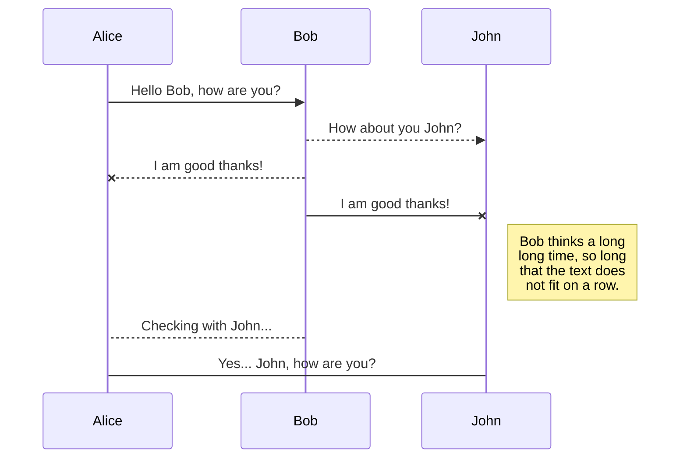
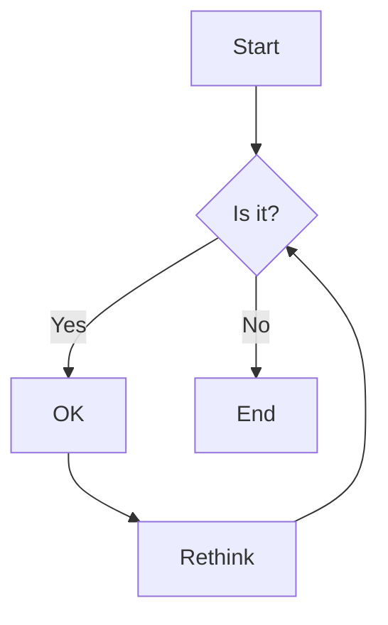

# Spec-Up-T Demo

## Intro

This is a default Spec-Up-T installation. Find information on the [Spec-Up-T documentation website](https://trustoverip.github.io/spec-up-t-website/).

This is a demo site for Spec-Up-T. The subject matter – gardening and related terms – is used purely as an example to demonstrate how the system works. You can replace these demo terms and definitions with your own content to suit your documentation needs.

[//]: # (This file, named “terms-and-definitions-intro.md” is mandatory and should not be deleted. However, you can safely delete this comment and replace it with text of your choice.)

## Terms and definitions

This is the terms and definitions section
[[tref: KERISuite, composability ]]

~ Note: composability is not the same as compostability.

[[def: compost, composting, Compost]]

~ Compost is a mixture of decayed organic matter used to fertilize soil. It is created through the process of composting, where materials like leaves, food scraps, and grass clippings break down over time. Compost improves soil structure and provides nutrients for plants. See also [[ref: Mulch]], [[ref: Soil]], [[ref: Fertilizer]], [[ref: Seedling]], [[ref: Watering]].

[[tref: ExtRef2, dormancy]]

~ Note: This is a tref example. The term "dormancy" is imported from the ExtRef2 external glossary (focused on plant lifecycle and propagation concepts).

~ See also: [[xref: ExtRef1, perennial]] for perennial plants from ExtRef1.

[[def: fertilizer, fertilizing, Fertilizer]]

~ Fertilizer is a substance added to soil or plants to supply essential nutrients and promote growth. Fertilizers can be organic, like compost, or synthetic. Proper fertilizing ensures healthy plant development. See also [[ref: Compost]], [[ref: Mulch]], [[ref: Soil]], [[ref: Watering]], [[ref: Seedling]].

[[tref: ExtRef1, greenhouse]]

~ Note: This is a tref example. The term "greenhouse" is imported from the ExtRef1 external glossary (focused on greenhouse and irrigation concepts).

~ See also: [[xref: ExtRef2, propagation]] for plant propagation from ExtRef2.

[[def: mulch, mulching, Mulch]]

~ Mulch is a layer of material, such as wood chips or straw, spread on the surface of soil to retain moisture, suppress weeds, and regulate temperature. Mulching helps improve plant health and soil quality. Related terms: [[ref: Compost]], [[ref: Soil]], [[ref: Fertilizer]].

[[def: pruning, Pruning]]

~ Pruning is the practice of trimming plants by cutting away dead or overgrown branches or stems. Pruning encourages healthy growth and improves the shape of plants. See also [[ref: Seedling]], [[ref: Watering]].

[[def: seedling, seedlings, Seedling]]

~ A seedling is a young plant that has recently sprouted from a seed. Seedlings are delicate and require proper soil, water, and light to grow into mature plants. See also [[ref: Soil]], [[ref: Compost]], [[ref: Watering]].

[[def: soil, soils, Soil]]

~ Soil is the upper layer of earth in which plants grow. It consists of a mixture of organic matter, minerals, gases, liquids, and organisms that together support life. Healthy soil is essential for gardening and agriculture.

~ Refs examples: [[ref: Compost]], [[ref: Mulch]], [[ref: Fertilizer]].

~ Xref examples from external gardening glossaries: 
~ - From ExtRef1 (greenhouse focus): [[xref: ExtRef1, greenhouse]], [[xref: ExtRef1, irrigation]]
~ - From ExtRef2 (lifecycle focus): [[xref: ExtRef2, dormancy]], [[xref: ExtRef2, propagation]]

~ Note: The term "soil" exists in ExtRef1 and ExtRef2 with different definitions focused on their respective themes.

~ Soil quality affects water retention, nutrient availability, and plant health. Amending soil with compost or mulch can improve its structure and fertility. Fertilizer may be added to supplement nutrients as needed.

[[def: watering, Watering]]

~ Watering is the act of supplying water to plants to help them grow. Proper watering is essential for healthy roots and overall plant development. Overwatering or underwatering can harm plants. See also [[ref: Soil]], [[ref: Seedling]], [[ref: Mulch]].

## Demo of example markup in Spec-Up-T and Markdown

### Blockquote

> To be, or not to be, that is the question:
Whether 'tis nobler in the mind to suffer
The slings and arrows of outrageous fortune,
Or to take arms against a sea of troubles
And by opposing end them. To die—to sleep,
No more;

### Notices

<pre>
::: note Basic Note
  Check this out.
:::
</pre>

::: note Basic Note
  Check this out.
:::

::: note
  Here's another.
:::

::: note
  And one more!
:::

::: note Basic Note
  One last note!!!
:::

<pre>
::: issue Issue Notice
  I take issue with that, kind sir.
:::
</pre>

::: issue Issue Notice
  I take issue with that, kind sir.
:::

<pre>
::: warning Warning Notice
  Houston, I think we have a problem
:::
</pre>

::: warning Warning Notice
  Houston, I think we have a problem
:::

<pre>
::: todo Really Important
  Get this done!
:::
</pre>

::: todo Really Important
  Get this done!
:::

<pre>
::: informative Additional Context
  Here's some helpful information that's subtle and non-intrusive.
:::
</pre>

::: informative Additional Context
  Here's some helpful information that's subtle and non-intrusive.
:::

<pre>
::: example Code Example
  Put your code block here
:::
</pre>

::: example Code Example

```json
// Some comment in JSON
{
  "foo": "bar",
  "baz": 2
}
```

:::

### Content Insertion

Use the following format to pull in content from other files in your project:

<pre>
This text has been inserted here from another file: &#91;&#91;insert: assets/test.text&#93;&#93;
</pre>

This text has been inserted here from another file: [[insert: assets/test.text]]

You can even insert content within more complex blocks, like the JSON object below which is being pulled in and rendered in a syntax-highlighted example block:
<pre>
::: example Code Example
```json
&#91;&#91;insert: assets/test.json&#93;&#93;
```
:::
</pre>

::: example Code Example

```json
[[insert: assets/test.json]]
```

:::

### Tables

<pre>
|              Stage | Direct Products | ATP Yields |
| -----------------: | --------------: | ---------: |
|         Glycolysis |           2 ATP |            |
|                 ^^ |          2 NADH |   3--5 ATP |
| Pyruvaye oxidation |          2 NADH |      5 ATP |
|  Citric acid cycle |           2 ATP |            |
|                 ^^ |          6 NADH |     15 ATP |
|                 ^^ |         2 FADH2 |      3 ATP |
|     **30--32** ATP |                 |            |
[Net ATP yields per hexose]
</pre>

|              Stage | Direct Products | ATP Yields |
| -----------------: | --------------: | ---------: |
|         Glycolysis |           2 ATP |            |
|                 ^^ |          2 NADH |   3--5 ATP |
| Pyruvaye oxidation |          2 NADH |      5 ATP |
|  Citric acid cycle |           2 ATP |            |
|                 ^^ |          6 NADH |     15 ATP |
|                 ^^ |         2 FADH2 |      3 ATP |
|     **30--32** ATP |                 |            |
[Net ATP yields per hexose]

<pre>
|     |     |     |     |     |     |     |     |
| --- | --- | --- | --- | --- | --- | --- | --- |
| ♜   |     | ♝   | ♛   | ♚   | ♝   | ♞   | ♜   |
|     | ♟   | ♟   | ♟   |     | ♟   | ♟   | ♟   |
| ♟   |     | ♞   |     |     |     |     |     |
|     | ♗   |     |     | ♟   |     |     |     |
|     |     |     |     | ♙   |     |     |     |
|     |     |     |     |     | ♘   |     |     |
| ♙   | ♙   | ♙   | ♙   |     | ♙   | ♙   | ♙   |
| ♖   | ♘   | ♗   | ♕   | ♔   |     |     | ♖   |

</pre>

|     |     |     |     |     |     |     |     |
| --- | --- | --- | --- | --- | --- | --- | --- |
| ♜   |     | ♝   | ♛   | ♚   | ♝   | ♞   | ♜   |
|     | ♟   | ♟   | ♟   |     | ♟   | ♟   | ♟   |
| ♟   |     | ♞   |     |     |     |     |     |
|     | ♗   |     |     | ♟   |     |     |     |
|     |     |     |     | ♙   |     |     |     |
|     |     |     |     |     | ♘   |     |     |
| ♙   | ♙   | ♙   | ♙   |     | ♙   | ♙   | ♙   |
| ♖   | ♘   | ♗   | ♕   | ♔   |     |     | ♖   |

### Sequence Diagrams

<pre>

</pre>


### Flows

<pre>

</pre>


### Charts

<pre>
```js
{
  "type": "pie",
  "data": {
    "labels": [
      "Red",
      "Blue",
      "Yellow"
    ],
    "datasets": [
      {
        "data": [
          300,
          50,
          100
        ],
        "backgroundColor": [
          "#FF6384",
          "#36A2EB",
          "#FFCE56"
        ],
        "hoverBackgroundColor": [
          "#FF6384",
          "#36A2EB",
          "#FFCE56"
        ]
      }
    ]
  }
}
```
</pre>

```chart
{
  "type": "pie",
  "data": {
    "labels": [
      "Red",
      "Blue",
      "Yellow"
    ],
    "datasets": [
      {
        "data": [
          300,
          50,
          100
        ],
        "backgroundColor": [
          "#FF6384",
          "#36A2EB",
          "#FFCE56"
        ],
        "hoverBackgroundColor": [
          "#FF6384",
          "#36A2EB",
          "#FFCE56"
        ]
      }
    ]
  }
}
```

### Syntax Highlighting

<pre>
```json
{
  "@context": "https://www.w3.org/ns/did/v1",
  "id": "did:example:123456789abcdefghi",
  "authentication": [{
    "id": "did:example:123456789abcdefghi#keys-1",
    "type": "RsaVerificationKey2018",
    "controller": "did:example:123456789abcdefghi",
    "publicKeyPem": "-----BEGIN PUBLIC KEY...END PUBLIC KEY-----\r\n"
  }],
  "service": [{
    "id":"did:example:123456789abcdefghi#vcs",
    "type": "VerifiableCredentialService",
    "serviceEndpoint": "https://example.com/vc/"
  }]
}
```
</pre>

```json
{
  "@context": "https://www.w3.org/ns/did/v1",
  "id": "did:example:123456789abcdefghi",
  "authentication": [{ 
    "id": "did:example:123456789abcdefghi#keys-1",
    "type": "RsaVerificationKey2018",
    "controller": "did:example:123456789abcdefghi",
    "publicKeyPem": "-----BEGIN PUBLIC KEY...END PUBLIC KEY-----\r\n"
  }],
  "service": [{
    "id":"did:example:123456789abcdefghi#vcs",
    "type": "VerifiableCredentialService",
    "serviceEndpoint": "https://example.com/vc/"
  }]
}
```

### TeX Math Equations

When the `katex` option is enabled, the KaTeX math engine is used for TeX rendering. You can find a list of supported features and examples here: <https://katex.org/docs/supported.html>.

$$\begin{pmatrix}x_2 \\ y_2 \end{pmatrix} =
\begin{pmatrix} A & B \\ C & D \end{pmatrix}\cdot
\begin{pmatrix} x_1 \\ y_1 \end{pmatrix}$$

$$\def\arraystretch{1.5}
   \begin{array}{c:c:c}
   a & b & c \\ \hline
   d & e & f \\
   \hdashline
   g & h & i
\end{array}$$

$$
\underbrace{a+b+c}_{\text{Note: such math, much wow.}}
$$

### Tab Panels

<tab-panels selected-index="0">
  <nav>
    <button type="button">First Tab</button>
    <button type="button">Second Tab</button>
  </nav>

  <div>

```json
{
  "foo": "foo",
  "baz": 1
}
```

  </div>
  <div>

```json
{
  "foo": "bar",
  "baz": 2
}
```

  </div>
</tab-panels>

### Fancy Links

Spec-Up automatically upgrades the links of certain sites, like GitHub. GitHub is the only supported site with Fancy Links right now, but we'll be adding more as we go.

### GitHub

- **Issues**
  - Source: `https://github.com/decentralized-identity/presentation-exchange/issues/119`
  - Render: https://github.com/decentralized-identity/presentation-exchange/issues/119
- **Pull Requests**
  - Source: `https://github.com/decentralized-identity/sidetree/pull/863`
  - Render: https://github.com/decentralized-identity/sidetree/pull/863
- **Releases**
  - Source: `https://github.com/decentralized-identity/sidetree/releases/tag/v0.9.1`
  - Render: https://github.com/decentralized-identity/sidetree/releases/tag/v0.9.1

## Outro

Sed ut perspiciatis unde omnis iste natus error sit voluptatem accusantium doloremque laudantium, totam rem aperiam, eaque ipsa quae ab illo inventore veritatis et quasi architecto beatae vitae dicta sunt explicabo. Nemo enim ipsam voluptatem quia voluptas sit aspernatur aut odit aut fugit, sed quia consequuntur magni dolores eos qui ratione voluptatem sequi nesciunt. Neque porro quisquam est, qui dolorem ipsum quia dolor sit amet, consectetur, adipisci velit, sed quia non numquam eius modi tempora incidunt ut labore et dolore magnam aliquam quaerat voluptatem. Ut enim ad minima veniam, quis nostrum exercitationem ullam corporis suscipit laboriosam, nisi ut aliquid ex ea commodi consequatur? Quis autem vel eum iure reprehenderit qui in ea voluptate velit esse quam nihil molestiae consequatur, vel illum qui dolorem eum fugiat quo voluptas nulla pariatur?

