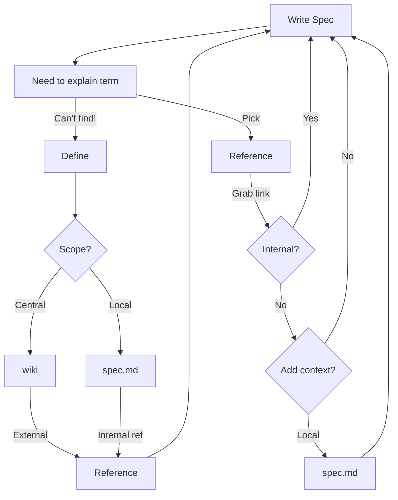
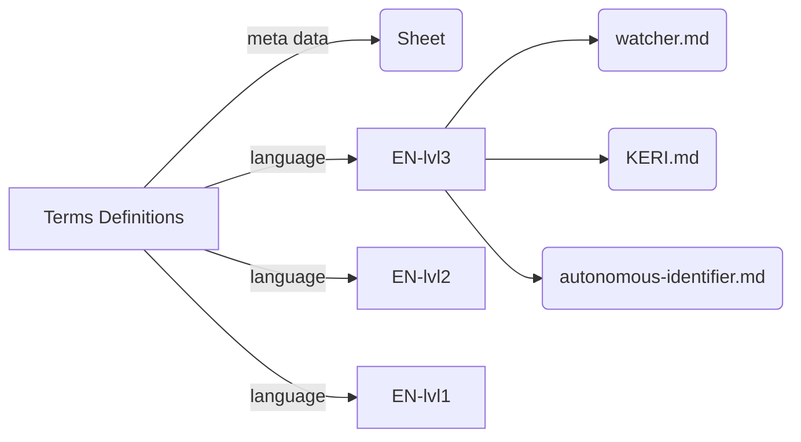
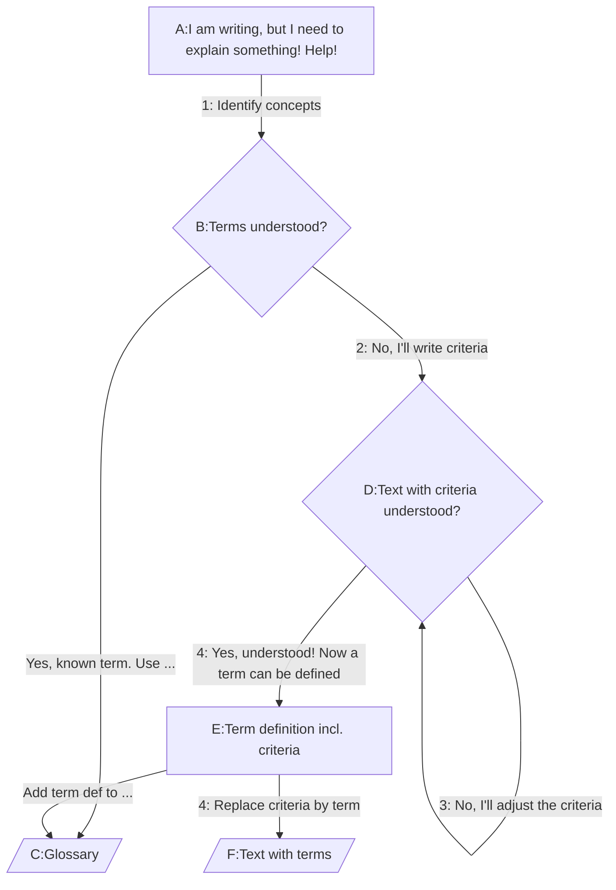
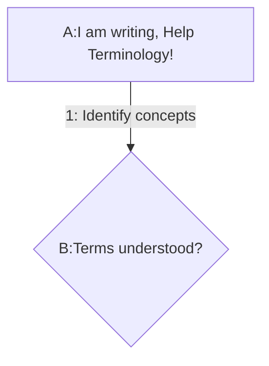
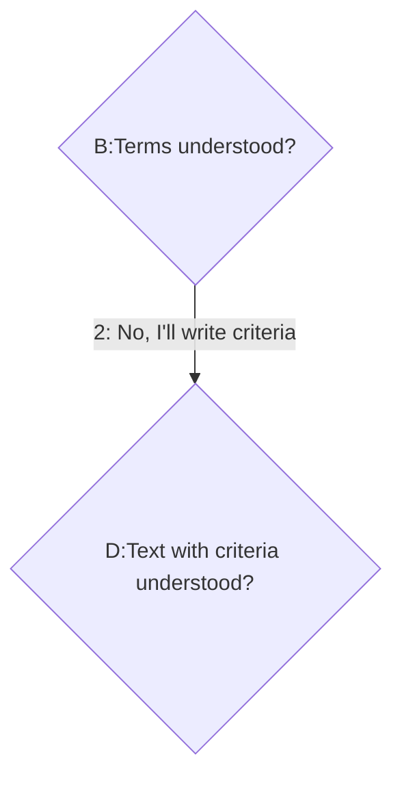
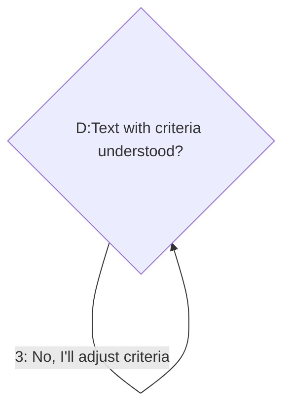
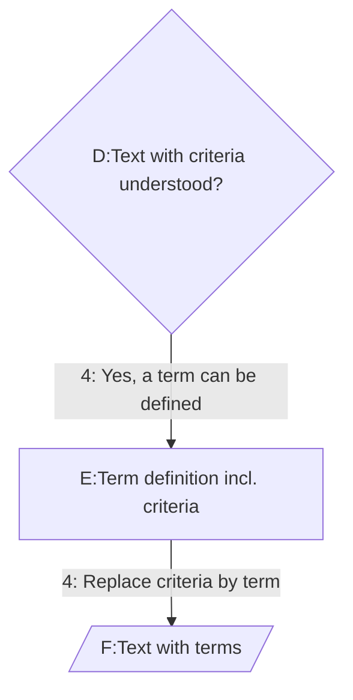
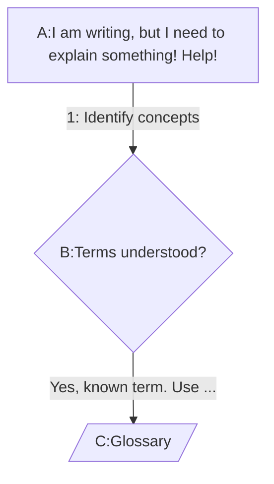
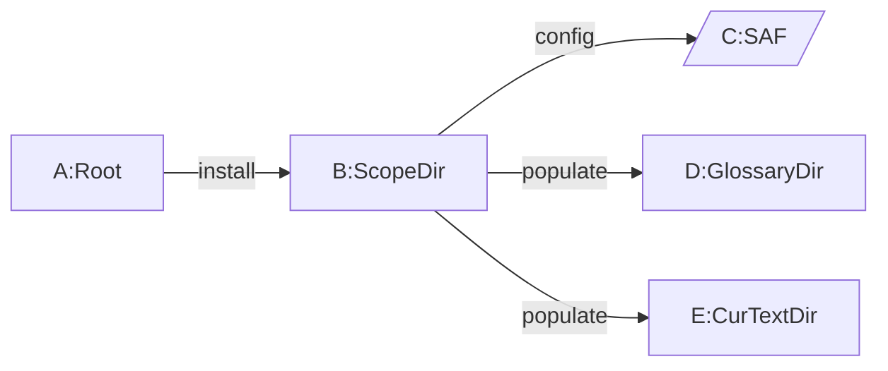
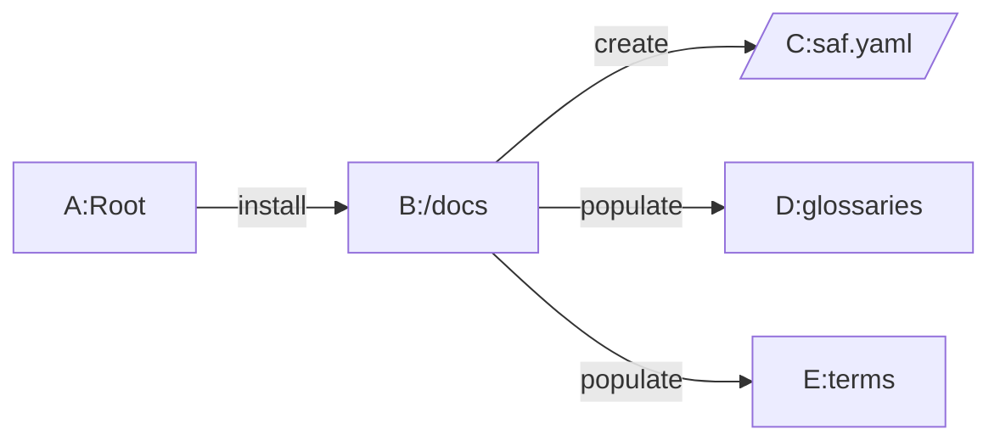

Terminology Governance Guide
==================

**Specification Status**: v1.0.8 draft

**Latest Draft:**

[https://github.com/henkvancann/terminology-governance-guide](https://github.com/trustoverip/ctwg-terminology-governance-guide)

**Editors:**

- [Henk van Cann](https://github.com/henkvancann), [Blockchainbird.org](https://blockchainbird.org)

**Contributors:**
- Neil Thomson
- Carly Huitema
- [Darrell O'Donnell](https://github.com/darrellodonnell), [Continuum Loop Inc.](https://www.continuumloop.com)
- Rieks Joosten
- Drummond Reed
- [Ed Eykholt](https://github.com/edeykholt)
- [Kor Dwarshuis](https://github.com/kordwarshuis)
- [Kevin Griffin](https://github.com/m00sey), [GLEIF](https://gleif.org)
- [Daniel Hardman](https://www.linkedin.com/in/danielhardman/), [Provenant, Inc](https://provenant.net)
  

**Participate:**

*In the Guide:*

The content is based on:
- activities and decisions of CTWG in 2024 and 2025; editor: Henk van Cann
- governance decisions around Spec-Up-T development.

*Spec-Up-T:*
- [GitHub repo](https://github.com/trustoverip/spec-up-t)
- [Commit history](https://github.com/trustoverip/spec-up-t/commits/main)

# Revision History

The editors made the following critical revisions to this specification:
- Draft v1.0.8: [Henk van Cann](https://github.com/henkvancann) Spec-Up-T development has changed the governance
- Final v1.0: [Henk van Cann](https://github.com/henkvancann)
- Draft v0.9: [Henk van Cann](https://github.com/henkvancann) Added the languages section.
- Draft v0.8: [Henk van Cann](https://github.com/henkvancann) rewrote and used Grammarly to check on correctness and clarity.
- Draft v0.6: [Ed Eykholt](https://github.com/edeykholt)'s review implemented by [Henk van Cann](https://github.com/henkvancann)
- Draft v0.5: a rough draft collection of seemingly relevant texts and diagrams, video by [Henk van Cann](https://github.com/henkvancann)
## Status

This document is a guide for spec authors (content authors and terminology authors) and a description of how the tooling is designed and supposed to work. The [normative section](#spec-up-improvements) is aimed at developers of Spec-Up-T.

## Copyright Notice

This specification is subject to the **OWF Contributor License Agreement 1.0 - Copyright** available at [https://www.openwebfoundation.org/the-agreements/the-owf-1-0-agreements-granted-claims/owf-contributor-license-agreement-1-0-copyright](https://www.openwebfoundation.org/the-agreements/the-owf-1-0-agreements-granted-claims/owf-contributor-license-agreement-1-0-copyright).

If source code is included in the specification, that code is subject to the
Apache 2.0 license unless otherwise marked. In the case of any conflict or
confusion within this specification between the OWF Contributor License 
and the designated source code license, the terms of the OWF Contributor License shall apply.

These terms are inherited from the Concepts and Terminology Working Group at the Trust over IP Foundation. [Working Group Home](https://lf-toip.atlassian.net/wiki/spaces/HOME/pages/22978063/Concepts+Terminology+Working+Group)

## Terms of Use

These materials are made available under and are subject to the [OWF CLA 1.0 - Copyright & Patent license](https://www.openwebfoundation.org/the-agreements/the-owf-1-0-agreements-granted-claims/owf-contributor-license-agreement-1-0-copyright-and-patent). Any source code is made available under the [Apache 2.0 license](https://www.apache.org/licenses/LICENSE-2.0.txt).

THESE MATERIALS ARE PROVIDED “AS IS.” The Trust Over IP Foundation, established as the Joint Development Foundation Projects, LLC, Trust Over IP Foundation Series ("ToIP"), and its members and contributors (each of ToIP, its members and contributors, a "ToIP Party") expressly disclaim any warranties (express, implied, or otherwise), including implied warranties of merchantability, non-infringement, fitness for a particular purpose, or title, related to the materials. The entire risk as to implementing or otherwise using the materials is assumed by the implementer and user. 
IN NO EVENT WILL ANY ToIP PARTY BE LIABLE TO ANY OTHER PARTY FOR LOST PROFITS OR ANY FORM OF INDIRECT, SPECIAL, INCIDENTAL, OR CONSEQUENTIAL DAMAGES OF ANY CHARACTER FROM ANY CAUSES OF ACTION OF ANY KIND WITH RESPECT TO THESE MATERIALS, ANY DELIVERABLE OR THE ToIP GOVERNING AGREEMENT, WHETHER BASED ON BREACH OF CONTRACT, TORT (INCLUDING NEGLIGENCE), OR OTHERWISE, AND WHETHER OR NOT THE OTHER PARTY HAS BEEN ADVISED OF THE POSSIBILITY OF SUCH DAMAGE.

## RFC 2119
The Internet Engineering Task Force (IETF) is a large open international community of network designers, operators, vendors, and researchers concerned with the evolution of the Internet architecture and to ensure maximal efficiency in operation. IETF has been operating since the advent of the Internet using a Request for Comments (RFC) to convey “current best practice” to those organizations seeking its guidance for conformance purposes.

The IETF uses RFC 2119 to define keywords for use in RFC documents; these keywords are used to signify applicability requirements.  ToIP has adapted the IETF RFC 2119 for use in the Terminology Specification Guide, and therefore its applicable use in ToIP-compliant governance frameworks.

The RFC 2119 keyword definitions and interpretation have been adopted. Those users who follow these guidelines SHOULD incorporate the following phrase near the beginning of their document:
        The key words "MUST", "MUST NOT", "REQUIRED", "SHALL", "SHALL NOT", "SHOULD", "SHOULD NOT", "RECOMMENDED", "MAY", and "OPTIONAL" in this document are to be interpreted as described in RFC 2119.

RFC 2119 defines these keywords as follows:

 * MUST: This word, or the terms "REQUIRED" or "SHALL", mean that the definition is an absolute requirement of the specification.
 * MUST NOT: This phrase, or the phrase "SHALL NOT", means that the definition is an absolute prohibition of the specification.
 * SHOULD: This word, or the adjective "RECOMMENDED", means that there MAY exist valid reasons in particular circumstances to ignore a particular item, but the full implications MUST be understood and carefully weighed before choosing a different course.
 * SHOULD NOT: This phrase, or the phrase "NOT RECOMMENDED" means that there MAY exist valid reasons in particular circumstances when the particular behavior is acceptable or even useful, but the full implications SHOULD be understood, and the case carefully weighed before implementing any behavior described with this label.
 * MAY: This word, or the adjective "OPTIONAL", means that an item is truly optional.  One vendor MAY choose to include the item because a particular marketplace requires it or because the vendor feels that it enhances the product while another vendor MAY omit the same item.

Requirements include any combination of Machine-Testable Requirements and Human-Auditable Requirements. Unless otherwise stated, all Requirements MUST be expressed as defined in RFC 2119.

 * Mandatories are Requirements that use a MUST, MUST NOT, SHALL, SHALL NOT or REQUIRED keyword.
 * Recommendations are Requirements that use a SHOULD, SHOULD NOT, or RECOMMENDED keyword.
 * Options are Requirements that use a MAY or OPTIONAL keyword.

An implementation which does not include a particular option MUST be prepared to interoperate with other implementations which include the option, recognizing the potential for reduced functionality. As well, implementations which include a particular option MUST be prepared to interoperate with implementations which do not include the option and the subsequent lack of function the feature provides.

## Table of contents

See the left menu for the table of contents.
## Foreword

This publicly available specification was approved by the ToIP Foundation Steering Committee on [dd month yyyy must match date in subtitle above]. The ToIP permalink for this document is:

            [permalink for this deliverable: see instructions on this [wiki page](https://wiki.trustoverip.org/display/HOME/File+Names+and+Permalinks)]

The mission of the Trust over IP (ToIP) Foundation is to define a complete architecture for Internet-scale digital trust that combines cryptographic assurance at the machine layer with human accountability at the business, legal, and social layers. Founded in May 2020 as a non-profit hosted by the Linux Foundation, the ToIP Foundation has over 400 organizational and 100 individual members from around the world.

Any trade name used in this document is information given for the convenience of users and does not constitute an endorsement.

This document was prepared by the ToIP Concepts and Terminology Working Group.

Any feedback or questions on this document should be directed to https://github.com/trustoverip/specification/issues

THESE MATERIALS ARE PROVIDED “AS IS.” The Trust Over IP Foundation, established as the Joint Development Foundation Projects, LLC, Trust Over IP Foundation Series ("ToIP"), and its members and contributors (each of ToIP, its members and contributors, a "ToIP Party") expressly disclaim any warranties (express, implied, or otherwise), including implied warranties of merchantability, non-infringement, fitness for a particular purpose, or title, related to the materials. The entire risk as to implementing or otherwise using the materials is assumed by the implementer and user. 
IN NO EVENT WILL ANY ToIP PARTY BE LIABLE TO ANY OTHER PARTY FOR LOST PROFITS OR ANY FORM OF INDIRECT, SPECIAL, INCIDENTAL, OR CONSEQUENTIAL DAMAGES OF ANY CHARACTER FROM ANY CAUSES OF ACTION OF ANY KIND WITH RESPECT TO THESE MATERIALS, ANY DELIVERABLE OR THE ToIP GOVERNING AGREEMENT, WHETHER BASED ON BREACH OF CONTRACT, TORT (INCLUDING NEGLIGENCE), OR OTHERWISE, AND WHETHER OR NOT THE OTHER PARTY HAS BEEN ADVISED OF THE POSSIBILITY OF SUCH DAMAGE.

## Executive Summary
This guide is a governance manual of our concepts & terminology for groups/scopes within TrustoverIP (ToIP) but also applicable outside of ToIP.

### Conclusion

Governing terminology is akin to herding cats — seemingly impossible. We tried our best.

The result is combination of:
- Content in Markdown
- Open-source Software on the command-line
- A GitHub web user interface (Open-source)
## Introduction

The Terminology Governance Guide is a 2024-2025 guide of assimilated expertise within Trust-over-IP about Concepts and Terminology. Its objective is to offer a comprehensive description of various data stores, tools, and processes to manage terminology, **albeit integrated in specification text**, consistently and reproducibly; the process intends to keep track of *who did what in which role to terms and definitions*.

The Spec-Up-T builders described the roles in the:

[Documentation of Spec-Up-T](https://trustoverip.github.io/spec-up-t-website/).

[GitHub-page of documentation of Spec-Up-T](https://www.github.com/trustoverip/spec-up-t-website/).


A brief description of its history is available in the [annex](#Annex). 
## Scope

This guide uses contemporary open-source technology:

- Git and github for version control, issue-handling, and project management in various github repos. A great easy-to-understand introduction of github is [here](https://www.youtube.com/watch?v=nPJw_rC9hKY)
- GitHub user management
- The LF-DT Discord group ToIP-CTWG for discussions
- Use Spec-Up-T 

### Roadmap

Build education tools like KERIDoc on top op Spec-Up-T-based glossaries: 

1. the ToIP General Glossary
2. the ToIP Main Glossary
3. KERISuite Main glossary

Introduce AI tools to offer languages:

- jargon-free explanations
- level of understanding specific
- real-life languages apart from Am. English

### Future ideas

#### Governance and Policies

We already see that apart from describing personas and who does what (read: should have user rights to do what) this guide has pragmatic solution to how things should be done. Let's extend it to full blown policies.

#### Languages
Extend how to deal with various levels of understanding and target groups having to consume the wording offered in glossaries.

#### Taxonomy and Ontology

## Terms, definitions and external definitions

A list of terms and definitions, and optionally references to external definitions.

[[def: abbrev, abbreviation]]

~ a shorthand in capitals for a [[ref: term]]. It may contain special characters. It may not contain spaces.  

~ Criterion for not being an abbreviation: If the word is not in uppercase, in our context the word is more likely to be an [[ref: alias]] for the term.

[[tref:toip1,actor]]

[[def: alias]]

~ Any notation of a terminology item, that is an alternative for a term being defined. The alias also serves as a comparison among term definitions.  

~ An alias is typically a means to one-on-one relate specific wording to a term already defined. For example :

~ - Synonyms

~ - Plural - singular

~ - Different spelling

~ - Lowercase versus Uppercase 

~ - another (!) abbreviation

~ *Mind you: the most applicable abbreviation should be in [[ref:abbrev]].*

~ Criterion: an alias | TBW |

[[def: doctag]]

~ A short unique tag assigned to the remote Spec-Up document containing the def for the term being referenced. So any Spec-Up document that uses remote refs would need to include a doctag section

[[def: Guide, guide, guidelines]]

~ What is the criterion something being a Guide versus a Specification?

~ A Specification has enough [[ref: normative]] statements to be directly implementable.

[[def: key-formatted, key-formatted, key format]]

~ All lower-case with dashes instead of spaces. `this-is-an-example-of-key-formatting`

[[def: normative]]

~ A theory is *normative* if it, in some sense, tells you what you should do - what action you should take. 

~ Also see [KERISSE](https://weboftrust.github.io/WOT-terms/docs/glossary-unified?level=2#normative), and [[xref: toip2, normative]]

[[def: phrase]]

~ Something is a phrase when it's either a [[ref: term]], an [[ref: abbreviation]] or an [[ref: alias]] in the context of this [[ref: guide]].

[[def: proper-noun, Proper Noun, Proper noun]]

~ A proper noun is a noun that identifies a single entity and is used to refer to that entity (Africa; Jupiter; Sarah; Microsoft) as distinguished from a common noun, which is a noun that refers to a class of entities (continent, planet, person, corporation) and may be used when referring to instances of a specific class (a continent, another planet, these persons, our corporation).

~ More: Key Characteristics
~ - Specific Name: Proper nouns name unique individuals, places, organizations, or events. 
~ - Capitalization: They are always capitalized, regardless of their position in a sentence. 
~ - Contrast with Common Nouns: The key difference is specificity; a common noun refers to a general category (e.g., "dog"), while a proper noun names a particular one (e.g., "Fido"). 
~ - 
~ Source: [Wikipedia](https://en.wikipedia.org/wiki/Proper_noun)

[[def: term]]

~ The ToIP notation of a terminology item, that requires a definition, that could have an abbreviation and zero or more aliases. A term is supposed to be uniquely defined in a certain scope, but can have many exactly the same instances in a broader community.  

~ The term also serves as a key in the source management tool of ToIP terminology sources and to make a comparison among terms.  

~ Criterion: only if a certain word or [[ref: phrase]] in ToIP notation and first placed in the definition tag, then it's a term in the scope of this [[ref: guide]]. Only a term can have just one [[ref:abbreviation]].  

~ Also see [term](https://weboftrust.github.io/WOT-terms/docs/glossary-unified?level=2#term).

[[def:web-user-interface, Web user interface, WebUI]]

~ A web user interface (UI) is the point of interaction between a user and a web-based application through a web browser, comprising visual and interactive elements like buttons, forms, and menus that enable navigation and content consumption.

~ More: Wikipedia on [Browser user interface](https://en.wikipedia.org/wiki/Browser_user_interface)

## How to write definitions in your terminology

Annex A. [Terminology Design](#terminology-design-aids) is a great way to learn the foundation of good Terminologies.

In brief:
1. Repeat the objectives or goals (of a specific group/community)
2. Discuss and communicate towards consensus about a particular concept or term
3. Define the scope or mental model together
4. Write *criteria* for which is inside or outside the reach of a specific term

This process is essential for mutual understanding.

### How to write criteria

1. Criteria must make sense for all roles involved in the community

> For example, a criterium like "A self-addressing identifier is automatically a self-sovereign identifier, but not the other way around." might not resonate with a Reader.

2. Criteria should be deterministic, either to be in or out of the definition

Example: **Acronym**
> [[def: self-certifying-identifier, Self-certifying identifier, SCID]]
> ~ a shorthand in capitals for a [[ref: {acronym}]]. It may contain special characters. It may not contain spaces.
> Criterium for not being an Acronym: If the word is not in uppercase, in our context, the word is more likely to be an [[ref: {alias}]] for the term.

:::note Info
Spec-Up-T uses the first alias (alias1, OPTIONAL) as the spelling to show in the resulting glossary/text.
:::

3. Formulate edge cases: What is just included in a definition and excluded from a definition?!

> E.g., X.509 could be an acronym, and 'EU ID' is not an acronym

::: note Basic Note
A writer needs to do a lot of adding-criteria work before we discuss anything, like reusing definitions in another mental model. It just makes no sense to refer/link to a non-deterministic definition of somebody else, for this inherently introduces confusion: we think we are talking about the same thing, but most probably, we're not!
:::

#### As we go, we can do
An editor can achieve enhancement in the written version of concepts and terminology in parallel with other activities:
- archiving old concepts and glossaries
- tool development
- consensus building
Good habit: **don't reference poorly-formulated definitions**, because that'll put a burden on the future.

### Towards automatic processing in github actions

Currently, we allow for two types of source management tools of terminologies. 
Check them out here: | TBW Link to the chapter |. 

Steps: 
1. Source management (`def`, `ref`, `xref` and `tref`)
2. Sticking to standardization rules
3. Processing automatically (using NPM and Github Actions)

Examples of standardizations:
1. introduce lowercase names with dashes between the words, example: `self-certifying-identifier`
2. don't **delete** items (i.e., .md files), but make clear they are depreciated and/or link to the new concept/term
3. don't change or **update** the name of an item single-handedly, for it might change the concept/meaning for other people and create dead links for those who **read** - or link to the term. Please open an issue or a PR to discuss first. 
4. any other immediate updates and amendments are welcome; the revisions are available for us to (partially) revert if something unwanted or unexpected happens.
5. Standardization of the use of acronyms. An acronym that is well-known and should be explained/linked to the term it abbreviates. Example: SCID, TSP. An acronym that is less/hardly known and links *only implicitly* to the term it abbreviates. Example: legitimized-human-meaningful-identifier, aka LID.
The use of "Also known as" is in both situations optional.

### Glossary processing

Whereas the source management tool (or *input tool*) alters the content of terminology and it's storage location, there should also be a way to add metadata (descriptive information).

Based on metadata it becomes possible to generate end-products that offers listing, search-functions, selection and filtering options.

Next step consists of:
- put terminology in online glossaries, Term-definition sections of specifications and in dictionaries.
- print terminology in hard-copy specifications (pdf and paper)

Some ToIP groups use workarounds to add metadata and extra functionality to their terminology based on the combination of labeling content and additional metadata

> E.g., the WebofTrust-harboured engine KERISSE regularly scrapes the the WOT-terms wiki into [KERISSE](http://kerisse.org), we add features and metadata through a Google Sheet, we connect relevant matching terms from related glossaries. Finally, we index it for the KERI Suite Search Engine (KERISSE).

### Spec-Up-T

Spec-Up-T is a static-page site generator. It's unique feature is it generates an all-encompassing sole internet page; one `index.html`.

The processing consists of:
- Updating NPM
- Updating specific NPM Spec-Up-T tools
- Run the Spec-Up-T menu by hand for additional functions
  - Generate the external references anew
  - Generate the single page website
- Investigate and lookup the results on a local computer
- Commit the changes on a local computer
- Push the result to a public internet server
- Generate the results using Github Actions on a public internet server

## Roles

This section is informative and intends to clarify people's different viewpoints when looking at concepts and terminology.

We offer:
1. minimalistic use cases for them
2. the necessary consecutive steps to fulfill their use case

Reminder: This governance guide is about **Specifications** and (their) **Glossaries** Our tooling Spec-Up-T handles both in one go and this might be confusing sometimes.

::: todo Important
 Have a look at the diagram and role descriptions in the [Spec-Up-T documentation](https://trustoverip.github.io/spec-up-t-website/docs/intro) first!
:::

### Role: Reader
Who uses the Github.io website, reads concepts in text and terminology in glossaries (for example, generated by Spec-Up), and has its tailor-made contextual glossary that generates pop-ups here and there in the text offered. The reader optionally follows links by clicking on them.

### Role: Curator
Uses a Web user interface ([[ref: WebUI]]) of GitHub.com, the command-line and an IDE and git and browser extensions to check logical consistency & meaning of term definitions in a particular context and uses browser extensions to harvest a personal collection of term definitions based on those recommended by the specification authors.

### Role: Specification CONTENT author, describing concepts
Focuses on content and concepts of the group they belong to. 

:::warning Warning Notice
Whenever they change **terminology**, he should be aware that it's the responsibility of the *terminology author* to make changes to defs and refs!
:::

This role uses a Web user interface ([[ref: WebUI]]) of GitHub.com, the command-line and an IDE, git, and a browser extension to edit  Spec-Up markdown files for their specific context (mental model) in a version-managed environment, authenticated, to write the concept and specification and offer this as a PR. They use browser extensions to check the technical consistency of the text's links and harvest a personal collection of term definitions.


### Role: Specification TERMINOLOGY author, covering concepts
Who focuses on term definitions covering concepts of the group to which they belong.

::: note Notice
They maintain a consistent set of definitions and references throughout the specification.
:::

This role uses a Web user interface ([[ref: WebUI]]) of GitHub.com, the command-line and an IDE, git, and a browser extension to edit Spec-Up markdown files for their specific context (mental model) in a version-managed environment, authenticated, to write the concept and specification and offer this as a PR. They use browser extensions to check the technical consistency of the links in the text and harvest a personal collection of term definitions. Specification author terms that cover those concepts.

### Role: ToIP glossary maintainer
This role uses a source management tool. Reads and compares concepts in text and terminology in glossaries (for example, generated by Spec-Up) to use within their "own" over-arching ToIP glossary. They build as much consensus around terms and concepts as possible and promote using the ToIP glossary as reference material.


## Tools Landscape

This section presents the components and structure of ToIP's concepts, machinery for terminology, and governance.

### git and github

##### Why?
- We need to know "who did what at what point in time"
- We need to be able to get back and link to historical (intermediate) result

##### How?
Every role that changes stuff (Create, Update, or Delete) must be on github, and the users sign off their results.

This way:
- sources are GitHub managed, and so is the provenance of each definition
- we can track provenance carefully. Tracking is a step towards fully managed, individually versioned glossary management tooling, such as those developed with Spec-Up-T.

### Github landscape

Every group within ToIP that uses Spec-Up-T has a setup that is more or less like the following. 

Platform| Git branch | Software
----: | --------------: | ---------:
github.com repo| main or 'own choice' |Spec-Up-T
^^  | | VsCode |
^^ | | Node.js / NPM |
github.io pages |gh-pages| `user.github.io/repo` 
^^ |  | github actions |
^^ |  | kerific |
[Infrastructure Terminology Engine ToIP]

### Flow of Writing a Specification in Spec-Up



### Glossary Flow: Ingest - Curation - Output


By: Darrell O'Donnell, Jan 2024

## Writing

This section is informative.

In case of a *specification*, it is important to ask yourself, "Is what I write implementable?" Follow it step by step. Check all the MUSTs and SHOULDs in the normative section.

### Readability
- numbering of paragraphs: automatic
- Informative stuff per the section below the normative

## Technical consistency
 - split the text over markdown files in the spec-up `./spec` folder
 - beware Spec-Up-T has as mandatory directory structure, where the Terms Definition reside in a subdirectory of `./spec` 

## Style guide for Markdown text, headers and anchors

### Conflating transformation

Markdown creates HTML ID attributes from a header. If two identical id's are create, anchors will not work correctly at all times.

Example: 
```text
term 1: “My Awesome Term” and term 2: “My awesome term”
For example:

Original: My Awesome Term
Transformed id: my-awesome-term
```

You cannot definitively reverse my-awesome-term back to "My Awesome Term" because the capitalization and exact spacing are lost.

It should be noted that an HTML document (resulting from Markdown generation) should not contain two identical ID attributes; however, it does not stop browsers from rendering the page.

#### Original Spec-Up feature

This "feature" has been available since the introduction of Spec-Up. It's the responsibility of the text writer to solve conflating anchors.

For terms and definitions, we should introduce a governance rule. 

## Style guide for ToIP terminology

The governance rule we need for terminology:

**a combination of repo and key-formatted term is unique.** Terms should convert to:

<URL>/#term:<term-in-key-format>

for example

https://glossary.trustoverip.org/#term:administering-body

### key-format

Any \[\[def:]] MUST HAVE a key, and it SHOULD BE [[ref: key-formatted]].

In an ecosystem of spec-up-t-based glossaries, there _could be_ another `administering-body` defined somewhere else, for example, `https://github.com/weboftrust/ctwg-main-glossary/#term:administering-body` and this exact same keys are addressable independently via a `tref` and `xref`.


A term that is intended to be generic SHOULD be **lowercase** in the glossary and in the specs and other documents that use that term. 

The key-format is lowercase and dashes: `lowercase-example`

### Proper nouns

To address proper nouns we SHOULD use an alias. 

A key can be uppercase if it is a [[def: ]]. The only exception is an acronym. For example, the following terms are all generic nouns:
- wallet
- agent
- public key (leading to key-format `public-key`)
- key event log (leading to key-format `key-event-log`)

### Forms
Terminology can be defined in various forms: nouns, verbs, adjectives/adverbs, and relations(hips).

#### Example
Noun: Verifier
Verb: Verify
Adjective: verified (signature)
Relationships: verifying

Authors are free to choose any form of a term. However, we highly recommend the use of our key-format (lowercase and dashes for the keys)

It's a way to express their objectives and concepts and give meaning. But use aliases for this. Even multiple forms are welcome, which means that in your scope, you COULD define the noun, the verb, and a relationship. E.g., verifier, verify and verifying.

### Acronym standardization

The following terms are proper nouns or acronyms:
- ToIP
- W3C
- DIF
- X.509
- Diffie-Hellman
- KEL

Good governance Use them as an alias, preferably.

```
[[def: KEL]]

~ See [Key event log](key-event-log)
```

is allowed, but we prefer

```
[[def: key-event-log, Key event log, KEL]]

~ explanation, single point of definition
```

Both definitions will lead to your explanation using

[[ref: KEL]] and via a click to `kel-event-log`

but you'll have to maintain the local reference in markdown, whereas Spec-Up-T will have more abilities to health check refs, trefs and xrefs.

Furthermore,

[[def: key-event-log, Key event log, KEL]]

gives you all these options
```
[[ref: key-event-log]]
[[ref: Key event log]]
[[ref: KEL]]
[[xref: repo, key-event-log]]
[[xref: repo, key-event-log, Key event log]], Showing `Key event log` as the external link text
[[xref: repo, KEL]], Showing `KEL` as the external link text
[[tref: repo, key-event-log]]
[[tref: repo, key-event-log, alias1, <any list of aliases>]]
... being able to reference the tref transclusion with any alias and the key showing `alias1` in local refs.
```


#### Special characters
Notice that the Acronym `X.509` has a special character (`.`). You SHOULD use special characters only if it's crucial for the meaning of the term. 

So, for example, *not this*: `security@hub4issuer` but stick to the guidelines above and define, for example, `security-at-hub-for-issuer`.


#### Constants, variables, and terms in coding
Sometimes, acronyms in code are (partly) in lowercase (e.g., `vLEI`, `eID`, `ind`) for various reasons. One needs to explain those acronyms in terms of concepts and terminology; we allow them to do so in their original case.

#### Authors partly comply and have freedom of choice

### Standardization of acronyms

Two situations:

1. An acronym that is well-known and should be explained/linked to the term it abbreviates. For example, because the acronym is multi-explicable. Example: SCID, TSP.

2. An acronym that is less/hardly known and links to the term it abbreviates

Add 1. A well-known acronym needs its own entry in the glossary:

```Spec-Up-T
[[def: SCID, SCIDs]]

~ [[ref: self-certifying-identifier]]
```
If you would only do this:

```Spec-Up-T
[[def: self-certifying-identifier, Self-certifying identifiers, SCID, SCIDs]]
```

then it's a bit harder to find the entry SCID in the glossary. Referencing SCID In the specification links directly to Self-certifying identifier.

Add 2. Less-known acronyms could be defined, but it could burden the glossary with unnecessary entries.

```Spec-Up-T
[[def: LID]]
~ [[ref: legitimized-human-meaningful-identifier]]
```

In this case, it's better to use just one entry:

```Spec-Up-T
[[def: legitimized-human-meaningful-identifier, legitimized human-meaningful identifier, LID, LIDs]]
```

The use of: 

~ Also known as: `[[ref: {acronym or term} ]]`

is in both situations OPTIONAL.


##### Comply with
- all of the above-mentioned style guides
- the governance of terms using the current terminology source management tools

See the [Roles](roles) section for the various sub roles of an author.

## Source Management Use Cases

:::note Note
Input knowledge level: You know how to create, read, and update term definitions fit for your concept or mental model.
:::

### What is source management about?
This section is about the technical processing/source management of terms and definitions: the latest single source of truth about them in a certain scope. Spec-Up-T is the tool we discuss. The elementary part in Spec-Up-T is the `{term}.md` file that contains markdown and Spec-Up-T-specific tags. We offer various ways of managing these source files while maintaining their overall integrity.

### What can I do with it?
Source management culminates in the *latest version* of any glossary in which the term is accessible (linkable) with a *permanent URL*, and we have a *history available* that referred to this term at what time in the past.

:::info
You can reference to any Spec-Up-T-based glossary in your own write-ups and add to the general consensus about terms at the same time.
:::

### Why source management?
We want to offer multiple ways to edit term definitions. So it is not markdown **or** github frontend but markdown **and** github frontend.
The end result is always a git(hub) tracked directory with separate `.md` files of a Spec-up-T-based specification. The use cases are described below. The term definitions themselves use the Spec-Up-T markdown extensions syntax: `def`, `ref`, `tref` and `xref`.

Examples given:

``` markdown
[[def: access-control-list, access-control-list, ACL]]: 
~ The process of granting or denying specific [[ref: request]]s for obtaining 
and using information and related information [[xref: toip2, processing]] services.
```


``` markdown
[[tref: toip1, access-control, Access control]] 
```

### Why not simply use a Content Management System like WordPress??!

Just to name a few reasons:
1. User management and version control in the github ecosystem instead of centralized technological island creation
2. Spec-Up-T static website generation; we don't want the introduction of databases
3. Continuous Development Continuous Integration (CDCI) versus staging by hand
4. Business rules and Permanent linking made possible via Github Actions
5. Consensus-building within scopes but also between scopes
6. Mapping of locally defined terms, aliases and spelling.

### For who is source management of terminology relevant?
The roles involved in the use cases are `editor`, `production repo` master and `curator`.

One person could have more than one role.

**All roles above have a github user account**, because we need to know 
- *who* proposes a change on *what* and *when* this occurred.
- who changes what and when. 
Git keeps track of the changes we provoke.

:::info Info
Only the `Reader` role doesn't need a GitHub account.
:::

He/she who has `write` user rights on the target repo (e.g. TrustoverIP main glossary) can directly edit and commit the latest version. Other roles will have to adapt to those results.

 For example *merge conflicts* might arise and then need to be solved.

The good news is that Spec-Up-T has a mechanism for fallback to local versions of a definition if the original owner decides to update or delete it.
We'll get into more detail about fall-back options.

Further guidelines:
- Editors COULD have a fork for the repo. They NEED TO have a forked target repo for options 2, 3, and 4 below.
- curators don't need to have a user github repo, only a github user account, and they use the functionality to comment on PRs.

### How it works
Github Actions will pick up, and process changes as they occur and trigger staging of chancing to the production server.

This is the process diagram:


There are two main options we have use cases for:
- Local computer
- On Github.com

All are PR based WITH optional curation and **mandatory** PRs; see options 1, 2, and 3 below.

### 1. Github edit
Editors go to the term definition they want to use for C R U on the github.com user site of the target repo (which is controlled by Master). 

This way, editors can edit (after having forked the target repo to their own user account) the term definition and offer a PR to Master. After the PR is made, the curator can comment on the changes proposed and make them live and viewable on the editor's user account.

::: note Basic Note
After this source editing has been saved, our solution also overwrites the wiki repo file `/{term}.md` (if present) for syncing purposes.
:::

### 2. Terminal - text file edit

This way, editors can edit the target repo (after having cloned it to their own user account). He/she uses a text editor to write changes in the separate .md file of the term and definitions directory. He/she uses git on the command line to add, commit, and push files to their own github user account version of the target repo. From the target repo, he/she creates a PR by hand for the curator and the Master to assess and eventually accept or decline. After the PR is made, the curator can comment on the changes proposed and make them live and viewable on the editor's user account.

::: note Basic Note
After this source editing have been saved our solution also overwrites the wiki repo file `/{term}.md` (if present) for syncing purposes.
:::

### 3. IDE
An integrated Development Environment, e.g., Visual Studio Code - text file edit.

This way, editors can edit the target repo (after having cloned it to their own user account). He/she uses an IDE to write changes in the separate .md file of the term and definitions directory. He/she uses the IDE git functionality to finally create a PR on the target repo for the curator and the Master to assess and eventually accept or decline. After the PR is made, the curator can comment on the changes proposed and make them live and viewable on the editor's user account.

#### Source management of terminology wrapped up

**The input** is a per-term-splitted directory of term md files
**The process**: four options to make changes 
**The end result** two options to get the results accepted in the target repo and final Spec-Up-T html output: Via 1. and via 2,3: all PR-based.

All methods have full git tracing of who did what and when.

::: note Basic Note
After this source editing have been saved our solution also overwrites the wiki repo file `/{term}.md` (if present) for syncing purposes.
:::

### How it works in use cases

The rest of this chapter outlines the use cases for managing term definitions in a Spec-Up-T-based specification, focusing on the roles of editors, production repo masters, and curators.

We focus only on **terms and definitions**. We use the term *target repo* for the production repo, controlled by the role `master`.

### Roles in the use cases

- **Editor**: Individuals proposing changes to term definitions.
- **Production Repo Master (Master)**: Oversees the merging of PRs and has the authority to delete term definitions.
- **Curator**: Engages in reviewing proposed changes to enhance quality and accuracy.

### 4. Editing Options

#### 1. GitHub Edit (via GitHub UI)

##### Create and Update (C/U)
- **Actor**: Editor
- **Process**:
  1. Fork the target repository to your GitHub account.
  2. In your fork, navigate to the `terms-definitions` directory.
  3. To add a new term, click "Add file" > "Create new file". To update, click on an existing `.md` file and then the pencil icon (Edit this file).
  4. Make changes or add the new term using markdown syntax. Commit the changes to a new branch in your fork and start a pull request on the target repo.

##### Read (R)
- View the `.md` files directly in the target repository or through the proposed changes in pull requests.

#### 2. Terminal - Text File Edit

##### Create and Update (C/U)
- **Actor**: Editor
- **Process**:
  1. Clone your fork of the target repository to your local machine using the terminal: `git clone [Your-Fork-URL]`.
  2. Navigate to the `terms-definitions` directory within your local repository.
  3. Use a text editor to create a new `.md` file or update an existing one with the term definition.
  4. Use Git commands to add (`git add .`), commit (`git commit -m "your message"`), and push (`git push origin main`) the changes.
  5. Create a pull request from your GitHub fork's page.

#### 3. IDE - Visual Studio Code Text File Edit

##### Create and Update (C/U)
- **Actor**: Editor
- **Process**:
  1. Clone your fork of the target repository into Visual Studio Code (VS Code) using its Git: Clone command.
  2. Navigate to the `terms-definitions` directory within the VS Code Explorer.
  3. Create a new `.md` file or edit an existing one, using markdown for the term definition.
  4. Commit the changes using the Source Control panel in VS Code, pushing them to your fork.
  5. Initiate a pull request via GitHub's website from your fork to the original repository.

### 5. Master and Curator Actions

#### Update (U) by Master
- **Process**: Review, potentially edit, and merge pull requests. Manage and resolve any merge conflicts.

#### Delete (D) by Master
- **Process**:
  1. For deleting a term, remove the `.md` file or edit its content to reflect the term's deprecation, committing with a clear rationale. Only in exceptional cases, because it's far better to archive instead of delete.
  2. Push the changes to the main branch and update any documentation accordingly.

#### Curator Review
- **Process**: Engage in PR discussions, offering feedback and suggestions to ensure clarity and correctness of term definitions.

#### Notes

- Merge conflicts may arise during the PR process, requiring coordination for resolution.
- All changes, including deletions, should be documented with clear commit messages and PR descriptions to maintain a transparent history of modifications.

### 6. Being a host for x- and t- referenced glossaries

The governance rules for Glossaries that apply to be a referenced glossary (like ToIP main Glossary, KERI, General Glossary) is best summarized in this one sentence:

**Your Index.html is leading on github.com.**

Any guest using `tref` or the `xref` tag to an external glossary will generate an API call, and get the index.html files over from their externally referenced glossaries and distill the right xref or tref information from those.

It's the responsibility of every host to:

- keep all `.md` files on github.com in sync with their live `Index.html` file of Spec-Up-T
- have successful runs of their *Github Action Scripts* that generate the `Index.html` file
- differentiate between the `main` branch (production) and other branches on github.com
- have `index.html` be at least as young as any of the .md files that contain term definitions on github.com on the `main` branch.
  
The reason for these source management rules is consistency: How can a guest be sure to have the latest term definition if the host would not have the latest version live in its own production glossary?  
## User manual defs, refs, trefs and xrefs

#### Background
To simplify the job of tech spec construction and editing, the Technology Stack WG has adopted the Spec-Up spec editing tool, which was originally a DIF open-source project ([here](https://github.com/decentralized-identity/spec-up)). 

Blockchainbird and TrustoverIP invest in improving this tool. It's currently at Blockchainbird's [Spec-Up-T](https://github.com/blockchainbird/spec-up-t) repository only but will eventually sync to [ToIP](https://github.com/trustoverip/spec-up-t).

This document also contains a [normative section](#spec-up-improvements) that has served as a design for the coding project since the start of 2024.

#### Objective
To offer authors and curators a hands-up guide to handle Spec-up's syntax correctly and efficiently with regard to `defs`, `refs`, `trefs` and `xrefs`. Thereby respecting the golden rule:

 "Try `(x/t)ref` before `def`"

([why?](#try-ref-before-def))

#### Characteristics

Why bother? Because it's going to be a mess soon, if you don't. 

Terminology has a life cycle. Some concepts and their specific terminology are long-lived. They reside in their field and are related to other concepts. Other terminologies are contemporary. Terminology can have broad applications or, conversely, have a specific small niche. Nevertheless, they all share these characteristics:
1. The sources (definitions or defs) need to be managed because its content is burdened with reputation
2. References (or refs, trefs and xrefs) need to be managed in the digital world where creating copies is easy, and every *copy* for no reason whatsoever might cause confusion
3. Different roles and responsibilities work with and work on terminology. We got to keep track of who did what in which role. 

#### Cheat-sheet using def,ref,tref and xref

You have your own definition of a term?

Use [[def:<term>]] and [[ref:<term>]]

Would you like to list an external term definition in your own glossary?

1. Declare an external glossary in your configuration file with an <xgloss> mnenomic to reference it
2. Use [[tref:<xgloss>, <term>]] to list a snapshot *in the Terms Definition section* of your specification or glossary.

Would you like to link to an external term definition anywhere in your own glossary (and have a popup definition with a mouse-over)?

1. Declare an external glossary in your configuration file with an <xgloss> mnenomic to reference it
2. Use [[xref:<xgloss>, <term>, {<alias>} ]] to link to it real time anywhere in your glossary or specification. The optional `alias` will be show as the link text.

#### Governance of own repo
The governance of def & refs in the own repo has to be strict: The content of definition has to be kept sound by humans. So check your `ref`s to see if you changed the `def`.  
[Source](https://wiki.trustoverip.org/display/HOME/2024-07-01+CTWG+Meeting+Notes)

#### ToIP glossaries

 In the ToIP Technology Architecture Specification, it's a long-desired feature to add an integrated glossary; It's named https://glossary.trustoverip.org.
 
 Our objective is to offer a framework to offer this in a sustainably consistent way. The Concept & Terminology work group (CTWG) has begun publishing the ToIP Glossary as its own standalone Spec-Up-T specification, where every entry is properly formatted, and people are able to include terms from the ToIP Glossary (without having to copy those 400+ terms over into its own glossary).

We have in fact three general-purpose glossaries available at ToIP/WebofTrust from April 2025:
- [General IT glossary](trustoverip.github.io/ctwg-general-glossary)
- [ToIP main glossary](https://glossary.trustoverip.org) which is focussed on term definitions in the Self-Sovereign-Identity field
- [KERIsuite glossary](https://weboftrust.github.io/kerisuite-glossary)

**Process check: content requirement**

External glossaries:

You should visually check each `def` created in a local Spec-Up document against *any `def`* that exists in any of the remotely referenced document URLs listed in the local document (see the `title` list description in your `specs.json`).

To find the list, look for `external_specs:`

```
 "external_specs": [
 {
 "TP": "https://trustoverip.github.io/ctwg-main-glossary/"
 }
 ...
```

##### Why "try ref before def" {#try-ref-before-def}

::: note Info
with ref we mean the broader concept of `tref`, `xref`, `iref` and `ref`
:::

These are the advantages of *trying ref before def*:
- consensus building: if you study defs of related scopes under the same umbrella, you'll become more knowledgeable and aware of the different fields
- less work: it's easier to adopt a definition with well-formed criteria than having to [design one](#terminology-design-aids) yourself
- leading by example: your refs might be copied, enforcing the reputation of the `def` at hand.
  
Keep reading for an **important caveat** to these advantages! (No, [bring me there](#caveat-copy-def) now)  

**Decide whether you'd like to adopt a definition as is, adopt with a comment, or define yourself.** See [flow diagram](#flow-of-writing-a-specification-in-spec-up)

#### Functionality
For an author, there are three main relevant functionalities.
1. Spec-Up already has a basic glossary feature: `def` tags for defining glossary entries and `ref` tags for marking up terms in the spec that refer to def-tagged terms. Def tags only reference def tags *in the same* Spec-Up document.
2. An `xref` supports *remote* refs
3. A `tref` to print a external definition in your own glossary
4. An `iref` to include a front-end generated inline copy of a definition.
5. We have functionality that detects dangling `refs` and `defs`. In other words, code that checks to see that: 
 a. any ref tag defined in the spec has a corresponding def tag for the glossary entry, and  
 b. every def tag defining a glossary entry has at least one ref tag pointing to it.

Supported consistency pre-cautions and reporting:

::: note Status
October 2025 - The feature "health checks" is operational and available as a separate repository:  https://github.com/trustoverip/spec-up-t-healthcheck. Also, the npm package is available via npm install spec-up-t-healthcheck (Oct 2025: version 1.0.0)
:::

Each `def` in a local Spec-Up document has **exactly the same** `def`* existing in any of the remotely referenced document URLs listed in the local document (see the `title` list description in your `specs.json`). This is also a recommended visual check performed by authors. ([Why?]({#try-ref-before-def}))

Each `ref` has an existing `def`. Each `xref` has an existing `def` in the `title` glossary.

It **checks** each `ref` and `xref` created in reference `doctags` against *any `def`* that you're about to **remove** from a local file. 

It **signals** each `ref` and `xref` created in reference `doctags` against *any `def`* that you're about to **change** in a local file.  

When a local Spec-Up document includes a certain glossary from another remote Spec-Up document, this can be considered as a statement: "We think we might be on the same page as the people that maintain this glossary."

It's important to make explicit that somebody in a certain [role](./role.md#user-reader) added context to a remotely referenced term definition. Or he/she has chosen to refrain from that.

#### Title (formerly "Doctag")

#### External linking (tref and xref)

::: note Info
the `key` refers to a term specified in key-format spelling; lowercase with dashes instead of spaces. Example: `self-sovereign-identity`.
:::

We need the capability for all ToIP specs to use remote refs to reference a common ToIP Glossary in addition to their own internal glossary. So far, an incentivization under TSWG spec authors would be fine with that capability: they can use any term already defined in the ToIP Glossary without having to repeat it in their glossary, and they can add any term specific to their spec.

```
[[tref: group, key, {alias1}, {aliases 2 to n}]] and [[xref: group, key, {alias1} ]]
```

`key` MUST be one of `term` in any of `group`'s glossary. If there is an `alias1` it'll be used as the definition text (tref) and link text (xref).

For example, a specification that includes an `xref` tag that looks like this: [[xref: toip, key, ]] would reference a def tag defined in the ToIP Glossary. Similarly, a ref that looks like [[xref: hxwg, {term}]] would reference a defined term in the (theoretical) HXWG glossary.

With this remote reference feature, all ToIP specifications (and any other deliverable written with Spec-Up) would be able to include linked glossary terms (including hover pop-up definitions), both from within its own glossary and from any referenced glossary in another document that also uses Spec-Up.

Mind you, this process touches on group dynamics, consensus building, and communication.

#### Dangers of bluntly referencing and copying  {#caveat-copy-def}

It's important to note that team members in various [roles](#Roles) should feel free to define a term as they wish, **after studying what's available**. This is an important caveat for referencing terms.

#### chains of refs and context switching

##### What is "chains of refs"

Specifications have their own mental model. Referencing definitions and text sections in other specs or glossaries means consensus building (via `tref`) and syncing ideas (via `tref` and `xref`).

In Spec-Up-T we've been able to group specs and glossaries under a certain umbrella in an "ecosystem" of interrelated GitHub pages end-products and repos.

A chain of ref mean: a tref to a tref to a tref, etc. Is also means the possibility a of a circular ref.
**We do not want chain of refs**, rejected on content grounds too, which we call `context switching`

Context switching means that you refer to exactly the same term or alias of a term in another context, without confirming that you're talking about the same concept.

##### Example

`witness` in KERI means something other than what is usually understood in the broader SSI field.

The design decision of Spec-Up-T therefore, is:
only one-deep trefs
only one-deep xrefs
a local (i)ref to a tref(-alias) is fine

Not allowed:
- an xref to a tref
- an xref to an alias
- a tref to a tref
- a tref to an alias

This way Spec-Up-T prevents circular refs and unobserved context-switching (or mental-model switching).

##### Substitutions to not switch contexts

Spec-Up-T offers front-end functionality to substitute each `ref` in a `tref`ed text snippet for the **local match** of that `key` as long as the `ref`ed term has the syntax of a `key`.

Spec-Up-T also offers front-end functionality to make each full URL in a `tref`ed text snippet operational. It can only check the validity of the link with tooling as specified in the [parent issue](https://github.com/trustoverip/spec-up-t/issues/160)

`Trefs` can also be presented as plain text without links. So the toggle offers plain text or text with links; these links consist of full URLs and locally-matched `refs` in the proper `key` format.

#####  It should consist of **errors** for:

Dangling tref: there's no match in the external document on the `key` to a `def`

Dangling xref: there's no match in the external document on the `key` to a `def`

##### It should consist of **warnings** for:

Dangling refs: there's no hit in the document to a `def`(-alias), `tref`(-alias)

Dangling def: 
1. There's no `ref` in the local document, 
 2. There's no `xref` or `tref` in the ecosystem of interlinked specs

Dangling tref: there's no `ref` in the local document to the `key` or `alias` of the `tref`

Plain external links: broken, full URLs to outside 

Local anchors: broken, for cross-references and bibliography's normative and informative links

##### Mind you: we cannot accept chains of refs nor context switching:

xrefs: we do not match an *alias* defined in an external document's `def`, only the properly formatted `key`

xrefs: we do not match anything from a `tref` defined in an external document

trefs: we do not match an *alias* defined in an external document's `def`

trefs: we do not match anything from a `tref` defined in an external document

#### Add context and metadata

::: note Status
March 2025 - The feature "context metadata" is in the design phase, so it is not operational
:::

Adopting a term from a related scope (under the ToIP umbrella) or externally has the possibility for the author, curator, and maybe even other team members to add context to the definition adopted. The following metadata will be (automatically as much as possible) registered:

- `term`, or (optional) `alias` or (optional) `acronym` of the term definition used to reference
- `URL` of the spec in which the term definition list is present and the name of the header
- `commit hash` of the term definition plus specification adopted
- `authenticated GitHub user` that adopts the term (create), changes its context (update) or deletes the context.

This metadata can be added:

- `group name` from which the term will be adopted
- `role` of the `authenticated GitHub user` in the current scope

You could add or remove:
- `context`, which is a block of free text.

The **order in which these changes take place** to a terminology definition, referencing, and/or comments will be registered.

Mind you: the adopter of a term can't delete nor alter the original definition present in another scope.

#### Local versus Remote references
Technically, the only difference between a local ref and a remote ref is that the former are always within the same Spec-Up document — they look like:

`[[ref: term]]`

The latter allows the author to reference a def in a different Spec-Up document. They look something like:

::: note Status
March 2025 - The features "tref and xref" are under testing, so it is not fully operational yet
:::

`[[xref: title, term]]` is a short unique tag assigned to the remote Spec-Up document containing the def for the term being referenced. So, any Spec-Up document that uses remote refs would need to include a `doctag` section that looks something like this:

In `specs.json`:
```
 "external_specs": [
 {
 "<title>": "<URL>"
 }
```
example
```
 "external_specs": [
 {
 "PE": "https://identity.foundation/presentation-exchange"
 },
 {
 "TP": "https://trustoverip.github.io/ctwg-main-glossary/"
 }
 ...
```

### Adopt, add context, or define

::: note Status
March 2025 - The feature "context metadata" is in the design phase, so it is not operational
:::

Check the flow diagram of writing terminology (references) in a specification [here](#flow-of-writing-a-specification-in-spec-up).

##### How do we adopt the term "as is"?

*Local* preferable
`[[ref: term]]` 

Or *remote* reference

`[[xref: title, term]]`  and `[[tref: title, term]]` 

Where `term` is either a term, acronym, or alias.

##### How do you adopt a term with added or updated context?

::: note Status
March 2025 - The feature "adopt a term with context and metadata" is in the design phase, so it is not operational
:::

**Example**
Where `KE` is the `title` (doctag) of the KERI spec in spec-up format and `TP` is the title of the ToIP overall glossary in spec-up.

```
[[def: verification]]

~ Verification in Healthcare is in between the strict [[xref: KE, verification]]
 and the more loose ToIP definition [[xref: TP, verification]]. However, we have the same criteria as KERI
 because our system will be KERI-based.
```

Print the definition in the Terms Definition section (to be specific in the .md file under the subdirectory of directory `./spec` that holds all term derfinition of a specification:

`verification.md` contains:
 ```
 [[tref: TP, verification]]
```
##### Local inline transclusion of a definition

The specification: `[[iref, key or alias]]` and this tag produces:

<p>key/alias : {def text}</p> with a <a href="{anchor}">source</a> link if it can be found, and nothing at all if it can't; the result itself doesn't get an anchor.

In principal we have one contains-all glossary per repo/specification but `iref` offers the extra ability to repeat a `def`-ed of `tref`-ed definition with an inline reference.

Example:
```
[[iref, Attestation]]
```

If there's a local match, the tag produces for example:
```
Attestion: An identifiable set of data that describes an [entity]({link}), which is the [subject]({link}) of the attribute.
```

if no match: non-fatal error

##### How do you add context to an adopted term?

`[[tref]]` + extra text in the Markdown file using `~` per paragraph

Example Markdown in example file `decentralized-identifier.md`:

```
[[tref: toip1, decentralized-identifier, Decentralized ID]]

~ In our project an identifier is a hash made of the uploaded image, ...
```

##### How to reference an external definition?

Remove the local `def` and change.

`[[ref: term]]` into `[[xref: term]]`

Now, the term is again externally referenced as "as is."

##### How to transclude an external definition?

[[tref]]

##### Form phrase macros

A disputable way of matching terms to definitions is by using Form phrase macros. See Annex [Form phrase macros](#form-phrase-macros) by Rieks Joosten.

The upside of using Form phrase macros is that you don't have to explicitly list all possible aliases of a term.

The upside of using Form phrase macros is that you have to guess or reason how matches have been established.

As of October 2025 we don't a have a clear policy yet, and aliases all have to be explicitly summed up.

### Normative section

Have a look at it [here](#spec-up-improvements) and be informed that Spec-Up is a longer running open source project that [originated in DIF](https://github.com/decentralized-identity/spec-up). ToIP will invest in improvements to it in 2024. And offers these improvements as PRs to the DIF repo.

Here, we focus on the informative aspects of the technical specification: what it is, why we are programming it, and how to use it.

It is possible to include references to terms from external spec-up generated specifications. To include a source you would like to pull references from, include an external_specs array in your spec config. The value should be a key/value object where the key is used in the external reference below, and the value should be the URL of the external spec.

To include **an external term reference** within your spec, use the following format `[[xref: {title}, {term}]]` where `{title}` is the title given to the spec in the `specs.json` configuration file and `{term}` is the term being used. 

To include an **external term definition print-out** within your spec, use the following format `[[tref: {title}, {term}]]` where `{title}` is the title given to the spec in the `specs.json` configuration file and `{term}` is the term being used. You will recognize the `tref` by an altered background color and other controls in the panel.

For example, using the `PE` spec given in this example:
```json
{
  "specs": [
 {
      ...
      "external_specs": [
 {"PE": "https://identity.foundation/presentation-exchange"}
 ]
 }
 ]
}
```

#### Internal definition (def)
definitions (`def`s)

::: note Status
The feature "acronym" is under construction!
:::

```
[[def: term , {acronym}, {alias}, {alias}, ... ]]
~ Lorem Ipsum 
```
{optinal}

Define a `term` in a ToIP definition style: lowercase.

Optionally, an `alias` could be referenced. If you do so, the reference MUST end with the definition of `term`. Test by simply clicking the link.

::: note More Info
Check `defs` of aliases https://github.com/decentralized-identity/spec-up/blob/master/single-file-test/spec.md#term-references
and the working `refs` here: https://identity.foundation/spec-up/#term-references
:::

An `acronym` could be defined and referenced. If you do so, a separate definition of `acronym` must be present in the document itself.

::: note Status
March 2025 - This feature "acronym" is in the design phase, so not operational. However, you can already use acronyms as a def and as an alias.
:::

##### Don't do this
```
[[def: term (acronym)]] and  
[[ref: phrase]]
```
But do this

::: note Status
March 2024 - This feature "abbrev" is in the design phase, so not operational
:::

```
[[def: term, acronym]]
```
How do you add an acronym after the term? Two ways possible:
1. in the markdown, but NOT in the reference to the term:
 [[ref:]]
2. There will be post-markdown processing available to proportionally add the acronym


#### Internal linking (ref)

```
[[ref: phrase]]
```
`phrase` MUST be one of `term`, `acronym` or `alias`.

Three ways of offering references (`ref`s) to definitions (`def`s) by the author of a text:
1. explicitly created by the author
2. extra by default, after n occurrences or below a header of a certain level

1. MUST be done in the source by hand
2. MUST be done by code; we'll add a data attribute to the resulting HTML that indicates the origin of the link.

| TBW, where is the registry to ensure the uniqueness of doctags and the prevention of duplicitous [[ref: doctag]]s? |


## System feature Consistency

Have a look at it [here](#spec-up-improvements) and be informed that Spec-Up is a longer running open source project that [originated in DIF](https://github.com/decentralized-identity/spec-up). ToIP will invest in improvements to it in 2024. And offers these improvements as PRs to the DIF repo.

The tool will perform:
- Basic domain checks
- Domain checks Spe-Up or GitHub actions
- Parser checks Spe-Up or GitHub actions

### External Consistency
We like the reuse of existing terminology laid out in definitions and glossaries. If applied correctly, reuse will increase consensus within TrustoverIP.

Given this positive effect, we encourage people to look at what's there already before defining and writing their own definition.

How do we know which known glossary to use? Maybe any glossary we have previously created a cross-reference from should be included?
There is already tooling available to include existing glossaries and give a unified overview of them in [KERISSE](https://weboftrust.github.io/WOT-terms/docs/glossary-unified?level=2). This listing can be adjusted to "ToIP only".


### No effective system without governance

The governance rules that we have to put in place (at least with the ToIP community) should be:

1. If the spec authors want to use a term with its definition term as defined in the ToIP Glossary, the spec authors MUST insert a remote ref to that term in their spec and MUST NOT copy the term (or worse, redefine it) in their internal spec glossary.

2. If the spec authors want to use a term defined in the ToIP Glossary but modify its definition, they COULD raise an issue and/or a pull request (PR) to the ToIP Glossary, making the case for their proposed change. If that change is resolved to their satisfaction, they can proceed as per rule #1 above.

3. If the spec authors want to use a new term that does not exist in the ToIP Glossary to their liking, they have two choices:
- If the spec authors believe the term should apply “ToIP community-wide”, they can submit a PR to have it added to the ToIP Glossary. If accepted, they can then follow rule #1 above.
- If the spec authors believe the term only applies in the scope of their particular spec, they can define it with a def tag in their own internal spec glossary and then ref it there.

Of course, this set of rules only works within a coherent community willing to follow them. We can’t control the use of terminology outside of the ToIP community.

## System feature functionality  {#post-processing}

The front-end functionality of the resulting github.io page of a Specification can and must be altered to comply with various Reader allowances:
- Only so and so often is a link to a known term in the glossary
- Only so and so often is an acronym of a term added to the term in the core text
- Pop-ups consistently showing definitions while hovering over the term
- Consensus tooling (kerific) as a browser extension
- Search functionality is present already in Spec-Up-T
- Harmonica function available, to hide info or restrain search function to only the headers.


## System feature layout
The front-end layout and pdf layout of the resulting GitHub.io page can and must be altered to comply with various style-guide rules of external parties like IETF or ISO.

This is out of scope of this terminology governance guide.
## Audiences and languages

We have audiences that need to be addressed in their own language along three axes:
1. Level of Understanding: we currently use three levels of understanding
2. Languages: e.g., Switzerland has four languages
3. Jargon: language specific to the field of expertise

### Design principle
We stick to one language in the most specific (or most elaborate definition of a term) for the source: American English

Jargon needs a separate term definition to specify the term that covers a known concept for an inner circle but is unknown to the outside world.

We use AI tools to translate to more general language for a lower level of understanding in the line of work or the mental model.

We use AI tools to translate to a different language from the source language. E.g. English -> German & French & Italian. Why?: because it's a lot of work to maintain term definitions in four languages by hand and have every single term definition still cover the same concept. 

We always generate a link to the original, most elaborate source in the base language. Why?: to back your AI-generated translations with the human-curated source.

### The projected directory structure


## Normative addendum - Spec-Up-T improvements  {#spec-up-improvements}

This normative section is also called the “Spec-Up-T”.

#### Background
To simplify the job of tech spec construction and editing, the CTWG has adopted the Spec-Up-T document rendering tool which is originally a DIF open source project ([repo](https://github.com/decentralized-identity/spec-up)). 

#### Objective
[Spec-Up-T](https://github.com/trustoverip/spec-up-t) enhances Spec-Up-T for Terminology and Glossary design and implementation. In 2025 we plan to offer Spec-Up-T enhancements to the original DIF Spec-Up-T users through a migration. See the [issue list](https://github.com/decentralized-identity/spec-up/issues) at DIF user on github.com that we try to address in Spec-Up-T.

Based on use cases of certain roles we technically specify improvements in a normative way. This way we were able to implement them right away and manage the process in [github issues](https://github.com/trustoverip/spec-up-t/issues).

In each topical section (header level 3 in this chapter) there'll be various sub-topics (header level 4):

- features
- consistency checks
- domain checks
- business rules
  
#### Documentation of Spec-Up-T
Read or reference the [docusaurus website](https://trustoverip.github.io/spec-up-t-website).

### refs

One def and 1 to many refs may be present in a Spec-Up-Tsource document.

#### features

For an terminology author there are mainly three relevant functionalities.
1.  Spec-Up-Talready has a basic glossary feature: `def` tags for defining glossary entries and `ref` tags for marking up terms in the spec that refer to def-tagged terms. Def tags only reference def tags *in the same* Spec-Up-Tdocument.

### Internal definition (def)
definitions (`def`s)

```
[[def: term {, spelling} {, alias}]]
~ Lorem Ipsum ...
```
{optional}

A `term` SHOULD be defined as a ToIP definition style : lower case with dashes for spaces. We call this the "[[ref:key form]]".

The `spelling` COULD be defined differently then the `term`. The `spelling` shows as the main term in the glossary. If you want to show the [[ref:key-formatted]], you only need to specify it once as `[[def: term]]`. SHOULD you want to define aliases that are different than the spelling in the glossary, then first repeat the `spelling` in the definition clause and than a list of aliases you'd like to use in the document and reference to the glossary with.

Example:
`[[def:key-formatted, key-formatted, key format]]`


An `alias` COULD be referenced (by the `ref` tag). If you do so, the reference MUST end up at the definition of `term` This is already operational in the current version of Spec-Up-T and implemented with nested spans.

### Acronym and abbreviations
Any acronym COULD be defined and referenced by using it as a `term`, a `spelling` or an `alias`. If you do so a in separate definition of your acronym, it SHOULD be a very important acronym within your context.

```
[[def: acronym]]
~ [the term the acronym refers to]
```
#### Beware of duplicates. Example of a duplet:

```
[[def: KEL]]
~ [[ref: key-event-log]]

[[def: key-event-log, KEL, Key-event log]]
~ Lorem Ipsum ...
```

Both will show up as "KEL" in the glossary.

#### Don't do this

```
[[def: term (acronym)]]
```

but do this
```
[[def: term-in-key-format, Term spelled some way, acronym]]

~ Lorem ipsum
```

In the glossary this will show:

> Term spelled some way (acronym,  term-in-key-format)
> Lorem ipsum

How to add an acronym after the term in Markdown? Several ways possible:

- `term (acronym)` will show as "term (acronym)" without links
- `[[ref: term]] (acronym)` will show as "term (acronym)" and the link is in "term."
- `term ([[ref:acronym]])` will show as "term (acronym)" and the link is in "acronym."

### Internal linking (ref)

```
[[ref: phrase]]
```
`phrase` MUST be one of `term`, `spelling` or `alias`


Three ways of offering references (`ref`s) to definitions (`def`s) by the author of a text:
1. explicitly created by author
2. extra by default, after n occurrences or below a header of certain level


1. MUST be done in the source by hand
2. MUST be done by code, we'll add a data-attribute to the resulting html that indicates the origin of the link.


##### System feature Consistency

Consistency and rules for [[def:]]s and [[ref:]]s leads to github.io page with all kinds of working internal and external links and clear rules for writers.

#### Consistency pre-cautions between specifications and glossaries

These are all governance tasks and SHOULD be implemented in sources. Spec-Up-T will generate the resulting index.html document, but MAY contain broken links and unexpected behavior if the following rules are not obeyed.

Each `def` in a local Spec-Up-T document that has **exactly the same** `def`* existing in any of the remotely referenced document URLs listed in the local document (see the `title` list description in your `specs.json`), can be `tref` and `xref`-ed

Each `ref` has an existing `def`. Each `def` has at least one `ref` Each `tref` has at least one `ref` or `xref`.

Spec-Up-T code detects dangling `refs` and `defs`. In other words, code that checks to see that: 
   a. any `ref` tag defined in the spec has a corresponding `def` tag for the glossary entry, and  
   b. every `def` tag defining a glossary entry has at least one `ref` tag pointing to it.

#### Domain checks
- `term`, or (optional) `spelling` or (optional) `aliases` of the term definition used to reference

**Local references**

The most important domain check between a local `ref` and `def` is that they're always pointing back and forth in the same Spec-Up-T document — they look like:
`[[def: term, spelling, alias2,  ]]`

`[[ref: phrase]]` where phrase is one of `term` or optional `spelling` and `alias`es.

**Basic domain checks**

1. characterset
2. spaces
   [[def:<term>]] and [[def: <term>]]
3. Uppercase versus lowercase
4. Special characters
   
**Domain checks Spe-Up or github actions**

1. No acronyms in the text of a term either in "()" or after ";"
2. The system must warn for double `aliases` in one `def`
3. The system must warn for double `acronyms` in one `def`
4. No duplicity in wording in `term`, `acronym` and `alias`(ses)
5. If `term` and `acronym` are the same, discard `acronym`
6. If `alias` and `term` are the same, discard `alias`
7. If `acronym` and `alias` are the same, discard `alias`

##### What is 'the same'
When there is a collision, meaning an exact match of two terms using the terminology governance guidelines and Spec-Up-T rendering we consider them the same.

> **Example**
> "Root of trust" -> root-of-trust
> "Root-of-Trust" -> root-of-trust
> Conclusion "Root of trust" and "Root-of-Trust" are the same

#### Business rules

::: note Usecase Author
If the Terminology author believe a certain `term` only makes specific sense in the scope of their particular spec, they can define it with a `def` tag in their own internal spec glossary and then `ref` it there.
:::

**Parser checks Spec-Up-T or github actions**

1. The system must warn for double `aliases` in more than one `def`
2. The system must warn for double `acronyms` in more than one `def`
3. The system must report broken internal links, `ref`s that don't match `term`, `spelling` nor `alias`ses.

### xrefs

We have capability for all Spec-Up-T-based specs to use  `xref`s to reference a common ToIP Glossary in addition to their own internal glossary. The common glossary will be referenced with `title`.

::: note Usecase Author revisited
KSWG spec authors would like to use any term already defined in the ToIP Glossary without having to repeat it in their glossary, and they can add any term specific to their spec.
:::

- A `tref` tag to transclude a remote definition using Spec-Up-T code to show *remote* defs.
- An `xref` tag to enhance Spec-Up-T code to support *remote* refs.
  
#### Features

##### Feature Title and title collections

It is possible to include references to terms from external Spec-Up-T generated specifications. To include a source you would like to pull references from include an external_specs array in your spec config. The value should be a key/value object where the key is used in the external reference below and the value is the URL of the external spec.

To include an external term reference within your spec use the following format `[[xref: {title}, {term}, {spelling} ]]` where `{title}` is a MUST HAVE title given to the spec in the `specs.json` configuration file and `{term}` must be the [[ref:key-formatted]] term being used in the remote glossary or specification. 

For example using the `PE` spec given in this example:
```json
{
  "specs": [
    {
      ...
      "external_specs": [
        {"PE": "https://identity.foundation/presentation-exchange"}
      ]
    }
  ]
}
```


##### How to adopt a term "as is"? {#adopt-asis}

*Local* preferable
`[[ref: term]]` 

Or *remote* reference

`[[xref: title, term]]` 

Where `term` is key-formatted.

#### Consistency pre-caution

Each `xref` has an existing `def` in the `title` glossary.

Spec-Up-T code that detects dangling `refs` and `defs` in the collection of `title`s. In other words, code that checks to see that: 
   a. any ref tag defined in a spec has a corresponding def tag for the glossary entry somewhere in the collection of `titles`, and  
   b. every def tag defining a glossary entry in any of the `title`s including the local one. has at least one ref tag in any of the `title`s pointing to it.

#### Domain checks

see [refs](#refs) for applicable initial domain constraints; plus the following.

**Remote references**

`[[xref: title, term]]` is a short unique tag assigned to the remote Spec-Up-T document containing the def for the term being referenced. So any Spec-Up-T document that uses remote refs would need to include a [[ref: doctag]] section that looks something like this:

In specs.json:
```
      "external_specs": [
        {
          "<title>": "<URL>"
        }
```
example
```
      "external_specs": [
        {
          "PE": "https://identity.foundation/presentation-exchange"
        }
```

#### Business rules

::: note Rule 1 Author
If the spec authors want to use a term with its definition term as defined in the ToIP Glossary, the spec authors MUST insert a remote ref to that term in their spec and MUST NOT copy the term (or worse, redefine it) in their internal spec glossary.
:::

::: note Rule 2 Author
If the spec authors want to use a term defined in the ToIP Glossary but modify its definition, they COULD submit raise an issue and/or a pull request to the ToIP Glossary making the case for their proposed change. If that change is resolved to their satsifaction, they can proceed as per rule #1 above.
:::

::: note Rule 3 Author
If the spec authors want to use a new term that does not exist in the ToIP Glossary to their liking, and they believe the term should apply “ToIP community-wide”, they can submit a PR to have it added to the ToIP Glossary. If accepted, they can then follow rule #1 above.
:::

::: warning People involved!
Of course, this set of rules only works within an coherent community willing to follow them. We can’t control the use of terminology outside of the ToIP community.
:::

[[iref:phrase]]

[[iref:term]]

It should **check** each `ref` and `xref` created in reference `title` against *any `def`* that you're about to **remove** from a local file. 

It should **signal** each `ref` and `xref` created in reference `title` against *any `def`* that you're about to **change** in a local file. 


### Add context to adoption of a term

Adopting a term from a related scope (under the ToIP umbrella) or external SHOULD always be accompagnied with a possibility for the author, curator and maybe even other team members to add context to the definition adopted. 

#### Features context and metadata
The following metadata MUST be registered:
- `term`

The following metadata COULD be registered:
- (optional) `spelling` 
- (optional) `acronyms`
- (optional) `aliases`

- `url` of the spec in which the term definition list is present and the name of the header
- `commit hash` of the term definition plus specification adopted
- `authenticated github user` that adopts the term (create), changes it's context (update) or deletes the context.

This metadata SHOULD be added:
- `title` of the group from which the term will be adopted

You COULD add or remove:
- `role` of the `authenticated github user` in the current scope
- `context` which is a block of free text.

##### How to adopt a term with added or updated context? {#adopt-context}

Add:
`[[def: term or acronym or alias]]` with in the text part of the definition

`[[xref: title, term]]` 

Reference:

`[[ref: term]]` 

**Example**
Where mnenomic `KE` is the title of KERI spec in Spec-Up-T format and mnenomic `TP` (title) of the ToIP overall glossary in spec-up.

```

[[def: verification]]

~ Verification in Healthcare is in between the strict [[xref: KE, verification]]
 and the more loose ToIP definition [[xref: TP, verification]]. However we have the same criteria as KERI
  because our system will be KERI-based.

```

#### Consistency pre-caution

- The mnenomics (e.g. `KE`) SHOULD be unique per Spec-Up-T installation (repo)
- The github.io-pages website of every `title` SHOULD exist
- The `term` externally referenced SHOULD exist on the external github.io-pages referenced by the mnenomic/`title`.

#### Business rules

The **order in which these changes take place** to a terminology definition, referencing and/or commenting SHOULD be registered.

Mind you: the adopter of a term SHOULD NOT delete, nor alter the original definition, present in another scope.

##### How to stop adding context to an adopted term?

Remove the local `def` and change

`[[ref: term]]` into `[[xref: term]]`

Now the term is again externally referenced "as is".

### Authentication and roles

It's important to make explicit that somebody in a certain [role](./role.md#user-reader) added context to a remotely referenced term definition. Or he/she has chosen to refrain from that.


```
[[ref: title#phrase]]
```
`phrase` MUST be one of `term` in any of `title`'s glossary.

For example, a specification that includes a `ref` tag that looks like this: `[[xref : TP, term]]` would reference a def tag defined in the ToIP Glossary. Similarly, a ref that looks like `[[xref: hxwg, term]]` would reference a defined term in the (theoretical) HXWG glossary.

With the remote reference feature, all ToIP specifications (and any other deliverable written with Spec-Up) would be able to include linked glossary terms (including hover pop-up definitions), both from within its own glossary and from any referenced glossary in another document that also uses Spec-Up.

::: warning Non-technical characteristic
Mind you, this process touches group dynamics, consensus building and communication.
:::


### System feature functionality

The front-end functionality of the resulting github.io page can and should be altered to comply with various *Reader* allowances:

- Only so and so often a link to known term in the glossary (not yet implemented ultimo 2024)
- Only so and so often an acronym of a term added to the term in the core text (not yet implemented ultimo 2024)
- Be able to one-click copy a permanent link to a term (click the `#`symbol)
- Pop-ups consistently showing definitions while hovering over the term
- Consensus tooling (Kerific) as a browser extension
- Github commit history drill down option
- Compare changes since references to external sources (`xref`), for they might have changed in the meanwhile

 *Terminology author* allowances:
 - Save snapshot/versions of the glossary that have permanent links of their own.

### System feature layout
The front-end layout and pdf layout of the resulting github.io page can and must be altered to comply with various style-guide rules of external parties like IETF or ISO.

Not yet designed.

| TBW 2025|


## Integration
This is an informative section

Spec-Up from DIF, Spec-Up-T that started as "the Glossary tool", TEv2, and the KERISSE-engine (search engine, KERIDoc education) plus [Kerific]() tooling are gradually going to be integrated for the sake of concept & terminology management.

### Spec-Up-T is a migration from Spec-Up

Spec-Up-T does not support a backwards-compatible merge-back into Spec-Up due to architectural, structural, and functional advancements that fundamentally extend beyond the scope and capabilities of the original Spec-Up.

You can find the supporting arguments for this choice below.

#### Structural Differences in Configuration
Spec-Up-T introduces a significantly updated specs.json structure, including new fields such as spec_terms_directory, external_specs, and external_specs_repos. These are absent in the original Spec-Up and are essential to how Spec-Up-T organizes and renders terminology data, making direct backward merging infeasible.

#### Terminology Engine Dependency
Spec-Up-T integrates a dedicated terminology engine, which requires term definitions to be stored in individually structured files and tracked through terms-index.json. Spec-Up, by contrast, operates with simpler, monolithic Markdown files. This decoupling of terms is central to Spec-Up-T, and we cannot plausibly reverse-engineer it into Spec-Up without overhauling its processing logic.

#### Rendering and Output Mechanism Changes
Spec-Up-T introduces generated artifacts such as specs-generated.json and automated glossary indexing, which are not recognized or usable by Spec-Up's static site generator. These outputs are vital for maintaining terminological integrity and cross-spec reference management.

#### Command-Line and Automation Enhancements
The Spec-Up-T command-line interface includes extended tooling for rendering, xref management, and specification freezing (e.g., version snapshots), which depend on newer Node.js capabilities and structural expectations not present in Spec-Up.

#### One-Way Migration Path Provided
The official documentation only supports a forward migration path—from Spec-Up to Spec-Up-T—and includes no tooling or guidance for a reverse path. This unidirectional approach reinforces the directionality of development and the intent to treat Spec-Up-T as a successor, not a drop-in replacement.

#### Conclusion
The evolution of Spec-Up-T into a dual-purpose engine (technical specification + integrated glossary) reflects a shift that renders backwards compatibility impractical. Migration to Spec-Up-T is clearly supported and encouraged, but returning to Spec-Up would require dismantling key features and functionality, making such a merge-back both unsupported and strategically unwise.

#### Acknowledgement
We would like to thank Spec-Up for laying the groundwork with a simple and accessible way to write specs in Markdown, resulting in a one-pager on the web. Big thanks to Daniel Buchner for kickstarting it all—his early ideas and work made spec writing more structured and collaborative. Spec-Up-T builds on that same spirit, adding a terminology engine to tackle new needs.

### No current TEv2 

After the retirement of Rieks Joosten, TEv2 has become a dormant project?

We refer to the Annex of the achievements of TEv2 and how it has shaped Spec-Up-T.
 
## Informative references

 [TNO Terminology Design](https://tno-terminology-design.github.io/design-methods/). 
 
## Annex

A. [Terminology design steps](#terminology-design-aids)

B. [Splitfiles](#how-to-split-terms)

C. [Historical overview of development](#history-of-development)

## Terminology design aids

This chapter addresses the hard work needed when designing terminologies.

The process result in a consistent and accepted set of term definitions. The next step consists of achieving consensus over them, internally and externally. 

> Just think of the confusion you get when having the exact same terms but different concepts behind them.

 **If communication and understanding each other were easy, we could leave the hard part out.**

::: warning Alert
You can't skip terminology design. It is fundamental to success.
::: 


So **we must remember terminology design** if we want to convey a (new) concept and make sense to others. You need to understand first to be understood.

### One-word solution (trailer)

::: warning Warning Notice
Hold your breath for the magic word, **the solution for everything** in terminology design! 
:::

But first, we have to make a small but significant detour! And that is: 

> **Why are we doing this?!**

### Who benefits

Who are we doing this for, what can this person do with it, and what is the unique result?

Will you be faster and better at writing texts? Will you be better understood by a larger audience?

The brief answer is *yes*. Just imprint this paragraph for more backing:

#### Why are we doing this?

**Authors and curators** of texts can follow this guideline for terminology design in order to **create their terminology**, **invent smart criteria to distinguish their concepts from others**, thereby identifying their own concepts clearer, understand their peers better, and finally **be understood better** and quicker by others.

Oops, the magic word is in there! Have you been able to locate it? No? Keep going!

### Reality check

Most term definitions in the world do not comply with the distinguishing-criteria rule, and that’s the uniqueness of this guide: follow the steps and the result will be an improved terminology.

Before we share the *all-encompassing solution* in just one word, we’ll lay out the step-by-step process to get your terminology in order.

### Iterate through concepts

The idea is that anyone willing to explain some concepts by (first) understanding the perception of the receiving party, will go through this loop for every term that is unclear, any term that conflates, or is otherwise not fully understood.

::: note At least one criterium?
At least one clear, generally applicable criterion should come from this step-by-step per term.
:::



Tada! Our matching guidelines are:
1. Start writing your objectives and ideas, and identify the concepts behind the terms you use ([why](#why-objectives)-[what is it](#what-identifying)?) 
2. Write the concept in a specific way: formulate criteria ([why](#why-criteria)-[how](#how-criteria)-[what is good](#what-good-criteria)?) when you expect confusion to arise
3. As long as the target group does not understand a term, replace it with your criteria ([why](#why-replace)-[how](#how-replace)?) 
4. As soon as it’s understood, define the term with those criteria and replace it with the term in the text. ([why](#why-back-terms)-[how](#how-back-terms)?)

### Example: Health Care intake

Although we inevitably introduce some unexplained terms with an example, here’s an example:

#### Step 1

In the digital identity field, you might want to write a vision document on how Self-Sovereign Identity could work in Health Care. 

One of the concepts/mechanisms within healthcare is to be sure who's knee for example, will be operated on next. You write how that’s going to work out with terms covering this reassurance: *validation* and *verification*. The concept concluded successfully, which we call *authentication*.

#### Step 2

“Validation” and “Verification” of a visitor at the desk of the outpatient clinic are terms that might conflate with the “authentication” that needs to be successfully fulfilled: “Is this person really who he/she says he/she is?!”

You decide to distinguish validation and verification with a criterium for verification: 

> It must be “an automatic digital process” to be "verification".

The criterium is simple: must be an automatic digital process. 

This distinguishing criterion is handy because validation can also be something a person does!

Decryption on a computer is verification; checking a passport by the desk officer is not.

#### Step 3

Although you wrote ‘authentication is partly done by *an automatic digital process* called verification’, your team members are confused by the word ‘digital’. One brought forward that ‘computerized’ instead of digital is clearer, and the team agreed unanimously.

For the sake of the team members who weren’t present at the meeting, you leave the criteria in the text:

‘authentication is partly done by *an automatic computerized process* called verification.’

#### Step 4

Everyone understands the criteria and the term covering the concept behind it. You could now put the term definition, including its criteria, in your Terminology Engine and Glossary and replace the criteria in the text with only the term used:

‘authentication is partly done by verification.'

The term definition looks like this:

```
[[def: verification]]
 ~ 
 A data item or statement may be cryptographically securely attributable to its source (party at the source end) by any recipient verifier (party at the destination end). The process must be automatic and computerized.
 ```

**End of example.**

In this process and iteration, you could look for over-arching or adjacent term definitions (with criteria!) that match your concept. If this is the case, you could *adopt* a term definition, with or without an extra note. 
That’s when consensus building comes in as a spin-off of your terminology design.

### The magic word

What could the magic word be? No worries! Ladies and gentlemen (drum roll), the magic word in designing all your terms, defining them in a reproducible way so that anyone could identify your concepts, understand your ideas better, and apply the word by themself (drums hold!):

**Criteria!**

A least one well-formulated criterium is what we need per term definition, or should we say we need *minimally one* in order to distinguish whether something is 
- included or excluded from the definition
- inside or outside of the concept behind the term
Criteria! It's just pure magic.

::: warning Please hold on! 
Ah, happily, you’re still here. We need to share a question at this stage. Remember, we’re trying to offer a simple and speedy guideline to create great terminology for your project. 
:::

Why is it so **d.mn** difficult to get people to write proper criteria? If the “magic word” ‘criteria’ delivers the promise, why all the fuzz? Why are nearly all definitions in the digital world without proper criteria??

Because
- it’s work, it’s a task
- it needs practice
- it needs communication
- it needs the understanding of others
- it needs the dear wish to want to understand other people first before you push to be understood.

### The why and how of terminology-design steps

In the next paragraph, we'll revisit the guidelines with underlying motivation and further instructions.

### 1. Start writing your objectives and ideas, and identify the concepts behind the terms you use 



#### why writing your objectives and ideas down {#why-objectives}
If you want to guide the process of being understood and getting support, it's good to have a reference.

#### What is "identifying a concept"? {#what-identifying}
An identifier points to something, in this case, to a concept. Identification is the process of clearly describing what the concept is and defining the term that points to it.

### 2. Write the concept in a specific way: formulate criteria when you expect confusion to arise



#### why criteria? {#why-criteria}
Another person should be able to apply wording to a particular concept and decide whether something falls in or out of the criteria. Example: if someone defines a stool with the criterium "all furniture to comfortably sit on with exactly three legs from seat to each non-fixed contact point of the leg on the floor," then anyone could (dis)qualify various instances of something to sit on that looks like a stool to many.

Although you might not fully agree that a 4-legged stool is no stool according to this definition with this criterium, the fact is that it's the generally applicable criterium that we were looking for.

##### Stools IN the criterium


##### Stools OUTSIDE the criterium


::: note Important consideration
Communication, understanding, and learning will skyrocket with clear criteria, invest time in them, and earn time back further down the road.
:::

Example: moving stools

If a group of people had to move every stool, but only stools, from a furniture warehouse into a giant lorry without clear criteria on what a stool is and isn't, you would leave stools behind and for sure bring back half a truck of furniture upon unloading.

#### how to formulate criteria {#how-criteria}

Using text, you can formulate criteria. You could add examples to a criterium of edge cases/corner cases: what falls just in the criterium and outside?

#### What are good criteria? {#what-good-criteria}

Criteria that are deterministic and clearly distinguish something.

### 3. As long as the target group does not understand a term: replace it with your criteria



#### why replace terms by criteria? {#why-replace}

Criteria can be independently applied; terms have an alleged meaning, and interpretations of terms might point to distinctive concepts.
Example: *move the stools into the van* might be interpreted as "break out the fixed stools in the cantina and bring the remnants to the van."

#### How to replace terms with criteria? {#how-replace}

Replace the term with the sentence criteria it might consist of.

Example: *move the stools into the van* -> *move into the van all furniture to comfortably sit on with exactly 3 legs from seat to each non-fixed contact point of the leg on the floor*

### 4. As soon as it’s understood, define the term with those criteria and replace the criteria in the text with the term.



#### why put back terms {#why-back-terms}

Once you've identified a concept for all stakeholders, repeating lengthy criteria descriptions in a text makes no sense. Maintenance of the criteria is also easier with a single point of definition. 

#### how to put back terms {#how-back-terms}

Be sure to create a Terminology definition with the criteria and identify this concept with the term intended.

For example:
```
[[def: stool, Stool, stools]]
 ~ furniture to comfortably sit on with exactly three legs from the seat to each non-fixed contact point of the leg on the floor
```
AND then change the concept criteria in the text with the concept term:

move the ```[[ref: stools]]``` into the van.

> Mind you: a \[\[def:]] takes the form of `[[def: key, alias1, alias2, ...]]`, a main topic of this Terminology Governance Guide.

#### Next time 
You might come across a concept that has already been identified and defined with a term + criteria:



### Wrap up

Isn’t the magic word "Criteria" a bit cruel? It might snatch average human beings in the heart of their weakness: understanding others. Yet "mutual understanding" is needed to formulate suitable criteria.

### Move forward

Note that Terminology building is concise and extensive work. Beyond the basic terms, often defined as noun or noun phrases (e.g., "validation" and "peer to peer validation") we come across these challenges:
  - **different styles** to describe a concept: nouns, verbs, adverbs, adjectives, and relationships. E.g., validation, validator, validate, validated, valid? Validly? Validated data, validated person, validated intake, etc.
  - **abbreviations** for example VALD, p2p-validation
  - **synonyms** {case dependent}
  - **forms** e.g. validations, Validation, Peer-to-peer Validation, etc.

### Two for the road
1. How could we incentivize people to do the hard work of proper terminology design?

Ideas are welcome.

2. Never forget the *magic* word: **Criteria**!

### Further reading

See more here: 
- [TEv2 Design Methods Pages](https://tno-terminology-design.github.io/design-methods/)
- [TEv2 Tools Repo](https://github.com/tno-terminology-design/tev2-tools)
- [TEv2 Specifications Pages](https://tno-terminology-design.github.io/tev2-specifications)

## How to split terms

Suppose you have an old-school `terms_and_definitions.md` file. 

For Spec-Up-T you MUST have them available in multiple "atomic" files.

Find the most recent info about the working and user manual here: [Splitter-tool](https://trustoverip.github.io/spec-up-t-website/docs/advanced-features/splitter)

## General info

At the time of writing the Governance Guide (2024)

Note:

- The JSON file `specs.unsplit.json` is a one time back-up of `specs.json`.
- When running the script below (`npm run split`) the JSON file `specs.unsplit.json` will be copied to `specs.json`. **Use this file to change the config since this is the source**.
- Make sure that at the end this entry **"account":"trustoverip"** is correctly set.
- The `spec.json file will have multiple new entries, one entry per defined term. The file can grow large.
- The file is written without newlines. If you want to make it readable, run a code beautifier.

## How to split terms_and_definitions.md

Split `terms_and_definitions.md` into multiple files, one file per term:

```
npx spec-up-splitter [pathToTermsFile] [pathToTermsDir]
```

Create the glossary file (named `index.html`):

```
npm run render
```
or option 1 of the menu

```
npm run menu
1
```


## History of development

Anti-chronological report

### 2024 Wiki-based source management dropped.

In the process we have dropped github wiki-based source management of term definitions. It's done in Spec-Up-T from early 2025.

### Comparison Spec-Up 2023 and TEv2 by Rieks Joosten, Jan 2024
This specification has used the following insights to write the Guidelines, most notably in the Roles section and the Normative section.

#### Spec-Up

I have had a look at the latest spec-up draft, specifically one relating to terminology. The text tells you about its features, but (as often), you need to see the source of that text (in RAW format) to figure out how to do things if you're new to this. Here's my understanding:
Spec-up term definition syntax is as follows:

[[def: <term> ]]
~ <text that is used as the description/definition of 'term'>

where
<term> is the term that is being defined. The documentation doesn't say what it can(not) be, e.g., whether or not it may contain spaces or special characters and

<text that is used...> appears to be a (single) line of text, which also isn't further specified.

If you want to specify aliases (what TEv2 calls 'form phrases'), you say:

[[def: <term>, <alias1>, <alias2> ... ]]
~ <text that is used as the description/definition of 'term' (and its aliases)>

Where <term>and <text that is used...> are as before, and <alias<i>> are the aliases, which are also not further specified, but the example shows they can contain spaces (so the, and the closing ]] are the delimiters for the term list.

#### TEv2 definitions appear in different forms:

As a set of (curated) text files (markdown), one for each term. They contain (YAML) frontmatter in which there are fields for (a) the term, (b) the aliases (called 'form phrases'), and (c) the text line (called 'glossaryTexts'). In their body, they contain more documentation related to the term.
As an entry in a machine-readable glossary (YAML), every entry basically consists of not only the frontmatter of the curated text file but also some other fields that (third-party) tools can use to find the curated text file or a rendered version thereof.
As a set of Wiki files that will (soon?) be ingestable (turned into curated text files).

Spec-up use of term references within markdown:
[[ref: <term-or-alias>]]

Where <term-or-alias> is the defined term or one of its aliases.
TEv2 use of term references can be done in different forms:
[<showtext>](@)

Where <showtext> is a defined term or form phrase. However, if <showtext> is not a defined term or form phrase, you can still make it refer to a defined term using the syntax:
[<showtext>](term@)

TEv2 has additional syntax for using terms that refer to stuff
other than concepts (such as mental models, e.g., [<showtext>](pattern:jurisdiction@)
in other scopes, e.g., [parties](@essif-lab), in particular versions of terminology, e.g., [tag](@tev2:latest)

Also, TEv2 has mechanisms where users can define/configure their own syntax for term references, as well as mechanisms for specifying what a termref (when found) should be converted into.
Spec-up glossaries are a rendered version of the list of spec-up definitions, which requires them to all be specified in that same location. When a user clicks on a termref (in the rendered version), it is taken to the location where the term is defined. I haven't seen any documentation of whether/how that would work with multiple files.
TEv2 glossaries come in two forms: machine-readable glossaries (MRGs) and human-readable glossaries (HRGs). TEv2 sees an HRG as a rendered reference to a particular MRG, so (like TermRefs) users can specify a so-called 'MRG-Ref' in their markdown, and when that is processed, an HRG is generated at that location from the designated MRG in a format, and using contents that the user specifies. Here is an example of various HRGs generated on a single page.

#### Discussion

Spec-up is quite different from TEv2. Most notably, By design, spec-up is (very) simple to use and has the basic features you need when writing (simple) specifications. When things become more complex, or you want to explicitly position a spec in a context where other specs also live, my guess is that you run into its limitations. But then, that's not what spec-up was designed to do.
TEv2, on the other hand, is not simple when viewed from a single-context perspective. But you can use and build on the terminologies of others. Another source of perceived complexity may be caused by its flexibility, e.g., it allows users to specify syntaxes (for TermRefs and MRGRefs), as well as the (html, markdown, or other constructs) that they can be converted into.

So, the basic question seems to be whether or not there is an actual need for spec-up and/or TEv2 within ToIP, which I think we can ponder by understanding what we can and cannot do. 

[tno-terminology-design.github.io](tno-terminology-design.github.io)

Glossary Generation Demo | TNO Terminology Design

This page is evidence that an HRG can be generated for every MRG that is available within the scope. It also shows that HRGs can be generated in different formats.

Regarding the roles (specification author, curator, end-user/reader), some thoughts:

Authors come in different flavors. An author who writes specs has different capabilities (e.g., being precise and so) than an author who writes learning stuff (things for Muggles and so on). Darrell can do git and markdown, but I recall that Nicky (and others) thought that to be too cumbersome. The minimalistic use cases would differ for the different author sub-roles, so we should give some thought to which sub-roles exist within ToIP.

When we were talking about the 'term communities,' we also had the role of 'contributor,' which is the role a person performs as (s)he helps draft criteria (for definitions), mental models, and other stuff that we envisaged could be needed in a particular WG, TF (scope). Do we still think that way?

Apart from having the minimalistic use cases, I think it would be helpful if, for every activity or product from the CTWG, we knew
who would *actually* be using it and
what they would need to be able to do with that
so that we can make sure that they can use it and do with it what they need to. And IMHO, that is far from trivial; we should give that some attention.

#### Roadmap to TEv2
As a TEv2 creator and frontman, we share Rieks Joosten's viewpoint on this proposal for using Spec-Up-T refs and defs. 

He explained that the same features being discussed here were also added to TEv2. 

There is always tension between adding a lot of features and taking a long time or keeping things very minimal. He pointed out that creating glossaries based on cherry-picking glossary entries based on personal preferences can be problematic because it doesn't actually establish shared understanding and criteria for defining terms.  
The larger the group involved and the more varied their cultural backgrounds, the more problematic that can become. However, that doesn't mean we shouldn't start with tools that are actually working right now. Rieks' personal preference is to use terminology that expresses the author's intentions clearly. For example, reading the Spec-Up-T documentation was challenging for Rieks, because it was difficult to understand it without more context.

Rieks would like to have several more sessions on TEv2 so we can still look at how we can use it for our terminology. He's not opposed to enhancing Spec-Up-T for these features but, at the same time, keeping TEv2 tooling in progress. 

Rieks Joosten concluded that we need to see what tools are actually needed by both authors and readers to help them comprehend the terms they use. He can also explore how TEv2 tooling can be used to produce Spec-Up-T definitions.

Rieks Joosten was in favor of proceeding with changes to Spec-Up-T but also continuing the work on TEv2 to tackle larger issues of terminology management.

#### TEv2 Explanation

##### Current structure


#### Docusaurus example CURRENT

#### SpecUp example CURRENT


##### Internal Scope


##### External Scopes and internal scope


##### Full architecture


#### Always archive, never delete

Darrell O'Donnell clarified that technical maintainers will not delete any ToIP repos but will only archive them.

### Brief history of the guide

In 2021, TrustoverIP published the [Specification for Creating and Using Terms](https://wiki.trustoverip.org/display/HOME/Specification+for+Creating+and+Using+Terms)

In the years to follow, the guide to creating [Term wikis](https://wiki.trustoverip.org/display/HOME/Terms+Wikis) has been established. It gives extensive instructions on how to create wikis, use markdown and hyperlinks, etc.

As the number of implementations grew, maintenance of the wikis became out of sync, the number of broken links increased, and duplicate definitions of terms and deviations from the structure and governance offered.

> Darrell O'Donnell: As I am deep in a rabbit hole looking at definitions, a thought occurred to me. We may end up with “over-defined” terms - meaning the definition exists in multiple places. Have you considered that case?
> I believe that a ToIP Master: ToIP Specification conflict should be avoided. If a spec needs a different term than is in the Master glossary, then the conflict should be resolved:
adjust Master Glossary, or
create a new term in Spec
> BUT where we end up looking at terms that are managed even further afield, this gets really hard.
Just curious if this is a condition you’ve thought of.
> I see the following possibilities:
> - multiple def: in a single document (this is just sloppy work - but easy to do, for me at least)
> - duplicated def: - say in Spec and ToIP Master Glossary

::: note Basic Note
 [Check quickly out](https://henkvancann.github.io/ctwg-terminology-governance-guide/#system-feature-consistency) how we take on these concerns
:::

Some of these developments are part of the natural evolution of concepts and terminologies within an umbrella organization like ToIP. Others could be more streamlined.

This specification intends to offer a *[[ref: Guide]]*. A Guide has little or no normative statements as it describes advice on how to create a specific terminology by sticking to guidance and certain rules to know how to **write or adopt definitions**, how to reference them, and where to store and manage them:

- reuse the **specification template** and how to do this in a sustainable manner
- reuse the **ToIP over-arching glossary** where possible
- avoid breaking links in the future
- use the full power of **def, refs, and aliases** in individual documents based on Spec-Up (which is behind the specification template as of 202?)
- be able to generate your documents in a few leading **style guides** like ToIP, ISO, etc.
- Last but not least, any group with a certain scope will need to **source manage their own definitions** or views on the definition, which means that we need to earmark creation and updates with time & author.

## Historical perspective

### Past Practise Terminology Governance


### Current Practise Terminology Governance


### Future Practise Terminology Governance


### Form phrase macros
By: Rieks Joosten, July 1 2014

How to deal with singular/plural forms, here's my 2 cents:
TL;DR: In order to support different forms of terms, I suggest to follow the ideas from TEv2:
Allow a definition syntax that supports what TEv2 calls **form phrase macros**. For example, `[[def: actor{ss} ]]`, or `[[def: part{yies}]]`
Consider making the mapping between form phrase macros and the strings they represent configurable. For example, `{ss}` maps to the set of strings: "", "s", "'s", "s'".
When converting a document, make a list of the definitions, and replace every term therein with the string that results from resolving the form phrase macros therein (if any) and regularizing the results. This would result in [[def: actor, actors, actor's, actors']]. Regularization is a mechanism that facilitates the machine's handling of texts, similar to how titles of Wiki pages are converted into the corresponding parts of their URLs. Regularization would turn `[[def: Term 1, Term One]]` into `[[def: term-1, term-one]]`.
When converting a REF or XREF, use the regularized version of the term used in the (X)REF to look for the definition.

#### Elaboration Form phrase macros
Here is some elaboration/background:
I think the issue is broader: it's not just singular/plural forms (of nouns), e.g., "actor", "actors", "party", "parties", but also their possessive forms "actor's", "actors'", "party's", "parties". It's also various conjugation forms of verbs, e.g., "define", "defines", "defined", "defining", or "identify", "identifies", "identified", and "identifying".
To come to grips with this broader issue, TEv2 introduces "form phrases", i.e., one of the (multiple) forms in which concepts can be referred to. For example, the form phrases "actor", "actors", "actor's", etc. all refer to the same concept. That's why they can be specified in (the formPhrases field of) the curated text that documents that concept.
To reduce the work for creating such form phrases (and indeed, also to prevent typing mistakes!), TEv2 also introduces "form phrase macros", i.e., little strings, such as "{ss}" or "{yies}" that can be included in a form phrase, and represent a particular kind of variations. For example, "actor{ss}" is shorthand for "actor", "actors", "actor's" and "actors'". Similarly, "part{yies}" is short for "party," "party's," and "parties." A number of such form phrase macros are predefined, but you can override this set of macros with a set of your own, which is useful if texts are written in other languages (French, Dutch) or if you want or need to do your own. When generating the machine-readable glossaries (MRGs, the authoritative sources of terminologies/definitions as far as TEv2 is concerned), all form phrases as specified in the curated texts are converted into a canonical form (a regularized text), and their macros are expanded. Thus, an MRG entry only contains regularized form phrases, which helps with easy processing.
TEv2 includes a TermRef Resolution Tool (TRRT) that converts termrefs into so-called 'renderable refs'.

TermRefs are identified by a regex (called the TRRT interpreter) that is expected to populate particular variables, one of which is called show text, which contains the text that will be rendered. Another is called `term`; it contains the default name for the concept being referenced. The TRRT finds all texts that satisfy the regex and will replace them in the end with a character sequence that we call a 'renderable ref' (see point c)
The variables (named capturing groups) are then used to find the MRG that contains the term being referenced (there is a default MRG in case such variables are empty). From the selected or default MRG, a single entry needs to be found that corresponds with the termref. This is done by using the term variable (which often is empty) or, when it is empty, by using the showtext variable (which always exists) as a starting point. These texts are first processed into some canonical form, called a regularized text, so that they can be used to compare with entries in the formPhrases field of MRG entries. When a match is found, that MRG entry will be selected to create the renderable ref.

A 'renderable ref' is created by executing a handlebars template, which can access all fields in the MRG entry, as well as all named capturing groups as populated by the regex. This means that it is fully up to those who run the tool to determine what the renderable ref looks like.
The TEv2 MVP has an interpreter for Spec-Up term references, meaning it can find constructs of the form` [[ref: {showtext}]]` and `[[ref: {showtext}, {term}]]` as valid references.  It can also find constructs of the form `[[xref: {scopetag}, {showtext}]]`. All that is needed is a proper regex that finds occurrences of such syntax and populates the appropriate named capturing groups. The modification to also support syntaxes such as `[[xref: {scopetag}:{vsntag}, {showtext}]]` are trivial.

[Source Rieks Joosten July 1 2024](https://trustoverip.slack.com/archives/C01BBNGRPUH/p1719842141807949)

